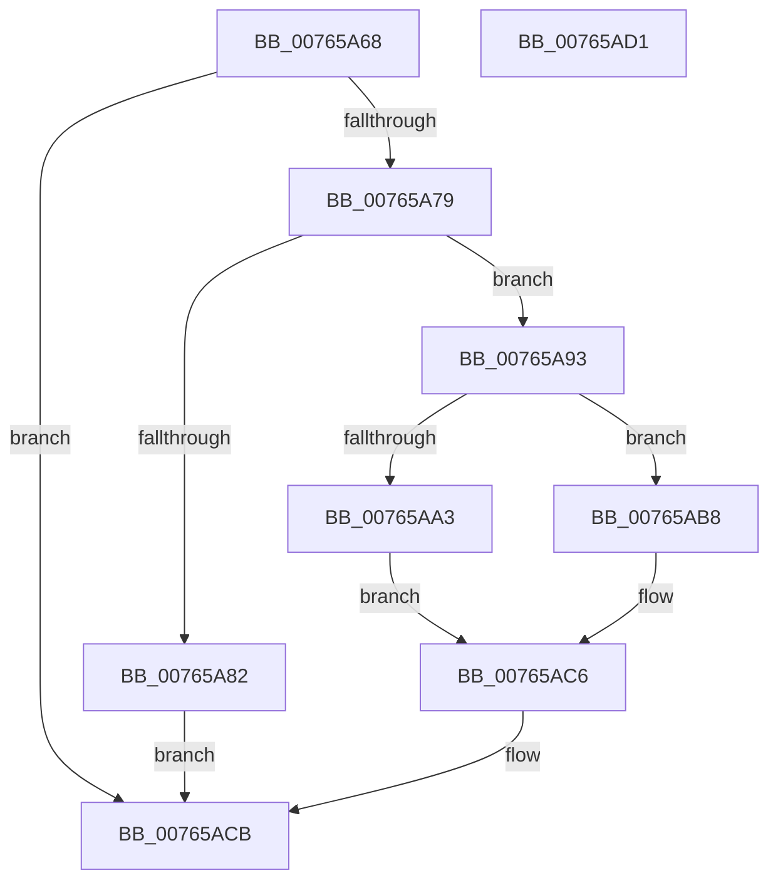

# PopPowerButtonLidReliabilityUpdated

- RVA: `0x00765A68`–`0x00765AD2` (길이 `106` bytes)
- VA: `0x0000000140765A68`
- 실행 섹션: `PAGE`
- PDB 이름 있음: `예`; PDB Function 태그: `아니요`
- unwind 정보 RVA: `0x0005CF00`
- 디코드: `29`개 명령, `106/106` bytes 표시
- 미해석 바이트: `0` (있으면 어셈블리에 `.byte`로 보존)

> 이 문서는 커널 이미지의 기계어와 PDB 기호를 분석해 생성했습니다. 4번과 5번은 함수 원형과 자료형을 바이너리 사용 방식에서 추정한 C 해석이며 원본 소스 복구 결과는 아닙니다.

## 1. Dependencies

- 직접 호출 지점: **5**; 고유 호출 대상: **5**
- 직접 호출자로 확인된 함수: **1**
- RIP 상대 이미지 참조: **4**

### Outgoing calls
- `0x00765A70` → [PopIsPlatformAoAcCapable](../../text/49/PopIsPlatformAoAcCapable_function_0049BF40.md) (function, `0x0049BF40`)
- `0x00765A79` → [Feature_Servicing_GamingHandheldPowBtnFilter__private_IsEnabledDeviceUsageNoInline](../../text/5C/Feature_Servicing_GamingHandheldPowBtnFilter__private_IsEnabledDeviceUsageNoInline_function_005CE2F4.md) (function, `0x005CE2F4`)
- `0x00765A8C` → [PopPowerButtonSuppressionUpdateDisableReason](PopPowerButtonSuppressionUpdateDisableReason_function_00765AD8.md) (function, `0x00765AD8`)
- `0x00765A9A` → [PopAcquireRwLockExclusive](../../text/43/PopAcquireRwLockExclusive_function_00430B44.md) (function, `0x00430B44`)
- `0x00765AC6` → [PopEvaluatePowerButtonSuppressionState](PopEvaluatePowerButtonSuppressionState_function_00765954.md) (function, `0x00765954`)

### Direct callers
- [PopLidSwitchReliabilityUpdateCallback](../75/PopLidSwitchReliabilityUpdateCallback_function_007582A0.md) at `0x00758313`

### Static image references
- `0x00765A93` → RVA `0x00F09230` (`.data`; read)
- `0x00765AA3` → RVA `0x00F09200` (`.data`; read)
- `0x00765AA9` → RVA `0x00F09204` (`.data`; read/write)
- `0x00765AB0` → RVA `0x00F09201` (`.data`; write)

## 2. Other-region calls and transfers

- 다른 실행 섹션으로 향하는 call: **3**
  - `0x00765A70` → [PopIsPlatformAoAcCapable](../../text/49/PopIsPlatformAoAcCapable_function_0049BF40.md) (`PAGE` → `.text`)
  - `0x00765A79` → [Feature_Servicing_GamingHandheldPowBtnFilter__private_IsEnabledDeviceUsageNoInline](../../text/5C/Feature_Servicing_GamingHandheldPowBtnFilter__private_IsEnabledDeviceUsageNoInline_function_005CE2F4.md) (`PAGE` → `.text`)
  - `0x00765A9A` → [PopAcquireRwLockExclusive](../../text/43/PopAcquireRwLockExclusive_function_00430B44.md) (`PAGE` → `.text`)
- 별도 외부 분기/꼬리 이동을 확인하지 못했습니다.

## 3. Assembly (complete function range)

```asm
00765A68  40 53                           push rbx
00765A6A  48 83 EC 20                     sub rsp, 0x20
00765A6E  8A D9                           mov bl, cl
00765A70  E8 CB 64 D3 FF                  call 0x14049bf40
00765A75  84 C0                           test al, al
00765A77  74 52                           je 0x140765acb
00765A79  E8 76 88 E6 FF                  call 0x1405ce2f4
00765A7E  85 C0                           test eax, eax
00765A80  74 11                           je 0x140765a93
00765A82  84 DB                           test bl, bl
00765A84  B9 05 00 00 00                  mov ecx, 5
00765A89  0F 94 C2                        sete dl
00765A8C  E8 47 00 00 00                  call 0x140765ad8
00765A91  EB 38                           jmp 0x140765acb
00765A93  48 8D 0D 96 37 7A 00            lea rcx, [rip + 0x7a3796]
00765A9A  E8 A5 B0 CC FF                  call 0x140430b44
00765A9F  84 DB                           test bl, bl
00765AA1  74 15                           je 0x140765ab8
00765AA3  8A 05 57 37 7A 00               mov al, byte ptr [rip + 0x7a3757]
00765AA9  83 25 54 37 7A 00 DF            and dword ptr [rip + 0x7a3754], 0xffffffdf
00765AB0  88 05 4B 37 7A 00               mov byte ptr [rip + 0x7a374b], al
00765AB6  EB 0E                           jmp 0x140765ac6
00765AB8  83 0D 45 37 7A 00 20            or dword ptr [rip + 0x7a3745], 0x20
00765ABF  C6 05 3B 37 7A 00 00            mov byte ptr [rip + 0x7a373b], 0
00765AC6  E8 89 FE FF FF                  call 0x140765954
00765ACB  48 83 C4 20                     add rsp, 0x20
00765ACF  5B                              pop rbx
00765AD0  C3                              ret
00765AD1  CC                              int3
```

## 4. C-style interpretation (structured pseudocode)

```c
__int64 __fastcall PopPowerButtonLidReliabilityUpdated(unsigned __int8 a1)
{
    __int64 result;
    __int64 v_rsp;

    v_rsp = (v_rsp) - (32);
    result = PopIsPlatformAoAcCapable(a1, a2, a3, a4);
    if ((unsigned __int8)(result) == 0) goto loc_00765ACB;
    result = Feature_Servicing_GamingHandheldPowBtnFilter__private_IsEnabledDeviceUsageNoInline(a1, a2, a3, a4);
    if ((unsigned int)(result) == 0) goto loc_00765A93;
    a2 = (a1 == 0) ? 1 : 0;
    result = PopPowerButtonSuppressionUpdateDisableReason(5, a2, a3, a4);
    goto loc_00765ACB;
loc_00765A93:
    result = PopAcquireRwLockExclusive(v_rip + 8009622, a2, a3, a4);
    if (a1 == 0) goto loc_00765AB8;
    *(unsigned __int8 *)(v_rip + 8009547) = (unsigned __int8)(*(unsigned __int8 *)(v_rip + 8009559));
    goto loc_00765AC6;
loc_00765AB8:
    *(unsigned __int8 *)(v_rip + 8009531) = 0;
loc_00765AC6:
    result = PopEvaluatePowerButtonSuppressionState(v_rip + 8009622, a2, a3, a4);
loc_00765ACB:
    v_rsp = (v_rsp) + (32);
    return result;
}
```

## 5. (Beta) C Style

```c
int64_t PopPowerButtonLidReliabilityUpdated(uint8_t Arg1)
{
    int64_t result;
    int64_t local_rsp;

    local_rsp = (local_rsp) - (32);
    result = PopIsPlatformAoAcCapable(Arg1, a2, a3, a4);
    if ((uint8_t)(result) == 0) goto loc_00765ACB;
    result = Feature_Servicing_GamingHandheldPowBtnFilter__private_IsEnabledDeviceUsageNoInline(Arg1, a2, a3, a4);
    if ((uint32_t)(result) == 0) goto loc_00765A93;
    a2 = (Arg1 == 0) ? 1 : 0;
    result = PopPowerButtonSuppressionUpdateDisableReason(5, a2, a3, a4);
    goto loc_00765ACB;
loc_00765A93:
    result = PopAcquireRwLockExclusive(v_rip + 8009622, a2, a3, a4);
    if (Arg1 == 0) goto loc_00765AB8;
    *(uint8_t *)(v_rip + 0x7A374B) = (uint8_t)(*(uint8_t *)(v_rip + 0x7A3757));
    goto loc_00765AC6;
loc_00765AB8:
    *(uint8_t *)(v_rip + 0x7A373B) = 0;
loc_00765AC6:
    result = PopEvaluatePowerButtonSuppressionState(v_rip + 8009622, a2, a3, a4);
loc_00765ACB:
    local_rsp = (local_rsp) + (32);
    return result;
}
```

## 6. Execution-region graph

[열기: 2D/3D 그래프와 함수 탐색 컨트롤 패널](../../../control-panel.html?section=page&rva=0x00765A68&view=graph)

- 2D 그래프는 위에서 아래로 흐르고, 3D 그래프는 빈 공간을 드래그해 회전합니다. Shift+드래그는 이동, 휠은 확대·축소, 함수 노드 선택은 대상 보고서 이동입니다.

### Static fallback


