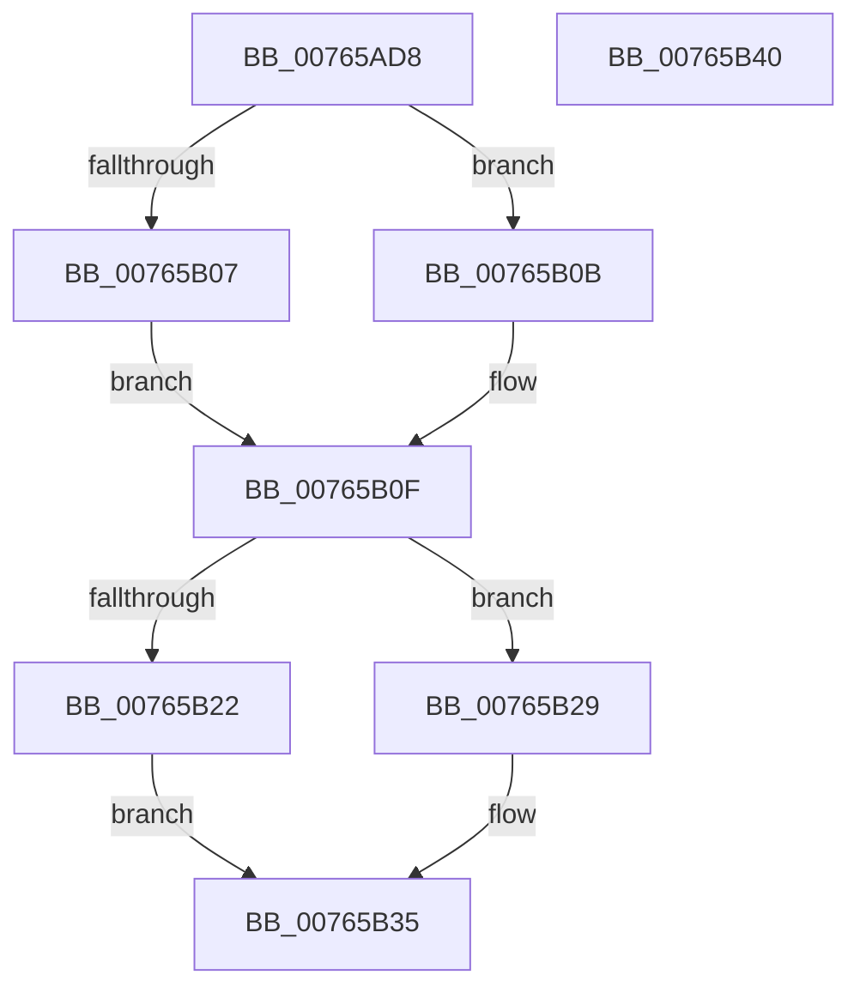

# PopPowerButtonSuppressionUpdateDisableReason

- RVA: `0x00765AD8`–`0x00765B41` (길이 `105` bytes)
- VA: `0x0000000140765AD8`
- 실행 섹션: `PAGE`
- PDB 이름 있음: `예`; PDB Function 태그: `아니요`
- unwind 정보 RVA: `0x0005CAAC`
- 디코드: `31`개 명령, `105/105` bytes 표시
- 미해석 바이트: `0` (있으면 어셈블리에 `.byte`로 보존)

> 이 문서는 커널 이미지의 기계어와 PDB 기호를 분석해 생성했습니다. 4번과 5번은 함수 원형과 자료형을 바이너리 사용 방식에서 추정한 C 해석이며 원본 소스 복구 결과는 아닙니다.

## 1. Dependencies

- 직접 호출 지점: **3**; 고유 호출 대상: **3**
- 직접 호출자로 확인된 함수: **2**
- RIP 상대 이미지 참조: **4**

### Outgoing calls
- `0x00765AEE` → [PopAcquireRwLockExclusive](../../text/43/PopAcquireRwLockExclusive_function_00430B44.md) (function, `0x00430B44`)
- `0x00765B22` → [PopEvaluatePowerButtonSuppressionState](PopEvaluatePowerButtonSuppressionState_function_00765954.md) (function, `0x00765954`)
- `0x00765B30` → [PopReleaseRwLock](../../text/2D/PopReleaseRwLock_function_002DFBBC.md) (function, `0x002DFBBC`)

### Direct callers
- [PopUpdateDeviceFamily](../75/PopUpdateDeviceFamily_function_007546D0.md) at `0x007547DF`
- [PopPowerButtonLidReliabilityUpdated](PopPowerButtonLidReliabilityUpdated_function_00765A68.md) at `0x00765A8C`

### Static image references
- `0x00765AE7` → RVA `0x00F09230` (`.data`; read)
- `0x00765AF3` → RVA `0x00F09204` (`.data`; read)
- `0x00765B11` → RVA `0x00F09204` (`.data`; write)
- `0x00765B17` → RVA `0x00F09201` (`.data`; write)

## 2. Other-region calls and transfers

- 다른 실행 섹션으로 향하는 call: **2**
  - `0x00765AEE` → [PopAcquireRwLockExclusive](../../text/43/PopAcquireRwLockExclusive_function_00430B44.md) (`PAGE` → `.text`)
  - `0x00765B30` → [PopReleaseRwLock](../../text/2D/PopReleaseRwLock_function_002DFBBC.md) (`PAGE` → `.text`)
- 별도 외부 분기/꼬리 이동을 확인하지 못했습니다.

## 3. Assembly (complete function range)

```asm
00765AD8  48 89 5C 24 08                  mov qword ptr [rsp + 8], rbx
00765ADD  57                              push rdi
00765ADE  48 83 EC 20                     sub rsp, 0x20
00765AE2  8B D9                           mov ebx, ecx
00765AE4  40 8A FA                        mov dil, dl
00765AE7  48 8D 0D 42 37 7A 00            lea rcx, [rip + 0x7a3742]
00765AEE  E8 51 B0 CC FF                  call 0x140430b44
00765AF3  8B 15 0B 37 7A 00               mov edx, dword ptr [rip + 0x7a370b]
00765AF9  8B CB                           mov ecx, ebx
00765AFB  B8 01 00 00 00                  mov eax, 1
00765B00  D3 E0                           shl eax, cl
00765B02  40 84 FF                        test dil, dil
00765B05  74 04                           je 0x140765b0b
00765B07  0B C2                           or eax, edx
00765B09  EB 04                           jmp 0x140765b0f
00765B0B  F7 D0                           not eax
00765B0D  23 C2                           and eax, edx
00765B0F  85 C0                           test eax, eax
00765B11  89 05 ED 36 7A 00               mov dword ptr [rip + 0x7a36ed], eax
00765B17  0F 94 05 E3 36 7A 00            sete byte ptr [rip + 0x7a36e3]
00765B1E  3B D0                           cmp edx, eax
00765B20  74 07                           je 0x140765b29
00765B22  E8 2D FE FF FF                  call 0x140765954
00765B27  EB 0C                           jmp 0x140765b35
00765B29  48 8D 0D 00 37 7A 00            lea rcx, [rip + 0x7a3700]
00765B30  E8 87 A0 B7 FF                  call 0x1402dfbbc
00765B35  48 8B 5C 24 30                  mov rbx, qword ptr [rsp + 0x30]
00765B3A  48 83 C4 20                     add rsp, 0x20
00765B3E  5F                              pop rdi
00765B3F  C3                              ret
00765B40  CC                              int3
```

## 4. C-style interpretation (structured pseudocode)

```c
__int64 __fastcall PopPowerButtonSuppressionUpdateDisableReason(int a1, unsigned __int8 a2)
{
    __int64 result;
    __int64 v_rsp;
    unsigned __int64 v_stack_p8;

    v_stack_p8 = v_rbx;
    v_rsp = (v_rsp) - (32);
    result = PopAcquireRwLockExclusive(v_rip + 8009538, a2, a3, a4);
    result = (unsigned int)((1) << ((unsigned __int8)((unsigned int)((unsigned int)((unsigned int)(a1))))));
    if (a2 == 0) goto loc_00765B0B;
    result = (unsigned int)((result) | ((unsigned int)((unsigned int)(*(unsigned int *)(v_rip + 8009483)))));
    goto loc_00765B0F;
loc_00765B0B:
    result = (unsigned int)(~(result));
    result = (unsigned int)((result) & ((unsigned int)((unsigned int)(*(unsigned int *)(v_rip + 8009483)))));
loc_00765B0F:
    *(unsigned int *)(v_rip + 8009453) = (unsigned int)(result);
    if (((unsigned int)((unsigned int)(*(unsigned int *)(v_rip + 8009483)))) == ((unsigned int)(result))) goto loc_00765B29;
    result = PopEvaluatePowerButtonSuppressionState((unsigned int)((unsigned int)((unsigned int)(a1))), (unsigned int)(*(unsigned int *)(v_rip + 8009483)), a3, a4);
    goto loc_00765B35;
loc_00765B29:
    result = PopReleaseRwLock(v_rip + 8009472, (unsigned int)(*(unsigned int *)(v_rip + 8009483)), a3, a4);
loc_00765B35:
    v_rsp = (v_rsp) + (32);
    return result;
}
```

## 5. (Beta) C Style

```c
int64_t PopPowerButtonSuppressionUpdateDisableReason(int32_t Arg1, uint8_t Arg2)
{
    int64_t result;
    int64_t local_rsp;
    uint64_t v_stack_p8;

    v_stack_p8 = local_rbx;
    local_rsp = (local_rsp) - (32);
    result = PopAcquireRwLockExclusive(v_rip + 8009538, Arg2, a3, a4);
    result = (uint32_t)((1) << ((uint8_t)((uint32_t)((uint32_t)((uint32_t)(Arg1))))));
    if (Arg2 == 0) goto loc_00765B0B;
    result = (uint32_t)((result) | ((uint32_t)((uint32_t)(*(uint32_t *)(v_rip + 0x7A370B)))));
    goto loc_00765B0F;
loc_00765B0B:
    result = (uint32_t)(~(result));
    result = (uint32_t)((result) & ((uint32_t)((uint32_t)(*(uint32_t *)(v_rip + 0x7A370B)))));
loc_00765B0F:
    *(uint32_t *)(v_rip + 0x7A36ED) = (uint32_t)(result);
    if (((uint32_t)((uint32_t)(*(uint32_t *)(v_rip + 0x7A370B)))) == ((uint32_t)(result))) goto loc_00765B29;
    result = PopEvaluatePowerButtonSuppressionState((uint32_t)((uint32_t)((uint32_t)(Arg1))), (uint32_t)(*(uint32_t *)(v_rip + 0x7A370B)), a3, a4);
    goto loc_00765B35;
loc_00765B29:
    result = PopReleaseRwLock(v_rip + 8009472, (uint32_t)(*(uint32_t *)(v_rip + 0x7A370B)), a3, a4);
loc_00765B35:
    local_rsp = (local_rsp) + (32);
    return result;
}
```

## 6. Execution-region graph

[열기: 2D/3D 그래프와 함수 탐색 컨트롤 패널](../../../control-panel.html?section=page&rva=0x00765AD8&view=graph)

- 2D 그래프는 위에서 아래로 흐르고, 3D 그래프는 빈 공간을 드래그해 회전합니다. Shift+드래그는 이동, 휠은 확대·축소, 함수 노드 선택은 대상 보고서 이동입니다.

### Static fallback


