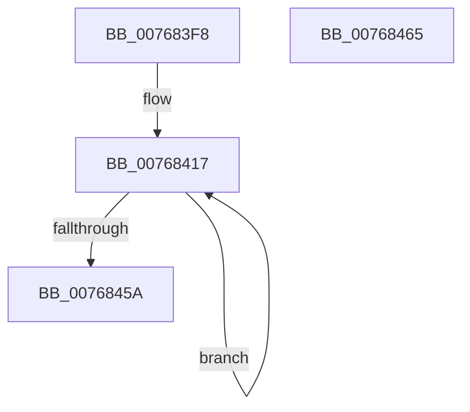

# PopResetCBTriggers

- RVA: `0x007683F8`–`0x00768466` (길이 `110` bytes)
- VA: `0x00000001407683F8`
- 실행 섹션: `PAGE`
- PDB 이름 있음: `예`; PDB Function 태그: `아니요`
- unwind 정보 RVA: `0x0005CAAC`
- 디코드: `31`개 명령, `110/110` bytes 표시
- 미해석 바이트: `0` (있으면 어셈블리에 `.byte`로 보존)

> 이 문서는 커널 이미지의 기계어와 PDB 기호를 분석해 생성했습니다. 4번과 5번은 함수 원형과 자료형을 바이너리 사용 방식에서 추정한 C 해석이며 원본 소스 복구 결과는 아닙니다.

## 1. Dependencies

- 직접 호출 지점: **1**; 고유 호출 대상: **1**
- 직접 호출자로 확인된 함수: **2**
- RIP 상대 이미지 참조: **1**

### Outgoing calls
- `0x00768443` → [PopDiagTraceBatteryTriggerFlags](../A8/PopDiagTraceBatteryTriggerFlags_function_00A84A50.md) (function, `0x00A84A50`)

### Direct callers
- [PopApplyPolicy](../91/PopApplyPolicy_function_009107B0.md) at `0x00910A7B`
- [PopBatteryWorker](../AE/PopBatteryWorker_function_00AE1650.md) at `0x00AE184F`

### Static image references
- `0x0076840B` → RVA `0x00F0C020` (`.data`; read)

## 2. Other-region calls and transfers

- 다른 실행 섹션으로 향하는 call: **0**
- 별도 외부 분기/꼬리 이동을 확인하지 못했습니다.

## 3. Assembly (complete function range)

```asm
007683F8  48 89 5C 24 08                  mov qword ptr [rsp + 8], rbx
007683FD  57                              push rdi
007683FE  48 83 EC 20                     sub rsp, 0x20
00768402  33 C0                           xor eax, eax
00768404  0F B6 D9                        movzx ebx, cl
00768407  89 44 24 38                     mov dword ptr [rsp + 0x38], eax
0076840B  48 8D 3D 0E 3C 7A 00            lea rdi, [rip + 0x7a3c0e]
00768412  F7 D3                           not ebx
00768414  44 8B C0                        mov r8d, eax
00768417  8B D0                           mov edx, eax
00768419  48 C1 E2 05                     shl rdx, 5
0076841D  41 8B C0                        mov eax, r8d
00768420  48 C1 E0 05                     shl rax, 5
00768424  8B 8C 3A 6C 01 00 00            mov ecx, dword ptr [rdx + rdi + 0x16c]
0076842B  48 81 C2 68 01 00 00            add rdx, 0x168
00768432  23 CB                           and ecx, ebx
00768434  48 03 D7                        add rdx, rdi
00768437  89 8C 38 6C 01 00 00            mov dword ptr [rax + rdi + 0x16c], ecx
0076843E  48 8D 4C 24 38                  lea rcx, [rsp + 0x38]
00768443  E8 08 C6 31 00                  call 0x140a84a50
00768448  8B 44 24 38                     mov eax, dword ptr [rsp + 0x38]
0076844C  FF C0                           inc eax
0076844E  89 44 24 38                     mov dword ptr [rsp + 0x38], eax
00768452  44 8B C0                        mov r8d, eax
00768455  83 F8 04                        cmp eax, 4
00768458  72 BD                           jb 0x140768417
0076845A  48 8B 5C 24 30                  mov rbx, qword ptr [rsp + 0x30]
0076845F  48 83 C4 20                     add rsp, 0x20
00768463  5F                              pop rdi
00768464  C3                              ret
00768465  CC                              int3
```

## 4. C-style interpretation (structured pseudocode)

```c
__int64 __fastcall PopResetCBTriggers(unsigned __int8 a1)
{
    __int64 result;
    __int64 v_rbx;
    __int64 v_rsp;
    unsigned int v_stack_p10;
    unsigned __int64 v_stack_p8;

    v_stack_p8 = v_rbx;
    v_rsp = (v_rsp) - (32);
    result = 0;
    v_stack_p10 = 0;
    v_rbx = (unsigned int)(~(a1));
loc_00768417:
    a2 = (0) << (5);
    result = (0) << (5);
    a2 = (a2) + (360);
    a1 = (unsigned int)(((unsigned int)(*(unsigned int *)(a2 + v_rip + 8010766 * 1 + 364))) & ((unsigned int)(v_rbx)));
    a2 = (a2) + (v_rip + 8010766);
    *(unsigned int *)(result + v_rip + 8010766 * 1 + 364) = a1;
    result = PopDiagTraceBatteryTriggerFlags(v_stack_p10, a2, 0, a4);
    result = (unsigned int)(((unsigned int)(v_stack_p10)) + 1);
    v_stack_p10 = (unsigned int)(result);
    if (((unsigned int)(result)) < 4) goto loc_00768417;
    v_rsp = (v_rsp) + (32);
    return result;
}
```

## 5. (Beta) C Style

```c
int64_t PopResetCBTriggers(uint8_t Arg1)
{
    int64_t result;
    int64_t local_rbx;
    int64_t local_rsp;
    uint32_t v_stack_p10;
    uint64_t v_stack_p8;

    v_stack_p8 = local_rbx;
    local_rsp = (local_rsp) - (32);
    result = 0;
    v_stack_p10 = 0;
    local_rbx = (uint32_t)(~(Arg1));
loc_00768417:
    a2 = (0) << (5);
    result = (0) << (5);
    a2 = (a2) + (360);
    Arg1 = (uint32_t)(((uint32_t)(*(uint32_t *)(a2 + v_rip + 0x7A3C0E * 1 + 0x16C))) & ((uint32_t)(local_rbx)));
    a2 = (a2) + (v_rip + 8010766);
    *(uint32_t *)(result + v_rip + 0x7A3C0E * 1 + 0x16C) = Arg1;
    result = PopDiagTraceBatteryTriggerFlags(v_stack_p10, a2, 0, a4);
    result = (uint32_t)(((uint32_t)(v_stack_p10)) + 1);
    v_stack_p10 = (uint32_t)(result);
    if (((uint32_t)(result)) < 4) goto loc_00768417;
    local_rsp = (local_rsp) + (32);
    return result;
}
```

## 6. Execution-region graph

[열기: 2D/3D 그래프와 함수 탐색 컨트롤 패널](../../../control-panel.html?section=page&rva=0x007683F8&view=graph)

- 2D 그래프는 위에서 아래로 흐르고, 3D 그래프는 빈 공간을 드래그해 회전합니다. Shift+드래그는 이동, 휠은 확대·축소, 함수 노드 선택은 대상 보고서 이동입니다.

### Static fallback


