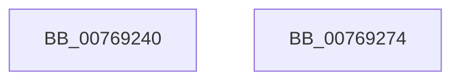

# PopSendFanNoiseChangeWnf

- RVA: `0x00769240`–`0x00769275` (길이 `53` bytes)
- VA: `0x0000000140769240`
- 실행 섹션: `PAGE`
- PDB 이름 있음: `예`; PDB Function 태그: `아니요`
- unwind 정보 RVA: `0x00063458`
- 디코드: `14`개 명령, `53/53` bytes 표시
- 미해석 바이트: `0` (있으면 어셈블리에 `.byte`로 보존)

> 이 문서는 커널 이미지의 기계어와 PDB 기호를 분석해 생성했습니다. 4번과 5번은 함수 원형과 자료형을 바이너리 사용 방식에서 추정한 C 해석이며 원본 소스 복구 결과는 아닙니다.

## 1. Dependencies

- 직접 호출 지점: **1**; 고유 호출 대상: **1**
- 직접 호출자로 확인된 함수: **2**
- RIP 상대 이미지 참조: **1**

### Outgoing calls
- `0x0076926A` → [ZwUpdateWnfStateData](../../text/6B/ZwUpdateWnfStateData_function_006B0D10.md) (function, `0x006B0D10`)

### Direct callers
- [PopFanUpdateSpeed](../AA/PopFanUpdateSpeed_function_00AABF40.md) at `0x00AAC06F`
- [PoInitSystem](../../init/C7/PoInitSystem_function_00C72358.md) at `0x00C72CA0`

### Static image references
- `0x00769257` → RVA `0x00020A48` (`.rdata`; read)

## 2. Other-region calls and transfers

- 다른 실행 섹션으로 향하는 call: **1**
  - `0x0076926A` → [ZwUpdateWnfStateData](../../text/6B/ZwUpdateWnfStateData_function_006B0D10.md) (`PAGE` → `.text`)
- 별도 외부 분기/꼬리 이동을 확인하지 못했습니다.

## 3. Assembly (complete function range)

```asm
00769240  48 83 EC 48                     sub rsp, 0x48
00769244  33 C0                           xor eax, eax
00769246  89 4C 24 50                     mov dword ptr [rsp + 0x50], ecx
0076924A  89 44 24 30                     mov dword ptr [rsp + 0x30], eax
0076924E  48 8D 54 24 50                  lea rdx, [rsp + 0x50]
00769253  89 44 24 28                     mov dword ptr [rsp + 0x28], eax
00769257  48 8D 0D EA 77 8B FF            lea rcx, [rip - 0x748816]
0076925E  45 33 C9                        xor r9d, r9d
00769261  48 89 44 24 20                  mov qword ptr [rsp + 0x20], rax
00769266  44 8D 40 04                     lea r8d, [rax + 4]
0076926A  E8 A1 7A F4 FF                  call 0x1406b0d10
0076926F  48 83 C4 48                     add rsp, 0x48
00769273  C3                              ret
00769274  CC                              int3
```

## 4. C-style interpretation (structured pseudocode)

```c
__int64 __fastcall PopSendFanNoiseChangeWnf(int a1, __int64 a2, __int64 a3, int a4)
{
    __int64 result;
    __int64 v_rsp;
    unsigned int v_stack_m18;
    unsigned int v_stack_m20;
    unsigned __int64 v_stack_m28;
    unsigned int v_stack_p8;

    v_rsp = (v_rsp) - (72);
    result = 0;
    v_stack_p8 = a1;
    v_stack_m18 = 0;
    v_stack_m20 = 0;
    a4 = 0;
    v_stack_m28 = 0;
    result = ZwUpdateWnfStateData(v_rip - 7637014, v_stack_p8, result + 4, a4);
    v_rsp = (v_rsp) + (72);
    return result;
}
```

## 5. (Beta) C Style

```c
int64_t PopSendFanNoiseChangeWnf(int32_t Arg1, int64_t Arg2, int64_t Arg3, int32_t Arg4)
{
    int64_t result;
    int64_t local_rsp;
    uint32_t v_stack_m18;
    uint32_t v_stack_m20;
    uint64_t v_stack_m28;
    uint32_t v_stack_p8;

    local_rsp = (local_rsp) - (72);
    result = 0;
    v_stack_p8 = Arg1;
    v_stack_m18 = 0;
    v_stack_m20 = 0;
    Arg4 = 0;
    v_stack_m28 = 0;
    result = ZwUpdateWnfStateData(v_rip - 7637014, v_stack_p8, result + 4, Arg4);
    local_rsp = (local_rsp) + (72);
    return result;
}
```

## 6. Execution-region graph

[열기: 2D/3D 그래프와 함수 탐색 컨트롤 패널](../../../control-panel.html?section=page&rva=0x00769240&view=graph)

- 2D 그래프는 위에서 아래로 흐르고, 3D 그래프는 빈 공간을 드래그해 회전합니다. Shift+드래그는 이동, 휠은 확대·축소, 함수 노드 선택은 대상 보고서 이동입니다.

### Static fallback


