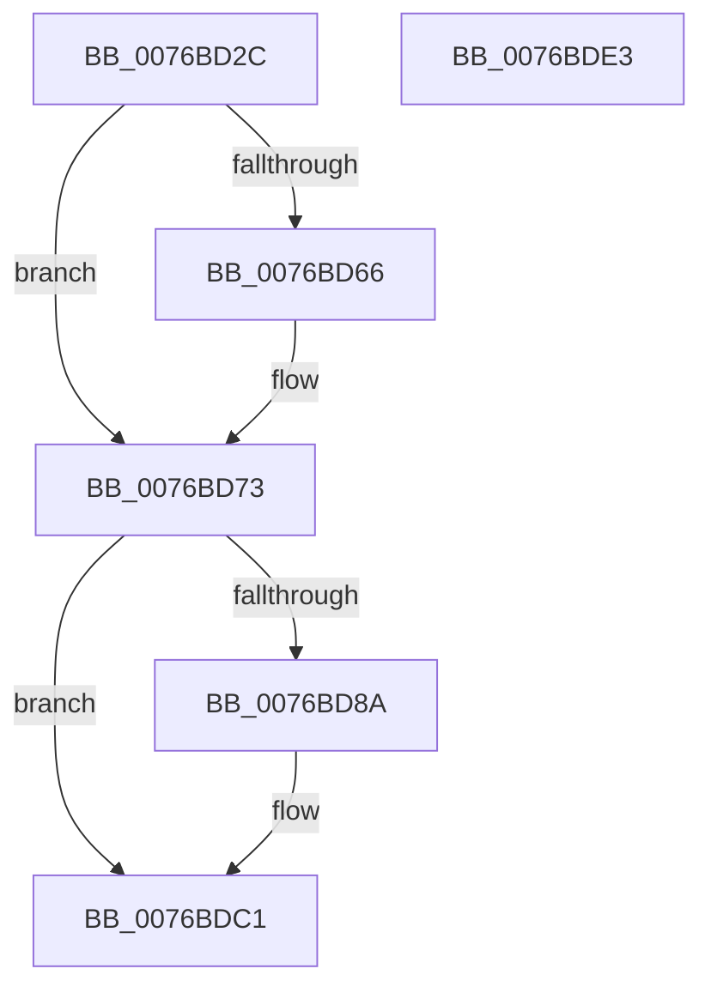

# PopSessionConnectedV2

- RVA: `0x0076BD2C`–`0x0076BDE4` (길이 `184` bytes)
- VA: `0x000000014076BD2C`
- 실행 섹션: `PAGE`
- PDB 이름 있음: `예`; PDB Function 태그: `아니요`
- unwind 정보 RVA: `0x0005C954`
- 디코드: `48`개 명령, `184/184` bytes 표시
- 미해석 바이트: `0` (있으면 어셈블리에 `.byte`로 보존)

> 이 문서는 커널 이미지의 기계어와 PDB 기호를 분석해 생성했습니다. 4번과 5번은 함수 원형과 자료형을 바이너리 사용 방식에서 추정한 C 해석이며 원본 소스 복구 결과는 아닙니다.

## 1. Dependencies

- 직접 호출 지점: **4**; 고유 호출 대상: **4**
- 직접 호출자로 확인된 함수: **1**
- RIP 상대 이미지 참조: **4**

### Outgoing calls
- `0x0076BD5D` → [PopDiagTraceSessionState](../91/PopDiagTraceSessionState_function_00912C5C.md) (function, `0x00912C5C`)
- `0x0076BD7C` → [PopSetSessionDisplayStatus](../91/PopSetSessionDisplayStatus_function_00912E7C.md) (function, `0x00912E7C`)
- `0x0076BDBC` → [PopAdaptiveConsoleSessionOverrideTrigger](PopAdaptiveConsoleSessionOverrideTrigger_function_0076B664.md) (function, `0x0076B664`)
- `0x0076BDC9` → [PopAdaptiveGetSessionStateUnsafe](../91/PopAdaptiveGetSessionStateUnsafe_function_00913A4C.md) (function, `0x00913A4C`)

### Direct callers
- [PopSessionConnectionChangeV2](PopSessionConnectionChangeV2_function_0076BEA8.md) at `0x0076BF2A`

### Static image references
- `0x0076BD4F` → RVA `0x00022238` (`.rdata`; read)
- `0x0076BD66` → RVA `0x00F08270` (`.data`; write)
- `0x0076BD6D` → RVA `0x00F08238` (`.data`; write)
- `0x0076BD81` → RVA `0x00FD81F0` (`PAGEDATA`; read)

## 2. Other-region calls and transfers

- 다른 실행 섹션으로 향하는 call: **0**
- 별도 외부 분기/꼬리 이동을 확인하지 못했습니다.

## 3. Assembly (complete function range)

```asm
0076BD2C  48 89 5C 24 08                  mov qword ptr [rsp + 8], rbx
0076BD31  48 89 6C 24 10                  mov qword ptr [rsp + 0x10], rbp
0076BD36  48 89 74 24 18                  mov qword ptr [rsp + 0x18], rsi
0076BD3B  57                              push rdi
0076BD3C  48 83 EC 20                     sub rsp, 0x20
0076BD40  8B 5A 04                        mov ebx, dword ptr [rdx + 4]
0076BD43  49 8B E8                        mov rbp, r8
0076BD46  45 33 C0                        xor r8d, r8d
0076BD49  8B F9                           mov edi, ecx
0076BD4B  8B D1                           mov edx, ecx
0076BD4D  85 DB                           test ebx, ebx
0076BD4F  48 8D 0D E2 64 8B FF            lea rcx, [rip - 0x749b1e]
0076BD56  49 8B F1                        mov rsi, r9
0076BD59  41 0F 94 C0                     sete r8b
0076BD5D  E8 FA 6E 1A 00                  call 0x140912c5c
0076BD62  85 DB                           test ebx, ebx
0076BD64  75 0D                           jne 0x14076bd73
0076BD66  C6 05 03 C5 79 00 01            mov byte ptr [rip + 0x79c503], 1
0076BD6D  89 3D C5 C4 79 00               mov dword ptr [rip + 0x79c4c5], edi
0076BD73  45 33 C0                        xor r8d, r8d
0076BD76  8B CF                           mov ecx, edi
0076BD78  41 8D 50 01                     lea edx, [r8 + 1]
0076BD7C  E8 FB 70 1A 00                  call 0x140912e7c
0076BD81  80 3D 68 C4 86 00 00            cmp byte ptr [rip + 0x86c468], 0
0076BD88  74 37                           je 0x14076bdc1
0076BD8A  45 33 C9                        xor r9d, r9d
0076BD8D  48 B8 04 00 00 00 80 F7 FF FF   movabs rax, 0xfffff78000000004
0076BD97  8B 08                           mov ecx, dword ptr [rax]
0076BD99  45 8D 41 02                     lea r8d, [r9 + 2]
0076BD9D  48 C1 E1 20                     shl rcx, 0x20
0076BDA1  48 B8 20 03 00 00 80 F7 FF FF   movabs rax, 0xfffff78000000320
0076BDAB  48 8B 00                        mov rax, qword ptr [rax]
0076BDAE  48 C1 E0 08                     shl rax, 8
0076BDB2  48 F7 E1                        mul rcx
0076BDB5  48 8B CA                        mov rcx, rdx
0076BDB8  41 8D 51 01                     lea edx, [r9 + 1]
0076BDBC  E8 A3 F8 FF FF                  call 0x14076b664
0076BDC1  4C 8B C6                        mov r8, rsi
0076BDC4  48 8B D5                        mov rdx, rbp
0076BDC7  8B CF                           mov ecx, edi
0076BDC9  E8 7E 7C 1A 00                  call 0x140913a4c
0076BDCE  48 8B 5C 24 30                  mov rbx, qword ptr [rsp + 0x30]
0076BDD3  48 8B 6C 24 38                  mov rbp, qword ptr [rsp + 0x38]
0076BDD8  48 8B 74 24 40                  mov rsi, qword ptr [rsp + 0x40]
0076BDDD  48 83 C4 20                     add rsp, 0x20
0076BDE1  5F                              pop rdi
0076BDE2  C3                              ret
0076BDE3  CC                              int3
```

## 4. C-style interpretation (structured pseudocode)

```c
__int64 __fastcall PopSessionConnectedV2(int a1, __int64 a2, __int64 a3, __int64 a4)
{
    __int64 result;
    __int64 v_rsp;
    unsigned __int64 v_stack_p10;
    unsigned __int64 v_stack_p18;
    unsigned __int64 v_stack_p8;

    v_stack_p8 = v_rbx;
    v_stack_p10 = v_rbp;
    v_stack_p18 = v_rsi;
    v_rsp = (v_rsp) - (32);
    a3 = 0;
    a3 = ((unsigned int)((unsigned int)(*(unsigned int *)(a2 + 4))) == 0) ? 1 : 0;
    result = PopDiagTraceSessionState(v_rip - 7641886, (unsigned int)(a1), a3, a4);
    if ((unsigned int)((unsigned int)(*(unsigned int *)(a2 + 4))) == 0) {
        *(unsigned __int8 *)(v_rip + 7980291) = 1;
        *(unsigned int *)(v_rip + 7980229) = (unsigned int)((unsigned int)(a1));
    }
    a3 = 0;
    result = PopSetSessionDisplayStatus((unsigned int)((unsigned int)((unsigned int)(a1))), a3 + 1, a3, a4);
    if ((*(unsigned __int8 *)(v_rip + 8832104)) != 0) {
        a4 = 0;
        a1 = *(unsigned int *)(result);
        a3 = a4 + 2;
        a1 = (a1) << (32);
        result = *(unsigned __int64 *)(result);
        result = (result) << (8);
        a1 = a3 + 1;
        a2 = a4 + 1;
        result = PopAdaptiveConsoleSessionOverrideTrigger(a1, a2, a3, a4);
    }
    result = PopAdaptiveGetSessionStateUnsafe((unsigned int)((unsigned int)((unsigned int)(a1))), a3, 0, a4);
    v_rsp = (v_rsp) + (32);
    return result;
}
```

## 5. (Beta) C Style

```c
int64_t PopSessionConnectedV2(int32_t Arg1, void *Arg2, int64_t Arg3, int64_t Arg4)
{
    uint8_t *arg2 = (uint8_t *)Arg2;

    int64_t result;
    int64_t local_rsp;
    uint64_t v_stack_p10;
    uint64_t v_stack_p18;
    uint64_t v_stack_p8;

    v_stack_p8 = local_rbx;
    v_stack_p10 = local_rbp;
    v_stack_p18 = local_rsi;
    local_rsp = (local_rsp) - (32);
    Arg3 = 0;
    Arg3 = ((uint32_t)((uint32_t)(*(uint32_t *)(arg2 + 0x4))) == 0) ? 1 : 0;
    result = PopDiagTraceSessionState(v_rip - 7641886, (uint32_t)(Arg1), Arg3, Arg4);
    if ((uint32_t)((uint32_t)(*(uint32_t *)(arg2 + 0x4))) == 0) {
        *(uint8_t *)(v_rip + 0x79C503) = 1;
        *(uint32_t *)(v_rip + 0x79C4C5) = (uint32_t)((uint32_t)(Arg1));
    }
    Arg3 = 0;
    result = PopSetSessionDisplayStatus((uint32_t)((uint32_t)((uint32_t)(Arg1))), Arg3 + 1, Arg3, Arg4);
    if ((*(uint8_t *)(v_rip + 0x86C468)) != 0) {
        Arg4 = 0;
        Arg1 = *(uint32_t *)(result);
        Arg3 = Arg4 + 2;
        Arg1 = (Arg1) << (32);
        result = *(uint64_t *)(result);
        result = (result) << (8);
        Arg1 = Arg3 + 1;
        Arg2 = Arg4 + 1;
        result = PopAdaptiveConsoleSessionOverrideTrigger(Arg1, Arg2, Arg3, Arg4);
    }
    result = PopAdaptiveGetSessionStateUnsafe((uint32_t)((uint32_t)((uint32_t)(Arg1))), Arg3, 0, Arg4);
    local_rsp = (local_rsp) + (32);
    return result;
}
```

### 관측된 메모리 오프셋

구조체 형식이 확인되지 않은 접근은 인자 기준의 오프셋으로만 기록했습니다.

| 기준 인자 | 오프셋 표현 | 폭 (bit) | 접근 |
|---|---:|---:|---|
| `Arg2` | `+ 0x4` | `32` | `R` |

## 6. Execution-region graph

[열기: 2D/3D 그래프와 함수 탐색 컨트롤 패널](../../../control-panel.html?section=page&rva=0x0076BD2C&view=graph)

- 2D 그래프는 위에서 아래로 흐르고, 3D 그래프는 빈 공간을 드래그해 회전합니다. Shift+드래그는 이동, 휠은 확대·축소, 함수 노드 선택은 대상 보고서 이동입니다.

### Static fallback


