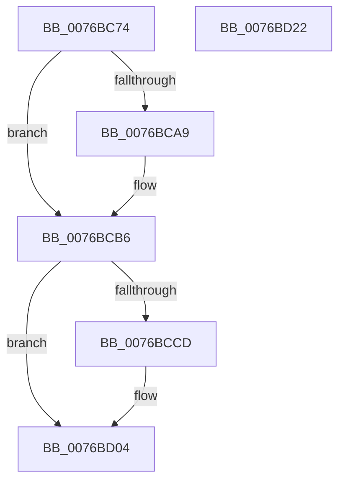

# PopSessionConnected

- RVA: `0x0076BC74`–`0x0076BD23` (길이 `175` bytes)
- VA: `0x000000014076BC74`
- 실행 섹션: `PAGE`
- PDB 이름 있음: `예`; PDB Function 태그: `아니요`
- unwind 정보 RVA: `0x00060BC4`
- 디코드: `44`개 명령, `175/175` bytes 표시
- 미해석 바이트: `0` (있으면 어셈블리에 `.byte`로 보존)

> 이 문서는 커널 이미지의 기계어와 PDB 기호를 분석해 생성했습니다. 4번과 5번은 함수 원형과 자료형을 바이너리 사용 방식에서 추정한 C 해석이며 원본 소스 복구 결과는 아닙니다.

## 1. Dependencies

- 직접 호출 지점: **5**; 고유 호출 대상: **5**
- 직접 호출자로 확인된 함수: **1**
- RIP 상대 이미지 참조: **4**

### Outgoing calls
- `0x0076BC8B` → [Feature_Servicing_PDCAgentSessions__private_IsEnabledDeviceUsageNoInline](../../text/4F/Feature_Servicing_PDCAgentSessions__private_IsEnabledDeviceUsageNoInline_function_004F5DA0.md) (function, `0x004F5DA0`)
- `0x0076BC9E` → [PopDiagTraceSessionState](../91/PopDiagTraceSessionState_function_00912C5C.md) (function, `0x00912C5C`)
- `0x0076BCBF` → [PopSetSessionDisplayStatus](../91/PopSetSessionDisplayStatus_function_00912E7C.md) (function, `0x00912E7C`)
- `0x0076BCFF` → [PopAdaptiveConsoleSessionOverrideTrigger](PopAdaptiveConsoleSessionOverrideTrigger_function_0076B664.md) (function, `0x0076B664`)
- `0x0076BD0D` → [PopAdaptiveGetSessionStateUnsafe](../91/PopAdaptiveGetSessionStateUnsafe_function_00913A4C.md) (function, `0x00913A4C`)

### Direct callers
- [PopSessionConnectionChange](PopSessionConnectionChange_function_0076BDEC.md) at `0x0076BE6F`

### Static image references
- `0x0076BC95` → RVA `0x00022238` (`.rdata`; read)
- `0x0076BCA9` → RVA `0x00F08270` (`.data`; write)
- `0x0076BCB0` → RVA `0x00F08238` (`.data`; write)
- `0x0076BCC4` → RVA `0x00FD81F0` (`PAGEDATA`; read)

## 2. Other-region calls and transfers

- 다른 실행 섹션으로 향하는 call: **1**
  - `0x0076BC8B` → [Feature_Servicing_PDCAgentSessions__private_IsEnabledDeviceUsageNoInline](../../text/4F/Feature_Servicing_PDCAgentSessions__private_IsEnabledDeviceUsageNoInline_function_004F5DA0.md) (`PAGE` → `.text`)
- 별도 외부 분기/꼬리 이동을 확인하지 못했습니다.

## 3. Assembly (complete function range)

```asm
0076BC74  48 89 5C 24 08                  mov qword ptr [rsp + 8], rbx
0076BC79  48 89 74 24 10                  mov qword ptr [rsp + 0x10], rsi
0076BC7E  57                              push rdi
0076BC7F  48 83 EC 20                     sub rsp, 0x20
0076BC83  49 8B F0                        mov rsi, r8
0076BC86  48 8B FA                        mov rdi, rdx
0076BC89  8B D9                           mov ebx, ecx
0076BC8B  E8 10 A1 D8 FF                  call 0x1404f5da0
0076BC90  44 0F B6 47 01                  movzx r8d, byte ptr [rdi + 1]
0076BC95  48 8D 0D 9C 65 8B FF            lea rcx, [rip - 0x749a64]
0076BC9C  8B D3                           mov edx, ebx
0076BC9E  E8 B9 6F 1A 00                  call 0x140912c5c
0076BCA3  80 7F 01 00                     cmp byte ptr [rdi + 1], 0
0076BCA7  74 0D                           je 0x14076bcb6
0076BCA9  C6 05 C0 C5 79 00 01            mov byte ptr [rip + 0x79c5c0], 1
0076BCB0  89 1D 82 C5 79 00               mov dword ptr [rip + 0x79c582], ebx
0076BCB6  45 33 C0                        xor r8d, r8d
0076BCB9  8B CB                           mov ecx, ebx
0076BCBB  41 8D 50 01                     lea edx, [r8 + 1]
0076BCBF  E8 B8 71 1A 00                  call 0x140912e7c
0076BCC4  80 3D 25 C5 86 00 00            cmp byte ptr [rip + 0x86c525], 0
0076BCCB  74 37                           je 0x14076bd04
0076BCCD  45 33 C9                        xor r9d, r9d
0076BCD0  48 B8 04 00 00 00 80 F7 FF FF   movabs rax, 0xfffff78000000004
0076BCDA  8B 08                           mov ecx, dword ptr [rax]
0076BCDC  45 8D 41 02                     lea r8d, [r9 + 2]
0076BCE0  48 C1 E1 20                     shl rcx, 0x20
0076BCE4  48 B8 20 03 00 00 80 F7 FF FF   movabs rax, 0xfffff78000000320
0076BCEE  48 8B 00                        mov rax, qword ptr [rax]
0076BCF1  48 C1 E0 08                     shl rax, 8
0076BCF5  48 F7 E1                        mul rcx
0076BCF8  48 8B CA                        mov rcx, rdx
0076BCFB  41 8D 51 01                     lea edx, [r9 + 1]
0076BCFF  E8 60 F9 FF FF                  call 0x14076b664
0076BD04  48 8D 57 08                     lea rdx, [rdi + 8]
0076BD08  4C 8B C6                        mov r8, rsi
0076BD0B  8B CB                           mov ecx, ebx
0076BD0D  E8 3A 7D 1A 00                  call 0x140913a4c
0076BD12  48 8B 5C 24 30                  mov rbx, qword ptr [rsp + 0x30]
0076BD17  48 8B 74 24 38                  mov rsi, qword ptr [rsp + 0x38]
0076BD1C  48 83 C4 20                     add rsp, 0x20
0076BD20  5F                              pop rdi
0076BD21  C3                              ret
0076BD22  CC                              int3
```

## 4. C-style interpretation (structured pseudocode)

```c
__int64 __fastcall PopSessionConnected(int a1, __int64 a2, __int64 a3, int a4)
{
    __int64 result;
    __int64 v_rsp;
    unsigned __int64 v_stack_p10;
    unsigned __int64 v_stack_p8;

    v_stack_p8 = v_rbx;
    v_stack_p10 = v_rsi;
    v_rsp = (v_rsp) - (32);
    result = Feature_Servicing_PDCAgentSessions__private_IsEnabledDeviceUsageNoInline(a1, a2, a3, a4);
    result = PopDiagTraceSessionState(v_rip - 7641700, (unsigned int)((unsigned int)((unsigned int)(a1))), *(unsigned __int8 *)(a2 + 1), a4);
    if ((*(unsigned __int8 *)(a2 + 1)) != 0) {
        *(unsigned __int8 *)(v_rip + 7980480) = 1;
        *(unsigned int *)(v_rip + 7980418) = (unsigned int)((unsigned int)(a1));
    }
    a3 = 0;
    result = PopSetSessionDisplayStatus((unsigned int)((unsigned int)((unsigned int)(a1))), a3 + 1, a3, a4);
    if ((*(unsigned __int8 *)(v_rip + 8832293)) != 0) {
        a4 = 0;
        a1 = *(unsigned int *)(result);
        a3 = a4 + 2;
        a1 = (a1) << (32);
        result = *(unsigned __int64 *)(result);
        result = (result) << (8);
        a1 = a3 + 1;
        a2 = a4 + 1;
        result = PopAdaptiveConsoleSessionOverrideTrigger(a1, a2, a3, a4);
    }
    result = PopAdaptiveGetSessionStateUnsafe((unsigned int)((unsigned int)((unsigned int)(a1))), a2 + 8, a3, a4);
    v_rsp = (v_rsp) + (32);
    return result;
}
```

## 5. (Beta) C Style

```c
int64_t PopSessionConnected(int32_t Arg1, void *Arg2, int64_t Arg3, int32_t Arg4)
{
    uint8_t *arg2 = (uint8_t *)Arg2;

    int64_t result;
    int64_t local_rsp;
    uint64_t v_stack_p10;
    uint64_t v_stack_p8;

    v_stack_p8 = local_rbx;
    v_stack_p10 = local_rsi;
    local_rsp = (local_rsp) - (32);
    result = Feature_Servicing_PDCAgentSessions__private_IsEnabledDeviceUsageNoInline(Arg1, Arg2, Arg3, Arg4);
    result = PopDiagTraceSessionState(v_rip - 7641700, (uint32_t)((uint32_t)((uint32_t)(Arg1))), *(uint8_t *)(arg2 + 0x1), Arg4);
    if ((*(uint8_t *)(arg2 + 0x1)) != 0) {
        *(uint8_t *)(v_rip + 0x79C5C0) = 1;
        *(uint32_t *)(v_rip + 0x79C582) = (uint32_t)((uint32_t)(Arg1));
    }
    Arg3 = 0;
    result = PopSetSessionDisplayStatus((uint32_t)((uint32_t)((uint32_t)(Arg1))), Arg3 + 1, Arg3, Arg4);
    if ((*(uint8_t *)(v_rip + 0x86C525)) != 0) {
        Arg4 = 0;
        Arg1 = *(uint32_t *)(result);
        Arg3 = Arg4 + 2;
        Arg1 = (Arg1) << (32);
        result = *(uint64_t *)(result);
        result = (result) << (8);
        Arg1 = Arg3 + 1;
        Arg2 = Arg4 + 1;
        result = PopAdaptiveConsoleSessionOverrideTrigger(Arg1, Arg2, Arg3, Arg4);
    }
    result = PopAdaptiveGetSessionStateUnsafe((uint32_t)((uint32_t)((uint32_t)(Arg1))), Arg2 + 8, Arg3, Arg4);
    local_rsp = (local_rsp) + (32);
    return result;
}
```

### 관측된 메모리 오프셋

구조체 형식이 확인되지 않은 접근은 인자 기준의 오프셋으로만 기록했습니다.

| 기준 인자 | 오프셋 표현 | 폭 (bit) | 접근 |
|---|---:|---:|---|
| `Arg2` | `+ 0x1` | `8` | `R` |
| `Arg2` | `+ 0x8` | `64` | `R` |

## 6. Execution-region graph

[열기: 2D/3D 그래프와 함수 탐색 컨트롤 패널](../../../control-panel.html?section=page&rva=0x0076BC74&view=graph)

- 2D 그래프는 위에서 아래로 흐르고, 3D 그래프는 빈 공간을 드래그해 회전합니다. Shift+드래그는 이동, 휠은 확대·축소, 함수 노드 선택은 대상 보고서 이동입니다.

### Static fallback


