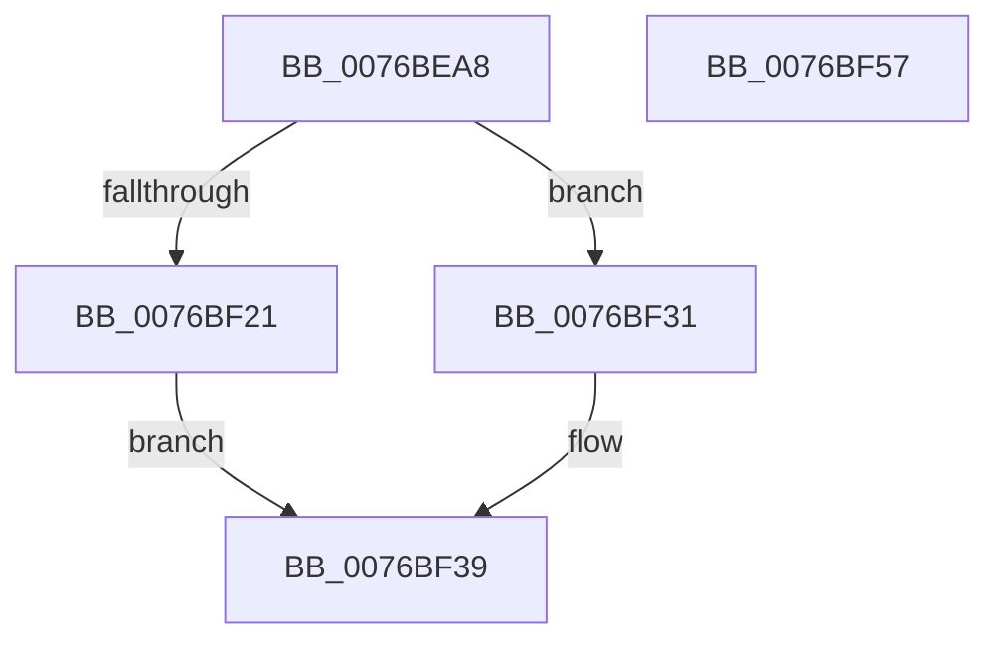

# PopSessionConnectionChangeV2

- RVA: `0x0076BEA8`–`0x0076BF58` (길이 `176` bytes)
- VA: `0x000000014076BEA8`
- 실행 섹션: `PAGE`
- PDB 이름 있음: `예`; PDB Function 태그: `아니요`
- unwind 정보 RVA: `0x00084C9C`
- 디코드: `48`개 명령, `176/176` bytes 표시
- 미해석 바이트: `0` (있으면 어셈블리에 `.byte`로 보존)

> 이 문서는 커널 이미지의 기계어와 PDB 기호를 분석해 생성했습니다. 4번과 5번은 함수 원형과 자료형을 바이너리 사용 방식에서 추정한 C 해석이며 원본 소스 복구 결과는 아닙니다.

## 1. Dependencies

- 직접 호출 지점: **5**; 고유 호출 대상: **5**
- 직접 호출자로 확인된 함수: **1**
- RIP 상대 이미지 참조: **5**

### Outgoing calls
- `0x0076BED3` → [PopAcquireAdaptiveLock](../A3/PopAcquireAdaptiveLock_function_00A3B0E8.md) (function, `0x00A3B0E8`)
- `0x0076BF15` → [PopPrintEx](../../text/48/PopPrintEx_function_0048EF24.md) (function, `0x0048EF24`)
- `0x0076BF2A` → [PopSessionConnectedV2](PopSessionConnectedV2_function_0076BD2C.md) (function, `0x0076BD2C`)
- `0x0076BF34` → [PopSessionDisconnected](../91/PopSessionDisconnected_function_00912BD8.md) (function, `0x00912BD8`)
- `0x0076BF39` → [PopReleaseAdaptiveLock](../91/PopReleaseAdaptiveLock_function_009137DC.md) (function, `0x009137DC`)

### Direct callers
- [PopPowerInformationInternal](../A8/PopPowerInformationInternal_function_00A8B7C0.md) at `0x00A8D382`

### Static image references
- `0x0076BEDB` → RVA `0x00B03190` (` ?? ::NNGAKEGL::`string'`; read)
- `0x0076BEE2` → RVA `0x00B03140` (` ?? ::NNGAKEGL::`string'`; read)
- `0x0076BEF0` → RVA `0x00B03180` (` ?? ::NNGAKEGL::`string'`; read)
- `0x0076BEF7` → RVA `0x00B03060` (` ?? ::NNGAKEGL::`string'`; read)
- `0x0076BF05` → RVA `0x00B03030` (` ?? ::NNGAKEGL::`string'`; read)

## 2. Other-region calls and transfers

- 다른 실행 섹션으로 향하는 call: **1**
  - `0x0076BF15` → [PopPrintEx](../../text/48/PopPrintEx_function_0048EF24.md) (`PAGE` → `.text`)
- 별도 외부 분기/꼬리 이동을 확인하지 못했습니다.

## 3. Assembly (complete function range)

```asm
0076BEA8  48 89 5C 24 08                  mov qword ptr [rsp + 8], rbx
0076BEAD  48 89 6C 24 10                  mov qword ptr [rsp + 0x10], rbp
0076BEB2  48 89 74 24 18                  mov qword ptr [rsp + 0x18], rsi
0076BEB7  57                              push rdi
0076BEB8  41 56                           push r14
0076BEBA  41 57                           push r15
0076BEBC  48 83 EC 30                     sub rsp, 0x30
0076BEC0  40 8A 3A                        mov dil, byte ptr [rdx]
0076BEC3  8B F1                           mov esi, ecx
0076BEC5  8B 5A 04                        mov ebx, dword ptr [rdx + 4]
0076BEC8  B1 01                           mov cl, 1
0076BECA  49 8B E9                        mov rbp, r9
0076BECD  4D 8B F8                        mov r15, r8
0076BED0  4C 8B F2                        mov r14, rdx
0076BED3  E8 10 F2 2C 00                  call 0x140a3b0e8
0076BED8  40 84 FF                        test dil, dil
0076BEDB  48 8D 0D AE 72 39 00            lea rcx, [rip + 0x3972ae]
0076BEE2  48 8D 05 57 72 39 00            lea rax, [rip + 0x397257]
0076BEE9  44 8B CE                        mov r9d, esi
0076BEEC  48 0F 44 C1                     cmove rax, rcx
0076BEF0  4C 8D 05 89 72 39 00            lea r8, [rip + 0x397289]
0076BEF7  48 8D 0D 62 71 39 00            lea rcx, [rip + 0x397162]
0076BEFE  48 89 44 24 20                  mov qword ptr [rsp + 0x20], rax
0076BF03  85 DB                           test ebx, ebx
0076BF05  48 8D 15 24 71 39 00            lea rdx, [rip + 0x397124]
0076BF0C  4C 0F 45 C1                     cmovne r8, rcx
0076BF10  B9 03 00 00 00                  mov ecx, 3
0076BF15  E8 0A 30 D2 FF                  call 0x14048ef24
0076BF1A  8B CE                           mov ecx, esi
0076BF1C  40 84 FF                        test dil, dil
0076BF1F  74 10                           je 0x14076bf31
0076BF21  4C 8B CD                        mov r9, rbp
0076BF24  4D 8B C7                        mov r8, r15
0076BF27  49 8B D6                        mov rdx, r14
0076BF2A  E8 FD FD FF FF                  call 0x14076bd2c
0076BF2F  EB 08                           jmp 0x14076bf39
0076BF31  48 8B D5                        mov rdx, rbp
0076BF34  E8 9F 6C 1A 00                  call 0x140912bd8
0076BF39  E8 9E 78 1A 00                  call 0x1409137dc
0076BF3E  48 8B 5C 24 50                  mov rbx, qword ptr [rsp + 0x50]
0076BF43  48 8B 6C 24 58                  mov rbp, qword ptr [rsp + 0x58]
0076BF48  48 8B 74 24 60                  mov rsi, qword ptr [rsp + 0x60]
0076BF4D  48 83 C4 30                     add rsp, 0x30
0076BF51  41 5F                           pop r15
0076BF53  41 5E                           pop r14
0076BF55  5F                              pop rdi
0076BF56  C3                              ret
0076BF57  CC                              int3
```

## 4. C-style interpretation (structured pseudocode)

```c
__int64 __fastcall PopSessionConnectionChangeV2(int a1, __int64 a2, __int64 a3, __int64 a4)
{
    __int64 result;
    __int64 v_rsp;
    unsigned __int64 v_stack_m28;
    unsigned __int64 v_stack_p10;
    unsigned __int64 v_stack_p18;
    unsigned __int64 v_stack_p8;

    v_stack_p8 = v_rbx;
    v_stack_p10 = v_rbp;
    v_stack_p18 = v_rsi;
    v_rsp = (v_rsp) - (48);
    result = PopAcquireAdaptiveLock(1, a2, a3, a4);
    result = v_rip + 3764823;
    if ((unsigned __int8)(*(unsigned __int8 *)(a2)) == 0) { result = v_rip + 3764910; }
    v_stack_m28 = result;
    a3 = v_rip + 3764873;
    if ((unsigned int)((unsigned int)(*(unsigned int *)(a2 + 4))) != 0) { a3 = v_rip + 3764578; }
    result = PopPrintEx(3, v_rip + 3764516, a3, (unsigned int)((unsigned int)((unsigned int)(a1))));
    if ((unsigned __int8)(*(unsigned __int8 *)(a2)) == 0) goto loc_0076BF31;
    result = PopSessionConnectedV2((unsigned int)((unsigned int)((unsigned int)(a1))), a2, a3, a4);
    goto loc_0076BF39;
loc_0076BF31:
    result = PopSessionDisconnected((unsigned int)((unsigned int)((unsigned int)(a1))), a4, a3, a4);
loc_0076BF39:
    result = PopReleaseAdaptiveLock((unsigned int)((unsigned int)((unsigned int)(a1))), a4, a3, a4);
    v_rsp = (v_rsp) + (48);
    return result;
}
```

## 5. (Beta) C Style

```c
int64_t PopSessionConnectionChangeV2(int32_t Arg1, void *Arg2, int64_t Arg3, int64_t Arg4)
{
    uint8_t *arg2 = (uint8_t *)Arg2;

    int64_t result;
    int64_t local_rsp;
    uint64_t v_stack_m28;
    uint64_t v_stack_p10;
    uint64_t v_stack_p18;
    uint64_t v_stack_p8;

    v_stack_p8 = local_rbx;
    v_stack_p10 = local_rbp;
    v_stack_p18 = local_rsi;
    local_rsp = (local_rsp) - (48);
    result = PopAcquireAdaptiveLock(1, Arg2, Arg3, Arg4);
    result = v_rip + 3764823;
    if ((uint8_t)(*(uint8_t *)(arg2)) == 0) { result = v_rip + 3764910; }
    v_stack_m28 = result;
    Arg3 = v_rip + 3764873;
    if ((uint32_t)((uint32_t)(*(uint32_t *)(arg2 + 0x4))) != 0) { Arg3 = v_rip + 3764578; }
    result = PopPrintEx(3, v_rip + 3764516, Arg3, (uint32_t)((uint32_t)((uint32_t)(Arg1))));
    if ((uint8_t)(*(uint8_t *)(arg2)) == 0) goto loc_0076BF31;
    result = PopSessionConnectedV2((uint32_t)((uint32_t)((uint32_t)(Arg1))), Arg2, Arg3, Arg4);
    goto loc_0076BF39;
loc_0076BF31:
    result = PopSessionDisconnected((uint32_t)((uint32_t)((uint32_t)(Arg1))), Arg4, Arg3, Arg4);
loc_0076BF39:
    result = PopReleaseAdaptiveLock((uint32_t)((uint32_t)((uint32_t)(Arg1))), Arg4, Arg3, Arg4);
    local_rsp = (local_rsp) + (48);
    return result;
}
```

### 관측된 메모리 오프셋

구조체 형식이 확인되지 않은 접근은 인자 기준의 오프셋으로만 기록했습니다.

| 기준 인자 | 오프셋 표현 | 폭 (bit) | 접근 |
|---|---:|---:|---|
| `Arg2` | `+ 0x0` | `8` | `R` |
| `Arg2` | `+ 0x4` | `32` | `R` |

## 6. Execution-region graph

[열기: 2D/3D 그래프와 함수 탐색 컨트롤 패널](../../../control-panel.html?section=page&rva=0x0076BEA8&view=graph)

- 2D 그래프는 위에서 아래로 흐르고, 3D 그래프는 빈 공간을 드래그해 회전합니다. Shift+드래그는 이동, 휠은 확대·축소, 함수 노드 선택은 대상 보고서 이동입니다.

### Static fallback


