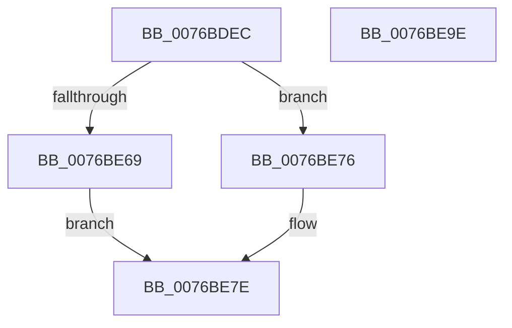

# PopSessionConnectionChange

- RVA: `0x0076BDEC`–`0x0076BE9F` (길이 `179` bytes)
- VA: `0x000000014076BDEC`
- 실행 섹션: `PAGE`
- PDB 이름 있음: `예`; PDB Function 태그: `아니요`
- unwind 정보 RVA: `0x0005D7BC`
- 디코드: `46`개 명령, `179/179` bytes 표시
- 미해석 바이트: `0` (있으면 어셈블리에 `.byte`로 보존)

> 이 문서는 커널 이미지의 기계어와 PDB 기호를 분석해 생성했습니다. 4번과 5번은 함수 원형과 자료형을 바이너리 사용 방식에서 추정한 C 해석이며 원본 소스 복구 결과는 아닙니다.

## 1. Dependencies

- 직접 호출 지점: **6**; 고유 호출 대상: **6**
- 직접 호출자로 확인된 함수: **1**
- RIP 상대 이미지 참조: **5**

### Outgoing calls
- `0x0076BE0D` → [Feature_Servicing_PDCAgentSessions__private_IsEnabledDeviceUsageNoInline](../../text/4F/Feature_Servicing_PDCAgentSessions__private_IsEnabledDeviceUsageNoInline_function_004F5DA0.md) (function, `0x004F5DA0`)
- `0x0076BE1B` → [PopAcquireAdaptiveLock](../A3/PopAcquireAdaptiveLock_function_00A3B0E8.md) (function, `0x00A3B0E8`)
- `0x0076BE5D` → [PopPrintEx](../../text/48/PopPrintEx_function_0048EF24.md) (function, `0x0048EF24`)
- `0x0076BE6F` → [PopSessionConnected](PopSessionConnected_function_0076BC74.md) (function, `0x0076BC74`)
- `0x0076BE79` → [PopSessionDisconnected](../91/PopSessionDisconnected_function_00912BD8.md) (function, `0x00912BD8`)
- `0x0076BE7E` → [PopReleaseAdaptiveLock](../91/PopReleaseAdaptiveLock_function_009137DC.md) (function, `0x009137DC`)

### Direct callers
- [NtPowerInformation](../95/NtPowerInformation_function_00955D80.md) at `0x009573E2`

### Static image references
- `0x0076BE23` → RVA `0x00B03190` (` ?? ::NNGAKEGL::`string'`; read)
- `0x0076BE2A` → RVA `0x00B03140` (` ?? ::NNGAKEGL::`string'`; read)
- `0x0076BE38` → RVA `0x00B03180` (` ?? ::NNGAKEGL::`string'`; read)
- `0x0076BE3F` → RVA `0x00B03060` (` ?? ::NNGAKEGL::`string'`; read)
- `0x0076BE4D` → RVA `0x00B03030` (` ?? ::NNGAKEGL::`string'`; read)

## 2. Other-region calls and transfers

- 다른 실행 섹션으로 향하는 call: **2**
  - `0x0076BE0D` → [Feature_Servicing_PDCAgentSessions__private_IsEnabledDeviceUsageNoInline](../../text/4F/Feature_Servicing_PDCAgentSessions__private_IsEnabledDeviceUsageNoInline_function_004F5DA0.md) (`PAGE` → `.text`)
  - `0x0076BE5D` → [PopPrintEx](../../text/48/PopPrintEx_function_0048EF24.md) (`PAGE` → `.text`)
- 별도 외부 분기/꼬리 이동을 확인하지 못했습니다.

## 3. Assembly (complete function range)

```asm
0076BDEC  48 8B C4                        mov rax, rsp
0076BDEF  48 89 58 08                     mov qword ptr [rax + 8], rbx
0076BDF3  48 89 68 10                     mov qword ptr [rax + 0x10], rbp
0076BDF7  48 89 70 18                     mov qword ptr [rax + 0x18], rsi
0076BDFB  48 89 78 20                     mov qword ptr [rax + 0x20], rdi
0076BDFF  41 56                           push r14
0076BE01  48 83 EC 30                     sub rsp, 0x30
0076BE05  49 8B E8                        mov rbp, r8
0076BE08  4C 8B F2                        mov r14, rdx
0076BE0B  8B F1                           mov esi, ecx
0076BE0D  E8 8E 9F D8 FF                  call 0x1404f5da0
0076BE12  41 8A 3E                        mov dil, byte ptr [r14]
0076BE15  B1 01                           mov cl, 1
0076BE17  41 8A 5E 01                     mov bl, byte ptr [r14 + 1]
0076BE1B  E8 C8 F2 2C 00                  call 0x140a3b0e8
0076BE20  40 84 FF                        test dil, dil
0076BE23  48 8D 0D 66 73 39 00            lea rcx, [rip + 0x397366]
0076BE2A  48 8D 05 0F 73 39 00            lea rax, [rip + 0x39730f]
0076BE31  44 8B CE                        mov r9d, esi
0076BE34  48 0F 44 C1                     cmove rax, rcx
0076BE38  4C 8D 05 41 73 39 00            lea r8, [rip + 0x397341]
0076BE3F  48 8D 0D 1A 72 39 00            lea rcx, [rip + 0x39721a]
0076BE46  48 89 44 24 20                  mov qword ptr [rsp + 0x20], rax
0076BE4B  84 DB                           test bl, bl
0076BE4D  48 8D 15 DC 71 39 00            lea rdx, [rip + 0x3971dc]
0076BE54  4C 0F 44 C1                     cmove r8, rcx
0076BE58  B9 03 00 00 00                  mov ecx, 3
0076BE5D  E8 C2 30 D2 FF                  call 0x14048ef24
0076BE62  8B CE                           mov ecx, esi
0076BE64  40 84 FF                        test dil, dil
0076BE67  74 0D                           je 0x14076be76
0076BE69  4C 8B C5                        mov r8, rbp
0076BE6C  49 8B D6                        mov rdx, r14
0076BE6F  E8 00 FE FF FF                  call 0x14076bc74
0076BE74  EB 08                           jmp 0x14076be7e
0076BE76  48 8B D5                        mov rdx, rbp
0076BE79  E8 5A 6D 1A 00                  call 0x140912bd8
0076BE7E  E8 59 79 1A 00                  call 0x1409137dc
0076BE83  48 8B 5C 24 40                  mov rbx, qword ptr [rsp + 0x40]
0076BE88  48 8B 6C 24 48                  mov rbp, qword ptr [rsp + 0x48]
0076BE8D  48 8B 74 24 50                  mov rsi, qword ptr [rsp + 0x50]
0076BE92  48 8B 7C 24 58                  mov rdi, qword ptr [rsp + 0x58]
0076BE97  48 83 C4 30                     add rsp, 0x30
0076BE9B  41 5E                           pop r14
0076BE9D  C3                              ret
0076BE9E  CC                              int3
```

## 4. C-style interpretation (structured pseudocode)

```c
__int64 __fastcall PopSessionConnectionChange(int a1, __int64 a2, __int64 a3)
{
    __int64 result;
    __int64 v_rsp;
    unsigned __int64 v_stack_m18;
    unsigned __int64 v_stack_p10;
    unsigned __int64 v_stack_p18;
    unsigned __int64 v_stack_p20;
    unsigned __int64 v_stack_p8;

    *(unsigned __int64 *)(v_rsp + 8) = v_rbx;
    *(unsigned __int64 *)(v_rsp + 16) = v_rbp;
    *(unsigned __int64 *)(v_rsp + 24) = v_rsi;
    *(unsigned __int64 *)(v_rsp + 32) = v_rdi;
    v_rsp = (v_rsp) - (48);
    result = Feature_Servicing_PDCAgentSessions__private_IsEnabledDeviceUsageNoInline(a1, a2, a3, a4);
    result = PopAcquireAdaptiveLock(1, a2, a3, a4);
    result = v_rip + 3765007;
    if ((unsigned __int8)(*(unsigned __int8 *)(a2)) == 0) { result = v_rip + 3765094; }
    v_stack_m18 = result;
    a3 = v_rip + 3765057;
    if ((unsigned __int8)(*(unsigned __int8 *)(a2 + 1)) == 0) { a3 = v_rip + 3764762; }
    result = PopPrintEx(3, v_rip + 3764700, a3, (unsigned int)((unsigned int)((unsigned int)(a1))));
    if ((unsigned __int8)(*(unsigned __int8 *)(a2)) == 0) goto loc_0076BE76;
    result = PopSessionConnected((unsigned int)((unsigned int)((unsigned int)(a1))), a2, a3, (unsigned int)((unsigned int)((unsigned int)(a1))));
    goto loc_0076BE7E;
loc_0076BE76:
    result = PopSessionDisconnected((unsigned int)((unsigned int)((unsigned int)(a1))), a3, a3, (unsigned int)((unsigned int)((unsigned int)(a1))));
loc_0076BE7E:
    result = PopReleaseAdaptiveLock((unsigned int)((unsigned int)((unsigned int)(a1))), a3, a3, (unsigned int)((unsigned int)((unsigned int)(a1))));
    v_rsp = (v_rsp) + (48);
    return result;
}
```

## 5. (Beta) C Style

```c
int64_t PopSessionConnectionChange(int32_t Arg1, void *Arg2, int64_t Arg3)
{
    uint8_t *arg2 = (uint8_t *)Arg2;

    int64_t result;
    int64_t local_rsp;
    uint64_t v_stack_m18;
    uint64_t v_stack_p10;
    uint64_t v_stack_p18;
    uint64_t v_stack_p20;
    uint64_t v_stack_p8;

    *(uint64_t *)(local_rsp + 0x8) = local_rbx;
    *(uint64_t *)(local_rsp + 0x10) = local_rbp;
    *(uint64_t *)(local_rsp + 0x18) = local_rsi;
    *(uint64_t *)(local_rsp + 0x20) = local_rdi;
    local_rsp = (local_rsp) - (48);
    result = Feature_Servicing_PDCAgentSessions__private_IsEnabledDeviceUsageNoInline(Arg1, Arg2, Arg3, a4);
    result = PopAcquireAdaptiveLock(1, Arg2, Arg3, a4);
    result = v_rip + 3765007;
    if ((uint8_t)(*(uint8_t *)(arg2)) == 0) { result = v_rip + 3765094; }
    v_stack_m18 = result;
    Arg3 = v_rip + 3765057;
    if ((uint8_t)(*(uint8_t *)(arg2 + 0x1)) == 0) { Arg3 = v_rip + 3764762; }
    result = PopPrintEx(3, v_rip + 3764700, Arg3, (uint32_t)((uint32_t)((uint32_t)(Arg1))));
    if ((uint8_t)(*(uint8_t *)(arg2)) == 0) goto loc_0076BE76;
    result = PopSessionConnected((uint32_t)((uint32_t)((uint32_t)(Arg1))), Arg2, Arg3, (uint32_t)((uint32_t)((uint32_t)(Arg1))));
    goto loc_0076BE7E;
loc_0076BE76:
    result = PopSessionDisconnected((uint32_t)((uint32_t)((uint32_t)(Arg1))), Arg3, Arg3, (uint32_t)((uint32_t)((uint32_t)(Arg1))));
loc_0076BE7E:
    result = PopReleaseAdaptiveLock((uint32_t)((uint32_t)((uint32_t)(Arg1))), Arg3, Arg3, (uint32_t)((uint32_t)((uint32_t)(Arg1))));
    local_rsp = (local_rsp) + (48);
    return result;
}
```

### 관측된 메모리 오프셋

구조체 형식이 확인되지 않은 접근은 인자 기준의 오프셋으로만 기록했습니다.

| 기준 인자 | 오프셋 표현 | 폭 (bit) | 접근 |
|---|---:|---:|---|
| `Arg2` | `+ 0x0` | `8` | `R` |
| `Arg2` | `+ 0x1` | `8` | `R` |

## 6. Execution-region graph

[열기: 2D/3D 그래프와 함수 탐색 컨트롤 패널](../../../control-panel.html?section=page&rva=0x0076BDEC&view=graph)

- 2D 그래프는 위에서 아래로 흐르고, 3D 그래프는 빈 공간을 드래그해 회전합니다. Shift+드래그는 이동, 휠은 확대·축소, 함수 노드 선택은 대상 보고서 이동입니다.

### Static fallback


