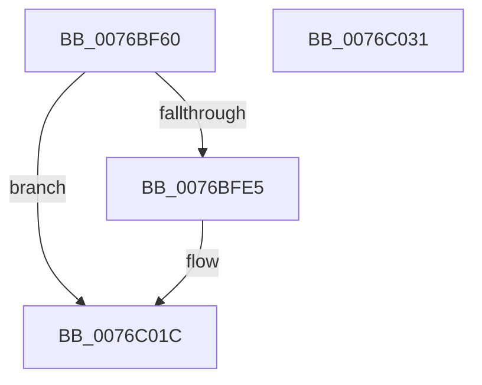

# PopSessionWinlogonNotification

- RVA: `0x0076BF60`–`0x0076C032` (길이 `210` bytes)
- VA: `0x000000014076BF60`
- 실행 섹션: `PAGE`
- PDB 이름 있음: `예`; PDB Function 태그: `아니요`
- unwind 정보 RVA: `0x000A7960`
- 디코드: `50`개 명령, `210/210` bytes 표시
- 미해석 바이트: `0` (있으면 어셈블리에 `.byte`로 보존)

> 이 문서는 커널 이미지의 기계어와 PDB 기호를 분석해 생성했습니다. 4번과 5번은 함수 원형과 자료형을 바이너리 사용 방식에서 추정한 C 해석이며 원본 소스 복구 결과는 아닙니다.

## 1. Dependencies

- 직접 호출 지점: **5**; 고유 호출 대상: **5**
- 직접 호출자로 확인된 함수: **2**
- RIP 상대 이미지 참조: **9**

### Outgoing calls
- `0x0076BF9A` → [PopDiagTraceSessionState](../91/PopDiagTraceSessionState_function_00912C5C.md) (function, `0x00912C5C`)
- `0x0076BFDB` → [PopPrintEx](../../text/48/PopPrintEx_function_0048EF24.md) (function, `0x0048EF24`)
- `0x0076BFE7` → [PopAcquireAdaptiveLock](../A3/PopAcquireAdaptiveLock_function_00A3B0E8.md) (function, `0x00A3B0E8`)
- `0x0076BFF6` → [PopReleaseAdaptiveLock](../91/PopReleaseAdaptiveLock_function_009137DC.md) (function, `0x009137DC`)
- `0x0076C017` → [PopSetPowerSettingValueAcDc](../91/PopSetPowerSettingValueAcDc_function_00914D6C.md) (function, `0x00914D6C`)

### Direct callers
- [NtPowerInformation](../95/NtPowerInformation_function_00955D80.md) at `0x009576D9`
- [PopPowerInformationInternal](../A8/PopPowerInformationInternal_function_00A8B7C0.md) at `0x00A8CE41`

### Static image references
- `0x0076BF78` → RVA `0x00021EA0` (`.rdata`; read)
- `0x0076BF87` → RVA `0x00022CA0` (`.rdata`; read)
- `0x0076BFA2` → RVA `0x00B03070` (` ?? ::NNGAKEGL::`string'`; read)
- `0x0076BFA9` → RVA `0x00B03080` (` ?? ::NNGAKEGL::`string'`; read)
- `0x0076BFB7` → RVA `0x00B03180` (` ?? ::NNGAKEGL::`string'`; read)
- `0x0076BFBE` → RVA `0x00B03060` (` ?? ::NNGAKEGL::`string'`; read)
- `0x0076BFCD` → RVA `0x00B030A0` (` ?? ::NNGAKEGL::`string'`; read)
- `0x0076BFEF` → RVA `0x00F08221` (`.data`; write)
- `0x0076C008` → RVA `0x00026AA8` (`.rdata`; read)

## 2. Other-region calls and transfers

- 다른 실행 섹션으로 향하는 call: **1**
  - `0x0076BFDB` → [PopPrintEx](../../text/48/PopPrintEx_function_0048EF24.md) (`PAGE` → `.text`)
- 별도 외부 분기/꼬리 이동을 확인하지 못했습니다.

## 3. Assembly (complete function range)

```asm
0076BF60  48 89 5C 24 08                  mov qword ptr [rsp + 8], rbx
0076BF65  48 89 6C 24 18                  mov qword ptr [rsp + 0x18], rbp
0076BF6A  48 89 74 24 20                  mov qword ptr [rsp + 0x20], rsi
0076BF6F  57                              push rdi
0076BF70  48 83 EC 30                     sub rsp, 0x30
0076BF74  40 8A 6A 05                     mov bpl, byte ptr [rdx + 5]
0076BF78  48 8D 05 21 5F 8B FF            lea rax, [rip - 0x74a0df]
0076BF7F  0F B6 7A 04                     movzx edi, byte ptr [rdx + 4]
0076BF83  8B D9                           mov ebx, ecx
0076BF85  33 F6                           xor esi, esi
0076BF87  48 8D 0D 12 6D 8B FF            lea rcx, [rip - 0x7492ee]
0076BF8E  40 84 ED                        test bpl, bpl
0076BF91  44 8B C7                        mov r8d, edi
0076BF94  8B D3                           mov edx, ebx
0076BF96  48 0F 44 C8                     cmove rcx, rax
0076BF9A  E8 BD 6C 1A 00                  call 0x140912c5c
0076BF9F  40 84 ED                        test bpl, bpl
0076BFA2  48 8D 0D C7 70 39 00            lea rcx, [rip + 0x3970c7]
0076BFA9  48 8D 05 D0 70 39 00            lea rax, [rip + 0x3970d0]
0076BFB0  44 8B CB                        mov r9d, ebx
0076BFB3  48 0F 44 C1                     cmove rax, rcx
0076BFB7  4C 8D 05 C2 71 39 00            lea r8, [rip + 0x3971c2]
0076BFBE  48 8D 0D 9B 70 39 00            lea rcx, [rip + 0x39709b]
0076BFC5  48 89 44 24 20                  mov qword ptr [rsp + 0x20], rax
0076BFCA  40 84 FF                        test dil, dil
0076BFCD  48 8D 15 CC 70 39 00            lea rdx, [rip + 0x3970cc]
0076BFD4  4C 0F 44 C1                     cmove r8, rcx
0076BFD8  8D 4E 03                        lea ecx, [rsi + 3]
0076BFDB  E8 44 2F D2 FF                  call 0x14048ef24
0076BFE0  40 84 FF                        test dil, dil
0076BFE3  74 37                           je 0x14076c01c
0076BFE5  33 C9                           xor ecx, ecx
0076BFE7  E8 FC F0 2C 00                  call 0x140a3b0e8
0076BFEC  40 84 ED                        test bpl, bpl
0076BFEF  0F 95 05 2B C2 79 00            setne byte ptr [rip + 0x79c22b]
0076BFF6  E8 E1 77 1A 00                  call 0x1409137dc
0076BFFB  40 84 ED                        test bpl, bpl
0076BFFE  4C 8D 44 24 48                  lea r8, [rsp + 0x48]
0076C003  BA 04 00 00 00                  mov edx, 4
0076C008  48 8D 0D 99 AA 8B FF            lea rcx, [rip - 0x745567]
0076C00F  40 0F 95 C6                     setne sil
0076C013  89 74 24 48                     mov dword ptr [rsp + 0x48], esi
0076C017  E8 50 8D 1A 00                  call 0x140914d6c
0076C01C  48 8B 5C 24 40                  mov rbx, qword ptr [rsp + 0x40]
0076C021  48 8B 6C 24 50                  mov rbp, qword ptr [rsp + 0x50]
0076C026  48 8B 74 24 58                  mov rsi, qword ptr [rsp + 0x58]
0076C02B  48 83 C4 30                     add rsp, 0x30
0076C02F  5F                              pop rdi
0076C030  C3                              ret
0076C031  CC                              int3
```

## 4. C-style interpretation (structured pseudocode)

```c
__int64 __fastcall PopSessionWinlogonNotification(int a1, __int64 a2)
{
    __int64 result;
    __int64 v_rsi;
    __int64 v_rsp;
    unsigned __int64 v_stack_m18;
    unsigned __int64 v_stack_p10;
    unsigned __int64 v_stack_p18;
    unsigned __int64 v_stack_p20;
    unsigned __int64 v_stack_p8;

    v_stack_p8 = v_rbx;
    v_stack_p18 = v_rbp;
    v_stack_p20 = v_rsi;
    v_rsp = (v_rsp) - (48);
    v_rsi = 0;
    a1 = v_rip - 7639790;
    if ((unsigned __int8)(*(unsigned __int8 *)(a2 + 5)) == 0) { a1 = v_rip - 7643359; }
    result = PopDiagTraceSessionState(a1, (unsigned int)((unsigned int)((unsigned int)(a1))), (unsigned int)((unsigned int)(*(unsigned __int8 *)(a2 + 4))), a4);
    result = v_rip + 3764432;
    if ((unsigned __int8)(*(unsigned __int8 *)(a2 + 5)) == 0) { result = v_rip + 3764423; }
    v_stack_m18 = result;
    a3 = v_rip + 3764674;
    if ((unsigned __int8)(*(unsigned __int8 *)(a2 + 4)) == 0) { a3 = v_rip + 3764379; }
    result = PopPrintEx(v_rsi + 3, v_rip + 3764428, a3, (unsigned int)((unsigned int)((unsigned int)(a1))));
    if ((unsigned __int8)(*(unsigned __int8 *)(a2 + 4)) != 0) {
        a1 = 0;
        result = PopAcquireAdaptiveLock(a1, v_rip + 3764428, a3, (unsigned int)((unsigned int)((unsigned int)(a1))));
        result = PopReleaseAdaptiveLock(a1, v_rip + 3764428, a3, (unsigned int)((unsigned int)((unsigned int)(a1))));
        a3 = v_stack_p10;
        a2 = 4;
        a1 = v_rip - 7624039;
        v_rsi = ((unsigned __int8)(*(unsigned __int8 *)(a2 + 5)) != 0) ? 1 : 0;
        v_stack_p10 = (unsigned int)(v_rsi);
        result = PopSetPowerSettingValueAcDc(a1, a2, a3, (unsigned int)((unsigned int)((unsigned int)(a1))));
    }
    v_rsp = (v_rsp) + (48);
    return result;
}
```

## 5. (Beta) C Style

```c
int64_t PopSessionWinlogonNotification(int32_t Arg1, void *Arg2)
{
    uint8_t *arg2 = (uint8_t *)Arg2;

    int64_t result;
    int64_t local_rsi;
    int64_t local_rsp;
    uint64_t v_stack_m18;
    uint64_t v_stack_p10;
    uint64_t v_stack_p18;
    uint64_t v_stack_p20;
    uint64_t v_stack_p8;

    v_stack_p8 = local_rbx;
    v_stack_p18 = local_rbp;
    v_stack_p20 = local_rsi;
    local_rsp = (local_rsp) - (48);
    local_rsi = 0;
    Arg1 = v_rip - 7639790;
    if ((uint8_t)(*(uint8_t *)(arg2 + 0x5)) == 0) { Arg1 = v_rip - 7643359; }
    result = PopDiagTraceSessionState(Arg1, (uint32_t)((uint32_t)((uint32_t)(Arg1))), (uint32_t)((uint32_t)(*(uint8_t *)(arg2 + 0x4))), a4);
    result = v_rip + 3764432;
    if ((uint8_t)(*(uint8_t *)(arg2 + 0x5)) == 0) { result = v_rip + 3764423; }
    v_stack_m18 = result;
    a3 = v_rip + 3764674;
    if ((uint8_t)(*(uint8_t *)(arg2 + 0x4)) == 0) { a3 = v_rip + 3764379; }
    result = PopPrintEx(local_rsi + 3, v_rip + 3764428, a3, (uint32_t)((uint32_t)((uint32_t)(Arg1))));
    if ((uint8_t)(*(uint8_t *)(arg2 + 0x4)) != 0) {
        Arg1 = 0;
        result = PopAcquireAdaptiveLock(Arg1, v_rip + 3764428, a3, (uint32_t)((uint32_t)((uint32_t)(Arg1))));
        result = PopReleaseAdaptiveLock(Arg1, v_rip + 3764428, a3, (uint32_t)((uint32_t)((uint32_t)(Arg1))));
        a3 = v_stack_p10;
        Arg2 = 4;
        Arg1 = v_rip - 7624039;
        local_rsi = ((uint8_t)(*(uint8_t *)(arg2 + 0x5)) != 0) ? 1 : 0;
        v_stack_p10 = (uint32_t)(local_rsi);
        result = PopSetPowerSettingValueAcDc(Arg1, Arg2, a3, (uint32_t)((uint32_t)((uint32_t)(Arg1))));
    }
    local_rsp = (local_rsp) + (48);
    return result;
}
```

### 관측된 메모리 오프셋

구조체 형식이 확인되지 않은 접근은 인자 기준의 오프셋으로만 기록했습니다.

| 기준 인자 | 오프셋 표현 | 폭 (bit) | 접근 |
|---|---:|---:|---|
| `Arg2` | `+ 0x4` | `8` | `R` |
| `Arg2` | `+ 0x5` | `8` | `R` |

## 6. Execution-region graph

[열기: 2D/3D 그래프와 함수 탐색 컨트롤 패널](../../../control-panel.html?section=page&rva=0x0076BF60&view=graph)

- 2D 그래프는 위에서 아래로 흐르고, 3D 그래프는 빈 공간을 드래그해 회전합니다. Shift+드래그는 이동, 휠은 확대·축소, 함수 노드 선택은 대상 보고서 이동입니다.

### Static fallback


