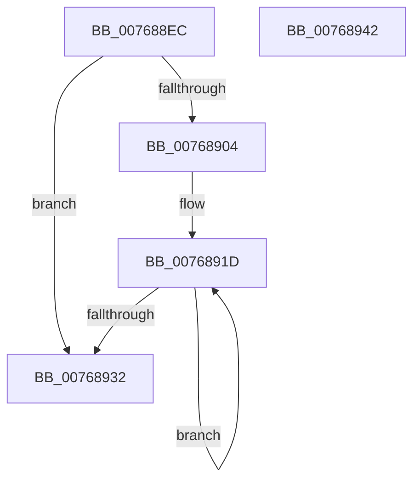

# PopSmartSuspendValidatePredictions

- RVA: `0x007688EC`–`0x00768943` (길이 `87` bytes)
- VA: `0x00000001407688EC`
- 실행 섹션: `PAGE`
- PDB 이름 있음: `예`; PDB Function 태그: `아니요`
- unwind 정보 RVA: `0x00060BC4`
- 디코드: `23`개 명령, `87/87` bytes 표시
- 미해석 바이트: `0` (있으면 어셈블리에 `.byte`로 보존)

> 이 문서는 커널 이미지의 기계어와 PDB 기호를 분석해 생성했습니다. 4번과 5번은 함수 원형과 자료형을 바이너리 사용 방식에서 추정한 C 해석이며 원본 소스 복구 결과는 아닙니다.

## 1. Dependencies

- 직접 호출 지점: **2**; 고유 호출 대상: **2**
- 직접 호출자로 확인된 함수: **1**
- RIP 상대 이미지 참조: **1**

### Outgoing calls
- `0x007688FB` → [PopIsPlatformAoAcCapable](../../text/49/PopIsPlatformAoAcCapable_function_0049BF40.md) (function, `0x0049BF40`)
- `0x00768923` → [PopSmartSuspendValidateSinglePrediction](../AA/PopSmartSuspendValidateSinglePrediction_function_00AA7124.md) (function, `0x00AA7124`)

### Direct callers
- [PopIdleGlobalUserPresenceCallback](../AD/PopIdleGlobalUserPresenceCallback_function_00AD89F0.md) at `0x00AD8A40`

### Static image references
- `0x0076890E` → RVA `0x00F088A0` (`.data`; read)

## 2. Other-region calls and transfers

- 다른 실행 섹션으로 향하는 call: **1**
  - `0x007688FB` → [PopIsPlatformAoAcCapable](../../text/49/PopIsPlatformAoAcCapable_function_0049BF40.md) (`PAGE` → `.text`)
- 별도 외부 분기/꼬리 이동을 확인하지 못했습니다.

## 3. Assembly (complete function range)

```asm
007688EC  48 89 5C 24 08                  mov qword ptr [rsp + 8], rbx
007688F1  48 89 74 24 10                  mov qword ptr [rsp + 0x10], rsi
007688F6  57                              push rdi
007688F7  48 83 EC 20                     sub rsp, 0x20
007688FB  E8 40 36 D3 FF                  call 0x14049bf40
00768900  84 C0                           test al, al
00768902  74 2E                           je 0x140768932
00768904  48 BB 14 00 00 00 80 F7 FF FF   movabs rbx, 0xfffff78000000014
0076890E  48 8D 3D 8B FF 79 00            lea rdi, [rip + 0x79ff8b]
00768915  BE 10 00 00 00                  mov esi, 0x10
0076891A  48 8B 1B                        mov rbx, qword ptr [rbx]
0076891D  48 8B D3                        mov rdx, rbx
00768920  48 8B CF                        mov rcx, rdi
00768923  E8 FC E7 33 00                  call 0x140aa7124
00768928  48 83 C7 60                     add rdi, 0x60
0076892C  48 83 EE 01                     sub rsi, 1
00768930  75 EB                           jne 0x14076891d
00768932  48 8B 5C 24 30                  mov rbx, qword ptr [rsp + 0x30]
00768937  48 8B 74 24 38                  mov rsi, qword ptr [rsp + 0x38]
0076893C  48 83 C4 20                     add rsp, 0x20
00768940  5F                              pop rdi
00768941  C3                              ret
00768942  CC                              int3
```

## 4. C-style interpretation (structured pseudocode)

```c
__int64 __fastcall PopSmartSuspendValidatePredictions(void)
{
    __int64 result;
    __int64 v_rdi;
    __int64 v_rsi;
    __int64 v_rsp;
    unsigned __int64 v_stack_p10;
    unsigned __int64 v_stack_p8;

    v_stack_p8 = v_rbx;
    v_stack_p10 = v_rsi;
    v_rsp = (v_rsp) - (32);
    result = PopIsPlatformAoAcCapable(a1, a2, a3, a4);
    if ((unsigned __int8)(result) == 0) goto loc_00768932;
loc_0076891D:
    result = PopSmartSuspendValidateSinglePrediction(v_rip + 7995275, *(unsigned __int64 *)(v_rbx), a3, a4);
    v_rdi = (v_rip + 7995275) + (96);
    v_rsi = (16) - (1);
    if (condition_is_not_equal) goto loc_0076891D;
loc_00768932:
    v_rsp = (v_rsp) + (32);
    return result;
}
```

## 5. (Beta) C Style

```c
void PopSmartSuspendValidatePredictions(void)
{
    int64_t result;
    int64_t local_rdi;
    int64_t local_rsi;
    int64_t local_rsp;
    uint64_t v_stack_p10;
    uint64_t v_stack_p8;

    v_stack_p8 = local_rbx;
    v_stack_p10 = local_rsi;
    local_rsp = (local_rsp) - (32);
    result = PopIsPlatformAoAcCapable(a1, a2, a3, a4);
    if ((uint8_t)(result) == 0) goto loc_00768932;
loc_0076891D:
    result = PopSmartSuspendValidateSinglePrediction(v_rip + 7995275, *(uint64_t *)(local_rbx), a3, a4);
    local_rdi = (v_rip + 7995275) + (96);
    local_rsi = (16) - (1);
    if (condition_is_not_equal) goto loc_0076891D;
loc_00768932:
    local_rsp = (local_rsp) + (32);
    return result;
}
```

## 6. Execution-region graph

[열기: 2D/3D 그래프와 함수 탐색 컨트롤 패널](../../../control-panel.html?section=page&rva=0x007688EC&view=graph)

- 2D 그래프는 위에서 아래로 흐르고, 3D 그래프는 빈 공간을 드래그해 회전합니다. Shift+드래그는 이동, 휠은 확대·축소, 함수 노드 선택은 대상 보고서 이동입니다.

### Static fallback


