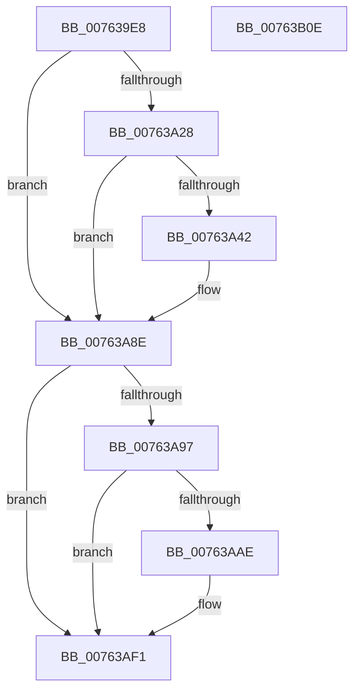

# PopTraceEsBgActivityPolicyUpdate

- RVA: `0x007639E8`–`0x00763B0F` (길이 `295` bytes)
- VA: `0x00000001407639E8`
- 실행 섹션: `PAGE`
- PDB 이름 있음: `예`; PDB Function 태그: `아니요`
- unwind 정보 RVA: `0x000CC774`
- 디코드: `67`개 명령, `295/295` bytes 표시
- 미해석 바이트: `0` (있으면 어셈블리에 `.byte`로 보존)

> 이 문서는 커널 이미지의 기계어와 PDB 기호를 분석해 생성했습니다. 4번과 5번은 함수 원형과 자료형을 바이너리 사용 방식에서 추정한 C 해석이며 원본 소스 복구 결과는 아닙니다.

## 1. Dependencies

- 직접 호출 지점: **5**; 고유 호출 대상: **5**
- 직접 호출자로 확인된 함수: **1**
- RIP 상대 이미지 참조: **7**

### Outgoing calls
- `0x00763A39` → [tlgKeywordOn](../../text/42/tlgKeywordOn_function_0042EAA0.md) (function, `0x0042EAA0`)
- `0x00763A89` → [tlgWriteTransfer_EtwWriteTransfer](../../text/42/tlgWriteTransfer_EtwWriteTransfer_function_004260E0.md) (function, `0x004260E0`)
- `0x00763AA5` → [EtwEventEnabled](../../text/39/EtwEventEnabled_function_00392450.md) (function, `0x00392450`)
- `0x00763AEC` → [EtwWrite](../../text/41/EtwWrite_function_0041C720.md) (function, `0x0041C720`)
- `0x00763AF8` → [_security_check_cookie](../../text/6A/_security_check_cookie_function_006AC640.md) (function, `0x006AC640`)

### Direct callers
- [PopEsInStandbyEvaluate](../A4/PopEsInStandbyEvaluate_function_00A4A260.md) at `0x00A4A384`

### Static image references
- `0x007639FE` → RVA `0x00E0A740` (`.data`; read)
- `0x00763A0C` → RVA `0x00E07748` (`.data`; read)
- `0x00763A16` → RVA `0x00E67A04` (`.data`; read)
- `0x00763A4E` → RVA `0x000495F2` (`.rdata`; read)
- `0x00763A8E` → RVA `0x00E67858` (`.data`; read)
- `0x00763A97` → RVA `0x00F0B408` (`.data`; read)
- `0x00763A9E` → RVA `0x00022280` (`.rdata`; read)

## 2. Other-region calls and transfers

- 다른 실행 섹션으로 향하는 call: **5**
  - `0x00763A39` → [tlgKeywordOn](../../text/42/tlgKeywordOn_function_0042EAA0.md) (`PAGE` → `.text`)
  - `0x00763A89` → [tlgWriteTransfer_EtwWriteTransfer](../../text/42/tlgWriteTransfer_EtwWriteTransfer_function_004260E0.md) (`PAGE` → `.text`)
  - `0x00763AA5` → [EtwEventEnabled](../../text/39/EtwEventEnabled_function_00392450.md) (`PAGE` → `.text`)
  - `0x00763AEC` → [EtwWrite](../../text/41/EtwWrite_function_0041C720.md) (`PAGE` → `.text`)
  - `0x00763AF8` → [_security_check_cookie](../../text/6A/_security_check_cookie_function_006AC640.md) (`PAGE` → `.text`)
- 별도 외부 분기/꼬리 이동을 확인하지 못했습니다.

## 3. Assembly (complete function range)

```asm
007639E8  48 89 7C 24 10                  mov qword ptr [rsp + 0x10], rdi
007639ED  89 4C 24 08                     mov dword ptr [rsp + 8], ecx
007639F1  55                              push rbp
007639F2  48 8D 6C 24 A9                  lea rbp, [rsp - 0x57]
007639F7  48 81 EC B0 00 00 00            sub rsp, 0xb0
007639FE  48 8B 05 3B 6D 6A 00            mov rax, qword ptr [rip + 0x6a6d3b]
00763A05  48 33 C4                        xor rax, rsp
00763A08  48 89 45 47                     mov qword ptr [rbp + 0x47], rax
00763A0C  83 3D 35 3D 6A 00 05            cmp dword ptr [rip + 0x6a3d35], 5
00763A13  44 8B C1                        mov r8d, ecx
00763A16  44 8B 0D E7 3F 70 00            mov r9d, dword ptr [rip + 0x703fe7]
00763A1D  BF 04 00 00 00                  mov edi, 4
00763A22  44 89 4D DF                     mov dword ptr [rbp - 0x21], r9d
00763A26  76 66                           jbe 0x140763a8e
00763A28  48 BA 00 00 00 00 00 40 00 00   movabs rdx, 0x400000000000
00763A32  48 8D 0D 0F 3D 6A 00            lea rcx, [rip + 0x6a3d0f]
00763A39  E8 62 B0 CC FF                  call 0x14042eaa0
00763A3E  84 C0                           test al, al
00763A40  74 4C                           je 0x140763a8e
00763A42  83 65 33 00                     and dword ptr [rbp + 0x33], 0
00763A46  48 8D 45 D7                     lea rax, [rbp - 0x29]
00763A4A  83 65 43 00                     and dword ptr [rbp + 0x43], 0
00763A4E  48 8D 15 9D 5B 8E FF            lea rdx, [rip - 0x71a463]
00763A55  48 89 45 27                     mov qword ptr [rbp + 0x27], rax
00763A59  48 8D 0D E8 3C 6A 00            lea rcx, [rip + 0x6a3ce8]
00763A60  48 8D 45 DB                     lea rax, [rbp - 0x25]
00763A64  44 89 45 D7                     mov dword ptr [rbp - 0x29], r8d
00763A68  48 89 45 37                     mov qword ptr [rbp + 0x37], rax
00763A6C  45 33 C0                        xor r8d, r8d
00763A6F  48 8D 45 07                     lea rax, [rbp + 7]
00763A73  44 89 4D DB                     mov dword ptr [rbp - 0x25], r9d
00763A77  48 89 44 24 28                  mov qword ptr [rsp + 0x28], rax
00763A7C  45 33 C9                        xor r9d, r9d
00763A7F  89 7C 24 20                     mov dword ptr [rsp + 0x20], edi
00763A83  89 7D 2F                        mov dword ptr [rbp + 0x2f], edi
00763A86  89 7D 3F                        mov dword ptr [rbp + 0x3f], edi
00763A89  E8 52 26 CC FF                  call 0x1404260e0
00763A8E  80 3D C3 3D 70 00 00            cmp byte ptr [rip + 0x703dc3], 0
00763A95  74 5A                           je 0x140763af1
00763A97  48 8B 0D 6A 79 7A 00            mov rcx, qword ptr [rip + 0x7a796a]
00763A9E  48 8D 15 DB E7 8B FF            lea rdx, [rip - 0x741825]
00763AA5  E8 A6 E9 C2 FF                  call 0x140392450
00763AAA  84 C0                           test al, al
00763AAC  74 43                           je 0x140763af1
00763AAE  83 65 F3 00                     and dword ptr [rbp - 0xd], 0
00763AB2  48 8D 45 67                     lea rax, [rbp + 0x67]
00763AB6  83 65 03 00                     and dword ptr [rbp + 3], 0
00763ABA  48 8D 15 BF E7 8B FF            lea rdx, [rip - 0x741841]
00763AC1  48 8B 0D 40 79 7A 00            mov rcx, qword ptr [rip + 0x7a7940]
00763AC8  41 B9 02 00 00 00               mov r9d, 2
00763ACE  48 89 45 E7                     mov qword ptr [rbp - 0x19], rax
00763AD2  45 33 C0                        xor r8d, r8d
00763AD5  48 8D 45 DF                     lea rax, [rbp - 0x21]
00763AD9  89 7D EF                        mov dword ptr [rbp - 0x11], edi
00763ADC  48 89 45 F7                     mov qword ptr [rbp - 9], rax
00763AE0  48 8D 45 E7                     lea rax, [rbp - 0x19]
00763AE4  48 89 44 24 20                  mov qword ptr [rsp + 0x20], rax
00763AE9  89 7D FF                        mov dword ptr [rbp - 1], edi
00763AEC  E8 2F 8C CB FF                  call 0x14041c720
00763AF1  48 8B 4D 47                     mov rcx, qword ptr [rbp + 0x47]
00763AF5  48 33 CC                        xor rcx, rsp
00763AF8  E8 43 8B F4 FF                  call 0x1406ac640
00763AFD  48 8B BC 24 C8 00 00 00         mov rdi, qword ptr [rsp + 0xc8]
00763B05  48 81 C4 B0 00 00 00            add rsp, 0xb0
00763B0C  5D                              pop rbp
00763B0D  C3                              ret
00763B0E  CC                              int3
```

## 4. C-style interpretation (structured pseudocode)

```c
__int64 __fastcall PopTraceEsBgActivityPolicyUpdate(int a1)
{
    __int64 result;
    __int64 v_rsp;
    unsigned __int64 v_stack_m18;
    unsigned int v_stack_m1C;
    unsigned int v_stack_m20;
    unsigned __int64 v_stack_m28;
    unsigned int v_stack_m2C;
    unsigned int v_stack_m30;
    unsigned __int64 v_stack_m38;
    unsigned __int64 v_stack_m58;
    unsigned int v_stack_m5C;
    unsigned __int64 v_stack_m5F;
    unsigned int v_stack_m60;
    unsigned __int64 v_stack_m68;
    unsigned int v_stack_m6C;
    unsigned int v_stack_m70;
    unsigned __int64 v_stack_m78;
    unsigned int v_stack_m80;
    unsigned __int64 v_stack_m84;
    unsigned __int64 v_stack_m88;
    unsigned __int64 v_stack_m90;
    unsigned int v_stack_m98;
    unsigned __int64 v_stack_p10;
    unsigned int v_stack_p8;

    v_stack_p10 = v_rdi;
    v_stack_p8 = a1;
    v_rsp = (v_rsp) - (176);
    result = (*(unsigned __int64 *)(v_rip + 6974779)) ^ (v_rsp);
    v_stack_m18 = result;
    v_stack_m80 = (unsigned int)((unsigned int)(*(unsigned int *)(v_rip + 7356391)));
    if ((*(unsigned int *)(v_rip + 6962485)) <= 5) goto loc_00763A8E;
    result = tlgKeywordOn(v_rip + 6962447, a2, (unsigned int)(a1), (unsigned int)(*(unsigned int *)(v_rip + 7356391)));
    if ((unsigned __int8)(result) != 0) {
        result = v_stack_m88;
        a2 = v_rip - 7447651;
        v_stack_m38 = result;
        a1 = v_rip + 6962408;
        result = v_stack_m84;
        v_stack_m88 = (unsigned int)((unsigned int)(a1));
        v_stack_m28 = result;
        a3 = 0;
        result = v_stack_m58;
        v_stack_m84 = (unsigned int)((unsigned int)(*(unsigned int *)(v_rip + 7356391)));
        v_stack_m90 = result;
        a4 = 0;
        v_stack_m98 = 4;
        v_stack_m30 = 4;
        v_stack_m20 = 4;
        result = tlgWriteTransfer_EtwWriteTransfer(a1, a2, a3, a4);
    }
    if ((*(unsigned __int8 *)(v_rip + 7355843)) == 0) goto loc_00763AF1;
    result = EtwEventEnabled(*(unsigned __int64 *)(v_rip + 8026474), v_rip - 7608357, a3, a4);
    if ((unsigned __int8)(result) != 0) {
        result = v_stack_p8;
        a2 = v_rip - 7608385;
        a1 = *(unsigned __int64 *)(v_rip + 8026432);
        a4 = 2;
        v_stack_m78 = result;
        a3 = 0;
        result = v_stack_m80;
        v_stack_m70 = 4;
        v_stack_m68 = result;
        result = v_stack_m78;
        v_stack_m98 = result;
        v_stack_m60 = 4;
        result = EtwWrite(a1, a2, a3, a4);
    }
    a1 = (v_stack_m18) ^ (v_rsp);
    result = _security_check_cookie(a1, a2, a3, a4);
    v_rsp = (v_rsp) + (176);
    return result;
}
```

## 5. (Beta) C Style

```c
int64_t PopTraceEsBgActivityPolicyUpdate(int32_t Arg1)
{
    int64_t result;
    int64_t local_rsp;
    uint64_t v_stack_m18;
    uint32_t v_stack_m1C;
    uint32_t v_stack_m20;
    uint64_t v_stack_m28;
    uint32_t v_stack_m2C;
    uint32_t v_stack_m30;
    uint64_t v_stack_m38;
    uint64_t v_stack_m58;
    uint32_t v_stack_m5C;
    uint64_t v_stack_m5F;
    uint32_t v_stack_m60;
    uint64_t v_stack_m68;
    uint32_t v_stack_m6C;
    uint32_t v_stack_m70;
    uint64_t v_stack_m78;
    uint32_t v_stack_m80;
    uint64_t v_stack_m84;
    uint64_t v_stack_m88;
    uint64_t v_stack_m90;
    uint32_t v_stack_m98;
    uint64_t v_stack_p10;
    uint32_t v_stack_p8;

    v_stack_p10 = local_rdi;
    v_stack_p8 = Arg1;
    local_rsp = (local_rsp) - (176);
    result = (*(uint64_t *)(v_rip + 0x6A6D3B)) ^ (local_rsp);
    v_stack_m18 = result;
    v_stack_m80 = (uint32_t)((uint32_t)(*(uint32_t *)(v_rip + 0x703FE7)));
    if ((*(uint32_t *)(v_rip + 0x6A3D35)) <= 5) goto loc_00763A8E;
    result = tlgKeywordOn(v_rip + 6962447, a2, (uint32_t)(Arg1), (uint32_t)(*(uint32_t *)(v_rip + 0x703FE7)));
    if ((uint8_t)(result) != 0) {
        result = v_stack_m88;
        a2 = v_rip - 7447651;
        v_stack_m38 = result;
        Arg1 = v_rip + 6962408;
        result = v_stack_m84;
        v_stack_m88 = (uint32_t)((uint32_t)(Arg1));
        v_stack_m28 = result;
        a3 = 0;
        result = v_stack_m58;
        v_stack_m84 = (uint32_t)((uint32_t)(*(uint32_t *)(v_rip + 0x703FE7)));
        v_stack_m90 = result;
        a4 = 0;
        v_stack_m98 = 4;
        v_stack_m30 = 4;
        v_stack_m20 = 4;
        result = tlgWriteTransfer_EtwWriteTransfer(Arg1, a2, a3, a4);
    }
    if ((*(uint8_t *)(v_rip + 0x703DC3)) == 0) goto loc_00763AF1;
    result = EtwEventEnabled(*(uint64_t *)(v_rip + 0x7A796A), v_rip - 7608357, a3, a4);
    if ((uint8_t)(result) != 0) {
        result = v_stack_p8;
        a2 = v_rip - 7608385;
        Arg1 = *(uint64_t *)(v_rip + 0x7A7940);
        a4 = 2;
        v_stack_m78 = result;
        a3 = 0;
        result = v_stack_m80;
        v_stack_m70 = 4;
        v_stack_m68 = result;
        result = v_stack_m78;
        v_stack_m98 = result;
        v_stack_m60 = 4;
        result = EtwWrite(Arg1, a2, a3, a4);
    }
    Arg1 = (v_stack_m18) ^ (local_rsp);
    result = _security_check_cookie(Arg1, a2, a3, a4);
    local_rsp = (local_rsp) + (176);
    return result;
}
```

## 6. Execution-region graph

[열기: 2D/3D 그래프와 함수 탐색 컨트롤 패널](../../../control-panel.html?section=page&rva=0x007639E8&view=graph)

- 2D 그래프는 위에서 아래로 흐르고, 3D 그래프는 빈 공간을 드래그해 회전합니다. Shift+드래그는 이동, 휠은 확대·축소, 함수 노드 선택은 대상 보고서 이동입니다.

### Static fallback


