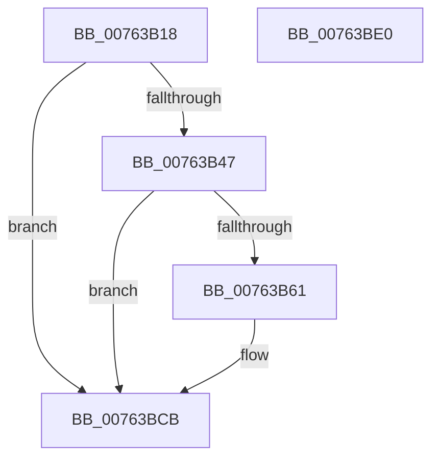

# PopTraceHibernatePolicyUpdate

- RVA: `0x00763B18`–`0x00763BE1` (길이 `201` bytes)
- VA: `0x0000000140763B18`
- 실행 섹션: `PAGE`
- PDB 이름 있음: `예`; PDB Function 태그: `아니요`
- unwind 정보 RVA: `0x0009EA9C`
- 디코드: `42`개 명령, `201/201` bytes 표시
- 미해석 바이트: `0` (있으면 어셈블리에 `.byte`로 보존)

> 이 문서는 커널 이미지의 기계어와 PDB 기호를 분석해 생성했습니다. 4번과 5번은 함수 원형과 자료형을 바이너리 사용 방식에서 추정한 C 해석이며 원본 소스 복구 결과는 아닙니다.

## 1. Dependencies

- 직접 호출 지점: **3**; 고유 호출 대상: **3**
- 직접 호출자로 확인된 함수: **2**
- RIP 상대 이미지 참조: **3**

### Outgoing calls
- `0x00763B58` → [tlgKeywordOn](../../text/42/tlgKeywordOn_function_0042EAA0.md) (function, `0x0042EAA0`)
- `0x00763BC6` → [tlgWriteTransfer_EtwWriteTransfer](../../text/42/tlgWriteTransfer_EtwWriteTransfer_function_004260E0.md) (function, `0x004260E0`)
- `0x00763BD2` → [_security_check_cookie](../../text/6A/_security_check_cookie_function_006AC640.md) (function, `0x006AC640`)

### Direct callers
- [PoInitHiberServices](../75/PoInitHiberServices_function_007537C4.md) at `0x00753845`
- [PopWnfHibernatePolicyCallback](../75/PopWnfHibernatePolicyCallback_function_0075E3C0.md) at `0x0075E426`

### Static image references
- `0x00763B26` → RVA `0x00E0A740` (`.data`; read)
- `0x00763B34` → RVA `0x00E07748` (`.data`; read)
- `0x00763B6D` → RVA `0x00049813` (`.rdata`; read)

## 2. Other-region calls and transfers

- 다른 실행 섹션으로 향하는 call: **3**
  - `0x00763B58` → [tlgKeywordOn](../../text/42/tlgKeywordOn_function_0042EAA0.md) (`PAGE` → `.text`)
  - `0x00763BC6` → [tlgWriteTransfer_EtwWriteTransfer](../../text/42/tlgWriteTransfer_EtwWriteTransfer_function_004260E0.md) (`PAGE` → `.text`)
  - `0x00763BD2` → [_security_check_cookie](../../text/6A/_security_check_cookie_function_006AC640.md) (`PAGE` → `.text`)
- 별도 외부 분기/꼬리 이동을 확인하지 못했습니다.

## 3. Assembly (complete function range)

```asm
00763B18  40 55                           push rbp
00763B1A  48 8D 6C 24 A9                  lea rbp, [rsp - 0x57]
00763B1F  48 81 EC A0 00 00 00            sub rsp, 0xa0
00763B26  48 8B 05 13 6C 6A 00            mov rax, qword ptr [rip + 0x6a6c13]
00763B2D  48 33 C4                        xor rax, rsp
00763B30  48 89 45 47                     mov qword ptr [rbp + 0x47], rax
00763B34  83 3D 0D 3C 6A 00 05            cmp dword ptr [rip + 0x6a3c0d], 5
00763B3B  44 8A C2                        mov r8b, dl
00763B3E  44 8B C9                        mov r9d, ecx
00763B41  0F 86 84 00 00 00               jbe 0x140763bcb
00763B47  48 BA 00 00 00 00 00 40 00 00   movabs rdx, 0x400000000000
00763B51  48 8D 0D F0 3B 6A 00            lea rcx, [rip + 0x6a3bf0]
00763B58  E8 43 AF CC FF                  call 0x14042eaa0
00763B5D  84 C0                           test al, al
00763B5F  74 6A                           je 0x140763bcb
00763B61  48 8D 45 EB                     lea rax, [rbp - 0x15]
00763B65  44 89 4D EB                     mov dword ptr [rbp - 0x15], r9d
00763B69  48 89 45 17                     mov qword ptr [rbp + 0x17], rax
00763B6D  48 8D 15 9F 5C 8E FF            lea rdx, [rip - 0x71a361]
00763B74  48 8D 45 E7                     lea rax, [rbp - 0x19]
00763B78  44 88 45 E7                     mov byte ptr [rbp - 0x19], r8b
00763B7C  48 89 45 27                     mov qword ptr [rbp + 0x27], rax
00763B80  48 8D 0D C1 3B 6A 00            lea rcx, [rip + 0x6a3bc1]
00763B87  48 8D 45 EF                     lea rax, [rbp - 0x11]
00763B8B  48 C7 45 1F 04 00 00 00         mov qword ptr [rbp + 0x1f], 4
00763B93  48 89 45 37                     mov qword ptr [rbp + 0x37], rax
00763B97  45 33 C9                        xor r9d, r9d
00763B9A  48 8D 45 F7                     lea rax, [rbp - 9]
00763B9E  48 C7 45 2F 01 00 00 00         mov qword ptr [rbp + 0x2f], 1
00763BA6  48 89 44 24 28                  mov qword ptr [rsp + 0x28], rax
00763BAB  45 33 C0                        xor r8d, r8d
00763BAE  C7 44 24 20 05 00 00 00         mov dword ptr [rsp + 0x20], 5
00763BB6  48 C7 45 EF 00 00 00 01         mov qword ptr [rbp - 0x11], 0x1000000
00763BBE  48 C7 45 3F 08 00 00 00         mov qword ptr [rbp + 0x3f], 8
00763BC6  E8 15 25 CC FF                  call 0x1404260e0
00763BCB  48 8B 4D 47                     mov rcx, qword ptr [rbp + 0x47]
00763BCF  48 33 CC                        xor rcx, rsp
00763BD2  E8 69 8A F4 FF                  call 0x1406ac640
00763BD7  48 81 C4 A0 00 00 00            add rsp, 0xa0
00763BDE  5D                              pop rbp
00763BDF  C3                              ret
00763BE0  CC                              int3
```

## 4. C-style interpretation (structured pseudocode)

```c
__int64 __fastcall PopTraceHibernatePolicyUpdate(int a1, unsigned __int8 a2)
{
    __int64 result;
    __int64 v_rsp;
    unsigned __int64 v_stack_m18;
    unsigned __int64 v_stack_m20;
    unsigned __int64 v_stack_m28;
    unsigned __int64 v_stack_m30;
    unsigned __int64 v_stack_m38;
    unsigned __int64 v_stack_m40;
    unsigned __int64 v_stack_m48;
    unsigned __int64 v_stack_m5F;
    unsigned __int64 v_stack_m68;
    unsigned __int64 v_stack_m70;
    unsigned __int64 v_stack_m74;
    unsigned __int64 v_stack_m78;
    unsigned __int64 v_stack_m80;
    unsigned int v_stack_m88;

    v_rsp = (v_rsp) - (160);
    result = (*(unsigned __int64 *)(v_rip + 6974483)) ^ (v_rsp);
    v_stack_m18 = result;
    if ((*(unsigned int *)(v_rip + 6962189)) <= 5) goto loc_00763BCB;
    result = tlgKeywordOn(v_rip + 6962160, a2, a2, (unsigned int)(a1));
    if ((unsigned __int8)(result) != 0) {
        result = v_stack_m74;
        v_stack_m74 = (unsigned int)((unsigned int)(a1));
        v_stack_m48 = result;
        a2 = v_rip - 7447393;
        result = v_stack_m78;
        v_stack_m78 = a2;
        v_stack_m38 = result;
        a1 = v_rip + 6962113;
        result = v_stack_m70;
        v_stack_m40 = 4;
        v_stack_m28 = result;
        a4 = 0;
        result = v_stack_m68;
        v_stack_m30 = 1;
        v_stack_m80 = result;
        a3 = 0;
        v_stack_m88 = 5;
        v_stack_m70 = 0x1000000ULL;
        v_stack_m20 = 8;
        result = tlgWriteTransfer_EtwWriteTransfer(a1, a2, a3, a4);
    }
    a1 = (v_stack_m18) ^ (v_rsp);
    result = _security_check_cookie(a1, a2, a3, a4);
    v_rsp = (v_rsp) + (160);
    return result;
}
```

## 5. (Beta) C Style

```c
int64_t PopTraceHibernatePolicyUpdate(int32_t Arg1, uint8_t Arg2)
{
    int64_t result;
    int64_t local_rsp;
    uint64_t v_stack_m18;
    uint64_t v_stack_m20;
    uint64_t v_stack_m28;
    uint64_t v_stack_m30;
    uint64_t v_stack_m38;
    uint64_t v_stack_m40;
    uint64_t v_stack_m48;
    uint64_t v_stack_m5F;
    uint64_t v_stack_m68;
    uint64_t v_stack_m70;
    uint64_t v_stack_m74;
    uint64_t v_stack_m78;
    uint64_t v_stack_m80;
    uint32_t v_stack_m88;

    local_rsp = (local_rsp) - (160);
    result = (*(uint64_t *)(v_rip + 0x6A6C13)) ^ (local_rsp);
    v_stack_m18 = result;
    if ((*(uint32_t *)(v_rip + 0x6A3C0D)) <= 5) goto loc_00763BCB;
    result = tlgKeywordOn(v_rip + 6962160, Arg2, Arg2, (uint32_t)(Arg1));
    if ((uint8_t)(result) != 0) {
        result = v_stack_m74;
        v_stack_m74 = (uint32_t)((uint32_t)(Arg1));
        v_stack_m48 = result;
        Arg2 = v_rip - 7447393;
        result = v_stack_m78;
        v_stack_m78 = Arg2;
        v_stack_m38 = result;
        Arg1 = v_rip + 6962113;
        result = v_stack_m70;
        v_stack_m40 = 4;
        v_stack_m28 = result;
        a4 = 0;
        result = v_stack_m68;
        v_stack_m30 = 1;
        v_stack_m80 = result;
        a3 = 0;
        v_stack_m88 = 5;
        v_stack_m70 = 0x1000000ULL;
        v_stack_m20 = 8;
        result = tlgWriteTransfer_EtwWriteTransfer(Arg1, Arg2, a3, a4);
    }
    Arg1 = (v_stack_m18) ^ (local_rsp);
    result = _security_check_cookie(Arg1, Arg2, a3, a4);
    local_rsp = (local_rsp) + (160);
    return result;
}
```

## 6. Execution-region graph

[열기: 2D/3D 그래프와 함수 탐색 컨트롤 패널](../../../control-panel.html?section=page&rva=0x00763B18&view=graph)

- 2D 그래프는 위에서 아래로 흐르고, 3D 그래프는 빈 공간을 드래그해 회전합니다. Shift+드래그는 이동, 휠은 확대·축소, 함수 노드 선택은 대상 보고서 이동입니다.

### Static fallback


