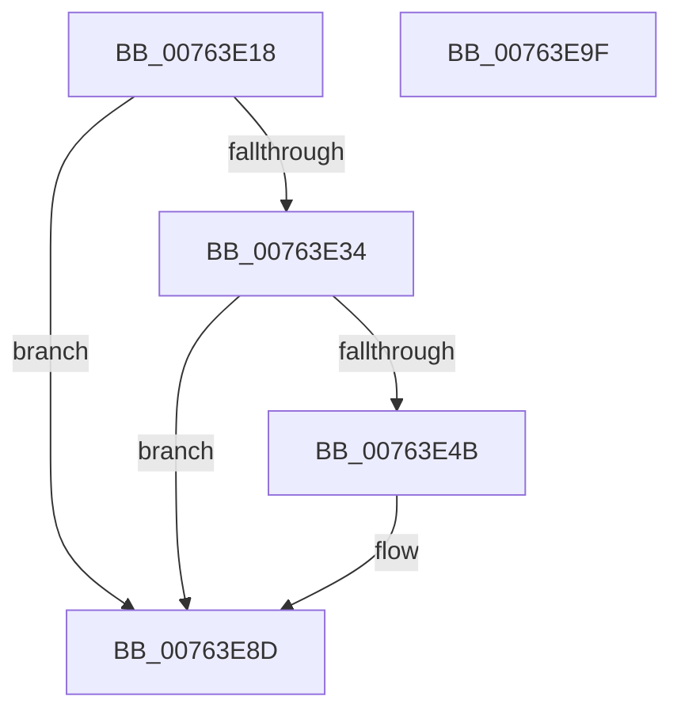

# PopTraceSystemIdleS0LowPowerDoze

- RVA: `0x00763E18`–`0x00763EA0` (길이 `136` bytes)
- VA: `0x0000000140763E18`
- 실행 섹션: `PAGE`
- PDB 이름 있음: `예`; PDB Function 태그: `아니요`
- unwind 정보 RVA: `0x000B3A94`
- 디코드: `29`개 명령, `136/136` bytes 표시
- 미해석 바이트: `0` (있으면 어셈블리에 `.byte`로 보존)

> 이 문서는 커널 이미지의 기계어와 PDB 기호를 분석해 생성했습니다. 4번과 5번은 함수 원형과 자료형을 바이너리 사용 방식에서 추정한 C 해석이며 원본 소스 복구 결과는 아닙니다.

## 1. Dependencies

- 직접 호출 지점: **3**; 고유 호출 대상: **3**
- 직접 호출자로 확인된 함수: **1**
- RIP 상대 이미지 참조: **4**

### Outgoing calls
- `0x00763E42` → [EtwEventEnabled](../../text/39/EtwEventEnabled_function_00392450.md) (function, `0x00392450`)
- `0x00763E88` → [EtwWrite](../../text/41/EtwWrite_function_0041C720.md) (function, `0x0041C720`)
- `0x00763E95` → [_security_check_cookie](../../text/6A/_security_check_cookie_function_006AC640.md) (function, `0x006AC640`)

### Direct callers
- [PopIdleAoAcDozeToS4](PopIdleAoAcDozeToS4_function_00768790.md) at `0x0076879E`

### Static image references
- `0x00763E1C` → RVA `0x00E0A740` (`.data`; read)
- `0x00763E2B` → RVA `0x00E67858` (`.data`; read)
- `0x00763E34` → RVA `0x00F0B408` (`.data`; read)
- `0x00763E3B` → RVA `0x000230D8` (`.rdata`; read)

## 2. Other-region calls and transfers

- 다른 실행 섹션으로 향하는 call: **3**
  - `0x00763E42` → [EtwEventEnabled](../../text/39/EtwEventEnabled_function_00392450.md) (`PAGE` → `.text`)
  - `0x00763E88` → [EtwWrite](../../text/41/EtwWrite_function_0041C720.md) (`PAGE` → `.text`)
  - `0x00763E95` → [_security_check_cookie](../../text/6A/_security_check_cookie_function_006AC640.md) (`PAGE` → `.text`)
- 별도 외부 분기/꼬리 이동을 확인하지 못했습니다.

## 3. Assembly (complete function range)

```asm
00763E18  48 83 EC 58                     sub rsp, 0x58
00763E1C  48 8B 05 1D 69 6A 00            mov rax, qword ptr [rip + 0x6a691d]
00763E23  48 33 C4                        xor rax, rsp
00763E26  48 89 44 24 48                  mov qword ptr [rsp + 0x48], rax
00763E2B  80 3D 26 3A 70 00 00            cmp byte ptr [rip + 0x703a26], 0
00763E32  74 59                           je 0x140763e8d
00763E34  48 8B 0D CD 75 7A 00            mov rcx, qword ptr [rip + 0x7a75cd]
00763E3B  48 8D 15 96 F2 8B FF            lea rdx, [rip - 0x740d6a]
00763E42  E8 09 E6 C2 FF                  call 0x140392450
00763E47  84 C0                           test al, al
00763E49  74 42                           je 0x140763e8d
00763E4B  83 64 24 30 00                  and dword ptr [rsp + 0x30], 0
00763E50  48 8D 44 24 30                  lea rax, [rsp + 0x30]
00763E55  83 64 24 44 00                  and dword ptr [rsp + 0x44], 0
00763E5A  48 8D 15 77 F2 8B FF            lea rdx, [rip - 0x740d89]
00763E61  48 8B 0D A0 75 7A 00            mov rcx, qword ptr [rip + 0x7a75a0]
00763E68  41 B9 01 00 00 00               mov r9d, 1
00763E6E  48 89 44 24 38                  mov qword ptr [rsp + 0x38], rax
00763E73  45 33 C0                        xor r8d, r8d
00763E76  48 8D 44 24 38                  lea rax, [rsp + 0x38]
00763E7B  C7 44 24 40 04 00 00 00         mov dword ptr [rsp + 0x40], 4
00763E83  48 89 44 24 20                  mov qword ptr [rsp + 0x20], rax
00763E88  E8 93 88 CB FF                  call 0x14041c720
00763E8D  48 8B 4C 24 48                  mov rcx, qword ptr [rsp + 0x48]
00763E92  48 33 CC                        xor rcx, rsp
00763E95  E8 A6 87 F4 FF                  call 0x1406ac640
00763E9A  48 83 C4 58                     add rsp, 0x58
00763E9E  C3                              ret
00763E9F  CC                              int3
```

## 4. C-style interpretation (structured pseudocode)

```c
__int64 __fastcall PopTraceSystemIdleS0LowPowerDoze(__int64 a1, __int64 a2, int a3)
{
    __int64 result;
    __int64 v_rsp;
    unsigned __int64 v_stack_m10;
    unsigned int v_stack_m14;
    unsigned int v_stack_m18;
    unsigned __int64 v_stack_m20;
    unsigned int v_stack_m28;
    unsigned __int64 v_stack_m38;

    v_rsp = (v_rsp) - (88);
    result = (*(unsigned __int64 *)(v_rip + 6973725)) ^ (v_rsp);
    v_stack_m10 = result;
    if ((*(unsigned __int8 *)(v_rip + 7354918)) == 0) goto loc_00763E8D;
    result = EtwEventEnabled(*(unsigned __int64 *)(v_rip + 8025549), v_rip - 7605610, a3, a4);
    if ((unsigned __int8)(result) != 0) {
        result = v_stack_m28;
        a2 = v_rip - 7605641;
        a1 = *(unsigned __int64 *)(v_rip + 8025504);
        a4 = 1;
        v_stack_m20 = result;
        a3 = 0;
        result = v_stack_m20;
        v_stack_m18 = 4;
        v_stack_m38 = result;
        result = EtwWrite(a1, a2, a3, a4);
    }
    a1 = (v_stack_m10) ^ (v_rsp);
    result = _security_check_cookie(a1, a2, a3, a4);
    v_rsp = (v_rsp) + (88);
    return result;
}
```

## 5. (Beta) C Style

```c
int64_t PopTraceSystemIdleS0LowPowerDoze(int64_t Arg1, int64_t Arg2, int32_t Arg3)
{
    int64_t result;
    int64_t local_rsp;
    uint64_t v_stack_m10;
    uint32_t v_stack_m14;
    uint32_t v_stack_m18;
    uint64_t v_stack_m20;
    uint32_t v_stack_m28;
    uint64_t v_stack_m38;

    local_rsp = (local_rsp) - (88);
    result = (*(uint64_t *)(v_rip + 0x6A691D)) ^ (local_rsp);
    v_stack_m10 = result;
    if ((*(uint8_t *)(v_rip + 0x703A26)) == 0) goto loc_00763E8D;
    result = EtwEventEnabled(*(uint64_t *)(v_rip + 0x7A75CD), v_rip - 7605610, Arg3, a4);
    if ((uint8_t)(result) != 0) {
        result = v_stack_m28;
        Arg2 = v_rip - 7605641;
        Arg1 = *(uint64_t *)(v_rip + 0x7A75A0);
        a4 = 1;
        v_stack_m20 = result;
        Arg3 = 0;
        result = v_stack_m20;
        v_stack_m18 = 4;
        v_stack_m38 = result;
        result = EtwWrite(Arg1, Arg2, Arg3, a4);
    }
    Arg1 = (v_stack_m10) ^ (local_rsp);
    result = _security_check_cookie(Arg1, Arg2, Arg3, a4);
    local_rsp = (local_rsp) + (88);
    return result;
}
```

## 6. Execution-region graph

[열기: 2D/3D 그래프와 함수 탐색 컨트롤 패널](../../../control-panel.html?section=page&rva=0x00763E18&view=graph)

- 2D 그래프는 위에서 아래로 흐르고, 3D 그래프는 빈 공간을 드래그해 회전합니다. Shift+드래그는 이동, 휠은 확대·축소, 함수 노드 선택은 대상 보고서 이동입니다.

### Static fallback


