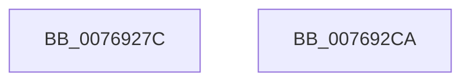

# PopUmpoQuerySmartSuspendPrediction

- RVA: `0x0076927C`–`0x007692CB` (길이 `79` bytes)
- VA: `0x000000014076927C`
- 실행 섹션: `PAGE`
- PDB 이름 있음: `예`; PDB Function 태그: `아니요`
- unwind 정보 RVA: `0x000BA0F0`
- 디코드: `21`개 명령, `79/79` bytes 표시
- 미해석 바이트: `0` (있으면 어셈블리에 `.byte`로 보존)

> 이 문서는 커널 이미지의 기계어와 PDB 기호를 분석해 생성했습니다. 4번과 5번은 함수 원형과 자료형을 바이너리 사용 방식에서 추정한 C 해석이며 원본 소스 복구 결과는 아닙니다.

## 1. Dependencies

- 직접 호출 지점: **2**; 고유 호출 대상: **2**
- 직접 호출자로 확인된 함수: **1**
- RIP 상대 이미지 참조: **0**

### Outgoing calls
- `0x00769296` → [memset](../../text/6C/memset_function_006C6C40.md) (function, `0x006C6C40`)
- `0x007692B7` → [PopUmpoSendPowerMessage](../../text/23/PopUmpoSendPowerMessage_function_00230730.md) (function, `0x00230730`)

### Direct callers
- [PopSmartSuspendMakePredictions](../AD/PopSmartSuspendMakePredictions_function_00AD9168.md) at `0x00AD9268`
- [PopSmartSuspendMakePredictions](../AD/PopSmartSuspendMakePredictions_function_00AD9168.md) at `0x00AD9282`

### Static image references
- 디코드된 RIP-relative 메모리 참조가 없습니다.

## 2. Other-region calls and transfers

- 다른 실행 섹션으로 향하는 call: **2**
  - `0x00769296` → [memset](../../text/6C/memset_function_006C6C40.md) (`PAGE` → `.text`)
  - `0x007692B7` → [PopUmpoSendPowerMessage](../../text/23/PopUmpoSendPowerMessage_function_00230730.md) (`PAGE` → `.text`)
- 별도 외부 분기/꼬리 이동을 확인하지 못했습니다.

## 3. Assembly (complete function range)

```asm
0076927C  48 89 5C 24 08                  mov qword ptr [rsp + 8], rbx
00769281  57                              push rdi
00769282  48 83 EC 70                     sub rsp, 0x70
00769286  8B DA                           mov ebx, edx
00769288  48 8B F9                        mov rdi, rcx
0076928B  33 D2                           xor edx, edx
0076928D  48 8D 4C 24 20                  lea rcx, [rsp + 0x20]
00769292  44 8D 42 48                     lea r8d, [rdx + 0x48]
00769296  E8 A5 D9 F5 FF                  call 0x1406c6c40
0076929B  4C 8B CF                        mov r9, rdi
0076929E  C7 44 24 20 12 00 00 00         mov dword ptr [rsp + 0x20], 0x12
007692A6  41 B0 01                        mov r8b, 1
007692A9  89 5C 24 28                     mov dword ptr [rsp + 0x28], ebx
007692AD  BA 48 00 00 00                  mov edx, 0x48
007692B2  48 8D 4C 24 20                  lea rcx, [rsp + 0x20]
007692B7  E8 74 74 AC FF                  call 0x140230730
007692BC  48 8B 9C 24 80 00 00 00         mov rbx, qword ptr [rsp + 0x80]
007692C4  48 83 C4 70                     add rsp, 0x70
007692C8  5F                              pop rdi
007692C9  C3                              ret
007692CA  CC                              int3
```

## 4. C-style interpretation (structured pseudocode)

```c
__int64 __fastcall PopUmpoQuerySmartSuspendPrediction(__int64 a1, int a2)
{
    __int64 result;
    __int64 v_rsp;
    unsigned int v_stack_m50;
    unsigned __int64 v_stack_m58;
    unsigned __int64 v_stack_p8;

    v_stack_p8 = v_rbx;
    v_rsp = (v_rsp) - (112);
    a2 = 0;
    result = memset(v_stack_m58, a2, a2 + 72, a4);
    v_stack_m58 = 18;
    v_stack_m50 = (unsigned int)((unsigned int)(a2));
    result = PopUmpoSendPowerMessage(v_stack_m58, 72, 1, a1);
    v_rsp = (v_rsp) + (112);
    return result;
}
```

## 5. (Beta) C Style

```c
int64_t PopUmpoQuerySmartSuspendPrediction(int64_t Arg1, int32_t Arg2)
{
    int64_t result;
    int64_t local_rsp;
    uint32_t v_stack_m50;
    uint64_t v_stack_m58;
    uint64_t v_stack_p8;

    v_stack_p8 = local_rbx;
    local_rsp = (local_rsp) - (112);
    Arg2 = 0;
    result = memset(v_stack_m58, Arg2, Arg2 + 72, a4);
    v_stack_m58 = 18;
    v_stack_m50 = (uint32_t)((uint32_t)(Arg2));
    result = PopUmpoSendPowerMessage(v_stack_m58, 72, 1, Arg1);
    local_rsp = (local_rsp) + (112);
    return result;
}
```

## 6. Execution-region graph

[열기: 2D/3D 그래프와 함수 탐색 컨트롤 패널](../../../control-panel.html?section=page&rva=0x0076927C&view=graph)

- 2D 그래프는 위에서 아래로 흐르고, 3D 그래프는 빈 공간을 드래그해 회전합니다. Shift+드래그는 이동, 휠은 확대·축소, 함수 노드 선택은 대상 보고서 이동입니다.

### Static fallback


