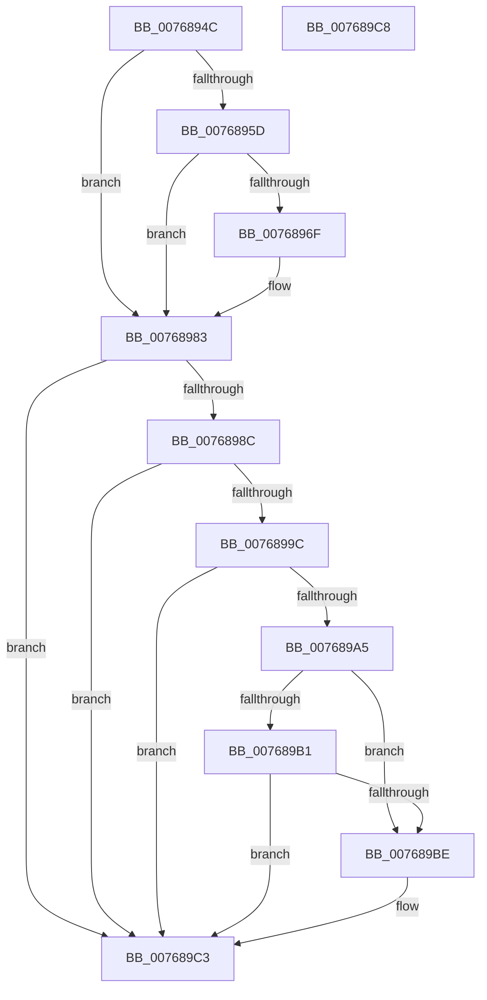

# PopUpdateSmartUserPresencePredictions

- RVA: `0x0076894C`–`0x007689C9` (길이 `125` bytes)
- VA: `0x000000014076894C`
- 실행 섹션: `PAGE`
- PDB 이름 있음: `예`; PDB Function 태그: `아니요`
- unwind 정보 RVA: `0x0005C788`
- 디코드: `31`개 명령, `125/125` bytes 표시
- 미해석 바이트: `0` (있으면 어셈블리에 `.byte`로 보존)

> 이 문서는 커널 이미지의 기계어와 PDB 기호를 분석해 생성했습니다. 4번과 5번은 함수 원형과 자료형을 바이너리 사용 방식에서 추정한 C 해석이며 원본 소스 복구 결과는 아닙니다.

## 1. Dependencies

- 직접 호출 지점: **2**; 고유 호출 대상: **2**
- 직접 호출자로 확인된 함수: **3**
- RIP 상대 이미지 참조: **6**

### Outgoing calls
- `0x007689A8` → [PopIdleCancelAoAcDozeS4Timer](../../text/4B/PopIdleCancelAoAcDozeS4Timer_function_004BC9C4.md) (function, `0x004BC9C4`)
- `0x007689BE` → [PopIdleArmAoAcDozeS4Timer](../../text/4E/PopIdleArmAoAcDozeS4Timer_function_004E03A8.md) (function, `0x004E03A8`)

### Direct callers
- [PopWnfUserAwayPredictionCallback](../75/PopWnfUserAwayPredictionCallback_function_00758640.md) at `0x00758685`
- [PopWnfAudioCallback](../A4/PopWnfAudioCallback_function_00A4A0E0.md) at `0x00A4A213`
- [PopPowerInformationInternal](../A8/PopPowerInformationInternal_function_00A8B7C0.md) at `0x00A8BB63`

### Static image references
- `0x00768955` → RVA `0x00F0CE4D` (`.data`; read)
- `0x00768983` → RVA `0x00F0BC78` (`.data`; read)
- `0x0076898C` → RVA `0x00FC527C` (`ALMOSTRO`; read)
- `0x00768993` → RVA `0x00F0BC78` (`.data`; write)
- `0x0076899C` → RVA `0x00F0BCA0` (`.data`; read)
- `0x007689B1` → RVA `0x00F0CE68` (`.data`; read)

## 2. Other-region calls and transfers

- 다른 실행 섹션으로 향하는 call: **2**
  - `0x007689A8` → [PopIdleCancelAoAcDozeS4Timer](../../text/4B/PopIdleCancelAoAcDozeS4Timer_function_004BC9C4.md) (`PAGE` → `.text`)
  - `0x007689BE` → [PopIdleArmAoAcDozeS4Timer](../../text/4E/PopIdleArmAoAcDozeS4Timer_function_004E03A8.md) (`PAGE` → `.text`)
- 별도 외부 분기/꼬리 이동을 확인하지 못했습니다.

## 3. Assembly (complete function range)

```asm
0076894C  48 83 EC 28                     sub rsp, 0x28
00768950  44 8B C2                        mov r8d, edx
00768953  33 D2                           xor edx, edx
00768955  38 15 F2 44 7A 00               cmp byte ptr [rip + 0x7a44f2], dl
0076895B  75 26                           jne 0x140768983
0076895D  48 B8 14 00 00 00 80 F7 FF FF   movabs rax, 0xfffff78000000014
00768967  48 8B 00                        mov rax, qword ptr [rax]
0076896A  48 3B C8                        cmp rcx, rax
0076896D  72 14                           jb 0x140768983
0076896F  48 2B C1                        sub rax, rcx
00768972  49 B9 00 D0 88 C3 10 00 00 00   movabs r9, 0x10c388d000
0076897C  49 3B C1                        cmp rax, r9
0076897F  48 0F 43 D1                     cmovae rdx, rcx
00768983  48 39 15 EE 32 7A 00            cmp qword ptr [rip + 0x7a32ee], rdx
0076898A  74 37                           je 0x1407689c3
0076898C  83 3D E9 C8 85 00 00            cmp dword ptr [rip + 0x85c8e9], 0
00768993  48 89 15 DE 32 7A 00            mov qword ptr [rip + 0x7a32de], rdx
0076899A  74 27                           je 0x1407689c3
0076899C  80 3D FD 32 7A 00 00            cmp byte ptr [rip + 0x7a32fd], 0
007689A3  74 1E                           je 0x1407689c3
007689A5  41 8B C8                        mov ecx, r8d
007689A8  E8 17 40 D5 FF                  call 0x1404bc9c4
007689AD  84 C0                           test al, al
007689AF  75 0D                           jne 0x1407689be
007689B1  48 8B 05 B0 44 7A 00            mov rax, qword ptr [rip + 0x7a44b0]
007689B8  83 78 58 00                     cmp dword ptr [rax + 0x58], 0
007689BC  75 05                           jne 0x1407689c3
007689BE  E8 E5 79 D7 FF                  call 0x1404e03a8
007689C3  48 83 C4 28                     add rsp, 0x28
007689C7  C3                              ret
007689C8  CC                              int3
```

## 4. C-style interpretation (structured pseudocode)

```c
__int64 __fastcall PopUpdateSmartUserPresencePredictions(__int64 a1, int a2)
{
    __int64 result;
    __int64 v_rsp;

    v_rsp = (v_rsp) - (40);
    a2 = 0;
    if ((*(unsigned __int8 *)(v_rip + 8013042)) != 0) goto loc_00768983;
    result = *(unsigned __int64 *)(result);
    if (a1 >= (*(unsigned __int64 *)(result))) {
        result = (*(unsigned __int64 *)(result)) - (a1);
        if (result >= a4) { a2 = a1; }
    }
    if ((*(unsigned __int64 *)(v_rip + 8008430)) == a2) goto loc_007689C3;
    *(unsigned __int64 *)(v_rip + 8008414) = a2;
    if ((*(unsigned int *)(v_rip + 8767721)) == 0) goto loc_007689C3;
    if ((*(unsigned __int8 *)(v_rip + 8008445)) == 0) goto loc_007689C3;
    result = PopIdleCancelAoAcDozeS4Timer((unsigned int)((unsigned int)((unsigned int)(a2))), a2, (unsigned int)(a2), a4);
    if ((unsigned __int8)(result) != 0) goto loc_007689BE;
    result = *(unsigned __int64 *)(v_rip + 8012976);
    if ((*(unsigned int *)(*(unsigned __int64 *)(v_rip + 8012976) + 88)) == 0) {
        result = PopIdleArmAoAcDozeS4Timer((unsigned int)((unsigned int)((unsigned int)(a2))), a2, (unsigned int)(a2), a4);
    }
    v_rsp = (v_rsp) + (40);
    return result;
}
```

## 5. (Beta) C Style

```c
int64_t PopUpdateSmartUserPresencePredictions(int64_t Arg1, int32_t Arg2)
{
    int64_t result;
    int64_t local_rsp;

    local_rsp = (local_rsp) - (40);
    Arg2 = 0;
    if ((*(uint8_t *)(v_rip + 0x7A44F2)) != 0) goto loc_00768983;
    result = *(uint64_t *)(result);
    if (Arg1 >= (*(uint64_t *)(result))) {
        result = (*(uint64_t *)(result)) - (Arg1);
        if (result >= a4) { Arg2 = Arg1; }
    }
    if ((*(uint64_t *)(v_rip + 0x7A32EE)) == Arg2) goto loc_007689C3;
    *(uint64_t *)(v_rip + 0x7A32DE) = Arg2;
    if ((*(uint32_t *)(v_rip + 0x85C8E9)) == 0) goto loc_007689C3;
    if ((*(uint8_t *)(v_rip + 0x7A32FD)) == 0) goto loc_007689C3;
    result = PopIdleCancelAoAcDozeS4Timer((uint32_t)((uint32_t)((uint32_t)(Arg2))), Arg2, (uint32_t)(Arg2), a4);
    if ((uint8_t)(result) != 0) goto loc_007689BE;
    result = *(uint64_t *)(v_rip + 0x7A44B0);
    if ((*(uint32_t *)(*(uint64_t *)(v_rip + 0x7A44B0) + 0x58)) == 0) {
        result = PopIdleArmAoAcDozeS4Timer((uint32_t)((uint32_t)((uint32_t)(Arg2))), Arg2, (uint32_t)(Arg2), a4);
    }
    local_rsp = (local_rsp) + (40);
    return result;
}
```

## 6. Execution-region graph

[열기: 2D/3D 그래프와 함수 탐색 컨트롤 패널](../../../control-panel.html?section=page&rva=0x0076894C&view=graph)

- 2D 그래프는 위에서 아래로 흐르고, 3D 그래프는 빈 공간을 드래그해 회전합니다. Shift+드래그는 이동, 휠은 확대·축소, 함수 노드 선택은 대상 보고서 이동입니다.

### Static fallback


