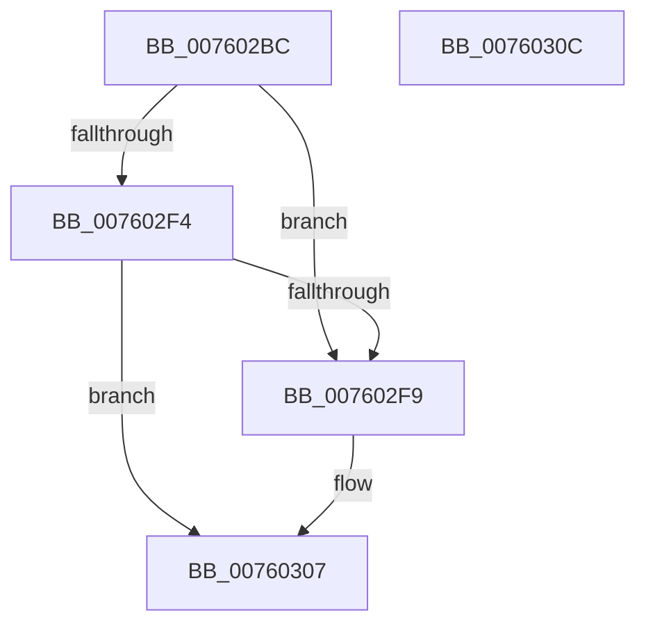

# PopUpdateSmbiosData

- RVA: `0x007602BC`–`0x0076030D` (길이 `81` bytes)
- VA: `0x00000001407602BC`
- 실행 섹션: `PAGE`
- PDB 이름 있음: `예`; PDB Function 태그: `아니요`
- unwind 정보 RVA: `0x0005C788`
- 디코드: `20`개 명령, `81/81` bytes 표시
- 미해석 바이트: `0` (있으면 어셈블리에 `.byte`로 보존)

> 이 문서는 커널 이미지의 기계어와 PDB 기호를 분석해 생성했습니다. 4번과 5번은 함수 원형과 자료형을 바이너리 사용 방식에서 추정한 C 해석이며 원본 소스 복구 결과는 아닙니다.

## 1. Dependencies

- 직접 호출 지점: **1**; 고유 호출 대상: **1**
- 직접 호출자로 확인된 함수: **1**
- RIP 상대 이미지 참조: **6**

### Outgoing calls
- `0x00760302` → [PopTraceSmbiosChange](../../text/5D/PopTraceSmbiosChange_function_005D7D88.md) (function, `0x005D7D88`)

### Direct callers
- [sub_00B80364](../../pagelk/B8/Unknown_function_00B80364.md) at `0x00B8047B`

### Static image references
- `0x007602C0` → RVA `0x00FD8038` (`PAGEDATA`; read)
- `0x007602CD` → RVA `0x00FD805E` (`PAGEDATA`; write)
- `0x007602D3` → RVA `0x00FD80E8` (`PAGEDATA`; read)
- `0x007602DA` → RVA `0x00FD805D` (`PAGEDATA`; write)
- `0x007602E1` → RVA `0x00FD80E8` (`PAGEDATA`; write)
- `0x007602E8` → RVA `0x00FD8038` (`PAGEDATA`; write)

## 2. Other-region calls and transfers

- 다른 실행 섹션으로 향하는 call: **1**
  - `0x00760302` → [PopTraceSmbiosChange](../../text/5D/PopTraceSmbiosChange_function_005D7D88.md) (`PAGE` → `.text`)
- 별도 외부 분기/꼬리 이동을 확인하지 못했습니다.

## 3. Assembly (complete function range)

```asm
007602BC  48 83 EC 28                     sub rsp, 0x28
007602C0  44 8B 15 71 7D 87 00            mov r10d, dword ptr [rip + 0x877d71]
007602C7  49 8B C1                        mov rax, r9
007602CA  44 8A C9                        mov r9b, cl
007602CD  88 15 8B 7D 87 00               mov byte ptr [rip + 0x877d8b], dl
007602D3  48 8B 0D 0E 7E 87 00            mov rcx, qword ptr [rip + 0x877e0e]
007602DA  44 88 0D 7C 7D 87 00            mov byte ptr [rip + 0x877d7c], r9b
007602E1  48 89 05 00 7E 87 00            mov qword ptr [rip + 0x877e00], rax
007602E8  44 89 05 49 7D 87 00            mov dword ptr [rip + 0x877d49], r8d
007602EF  48 3B C1                        cmp rax, rcx
007602F2  75 05                           jne 0x1407602f9
007602F4  45 3B C2                        cmp r8d, r10d
007602F7  74 0E                           je 0x140760307
007602F9  45 8B C8                        mov r9d, r8d
007602FC  41 8B D2                        mov edx, r10d
007602FF  4C 8B C0                        mov r8, rax
00760302  E8 81 7A E7 FF                  call 0x1405d7d88
00760307  48 83 C4 28                     add rsp, 0x28
0076030B  C3                              ret
0076030C  CC                              int3
```

## 4. C-style interpretation (structured pseudocode)

```c
__int64 __fastcall PopUpdateSmbiosData(unsigned __int8 a1, unsigned __int8 a2, int a3, __int64 a4)
{
    __int64 result;
    __int64 v_rsp;

    v_rsp = (v_rsp) - (40);
    *(unsigned __int8 *)(v_rip + 8879499) = a2;
    *(unsigned __int8 *)(v_rip + 8879484) = a1;
    *(unsigned __int64 *)(v_rip + 8879616) = a4;
    *(unsigned int *)(v_rip + 8879433) = a3;
    if (a4 != (*(unsigned __int64 *)(v_rip + 8879630))) goto loc_007602F9;
    result = a4;
    if (a3 != ((unsigned int)((unsigned int)(*(unsigned int *)(v_rip + 8879473))))) {
        a4 = a3;
        a2 = (unsigned int)((unsigned int)(*(unsigned int *)(v_rip + 8879473)));
        a3 = a4;
        result = PopTraceSmbiosChange(*(unsigned __int64 *)(v_rip + 8879630), a2, a3, a4);
    }
    v_rsp = (v_rsp) + (40);
    return result;
}
```

## 5. (Beta) C Style

```c
int64_t PopUpdateSmbiosData(uint8_t Arg1, uint8_t Arg2, int32_t Arg3, int64_t Arg4)
{
    int64_t result;
    int64_t local_rsp;

    local_rsp = (local_rsp) - (40);
    *(uint8_t *)(v_rip + 0x877D8B) = Arg2;
    *(uint8_t *)(v_rip + 0x877D7C) = Arg1;
    *(uint64_t *)(v_rip + 0x877E00) = Arg4;
    *(uint32_t *)(v_rip + 0x877D49) = Arg3;
    if (Arg4 != (*(uint64_t *)(v_rip + 0x877E0E))) goto loc_007602F9;
    result = Arg4;
    if (Arg3 != ((uint32_t)((uint32_t)(*(uint32_t *)(v_rip + 0x877D71))))) {
        Arg4 = Arg3;
        Arg2 = (uint32_t)((uint32_t)(*(uint32_t *)(v_rip + 0x877D71)));
        Arg3 = Arg4;
        result = PopTraceSmbiosChange(*(uint64_t *)(v_rip + 0x877E0E), Arg2, Arg3, Arg4);
    }
    local_rsp = (local_rsp) + (40);
    return result;
}
```

## 6. Execution-region graph

[열기: 2D/3D 그래프와 함수 탐색 컨트롤 패널](../../../control-panel.html?section=page&rva=0x007602BC&view=graph)

- 2D 그래프는 위에서 아래로 흐르고, 3D 그래프는 빈 공간을 드래그해 회전합니다. Shift+드래그는 이동, 휠은 확대·축소, 함수 노드 선택은 대상 보고서 이동입니다.

### Static fallback


