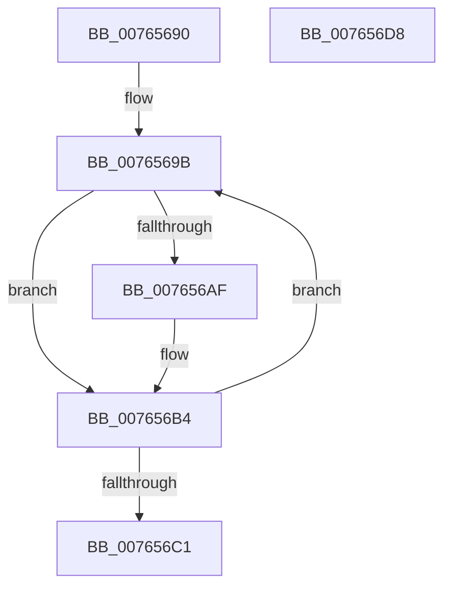

# PopUsb4DisplayPresenceUpdatedWorker

- RVA: `0x00765690`–`0x007656D9` (길이 `73` bytes)
- VA: `0x0000000140765690`
- 실행 섹션: `PAGE`
- PDB 이름 있음: `예`; PDB Function 태그: `아니요`
- unwind 정보 RVA: `0x0005CF00`
- 디코드: `19`개 명령, `73/73` bytes 표시
- 미해석 바이트: `0` (있으면 어셈블리에 `.byte`로 보존)

> 이 문서는 커널 이미지의 기계어와 PDB 기호를 분석해 생성했습니다. 4번과 5번은 함수 원형과 자료형을 바이너리 사용 방식에서 추정한 C 해석이며 원본 소스 복구 결과는 아닙니다.

## 1. Dependencies

- 직접 호출 지점: **7**; 고유 호출 대상: **5**
- 직접 호출자로 확인된 함수: **0**
- RIP 상대 이미지 참조: **2**

### Outgoing calls
- `0x00765696` → [PopAcquirePolicyLock](../../pagelk/B7/PopAcquirePolicyLock_function_00B783C0.md) (function, `0x00B783C0`)
- `0x007656A1` → [PopReleasePolicyLock](../../pagelk/B7/PopReleasePolicyLock_function_00B78410.md) (function, `0x00B78410`)
- `0x007656A6` → [PopIsPlatformAoAcCapable](../../text/49/PopIsPlatformAoAcCapable_function_0049BF40.md) (function, `0x0049BF40`)
- `0x007656AF` → [PopEvaluateInputSuppressionAction](PopEvaluateInputSuppressionAction_function_00765454.md) (function, `0x00765454`)
- `0x007656B4` → [PopAcquirePolicyLock](../../pagelk/B7/PopAcquirePolicyLock_function_00B783C0.md) (function, `0x00B783C0`)
- `0x007656C8` → [PopOkayToQueueNextWorkItem](../../text/4A/PopOkayToQueueNextWorkItem_function_004AED54.md) (function, `0x004AED54`)
- `0x007656CD` → [PopReleasePolicyLock](../../pagelk/B7/PopReleasePolicyLock_function_00B78410.md) (function, `0x00B78410`)

### Direct callers
- 이 함수 시작 RVA로 연결되는 직접 call은 확인되지 않았습니다. 간접 호출은 완전히 역산할 수 없습니다.

### Static image references
- `0x0076569B` → RVA `0x00E67884` (`.data`; read)
- `0x007656C1` → RVA `0x00F09260` (`.data`; read)

## 2. Other-region calls and transfers

- 다른 실행 섹션으로 향하는 call: **6**
  - `0x00765696` → [PopAcquirePolicyLock](../../pagelk/B7/PopAcquirePolicyLock_function_00B783C0.md) (`PAGE` → `PAGELK`)
  - `0x007656A1` → [PopReleasePolicyLock](../../pagelk/B7/PopReleasePolicyLock_function_00B78410.md) (`PAGE` → `PAGELK`)
  - `0x007656A6` → [PopIsPlatformAoAcCapable](../../text/49/PopIsPlatformAoAcCapable_function_0049BF40.md) (`PAGE` → `.text`)
  - `0x007656B4` → [PopAcquirePolicyLock](../../pagelk/B7/PopAcquirePolicyLock_function_00B783C0.md) (`PAGE` → `PAGELK`)
  - `0x007656C8` → [PopOkayToQueueNextWorkItem](../../text/4A/PopOkayToQueueNextWorkItem_function_004AED54.md) (`PAGE` → `.text`)
  - `0x007656CD` → [PopReleasePolicyLock](../../pagelk/B7/PopReleasePolicyLock_function_00B78410.md) (`PAGE` → `PAGELK`)
- 별도 외부 분기/꼬리 이동을 확인하지 못했습니다.

## 3. Assembly (complete function range)

```asm
00765690  40 53                           push rbx
00765692  48 83 EC 20                     sub rsp, 0x20
00765696  E8 25 2D 41 00                  call 0x140b783c0
0076569B  8A 1D E3 21 70 00               mov bl, byte ptr [rip + 0x7021e3]
007656A1  E8 6A 2D 41 00                  call 0x140b78410
007656A6  E8 95 68 D3 FF                  call 0x14049bf40
007656AB  84 C0                           test al, al
007656AD  74 05                           je 0x1407656b4
007656AF  E8 A0 FD FF FF                  call 0x140765454
007656B4  E8 07 2D 41 00                  call 0x140b783c0
007656B9  3A 1D C5 21 70 00               cmp bl, byte ptr [rip + 0x7021c5]
007656BF  75 DA                           jne 0x14076569b
007656C1  48 8D 0D 98 3B 7A 00            lea rcx, [rip + 0x7a3b98]
007656C8  E8 87 96 D4 FF                  call 0x1404aed54
007656CD  E8 3E 2D 41 00                  call 0x140b78410
007656D2  48 83 C4 20                     add rsp, 0x20
007656D6  5B                              pop rbx
007656D7  C3                              ret
007656D8  CC                              int3
```

## 4. C-style interpretation (structured pseudocode)

```c
__int64 __fastcall PopUsb4DisplayPresenceUpdatedWorker(void)
{
    __int64 result;
    __int64 v_rsp;

    v_rsp = (v_rsp) - (32);
    result = PopAcquirePolicyLock(a1, a2, a3, a4);
loc_0076569B:
    result = PopReleasePolicyLock(a1, a2, a3, a4);
    result = PopIsPlatformAoAcCapable(a1, a2, a3, a4);
    if ((unsigned __int8)(result) != 0) {
        result = PopEvaluateInputSuppressionAction(a1, a2, a3, a4);
    }
    result = PopAcquirePolicyLock(a1, a2, a3, a4);
    if (((unsigned __int8)(*(unsigned __int8 *)(v_rip + 7348707))) != (*(unsigned __int8 *)(v_rip + 7348677))) goto loc_0076569B;
    result = PopOkayToQueueNextWorkItem(v_rip + 8010648, a2, a3, a4);
    result = PopReleasePolicyLock(v_rip + 8010648, a2, a3, a4);
    v_rsp = (v_rsp) + (32);
    return result;
}
```

## 5. (Beta) C Style

```c
void PopUsb4DisplayPresenceUpdatedWorker(void)
{
    int64_t result;
    int64_t local_rsp;

    local_rsp = (local_rsp) - (32);
    result = PopAcquirePolicyLock(a1, a2, a3, a4);
loc_0076569B:
    result = PopReleasePolicyLock(a1, a2, a3, a4);
    result = PopIsPlatformAoAcCapable(a1, a2, a3, a4);
    if ((uint8_t)(result) != 0) {
        result = PopEvaluateInputSuppressionAction(a1, a2, a3, a4);
    }
    result = PopAcquirePolicyLock(a1, a2, a3, a4);
    if (((uint8_t)(*(uint8_t *)(v_rip + 0x7021E3))) != (*(uint8_t *)(v_rip + 0x7021C5))) goto loc_0076569B;
    result = PopOkayToQueueNextWorkItem(v_rip + 8010648, a2, a3, a4);
    result = PopReleasePolicyLock(v_rip + 8010648, a2, a3, a4);
    local_rsp = (local_rsp) + (32);
    return result;
}
```

## 6. Execution-region graph

[열기: 2D/3D 그래프와 함수 탐색 컨트롤 패널](../../../control-panel.html?section=page&rva=0x00765690&view=graph)

- 2D 그래프는 위에서 아래로 흐르고, 3D 그래프는 빈 공간을 드래그해 회전합니다. Shift+드래그는 이동, 휠은 확대·축소, 함수 노드 선택은 대상 보고서 이동입니다.

### Static fallback


