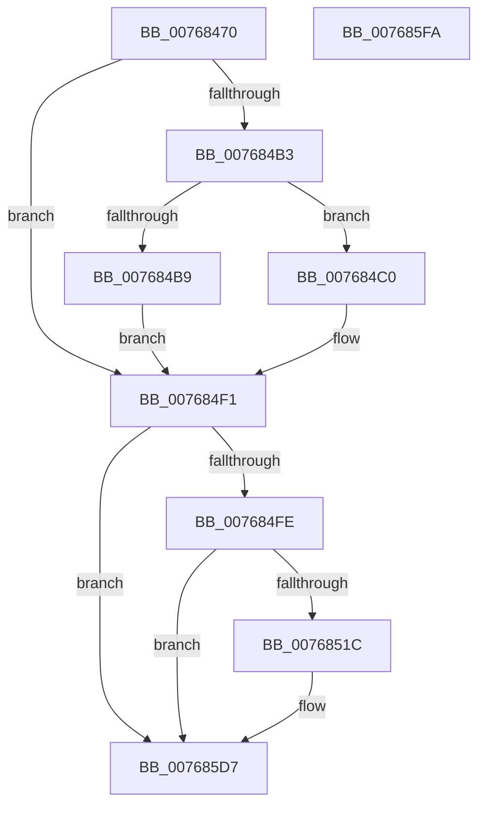

# PopUsbErrorWNFNotificationCallback

- RVA: `0x00768470`–`0x007685FB` (길이 `395` bytes)
- VA: `0x0000000140768470`
- 실행 섹션: `PAGE`
- PDB 이름 있음: `예`; PDB Function 태그: `아니요`
- unwind 정보 RVA: `0x000CCEF0`
- 디코드: `92`개 명령, `395/395` bytes 표시
- 미해석 바이트: `0` (있으면 어셈블리에 `.byte`로 보존)

> 이 문서는 커널 이미지의 기계어와 PDB 기호를 분석해 생성했습니다. 4번과 5번은 함수 원형과 자료형을 바이너리 사용 방식에서 추정한 C 해석이며 원본 소스 복구 결과는 아닙니다.

## 1. Dependencies

- 직접 호출 지점: **7**; 고유 호출 대상: **7**
- 직접 호출자로 확인된 함수: **0**
- RIP 상대 이미지 참조: **9**

### Outgoing calls
- `0x007684A8` → [ExQueryWnfStateData](../A4/ExQueryWnfStateData_function_00A4A480.md) (function, `0x00A4A480`)
- `0x007684D0` → [PopAcquireRwLockExclusive](../../text/43/PopAcquireRwLockExclusive_function_00430B44.md) (function, `0x00430B44`)
- `0x007684E0` → [PopBatteryQueueWork](../../text/4A/PopBatteryQueueWork_function_004AE3DC.md) (function, `0x004AE3DC`)
- `0x007684EC` → [PopReleaseRwLock](../../text/2D/PopReleaseRwLock_function_002DFBBC.md) (function, `0x002DFBBC`)
- `0x0076850F` → [tlgKeywordOn](../../text/42/tlgKeywordOn_function_0042EAA0.md) (function, `0x0042EAA0`)
- `0x007685D2` → [tlgWriteTransfer_EtwWriteTransfer](../../text/42/tlgWriteTransfer_EtwWriteTransfer_function_004260E0.md) (function, `0x004260E0`)
- `0x007685E0` → [_security_check_cookie](../../text/6A/_security_check_cookie_function_006AC640.md) (function, `0x006AC640`)

### Direct callers
- 이 함수 시작 RVA로 연결되는 직접 call은 확인되지 않았습니다. 간접 호출은 완전히 역산할 수 없습니다.

### Static image references
- `0x00768487` → RVA `0x00E0A740` (`.data`; read)
- `0x007684C2` → RVA `0x00F09010` (`.data`; read)
- `0x007684DA` → RVA `0x00F09044` (`.data`; write)
- `0x007684F1` → RVA `0x00E07748` (`.data`; read)
- `0x0076854A` → RVA `0x00F09048` (`.data`; read)
- `0x0076855B` → RVA `0x00F09040` (`.data`; read)
- `0x0076856C` → RVA `0x00F09044` (`.data`; read)
- `0x0076857D` → RVA `0x00F09000` (`.data`; read)
- `0x007685B9` → RVA `0x0004D4DC` (`.rdata`; read)

## 2. Other-region calls and transfers

- 다른 실행 섹션으로 향하는 call: **6**
  - `0x007684D0` → [PopAcquireRwLockExclusive](../../text/43/PopAcquireRwLockExclusive_function_00430B44.md) (`PAGE` → `.text`)
  - `0x007684E0` → [PopBatteryQueueWork](../../text/4A/PopBatteryQueueWork_function_004AE3DC.md) (`PAGE` → `.text`)
  - `0x007684EC` → [PopReleaseRwLock](../../text/2D/PopReleaseRwLock_function_002DFBBC.md) (`PAGE` → `.text`)
  - `0x0076850F` → [tlgKeywordOn](../../text/42/tlgKeywordOn_function_0042EAA0.md) (`PAGE` → `.text`)
  - `0x007685D2` → [tlgWriteTransfer_EtwWriteTransfer](../../text/42/tlgWriteTransfer_EtwWriteTransfer_function_004260E0.md) (`PAGE` → `.text`)
  - `0x007685E0` → [_security_check_cookie](../../text/6A/_security_check_cookie_function_006AC640.md) (`PAGE` → `.text`)
- 별도 외부 분기/꼬리 이동을 확인하지 못했습니다.

## 3. Assembly (complete function range)

```asm
00768470  48 89 5C 24 10                  mov qword ptr [rsp + 0x10], rbx
00768475  48 89 7C 24 18                  mov qword ptr [rsp + 0x18], rdi
0076847A  55                              push rbp
0076847B  48 8D 6C 24 B9                  lea rbp, [rsp - 0x47]
00768480  48 81 EC F0 00 00 00            sub rsp, 0xf0
00768487  48 8B 05 B2 22 6A 00            mov rax, qword ptr [rip + 0x6a22b2]
0076848E  48 33 C4                        xor rax, rsp
00768491  48 89 45 37                     mov qword ptr [rbp + 0x37], rax
00768495  4C 8D 4D 8B                     lea r9, [rbp - 0x75]
00768499  C7 45 8B 0C 00 00 00            mov dword ptr [rbp - 0x75], 0xc
007684A0  4C 8D 45 27                     lea r8, [rbp + 0x27]
007684A4  48 8D 55 8F                     lea rdx, [rbp - 0x71]
007684A8  E8 D3 1F 2E 00                  call 0x140a4a480
007684AD  8B F8                           mov edi, eax
007684AF  85 C0                           test eax, eax
007684B1  78 3E                           js 0x1407684f1
007684B3  83 7D 8B 0C                     cmp dword ptr [rbp - 0x75], 0xc
007684B7  74 07                           je 0x1407684c0
007684B9  BF 80 00 00 00                  mov edi, 0x80
007684BE  EB 31                           jmp 0x1407684f1
007684C0  33 DB                           xor ebx, ebx
007684C2  48 8D 0D 47 0B 7A 00            lea rcx, [rip + 0x7a0b47]
007684C9  83 7D 2F 01                     cmp dword ptr [rbp + 0x2f], 1
007684CD  0F 94 C3                        sete bl
007684D0  E8 6F 86 CC FF                  call 0x140430b44
007684D5  B9 40 00 00 00                  mov ecx, 0x40
007684DA  89 1D 64 0B 7A 00               mov dword ptr [rip + 0x7a0b64], ebx
007684E0  E8 F7 5E D4 FF                  call 0x1404ae3dc
007684E5  48 8D 0D 24 0B 7A 00            lea rcx, [rip + 0x7a0b24]
007684EC  E8 CB 76 B7 FF                  call 0x1402dfbbc
007684F1  83 3D 50 F2 69 00 05            cmp dword ptr [rip + 0x69f250], 5
007684F8  0F 86 D9 00 00 00               jbe 0x1407685d7
007684FE  48 BA 00 00 00 00 00 40 00 00   movabs rdx, 0x400000000000
00768508  48 8D 0D 39 F2 69 00            lea rcx, [rip + 0x69f239]
0076850F  E8 8C 65 CC FF                  call 0x14042eaa0
00768514  84 C0                           test al, al
00768516  0F 84 BB 00 00 00               je 0x1407685d7
0076851C  83 65 D3 00                     and dword ptr [rbp - 0x2d], 0
00768520  48 8D 45 8B                     lea rax, [rbp - 0x75]
00768524  83 65 E3 00                     and dword ptr [rbp - 0x1d], 0
00768528  B9 04 00 00 00                  mov ecx, 4
0076852D  83 65 F3 00                     and dword ptr [rbp - 0xd], 0
00768531  45 33 C9                        xor r9d, r9d
00768534  83 65 03 00                     and dword ptr [rbp + 3], 0
00768538  45 33 C0                        xor r8d, r8d
0076853B  83 65 13 00                     and dword ptr [rbp + 0x13], 0
0076853F  83 65 23 00                     and dword ptr [rbp + 0x23], 0
00768543  8D 51 04                        lea edx, [rcx + 4]
00768546  48 89 45 C7                     mov qword ptr [rbp - 0x39], rax
0076854A  8B 05 F8 0A 7A 00               mov eax, dword ptr [rip + 0x7a0af8]
00768550  89 45 97                        mov dword ptr [rbp - 0x69], eax
00768553  48 8D 45 97                     lea rax, [rbp - 0x69]
00768557  48 89 45 D7                     mov qword ptr [rbp - 0x29], rax
0076855B  8B 05 DF 0A 7A 00               mov eax, dword ptr [rip + 0x7a0adf]
00768561  89 45 9B                        mov dword ptr [rbp - 0x65], eax
00768564  48 8D 45 9B                     lea rax, [rbp - 0x65]
00768568  48 89 45 E7                     mov qword ptr [rbp - 0x19], rax
0076856C  8B 05 D2 0A 7A 00               mov eax, dword ptr [rip + 0x7a0ad2]
00768572  89 45 8F                        mov dword ptr [rbp - 0x71], eax
00768575  48 8D 45 8F                     lea rax, [rbp - 0x71]
00768579  48 89 45 F7                     mov qword ptr [rbp - 9], rax
0076857D  8A 05 7D 0A 7A 00               mov al, byte ptr [rip + 0x7a0a7d]
00768583  88 45 87                        mov byte ptr [rbp - 0x79], al
00768586  48 8D 45 87                     lea rax, [rbp - 0x79]
0076858A  48 89 45 07                     mov qword ptr [rbp + 7], rax
0076858E  48 8D 45 27                     lea rax, [rbp + 0x27]
00768592  48 89 45 17                     mov qword ptr [rbp + 0x17], rax
00768596  48 8D 45 A7                     lea rax, [rbp - 0x59]
0076859A  48 89 44 24 28                  mov qword ptr [rsp + 0x28], rax
0076859F  89 54 24 20                     mov dword ptr [rsp + 0x20], edx
007685A3  89 4D CF                        mov dword ptr [rbp - 0x31], ecx
007685A6  89 4D DF                        mov dword ptr [rbp - 0x21], ecx
007685A9  89 4D EF                        mov dword ptr [rbp - 0x11], ecx
007685AC  89 4D FF                        mov dword ptr [rbp - 1], ecx
007685AF  48 8D 0D 92 F1 69 00            lea rcx, [rip + 0x69f192]
007685B6  89 55 1F                        mov dword ptr [rbp + 0x1f], edx
007685B9  48 8D 15 1C 4F 8E FF            lea rdx, [rip - 0x71b0e4]
007685C0  89 7D 8B                        mov dword ptr [rbp - 0x75], edi
007685C3  C7 45 0F 01 00 00 00            mov dword ptr [rbp + 0xf], 1
007685CA  48 C7 45 27 00 00 00 01         mov qword ptr [rbp + 0x27], 0x1000000
007685D2  E8 09 DB CB FF                  call 0x1404260e0
007685D7  8B C7                           mov eax, edi
007685D9  48 8B 4D 37                     mov rcx, qword ptr [rbp + 0x37]
007685DD  48 33 CC                        xor rcx, rsp
007685E0  E8 5B 40 F4 FF                  call 0x1406ac640
007685E5  4C 8D 9C 24 F0 00 00 00         lea r11, [rsp + 0xf0]
007685ED  49 8B 5B 18                     mov rbx, qword ptr [r11 + 0x18]
007685F1  49 8B 7B 20                     mov rdi, qword ptr [r11 + 0x20]
007685F5  49 8B E3                        mov rsp, r11
007685F8  5D                              pop rbp
007685F9  C3                              ret
007685FA  CC                              int3
```

## 4. C-style interpretation (structured pseudocode)

```c
__int64 __fastcall PopUsbErrorWNFNotificationCallback(void)
{
    __int64 result;
    __int64 v_rbx;
    __int64 v_rsp;
    unsigned __int64 v_stack_m18;
    unsigned int v_stack_m20;
    unsigned __int64 v_stack_m28;
    unsigned int v_stack_m2C;
    unsigned int v_stack_m30;
    unsigned __int64 v_stack_m38;
    unsigned int v_stack_m3C;
    unsigned int v_stack_m40;
    unsigned __int64 v_stack_m48;
    unsigned int v_stack_m4C;
    unsigned __int64 v_stack_m4F;
    unsigned int v_stack_m50;
    unsigned __int64 v_stack_m58;
    unsigned int v_stack_m5C;
    unsigned int v_stack_m60;
    unsigned __int64 v_stack_m68;
    unsigned int v_stack_m6C;
    unsigned int v_stack_m70;
    unsigned __int64 v_stack_m78;
    unsigned int v_stack_m7C;
    unsigned __int64 v_stack_m8;
    unsigned int v_stack_m80;
    unsigned __int64 v_stack_m88;
    unsigned __int64 v_stack_mA8;
    unsigned int v_stack_mB4;
    unsigned int v_stack_mB8;
    unsigned __int64 v_stack_mC0;
    unsigned __int64 v_stack_mC4;
    unsigned __int8 v_stack_mC8;
    unsigned __int64 v_stack_mD0;
    unsigned int v_stack_mD8;
    unsigned __int64 v_stack_p10;
    unsigned __int64 v_stack_p18;

    v_stack_p10 = v_rbx;
    v_stack_p18 = v_rdi;
    v_rsp = (v_rsp) - (240);
    result = (*(unsigned __int64 *)(v_rip + 6955698)) ^ (v_rsp);
    v_stack_m18 = result;
    v_stack_mC4 = 12;
    result = ExQueryWnfStateData(a1, v_stack_mC0, v_stack_m28, v_stack_mC4);
    if (sign_flag) goto loc_007684F1;
    if (v_stack_mC4 == 12) goto loc_007684C0;
    goto loc_007684F1;
loc_007684C0:
    v_rbx = 0;
    v_rbx = (v_stack_m20 == 1) ? 1 : 0;
    result = PopAcquireRwLockExclusive(v_rip + 7998279, v_stack_mC0, v_stack_m28, v_stack_mC4);
    *(unsigned int *)(v_rip + 7998308) = (unsigned int)(v_rbx);
    result = PopBatteryQueueWork(64, v_stack_mC0, v_stack_m28, v_stack_mC4);
    result = PopReleaseRwLock(v_rip + 7998244, v_stack_mC0, v_stack_m28, v_stack_mC4);
loc_007684F1:
    if ((*(unsigned int *)(v_rip + 6943312)) <= 5) goto loc_007685D7;
    result = tlgKeywordOn(v_rip + 6943289, v_stack_mC0, v_stack_m28, v_stack_mC4);
    if ((unsigned __int8)(result) != 0) {
        result = v_stack_mC4;
        a1 = 4;
        a4 = 0;
        a3 = 0;
        a2 = a1 + 4;
        v_stack_m88 = result;
        result = *(unsigned int *)(v_rip + 7998200);
        v_stack_mB8 = (unsigned int)(result);
        result = v_stack_mB8;
        v_stack_m78 = result;
        result = *(unsigned int *)(v_rip + 7998175);
        v_stack_mB4 = (unsigned int)(result);
        result = v_stack_mB4;
        v_stack_m68 = result;
        result = *(unsigned int *)(v_rip + 7998162);
        v_stack_mC0 = (unsigned int)(result);
        result = v_stack_mC0;
        v_stack_m58 = result;
        result = *(unsigned __int8 *)(v_rip + 7998077);
        v_stack_mC8 = (unsigned __int8)(result);
        result = v_stack_mC8;
        v_stack_m48 = result;
        result = v_stack_m28;
        v_stack_m38 = result;
        result = v_stack_mA8;
        v_stack_mD0 = result;
        v_stack_mD8 = (unsigned int)(a2);
        v_stack_m80 = (unsigned int)(a1);
        v_stack_m70 = (unsigned int)(a1);
        v_stack_m60 = (unsigned int)(a1);
        v_stack_m50 = (unsigned int)(a1);
        a1 = v_rip + 6943122;
        v_stack_m30 = (unsigned int)(a2);
        a2 = v_rip - 7450852;
        v_stack_mC4 = 128;
        v_stack_m40 = 1;
        v_stack_m28 = 0x1000000ULL;
        result = tlgWriteTransfer_EtwWriteTransfer(a1, a2, a3, a4);
    }
    a1 = (v_stack_m18) ^ (v_rsp);
    result = _security_check_cookie(a1, a2, a3, a4);
    return result;
}
```

## 5. (Beta) C Style

```c
void PopUsbErrorWNFNotificationCallback(void)
{
    int64_t result;
    int64_t local_rbx;
    int64_t local_rsp;
    uint64_t v_stack_m18;
    uint32_t v_stack_m20;
    uint64_t v_stack_m28;
    uint32_t v_stack_m2C;
    uint32_t v_stack_m30;
    uint64_t v_stack_m38;
    uint32_t v_stack_m3C;
    uint32_t v_stack_m40;
    uint64_t v_stack_m48;
    uint32_t v_stack_m4C;
    uint64_t v_stack_m4F;
    uint32_t v_stack_m50;
    uint64_t v_stack_m58;
    uint32_t v_stack_m5C;
    uint32_t v_stack_m60;
    uint64_t v_stack_m68;
    uint32_t v_stack_m6C;
    uint32_t v_stack_m70;
    uint64_t v_stack_m78;
    uint32_t v_stack_m7C;
    uint64_t v_stack_m8;
    uint32_t v_stack_m80;
    uint64_t v_stack_m88;
    uint64_t v_stack_mA8;
    uint32_t v_stack_mB4;
    uint32_t v_stack_mB8;
    uint64_t v_stack_mC0;
    uint64_t v_stack_mC4;
    uint8_t v_stack_mC8;
    uint64_t v_stack_mD0;
    uint32_t v_stack_mD8;
    uint64_t v_stack_p10;
    uint64_t v_stack_p18;

    v_stack_p10 = local_rbx;
    v_stack_p18 = local_rdi;
    local_rsp = (local_rsp) - (240);
    result = (*(uint64_t *)(v_rip + 0x6A22B2)) ^ (local_rsp);
    v_stack_m18 = result;
    v_stack_mC4 = 12;
    result = ExQueryWnfStateData(a1, v_stack_mC0, v_stack_m28, v_stack_mC4);
    if (sign_flag) goto loc_007684F1;
    if (v_stack_mC4 == 12) goto loc_007684C0;
    goto loc_007684F1;
loc_007684C0:
    local_rbx = 0;
    local_rbx = (v_stack_m20 == 1) ? 1 : 0;
    result = PopAcquireRwLockExclusive(v_rip + 7998279, v_stack_mC0, v_stack_m28, v_stack_mC4);
    *(uint32_t *)(v_rip + 0x7A0B64) = (uint32_t)(local_rbx);
    result = PopBatteryQueueWork(64, v_stack_mC0, v_stack_m28, v_stack_mC4);
    result = PopReleaseRwLock(v_rip + 7998244, v_stack_mC0, v_stack_m28, v_stack_mC4);
loc_007684F1:
    if ((*(uint32_t *)(v_rip + 0x69F250)) <= 5) goto loc_007685D7;
    result = tlgKeywordOn(v_rip + 6943289, v_stack_mC0, v_stack_m28, v_stack_mC4);
    if ((uint8_t)(result) != 0) {
        result = v_stack_mC4;
        a1 = 4;
        a4 = 0;
        a3 = 0;
        a2 = a1 + 4;
        v_stack_m88 = result;
        result = *(uint32_t *)(v_rip + 0x7A0AF8);
        v_stack_mB8 = (uint32_t)(result);
        result = v_stack_mB8;
        v_stack_m78 = result;
        result = *(uint32_t *)(v_rip + 0x7A0ADF);
        v_stack_mB4 = (uint32_t)(result);
        result = v_stack_mB4;
        v_stack_m68 = result;
        result = *(uint32_t *)(v_rip + 0x7A0AD2);
        v_stack_mC0 = (uint32_t)(result);
        result = v_stack_mC0;
        v_stack_m58 = result;
        result = *(uint8_t *)(v_rip + 0x7A0A7D);
        v_stack_mC8 = (uint8_t)(result);
        result = v_stack_mC8;
        v_stack_m48 = result;
        result = v_stack_m28;
        v_stack_m38 = result;
        result = v_stack_mA8;
        v_stack_mD0 = result;
        v_stack_mD8 = (uint32_t)(a2);
        v_stack_m80 = (uint32_t)(a1);
        v_stack_m70 = (uint32_t)(a1);
        v_stack_m60 = (uint32_t)(a1);
        v_stack_m50 = (uint32_t)(a1);
        a1 = v_rip + 6943122;
        v_stack_m30 = (uint32_t)(a2);
        a2 = v_rip - 7450852;
        v_stack_mC4 = 128;
        v_stack_m40 = 1;
        v_stack_m28 = 0x1000000ULL;
        result = tlgWriteTransfer_EtwWriteTransfer(a1, a2, a3, a4);
    }
    a1 = (v_stack_m18) ^ (local_rsp);
    result = _security_check_cookie(a1, a2, a3, a4);
    return result;
}
```

## 6. Execution-region graph

[열기: 2D/3D 그래프와 함수 탐색 컨트롤 패널](../../../control-panel.html?section=page&rva=0x00768470&view=graph)

- 2D 그래프는 위에서 아래로 흐르고, 3D 그래프는 빈 공간을 드래그해 회전합니다. Shift+드래그는 이동, 휠은 확대·축소, 함수 노드 선택은 대상 보고서 이동입니다.

### Static fallback


