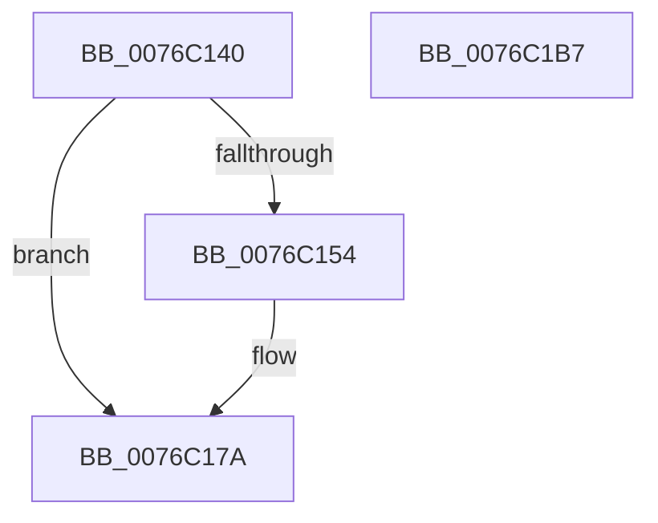

# PopWin32CalloutWatchdogCallback

- RVA: `0x0076C140`–`0x0076C1B8` (길이 `120` bytes)
- VA: `0x000000014076C140`
- 실행 섹션: `PAGE`
- PDB 이름 있음: `예`; PDB Function 태그: `아니요`
- unwind 정보 RVA: `0x0006C2A4`
- 디코드: `26`개 명령, `120/120` bytes 표시
- 미해석 바이트: `0` (있으면 어셈블리에 `.byte`로 보존)

> 이 문서는 커널 이미지의 기계어와 PDB 기호를 분석해 생성했습니다. 4번과 5번은 함수 원형과 자료형을 바이너리 사용 방식에서 추정한 C 해석이며 원본 소스 복구 결과는 아닙니다.

## 1. Dependencies

- 직접 호출 지점: **2**; 고유 호출 대상: **2**
- 직접 호출자로 확인된 함수: **0**
- RIP 상대 이미지 참조: **2**

### Outgoing calls
- `0x0076C174` → [KeBugCheckEx](../../text/4F/KeBugCheckEx_function_004FD660.md) (function, `0x004FD660`)
- `0x0076C1AD` → [DbgkWerCaptureLiveKernelDump](../AC/DbgkWerCaptureLiveKernelDump_function_00AC1E90.md) (function, `0x00AC1E90`)

### Direct callers
- 이 함수 시작 RVA로 연결되는 직접 call은 확인되지 않았습니다. 간접 호출은 완전히 역산할 수 없습니다.

### Static image references
- `0x0076C149` → RVA `0x00FC6F9C` (`ALMOSTRO`; read)
- `0x0076C182` → RVA `0x00B032C0` (` ?? ::NNGAKEGL::`string'`; read)

## 2. Other-region calls and transfers

- 다른 실행 섹션으로 향하는 call: **1**
  - `0x0076C174` → [KeBugCheckEx](../../text/4F/KeBugCheckEx_function_004FD660.md) (`PAGE` → `.text`)
- 별도 외부 분기/꼬리 이동을 확인하지 못했습니다.

## 3. Assembly (complete function range)

```asm
0076C140  48 83 EC 58                     sub rsp, 0x58
0076C144  33 C0                           xor eax, eax
0076C146  4D 8B D1                        mov r10, r9
0076C149  39 05 4D AE 85 00               cmp dword ptr [rip + 0x85ae4d], eax
0076C14F  4D 8B D8                        mov r11, r8
0076C152  74 26                           je 0x14076c17a
0076C154  48 8B 84 24 88 00 00 00         mov rax, qword ptr [rsp + 0x88]
0076C15C  4D 8B C2                        mov r8, r10
0076C15F  4C 8B 8C 24 80 00 00 00         mov r9, qword ptr [rsp + 0x80]
0076C167  49 8B D3                        mov rdx, r11
0076C16A  B9 A2 01 00 00                  mov ecx, 0x1a2
0076C16F  48 89 44 24 20                  mov qword ptr [rsp + 0x20], rax
0076C174  E8 E7 14 D9 FF                  call 0x1404fd660
0076C179  CC                              int3
0076C17A  C7 44 24 40 01 00 00 00         mov dword ptr [rsp + 0x40], 1
0076C182  48 8D 0D 37 71 39 00            lea rcx, [rip + 0x397137]
0076C189  48 89 44 24 38                  mov qword ptr [rsp + 0x38], rax
0076C18E  48 89 44 24 30                  mov qword ptr [rsp + 0x30], rax
0076C193  48 8B 84 24 88 00 00 00         mov rax, qword ptr [rsp + 0x88]
0076C19B  48 89 44 24 28                  mov qword ptr [rsp + 0x28], rax
0076C1A0  48 8B 84 24 80 00 00 00         mov rax, qword ptr [rsp + 0x80]
0076C1A8  48 89 44 24 20                  mov qword ptr [rsp + 0x20], rax
0076C1AD  E8 DE 5C 35 00                  call 0x140ac1e90
0076C1B2  48 83 C4 58                     add rsp, 0x58
0076C1B6  C3                              ret
0076C1B7  CC                              int3
```

## 4. C-style interpretation (structured pseudocode)

```c
__int64 __fastcall PopWin32CalloutWatchdogCallback(__int64 a1, __int64 a2, __int64 a3, __int64 a4, __int64 a5, __int64 a6)
{
    __int64 result;
    __int64 v_rsp;
    unsigned int v_stack_m18;
    unsigned __int64 v_stack_m20;
    unsigned __int64 v_stack_m28;
    unsigned __int64 v_stack_m30;
    unsigned __int64 v_stack_m38;

    v_rsp = (v_rsp) - (88);
    result = 0;
    if ((*(unsigned int *)(v_rip + 8760909)) != 0) {
        result = a6;
        a3 = a4;
        a4 = a5;
        a2 = a3;
        a1 = 418;
        v_stack_m38 = result;
        result = KeBugCheckEx(a1, a2, a3, a4);
    }
    v_stack_m18 = 1;
    v_stack_m20 = result;
    v_stack_m28 = result;
    v_stack_m30 = a6;
    v_stack_m38 = a5;
    result = DbgkWerCaptureLiveKernelDump(v_rip + 3764535, a2, a3, a4);
    v_rsp = (v_rsp) + (88);
    return result;
}
```

## 5. (Beta) C Style

```c
int64_t PopWin32CalloutWatchdogCallback(int64_t Arg1, int64_t Arg2, int64_t Arg3, int64_t Arg4, int64_t Arg5, int64_t Arg6)
{
    int64_t result;
    int64_t local_rsp;
    uint32_t v_stack_m18;
    uint64_t v_stack_m20;
    uint64_t v_stack_m28;
    uint64_t v_stack_m30;
    uint64_t v_stack_m38;

    local_rsp = (local_rsp) - (88);
    result = 0;
    if ((*(uint32_t *)(v_rip + 0x85AE4D)) != 0) {
        result = Arg6;
        Arg3 = Arg4;
        Arg4 = Arg5;
        Arg2 = Arg3;
        Arg1 = 418;
        v_stack_m38 = result;
        result = KeBugCheckEx(Arg1, Arg2, Arg3, Arg4);
    }
    v_stack_m18 = 1;
    v_stack_m20 = result;
    v_stack_m28 = result;
    v_stack_m30 = Arg6;
    v_stack_m38 = Arg5;
    result = DbgkWerCaptureLiveKernelDump(v_rip + 3764535, Arg2, Arg3, Arg4);
    local_rsp = (local_rsp) + (88);
    return result;
}
```

## 6. Execution-region graph

[열기: 2D/3D 그래프와 함수 탐색 컨트롤 패널](../../../control-panel.html?section=page&rva=0x0076C140&view=graph)

- 2D 그래프는 위에서 아래로 흐르고, 3D 그래프는 빈 공간을 드래그해 회전합니다. Shift+드래그는 이동, 휠은 확대·축소, 함수 노드 선택은 대상 보고서 이동입니다.

### Static fallback


