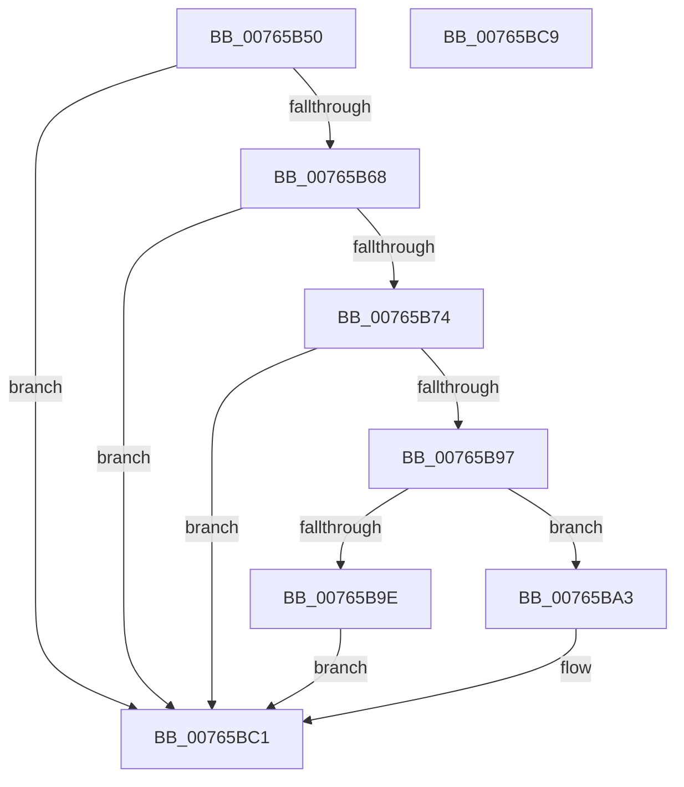

# PopWnfInSupCallback

- RVA: `0x00765B50`–`0x00765BCA` (길이 `122` bytes)
- VA: `0x0000000140765B50`
- 실행 섹션: `PAGE`
- PDB 이름 있음: `예`; PDB Function 태그: `아니요`
- unwind 정보 RVA: `0x0005D2F4`
- 디코드: `31`개 명령, `122/122` bytes 표시
- 미해석 바이트: `0` (있으면 어셈블리에 `.byte`로 보존)

> 이 문서는 커널 이미지의 기계어와 PDB 기호를 분석해 생성했습니다. 4번과 5번은 함수 원형과 자료형을 바이너리 사용 방식에서 추정한 C 해석이며 원본 소스 복구 결과는 아닙니다.

## 1. Dependencies

- 직접 호출 지점: **4**; 고유 호출 대상: **4**
- 직접 호출자로 확인된 함수: **0**
- RIP 상대 이미지 참조: **3**

### Outgoing calls
- `0x00765B5F` → [PopIsPlatformAoAcCapable](../../text/49/PopIsPlatformAoAcCapable_function_0049BF40.md) (function, `0x0049BF40`)
- `0x00765B8B` → [ExQueryWnfStateData](../A4/ExQueryWnfStateData_function_00A4A480.md) (function, `0x00A4A480`)
- `0x00765BAA` → [PopAcquireRwLockExclusive](../../text/43/PopAcquireRwLockExclusive_function_00430B44.md) (function, `0x00430B44`)
- `0x00765BB9` → [PopEvaluatePowerButtonSuppressionState](PopEvaluatePowerButtonSuppressionState_function_00765954.md) (function, `0x00765954`)

### Direct callers
- 이 함수 시작 RVA로 연결되는 직접 call은 확인되지 않았습니다. 간접 호출은 완전히 역산할 수 없습니다.

### Static image references
- `0x00765B6B` → RVA `0x000208C8` (`.rdata`; read)
- `0x00765BA3` → RVA `0x00F09230` (`.data`; read)
- `0x00765BB3` → RVA `0x00F09218` (`.data`; write)

## 2. Other-region calls and transfers

- 다른 실행 섹션으로 향하는 call: **2**
  - `0x00765B5F` → [PopIsPlatformAoAcCapable](../../text/49/PopIsPlatformAoAcCapable_function_0049BF40.md) (`PAGE` → `.text`)
  - `0x00765BAA` → [PopAcquireRwLockExclusive](../../text/43/PopAcquireRwLockExclusive_function_00430B44.md) (`PAGE` → `.text`)
- 별도 외부 분기/꼬리 이동을 확인하지 못했습니다.

## 3. Assembly (complete function range)

```asm
00765B50  48 83 EC 38                     sub rsp, 0x38
00765B54  83 64 24 24 00                  and dword ptr [rsp + 0x24], 0
00765B59  41 B8 0D 00 00 C0               mov r8d, 0xc000000d
00765B5F  E8 DC 63 D3 FF                  call 0x14049bf40
00765B64  84 C0                           test al, al
00765B66  74 59                           je 0x140765bc1
00765B68  48 8B 02                        mov rax, qword ptr [rdx]
00765B6B  48 3B 05 56 AD 8B FF            cmp rax, qword ptr [rip - 0x7452aa]
00765B72  75 4D                           jne 0x140765bc1
00765B74  4C 8D 4C 24 20                  lea r9, [rsp + 0x20]
00765B79  C7 44 24 20 04 00 00 00         mov dword ptr [rsp + 0x20], 4
00765B81  4C 8D 44 24 24                  lea r8, [rsp + 0x24]
00765B86  48 8D 54 24 58                  lea rdx, [rsp + 0x58]
00765B8B  E8 F0 48 2E 00                  call 0x140a4a480
00765B90  44 8B C0                        mov r8d, eax
00765B93  85 C0                           test eax, eax
00765B95  78 2A                           js 0x140765bc1
00765B97  83 7C 24 20 04                  cmp dword ptr [rsp + 0x20], 4
00765B9C  74 05                           je 0x140765ba3
00765B9E  45 33 C0                        xor r8d, r8d
00765BA1  EB 1E                           jmp 0x140765bc1
00765BA3  48 8D 0D 86 36 7A 00            lea rcx, [rip + 0x7a3686]
00765BAA  E8 95 AF CC FF                  call 0x140430b44
00765BAF  8B 44 24 24                     mov eax, dword ptr [rsp + 0x24]
00765BB3  89 05 5F 36 7A 00               mov dword ptr [rip + 0x7a365f], eax
00765BB9  E8 96 FD FF FF                  call 0x140765954
00765BBE  44 8B C0                        mov r8d, eax
00765BC1  41 8B C0                        mov eax, r8d
00765BC4  48 83 C4 38                     add rsp, 0x38
00765BC8  C3                              ret
00765BC9  CC                              int3
```

## 4. C-style interpretation (structured pseudocode)

```c
__int64 __fastcall PopWnfInSupCallback(__int64 a1, __int64 a2)
{
    __int64 result;
    __int64 v_rsp;
    unsigned int v_stack_m14;
    unsigned __int64 v_stack_m18;
    unsigned __int64 v_stack_p20;

    v_rsp = (v_rsp) - (56);
    result = PopIsPlatformAoAcCapable(a1, a2, (unsigned int)(0xC000000DULL), a4);
    if ((unsigned __int8)(result) == 0) goto loc_00765BC1;
    if ((*(unsigned __int64 *)(a2)) != (*(unsigned __int64 *)(v_rip - 7623338))) goto loc_00765BC1;
    v_stack_m18 = 4;
    result = ExQueryWnfStateData(a1, v_stack_p20, v_stack_m14, v_stack_m18);
    if (sign_flag) goto loc_00765BC1;
    if (v_stack_m18 == 4) goto loc_00765BA3;
    a3 = 0;
    goto loc_00765BC1;
loc_00765BA3:
    result = PopAcquireRwLockExclusive(v_rip + 8009350, v_stack_p20, a3, v_stack_m18);
    *(unsigned int *)(v_rip + 8009311) = (unsigned int)((unsigned int)(v_stack_m14));
    result = PopEvaluatePowerButtonSuppressionState(v_rip + 8009350, v_stack_p20, a3, v_stack_m18);
loc_00765BC1:
    v_rsp = (v_rsp) + (56);
    return (unsigned int)((unsigned int)((unsigned int)((unsigned int)(result))));
}
```

## 5. (Beta) C Style

```c
int64_t PopWnfInSupCallback(int64_t Arg1, int64_t Arg2)
{
    int64_t result;
    int64_t local_rsp;
    uint32_t v_stack_m14;
    uint64_t v_stack_m18;
    uint64_t v_stack_p20;

    local_rsp = (local_rsp) - (56);
    result = PopIsPlatformAoAcCapable(Arg1, Arg2, (uint32_t)(0xC000000DULL), a4);
    if ((uint8_t)(result) == 0) goto loc_00765BC1;
    if ((*(uint64_t *)(Arg2)) != (*(uint64_t *)(v_rip - 0x7452AA))) goto loc_00765BC1;
    v_stack_m18 = 4;
    result = ExQueryWnfStateData(Arg1, v_stack_p20, v_stack_m14, v_stack_m18);
    if (sign_flag) goto loc_00765BC1;
    if (v_stack_m18 == 4) goto loc_00765BA3;
    a3 = 0;
    goto loc_00765BC1;
loc_00765BA3:
    result = PopAcquireRwLockExclusive(v_rip + 8009350, v_stack_p20, a3, v_stack_m18);
    *(uint32_t *)(v_rip + 0x7A365F) = (uint32_t)((uint32_t)(v_stack_m14));
    result = PopEvaluatePowerButtonSuppressionState(v_rip + 8009350, v_stack_p20, a3, v_stack_m18);
loc_00765BC1:
    local_rsp = (local_rsp) + (56);
    return (uint32_t)((uint32_t)((uint32_t)((uint32_t)(result))));
}
```

## 6. Execution-region graph

[열기: 2D/3D 그래프와 함수 탐색 컨트롤 패널](../../../control-panel.html?section=page&rva=0x00765B50&view=graph)

- 2D 그래프는 위에서 아래로 흐르고, 3D 그래프는 빈 공간을 드래그해 회전합니다. Shift+드래그는 이동, 휠은 확대·축소, 함수 노드 선택은 대상 보고서 이동입니다.

### Static fallback


