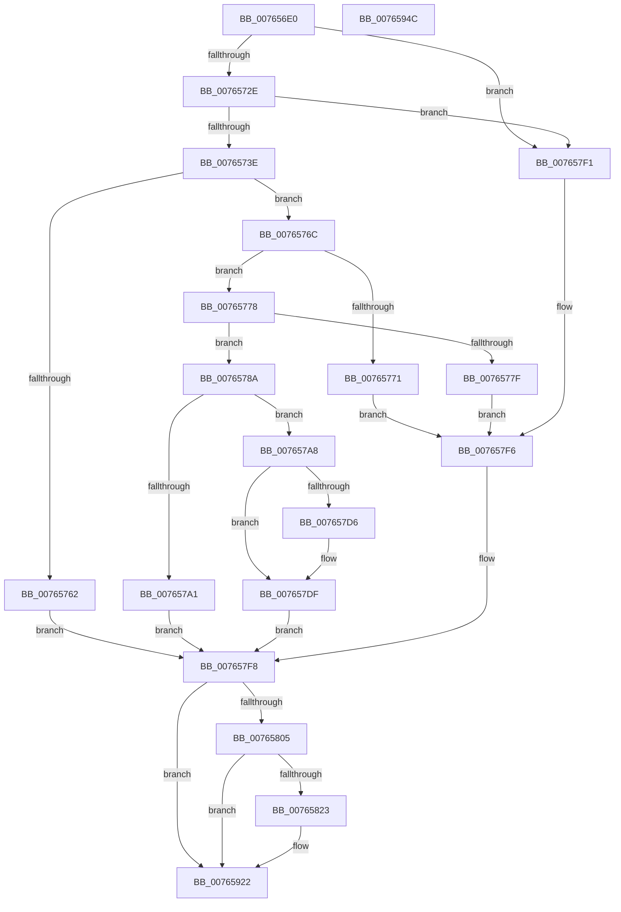

# PopWnfUsb4DisplayPresenceCallback

- RVA: `0x007656E0`–`0x0076594D` (길이 `621` bytes)
- VA: `0x00000001407656E0`
- 실행 섹션: `PAGE`
- PDB 이름 있음: `예`; PDB Function 태그: `아니요`
- unwind 정보 RVA: `0x000C7AD8`
- 디코드: `146`개 명령, `621/621` bytes 표시
- 미해석 바이트: `0` (있으면 어셈블리에 `.byte`로 보존)

> 이 문서는 커널 이미지의 기계어와 PDB 기호를 분석해 생성했습니다. 4번과 5번은 함수 원형과 자료형을 바이너리 사용 방식에서 추정한 C 해석이며 원본 소스 복구 결과는 아닙니다.

## 1. Dependencies

- 직접 호출 지점: **9**; 고유 호출 대상: **8**
- 직접 호출자로 확인된 함수: **0**
- RIP 상대 이미지 참조: **8**

### Outgoing calls
- `0x00765752` → [ExQueryWnfStateData](../A4/ExQueryWnfStateData_function_00A4A480.md) (function, `0x00A4A480`)
- `0x0076578A` → [PopAcquirePolicyLock](../../pagelk/B7/PopAcquirePolicyLock_function_00B783C0.md) (function, `0x00B783C0`)
- `0x007657A1` → [PopReleasePolicyLock](../../pagelk/B7/PopReleasePolicyLock_function_00B78410.md) (function, `0x00B78410`)
- `0x007657C2` → [PopQueueWorkItem](../../text/4A/PopQueueWorkItem_function_004A20F8.md) (function, `0x004A20F8`)
- `0x007657C7` → [PopReleasePolicyLock](../../pagelk/B7/PopReleasePolicyLock_function_00B78410.md) (function, `0x00B78410`)
- `0x007657E4` → [PopDiagTraceExternalDisplayState](PopDiagTraceExternalDisplayState_function_00761540.md) (function, `0x00761540`)
- `0x00765816` → [tlgKeywordOn](../../text/42/tlgKeywordOn_function_0042EAA0.md) (function, `0x0042EAA0`)
- `0x0076591D` → [tlgWriteTransfer_EtwWriteTransfer](../../text/42/tlgWriteTransfer_EtwWriteTransfer_function_004260E0.md) (function, `0x004260E0`)
- `0x0076592B` → [_security_check_cookie](../../text/6A/_security_check_cookie_function_006AC640.md) (function, `0x006AC640`)

### Direct callers
- 이 함수 시작 RVA로 연결되는 직접 call은 확인되지 않았습니다. 간접 호출은 완전히 역산할 수 없습니다.

### Static image references
- `0x007656FE` → RVA `0x00E0A740` (`.data`; read)
- `0x00765731` → RVA `0x00020B88` (`.rdata`; read)
- `0x00765798` → RVA `0x00E67884` (`.data`; read)
- `0x007657A8` → RVA `0x00E67A54` (`.data`; read)
- `0x007657AF` → RVA `0x00F09260` (`.data`; read)
- `0x007657BB` → RVA `0x00E67884` (`.data`; write)
- `0x007657F8` → RVA `0x00E07748` (`.data`; read)
- `0x00765830` → RVA `0x0004C23F` (`.rdata`; read)

## 2. Other-region calls and transfers

- 다른 실행 섹션으로 향하는 call: **7**
  - `0x0076578A` → [PopAcquirePolicyLock](../../pagelk/B7/PopAcquirePolicyLock_function_00B783C0.md) (`PAGE` → `PAGELK`)
  - `0x007657A1` → [PopReleasePolicyLock](../../pagelk/B7/PopReleasePolicyLock_function_00B78410.md) (`PAGE` → `PAGELK`)
  - `0x007657C2` → [PopQueueWorkItem](../../text/4A/PopQueueWorkItem_function_004A20F8.md) (`PAGE` → `.text`)
  - `0x007657C7` → [PopReleasePolicyLock](../../pagelk/B7/PopReleasePolicyLock_function_00B78410.md) (`PAGE` → `PAGELK`)
  - `0x00765816` → [tlgKeywordOn](../../text/42/tlgKeywordOn_function_0042EAA0.md) (`PAGE` → `.text`)
  - `0x0076591D` → [tlgWriteTransfer_EtwWriteTransfer](../../text/42/tlgWriteTransfer_EtwWriteTransfer_function_004260E0.md) (`PAGE` → `.text`)
  - `0x0076592B` → [_security_check_cookie](../../text/6A/_security_check_cookie_function_006AC640.md) (`PAGE` → `.text`)
- 별도 외부 분기/꼬리 이동을 확인하지 못했습니다.

## 3. Assembly (complete function range)

```asm
007656E0  48 89 5C 24 10                  mov qword ptr [rsp + 0x10], rbx
007656E5  48 89 74 24 18                  mov qword ptr [rsp + 0x18], rsi
007656EA  55                              push rbp
007656EB  57                              push rdi
007656EC  41 54                           push r12
007656EE  41 56                           push r14
007656F0  41 57                           push r15
007656F2  48 8D 6C 24 E0                  lea rbp, [rsp - 0x20]
007656F7  48 81 EC 20 01 00 00            sub rsp, 0x120
007656FE  48 8B 05 3B 50 6A 00            mov rax, qword ptr [rip + 0x6a503b]
00765705  48 33 C4                        xor rax, rsp
00765708  48 89 45 10                     mov qword ptr [rbp + 0x10], rax
0076570C  83 64 24 34 00                  and dword ptr [rsp + 0x34], 0
00765711  33 F6                           xor esi, esi
00765713  40 32 FF                        xor dil, dil
00765716  44 89 4C 24 40                  mov dword ptr [rsp + 0x40], r9d
0076571B  45 33 E4                        xor r12d, r12d
0076571E  45 33 F6                        xor r14d, r14d
00765721  44 8D 7E 04                     lea r15d, [rsi + 4]
00765725  48 85 D2                        test rdx, rdx
00765728  0F 84 C3 00 00 00               je 0x1407657f1
0076572E  48 8B 02                        mov rax, qword ptr [rdx]
00765731  48 3B 05 50 B4 8B FF            cmp rax, qword ptr [rip - 0x744bb0]
00765738  0F 85 B3 00 00 00               jne 0x1407657f1
0076573E  4C 8D 4C 24 38                  lea r9, [rsp + 0x38]
00765743  44 89 7C 24 38                  mov dword ptr [rsp + 0x38], r15d
00765748  4C 8D 44 24 34                  lea r8, [rsp + 0x34]
0076574D  48 8D 54 24 40                  lea rdx, [rsp + 0x40]
00765752  E8 29 4D 2E 00                  call 0x140a4a480
00765757  44 8B 74 24 38                  mov r14d, dword ptr [rsp + 0x38]
0076575C  8B D8                           mov ebx, eax
0076575E  85 C0                           test eax, eax
00765760  79 0A                           jns 0x14076576c
00765762  41 8D 74 24 02                  lea esi, [r12 + 2]
00765767  E9 8C 00 00 00                  jmp 0x1407657f8
0076576C  45 3B F7                        cmp r14d, r15d
0076576F  73 07                           jae 0x140765778
00765771  BE 03 00 00 00                  mov esi, 3
00765776  EB 7E                           jmp 0x1407657f6
00765778  80 7C 24 34 01                  cmp byte ptr [rsp + 0x34], 1
0076577D  74 0B                           je 0x14076578a
0076577F  44 0F B6 64 24 34               movzx r12d, byte ptr [rsp + 0x34]
00765785  41 8B F7                        mov esi, r15d
00765788  EB 6C                           jmp 0x1407657f6
0076578A  E8 31 2C 41 00                  call 0x140b783c0
0076578F  40 38 74 24 35                  cmp byte ptr [rsp + 0x35], sil
00765794  40 0F 95 C7                     setne dil
00765798  40 38 3D E5 20 70 00            cmp byte ptr [rip + 0x7020e5], dil
0076579F  75 07                           jne 0x1407657a8
007657A1  E8 6A 2C 41 00                  call 0x140b78410
007657A6  EB 50                           jmp 0x1407657f8
007657A8  44 8A 3D A5 22 70 00            mov r15b, byte ptr [rip + 0x7022a5]
007657AF  48 8D 0D AA 3A 7A 00            lea rcx, [rip + 0x7a3aaa]
007657B6  BA 01 00 00 00                  mov edx, 1
007657BB  40 88 3D C2 20 70 00            mov byte ptr [rip + 0x7020c2], dil
007657C2  E8 31 C9 D3 FF                  call 0x1404a20f8
007657C7  E8 44 2C 41 00                  call 0x140b78410
007657CC  B8 02 00 00 00                  mov eax, 2
007657D1  40 84 FF                        test dil, dil
007657D4  74 09                           je 0x1407657df
007657D6  45 84 FF                        test r15b, r15b
007657D9  8D 48 01                        lea ecx, [rax + 1]
007657DC  0F 45 C1                        cmovne eax, ecx
007657DF  8A D0                           mov dl, al
007657E1  40 8A CF                        mov cl, dil
007657E4  E8 57 BD FF FF                  call 0x140761540
007657E9  41 BF 04 00 00 00               mov r15d, 4
007657EF  EB 07                           jmp 0x1407657f8
007657F1  BE 01 00 00 00                  mov esi, 1
007657F6  33 DB                           xor ebx, ebx
007657F8  83 3D 49 1F 6A 00 05            cmp dword ptr [rip + 0x6a1f49], 5
007657FF  0F 86 1D 01 00 00               jbe 0x140765922
00765805  48 BA 00 00 00 00 00 40 00 00   movabs rdx, 0x400000000000
0076580F  48 8D 0D 32 1F 6A 00            lea rcx, [rip + 0x6a1f32]
00765816  E8 85 92 CC FF                  call 0x14042eaa0
0076581B  84 C0                           test al, al
0076581D  0F 84 FF 00 00 00               je 0x140765922
00765823  83 65 8C 00                     and dword ptr [rbp - 0x74], 0
00765827  48 8D 44 24 38                  lea rax, [rsp + 0x38]
0076582C  83 65 9C 00                     and dword ptr [rbp - 0x64], 0
00765830  48 8D 15 08 6A 8E FF            lea rdx, [rip - 0x7195f8]
00765837  83 65 AC 00                     and dword ptr [rbp - 0x54], 0
0076583B  48 8D 0D 06 1F 6A 00            lea rcx, [rip + 0x6a1f06]
00765842  83 65 BC 00                     and dword ptr [rbp - 0x44], 0
00765846  45 33 C9                        xor r9d, r9d
00765849  83 65 CC 00                     and dword ptr [rbp - 0x34], 0
0076584D  45 33 C0                        xor r8d, r8d
00765850  83 65 DC 00                     and dword ptr [rbp - 0x24], 0
00765854  83 65 EC 00                     and dword ptr [rbp - 0x14], 0
00765858  83 65 FC 00                     and dword ptr [rbp - 4], 0
0076585C  83 65 0C 00                     and dword ptr [rbp + 0xc], 0
00765860  48 89 45 80                     mov qword ptr [rbp - 0x80], rax
00765864  48 8D 44 24 34                  lea rax, [rsp + 0x34]
00765869  48 89 45 90                     mov qword ptr [rbp - 0x70], rax
0076586D  48 8D 44 24 48                  lea rax, [rsp + 0x48]
00765872  48 89 45 A0                     mov qword ptr [rbp - 0x60], rax
00765876  48 8D 44 24 4C                  lea rax, [rsp + 0x4c]
0076587B  48 89 45 B0                     mov qword ptr [rbp - 0x50], rax
0076587F  48 8D 44 24 30                  lea rax, [rsp + 0x30]
00765884  48 89 45 C0                     mov qword ptr [rbp - 0x40], rax
00765888  48 8D 44 24 50                  lea rax, [rsp + 0x50]
0076588D  48 89 45 D0                     mov qword ptr [rbp - 0x30], rax
00765891  48 8D 44 24 54                  lea rax, [rsp + 0x54]
00765896  48 89 45 E0                     mov qword ptr [rbp - 0x20], rax
0076589A  8B 44 24 40                     mov eax, dword ptr [rsp + 0x40]
0076589E  89 44 24 40                     mov dword ptr [rsp + 0x40], eax
007658A2  48 8D 44 24 40                  lea rax, [rsp + 0x40]
007658A7  48 89 45 F0                     mov qword ptr [rbp - 0x10], rax
007658AB  48 8D 44 24 58                  lea rax, [rsp + 0x58]
007658B0  48 89 45 00                     mov qword ptr [rbp], rax
007658B4  48 8D 44 24 60                  lea rax, [rsp + 0x60]
007658B9  48 89 44 24 28                  mov qword ptr [rsp + 0x28], rax
007658BE  C7 44 24 20 0B 00 00 00         mov dword ptr [rsp + 0x20], 0xb
007658C6  89 5C 24 38                     mov dword ptr [rsp + 0x38], ebx
007658CA  44 89 7D 88                     mov dword ptr [rbp - 0x78], r15d
007658CE  89 74 24 34                     mov dword ptr [rsp + 0x34], esi
007658D2  44 89 7D 98                     mov dword ptr [rbp - 0x68], r15d
007658D6  44 89 74 24 48                  mov dword ptr [rsp + 0x48], r14d
007658DB  44 89 7D A8                     mov dword ptr [rbp - 0x58], r15d
007658DF  44 89 7C 24 4C                  mov dword ptr [rsp + 0x4c], r15d
007658E4  44 89 7D B8                     mov dword ptr [rbp - 0x48], r15d
007658E8  40 88 7C 24 30                  mov byte ptr [rsp + 0x30], dil
007658ED  C7 45 C8 01 00 00 00            mov dword ptr [rbp - 0x38], 1
007658F4  44 89 64 24 50                  mov dword ptr [rsp + 0x50], r12d
007658F9  44 89 7D D8                     mov dword ptr [rbp - 0x28], r15d
007658FD  C7 44 24 54 01 00 00 00         mov dword ptr [rsp + 0x54], 1
00765905  44 89 7D E8                     mov dword ptr [rbp - 0x18], r15d
00765909  44 89 7D F8                     mov dword ptr [rbp - 8], r15d
0076590D  48 C7 44 24 58 00 00 00 01      mov qword ptr [rsp + 0x58], 0x1000000
00765916  C7 45 08 08 00 00 00            mov dword ptr [rbp + 8], 8
0076591D  E8 BE 07 CC FF                  call 0x1404260e0
00765922  8B C3                           mov eax, ebx
00765924  48 8B 4D 10                     mov rcx, qword ptr [rbp + 0x10]
00765928  48 33 CC                        xor rcx, rsp
0076592B  E8 10 6D F4 FF                  call 0x1406ac640
00765930  4C 8D 9C 24 20 01 00 00         lea r11, [rsp + 0x120]
00765938  49 8B 5B 38                     mov rbx, qword ptr [r11 + 0x38]
0076593C  49 8B 73 40                     mov rsi, qword ptr [r11 + 0x40]
00765940  49 8B E3                        mov rsp, r11
00765943  41 5F                           pop r15
00765945  41 5E                           pop r14
00765947  41 5C                           pop r12
00765949  5F                              pop rdi
0076594A  5D                              pop rbp
0076594B  C3                              ret
0076594C  CC                              int3
```

## 4. C-style interpretation (structured pseudocode)

```c
__int64 __fastcall PopWnfUsb4DisplayPresenceCallback(__int64 a1, __int64 a2, __int64 a3, int a4)
{
    __int64 result;
    __int64 v_r12;
    __int64 v_r14;
    __int64 v_rbx;
    __int64 v_rdi;
    __int64 v_rsi;
    __int64 v_rsp;
    unsigned __int64 v_stack_m100;
    unsigned int v_stack_m108;
    unsigned __int64 v_stack_m110;
    unsigned __int8 v_stack_m113;
    unsigned int v_stack_m114;
    unsigned __int64 v_stack_m118;
    unsigned __int64 v_stack_m120;
    unsigned int v_stack_m128;
    unsigned __int64 v_stack_m28;
    unsigned __int64 v_stack_m38;
    unsigned int v_stack_m3C;
    unsigned int v_stack_m40;
    unsigned __int64 v_stack_m48;
    unsigned int v_stack_m4C;
    unsigned int v_stack_m50;
    unsigned __int64 v_stack_m58;
    unsigned int v_stack_m5C;
    unsigned int v_stack_m60;
    unsigned __int64 v_stack_m68;
    unsigned int v_stack_m6C;
    unsigned int v_stack_m70;
    unsigned __int64 v_stack_m78;
    unsigned int v_stack_m7C;
    unsigned int v_stack_m80;
    unsigned __int64 v_stack_m88;
    unsigned int v_stack_m8C;
    unsigned int v_stack_m90;
    unsigned __int64 v_stack_m98;
    unsigned int v_stack_m9C;
    unsigned int v_stack_mA0;
    unsigned __int64 v_stack_mA8;
    unsigned int v_stack_mAC;
    unsigned int v_stack_mB0;
    unsigned __int64 v_stack_mB8;
    unsigned int v_stack_mBC;
    unsigned int v_stack_mC0;
    unsigned __int64 v_stack_mC8;
    unsigned __int64 v_stack_mE8;
    unsigned __int64 v_stack_mF0;
    unsigned __int64 v_stack_mF4;
    unsigned __int64 v_stack_mF8;
    unsigned __int64 v_stack_mFC;
    unsigned __int64 v_stack_p10;
    unsigned __int64 v_stack_p18;

    v_stack_p10 = v_rbx;
    v_stack_p18 = v_rsi;
    v_rsp = (v_rsp) - (288);
    result = (*(unsigned __int64 *)(v_rip + 6967355)) ^ (v_rsp);
    v_stack_m38 = result;
    v_rsi = 0;
    v_rdi = 0;
    v_stack_m108 = a4;
    v_r12 = 0;
    v_r14 = 0;
    if (a2 == 0) goto loc_007657F1;
    if ((*(unsigned __int64 *)(a2)) != (*(unsigned __int64 *)(v_rip - 7621552))) goto loc_007657F1;
    v_stack_m110 = (unsigned int)(v_rsi + 4);
    result = ExQueryWnfStateData(a1, v_stack_m108, v_stack_m114, v_stack_m110);
    if (!sign_flag) goto loc_0076576C;
    goto loc_007657F8;
loc_0076576C:
    if (((unsigned int)((unsigned int)(v_stack_m110))) >= ((unsigned int)(v_rsi + 4))) goto loc_00765778;
    goto loc_007657F6;
loc_00765778:
    if (v_stack_m114 == 1) goto loc_0076578A;
    goto loc_007657F6;
loc_0076578A:
    result = PopAcquirePolicyLock(a1, v_stack_m108, v_stack_m114, v_stack_m110);
    v_rdi = (v_stack_m113 != ((unsigned __int8)((unsigned int)((unsigned int)(v_rsi + 4))))) ? 1 : 0;
    if ((*(unsigned __int8 *)(v_rip + 7348453)) != ((unsigned __int8)(v_rdi))) goto loc_007657A8;
    result = PopReleasePolicyLock(a1, v_stack_m108, v_stack_m114, v_stack_m110);
    goto loc_007657F8;
loc_007657A8:
    *(unsigned __int8 *)(v_rip + 7348418) = (unsigned __int8)(v_rdi);
    result = PopQueueWorkItem(v_rip + 8010410, 1, v_stack_m114, v_stack_m110);
    result = PopReleasePolicyLock(v_rip + 8010410, 1, v_stack_m114, v_stack_m110);
    result = 2;
    if ((unsigned __int8)(v_rdi) != 0) {
        a1 = 2 + 1;
        result = 2;
        if ((unsigned __int8)(*(unsigned __int8 *)(v_rip + 7348901)) != 0) { result = (unsigned int)(a1); }
    }
    result = PopDiagTraceExternalDisplayState((unsigned __int8)(v_rdi), (unsigned __int8)(result), v_stack_m114, v_stack_m110);
    goto loc_007657F8;
loc_007657F1:
loc_007657F6:
    v_rbx = 0;
loc_007657F8:
    if ((*(unsigned int *)(v_rip + 6954825)) <= 5) goto loc_00765922;
    result = tlgKeywordOn(v_rip + 6954802, (unsigned __int8)(result), v_stack_m114, v_stack_m110);
    if ((unsigned __int8)(result) != 0) {
        result = v_stack_m110;
        a2 = v_rip - 7443960;
        a1 = v_rip + 6954758;
        a4 = 0;
        a3 = 0;
        v_stack_mC8 = result;
        result = v_stack_m114;
        v_stack_mB8 = result;
        result = v_stack_m100;
        v_stack_mA8 = result;
        result = v_stack_mFC;
        v_stack_m98 = result;
        result = v_stack_m118;
        v_stack_m88 = result;
        result = v_stack_mF8;
        v_stack_m78 = result;
        result = v_stack_mF4;
        v_stack_m68 = result;
        result = v_stack_m108;
        v_stack_m108 = (unsigned int)(result);
        result = v_stack_m108;
        v_stack_m58 = result;
        result = v_stack_mF0;
        v_stack_m48 = result;
        result = v_stack_mE8;
        v_stack_m120 = result;
        v_stack_m128 = 11;
        v_stack_m110 = 0;
        v_stack_mC0 = 4;
        v_stack_m114 = 1;
        v_stack_mB0 = 4;
        v_stack_m100 = (unsigned int)((unsigned int)(v_stack_m110));
        v_stack_mA0 = 4;
        v_stack_mFC = 4;
        v_stack_m90 = 4;
        v_stack_m118 = (unsigned __int8)(v_rdi);
        v_stack_m80 = 1;
        v_stack_mF8 = (unsigned int)(v_stack_m114);
        v_stack_m70 = 4;
        v_stack_mF4 = 1;
        v_stack_m60 = 4;
        v_stack_m50 = 4;
        v_stack_mF0 = 0x1000000ULL;
        v_stack_m40 = 8;
        result = tlgWriteTransfer_EtwWriteTransfer(a1, a2, a3, a4);
    }
    a1 = (v_stack_m38) ^ (v_rsp);
    result = _security_check_cookie(a1, a2, a3, a4);
    return result;
}
```

## 5. (Beta) C Style

```c
int64_t PopWnfUsb4DisplayPresenceCallback(int64_t Arg1, int64_t Arg2, int64_t Arg3, int32_t Arg4)
{
    int64_t result;
    int64_t local_r12;
    int64_t local_r14;
    int64_t local_rbx;
    int64_t local_rdi;
    int64_t local_rsi;
    int64_t local_rsp;
    uint64_t v_stack_m100;
    uint32_t v_stack_m108;
    uint64_t v_stack_m110;
    uint8_t v_stack_m113;
    uint32_t v_stack_m114;
    uint64_t v_stack_m118;
    uint64_t v_stack_m120;
    uint32_t v_stack_m128;
    uint64_t v_stack_m28;
    uint64_t v_stack_m38;
    uint32_t v_stack_m3C;
    uint32_t v_stack_m40;
    uint64_t v_stack_m48;
    uint32_t v_stack_m4C;
    uint32_t v_stack_m50;
    uint64_t v_stack_m58;
    uint32_t v_stack_m5C;
    uint32_t v_stack_m60;
    uint64_t v_stack_m68;
    uint32_t v_stack_m6C;
    uint32_t v_stack_m70;
    uint64_t v_stack_m78;
    uint32_t v_stack_m7C;
    uint32_t v_stack_m80;
    uint64_t v_stack_m88;
    uint32_t v_stack_m8C;
    uint32_t v_stack_m90;
    uint64_t v_stack_m98;
    uint32_t v_stack_m9C;
    uint32_t v_stack_mA0;
    uint64_t v_stack_mA8;
    uint32_t v_stack_mAC;
    uint32_t v_stack_mB0;
    uint64_t v_stack_mB8;
    uint32_t v_stack_mBC;
    uint32_t v_stack_mC0;
    uint64_t v_stack_mC8;
    uint64_t v_stack_mE8;
    uint64_t v_stack_mF0;
    uint64_t v_stack_mF4;
    uint64_t v_stack_mF8;
    uint64_t v_stack_mFC;
    uint64_t v_stack_p10;
    uint64_t v_stack_p18;

    v_stack_p10 = local_rbx;
    v_stack_p18 = local_rsi;
    local_rsp = (local_rsp) - (288);
    result = (*(uint64_t *)(v_rip + 0x6A503B)) ^ (local_rsp);
    v_stack_m38 = result;
    local_rsi = 0;
    local_rdi = 0;
    v_stack_m108 = Arg4;
    local_r12 = 0;
    local_r14 = 0;
    if (Arg2 == 0) goto loc_007657F1;
    if ((*(uint64_t *)(Arg2)) != (*(uint64_t *)(v_rip - 0x744BB0))) goto loc_007657F1;
    v_stack_m110 = (uint32_t)(local_rsi + 4);
    result = ExQueryWnfStateData(Arg1, v_stack_m108, v_stack_m114, v_stack_m110);
    if (!sign_flag) goto loc_0076576C;
    goto loc_007657F8;
loc_0076576C:
    if (((uint32_t)((uint32_t)(v_stack_m110))) >= ((uint32_t)(local_rsi + 4))) goto loc_00765778;
    goto loc_007657F6;
loc_00765778:
    if (v_stack_m114 == 1) goto loc_0076578A;
    goto loc_007657F6;
loc_0076578A:
    result = PopAcquirePolicyLock(Arg1, v_stack_m108, v_stack_m114, v_stack_m110);
    local_rdi = (v_stack_m113 != ((uint8_t)((uint32_t)((uint32_t)(local_rsi + 4))))) ? 1 : 0;
    if ((*(uint8_t *)(v_rip + 0x7020E5)) != ((uint8_t)(local_rdi))) goto loc_007657A8;
    result = PopReleasePolicyLock(Arg1, v_stack_m108, v_stack_m114, v_stack_m110);
    goto loc_007657F8;
loc_007657A8:
    *(uint8_t *)(v_rip + 0x7020C2) = (uint8_t)(local_rdi);
    result = PopQueueWorkItem(v_rip + 8010410, 1, v_stack_m114, v_stack_m110);
    result = PopReleasePolicyLock(v_rip + 8010410, 1, v_stack_m114, v_stack_m110);
    result = 2;
    if ((uint8_t)(local_rdi) != 0) {
        Arg1 = 2 + 1;
        result = 2;
        if ((uint8_t)(*(uint8_t *)(v_rip + 0x7022A5)) != 0) { result = (uint32_t)(Arg1); }
    }
    result = PopDiagTraceExternalDisplayState((uint8_t)(local_rdi), (uint8_t)(result), v_stack_m114, v_stack_m110);
    goto loc_007657F8;
loc_007657F1:
loc_007657F6:
    local_rbx = 0;
loc_007657F8:
    if ((*(uint32_t *)(v_rip + 0x6A1F49)) <= 5) goto loc_00765922;
    result = tlgKeywordOn(v_rip + 6954802, (uint8_t)(result), v_stack_m114, v_stack_m110);
    if ((uint8_t)(result) != 0) {
        result = v_stack_m110;
        Arg2 = v_rip - 7443960;
        Arg1 = v_rip + 6954758;
        Arg4 = 0;
        Arg3 = 0;
        v_stack_mC8 = result;
        result = v_stack_m114;
        v_stack_mB8 = result;
        result = v_stack_m100;
        v_stack_mA8 = result;
        result = v_stack_mFC;
        v_stack_m98 = result;
        result = v_stack_m118;
        v_stack_m88 = result;
        result = v_stack_mF8;
        v_stack_m78 = result;
        result = v_stack_mF4;
        v_stack_m68 = result;
        result = v_stack_m108;
        v_stack_m108 = (uint32_t)(result);
        result = v_stack_m108;
        v_stack_m58 = result;
        result = v_stack_mF0;
        v_stack_m48 = result;
        result = v_stack_mE8;
        v_stack_m120 = result;
        v_stack_m128 = 11;
        v_stack_m110 = 0;
        v_stack_mC0 = 4;
        v_stack_m114 = 1;
        v_stack_mB0 = 4;
        v_stack_m100 = (uint32_t)((uint32_t)(v_stack_m110));
        v_stack_mA0 = 4;
        v_stack_mFC = 4;
        v_stack_m90 = 4;
        v_stack_m118 = (uint8_t)(local_rdi);
        v_stack_m80 = 1;
        v_stack_mF8 = (uint32_t)(v_stack_m114);
        v_stack_m70 = 4;
        v_stack_mF4 = 1;
        v_stack_m60 = 4;
        v_stack_m50 = 4;
        v_stack_mF0 = 0x1000000ULL;
        v_stack_m40 = 8;
        result = tlgWriteTransfer_EtwWriteTransfer(Arg1, Arg2, Arg3, Arg4);
    }
    Arg1 = (v_stack_m38) ^ (local_rsp);
    result = _security_check_cookie(Arg1, Arg2, Arg3, Arg4);
    return result;
}
```

## 6. Execution-region graph

[열기: 2D/3D 그래프와 함수 탐색 컨트롤 패널](../../../control-panel.html?section=page&rva=0x007656E0&view=graph)

- 2D 그래프는 위에서 아래로 흐르고, 3D 그래프는 빈 공간을 드래그해 회전합니다. Shift+드래그는 이동, 휠은 확대·축소, 함수 노드 선택은 대상 보고서 이동입니다.

### Static fallback


