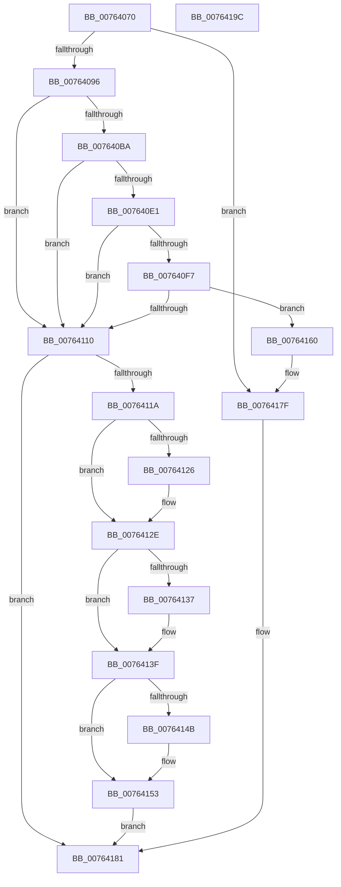

# PpmAllocatePerfCheck

- RVA: `0x00764070`–`0x0076419D` (길이 `301` bytes)
- VA: `0x0000000140764070`
- 실행 섹션: `PAGE`
- PDB 이름 있음: `예`; PDB Function 태그: `아니요`
- unwind 정보 RVA: `0x00060300`
- 디코드: `84`개 명령, `301/301` bytes 표시
- 미해석 바이트: `0` (있으면 어셈블리에 `.byte`로 보존)

> 이 문서는 커널 이미지의 기계어와 PDB 기호를 분석해 생성했습니다. 4번과 5번은 함수 원형과 자료형을 바이너리 사용 방식에서 추정한 C 해석이며 원본 소스 복구 결과는 아닙니다.

## 1. Dependencies

- 직접 호출 지점: **8**; 고유 호출 대상: **2**
- 직접 호출자로 확인된 함수: **2**
- RIP 상대 이미지 참조: **1**

### Outgoing calls
- `0x007640AD` → [ExAllocatePool2](../../poolcode/B8/ExAllocatePool2_function_00B820F0.md) (function, `0x00B820F0`)
- `0x007640D0` → [ExAllocatePool2](../../poolcode/B8/ExAllocatePool2_function_00B820F0.md) (function, `0x00B820F0`)
- `0x007640E9` → [ExAllocatePool2](../../poolcode/B8/ExAllocatePool2_function_00B820F0.md) (function, `0x00B820F0`)
- `0x007640FF` → [ExAllocatePool2](../../poolcode/B8/ExAllocatePool2_function_00B820F0.md) (function, `0x00B820F0`)
- `0x00764129` → [ExFreePoolWithTag](../../poolcode/B8/ExFreePoolWithTag_function_00B82870.md) (function, `0x00B82870`)
- `0x0076413A` → [ExFreePoolWithTag](../../poolcode/B8/ExFreePoolWithTag_function_00B82870.md) (function, `0x00B82870`)
- `0x0076414E` → [ExFreePoolWithTag](../../poolcode/B8/ExFreePoolWithTag_function_00B82870.md) (function, `0x00B82870`)
- `0x00764159` → [ExFreePoolWithTag](../../poolcode/B8/ExFreePoolWithTag_function_00B82870.md) (function, `0x00B82870`)

### Direct callers
- [PpmRegisterPerfStates](../75/PpmRegisterPerfStates_function_0075B084.md) at `0x0075B351`
- [PpmRegisterPerfStates](../75/PpmRegisterPerfStates_function_0075B084.md) at `0x0075B3AF`
- [PpmCheckInitProcessors](../A8/PpmCheckInitProcessors_function_00A84AE8.md) at `0x00A84C08`

### Static image references
- `0x007640BA` → RVA `0x00E0B804` (`.data`; read)

## 2. Other-region calls and transfers

- 다른 실행 섹션으로 향하는 call: **8**
  - `0x007640AD` → [ExAllocatePool2](../../poolcode/B8/ExAllocatePool2_function_00B820F0.md) (`PAGE` → `POOLCODE`)
  - `0x007640D0` → [ExAllocatePool2](../../poolcode/B8/ExAllocatePool2_function_00B820F0.md) (`PAGE` → `POOLCODE`)
  - `0x007640E9` → [ExAllocatePool2](../../poolcode/B8/ExAllocatePool2_function_00B820F0.md) (`PAGE` → `POOLCODE`)
  - `0x007640FF` → [ExAllocatePool2](../../poolcode/B8/ExAllocatePool2_function_00B820F0.md) (`PAGE` → `POOLCODE`)
  - `0x00764129` → [ExFreePoolWithTag](../../poolcode/B8/ExFreePoolWithTag_function_00B82870.md) (`PAGE` → `POOLCODE`)
  - `0x0076413A` → [ExFreePoolWithTag](../../poolcode/B8/ExFreePoolWithTag_function_00B82870.md) (`PAGE` → `POOLCODE`)
  - `0x0076414E` → [ExFreePoolWithTag](../../poolcode/B8/ExFreePoolWithTag_function_00B82870.md) (`PAGE` → `POOLCODE`)
  - `0x00764159` → [ExFreePoolWithTag](../../poolcode/B8/ExFreePoolWithTag_function_00B82870.md) (`PAGE` → `POOLCODE`)
- 별도 외부 분기/꼬리 이동을 확인하지 못했습니다.

## 3. Assembly (complete function range)

```asm
00764070  48 89 5C 24 08                  mov qword ptr [rsp + 8], rbx
00764075  48 89 6C 24 10                  mov qword ptr [rsp + 0x10], rbp
0076407A  48 89 74 24 18                  mov qword ptr [rsp + 0x18], rsi
0076407F  57                              push rdi
00764080  41 56                           push r14
00764082  41 57                           push r15
00764084  48 83 EC 20                     sub rsp, 0x20
00764088  48 83 79 10 00                  cmp qword ptr [rcx + 0x10], 0
0076408D  48 8B F1                        mov rsi, rcx
00764090  0F 85 E9 00 00 00               jne 0x14076417f
00764096  41 BE 50 50 4D 70               mov r14d, 0x704d5050
0076409C  41 BF 40 00 00 00               mov r15d, 0x40
007640A2  45 8B C6                        mov r8d, r14d
007640A5  41 8B CF                        mov ecx, r15d
007640A8  BA 78 05 00 00                  mov edx, 0x578
007640AD  E8 3E E0 41 00                  call 0x140b820f0
007640B2  48 8B F8                        mov rdi, rax
007640B5  48 85 C0                        test rax, rax
007640B8  74 56                           je 0x140764110
007640BA  8B 1D 44 77 6A 00               mov ebx, dword ptr [rip + 0x6a7744]
007640C0  45 8B C6                        mov r8d, r14d
007640C3  6B C3 70                        imul eax, ebx, 0x70
007640C6  41 8B CF                        mov ecx, r15d
007640C9  83 C0 38                        add eax, 0x38
007640CC  8B D0                           mov edx, eax
007640CE  8B E8                           mov ebp, eax
007640D0  E8 1B E0 41 00                  call 0x140b820f0
007640D5  48 89 87 98 00 00 00            mov qword ptr [rdi + 0x98], rax
007640DC  48 85 C0                        test rax, rax
007640DF  74 2F                           je 0x140764110
007640E1  45 8B C6                        mov r8d, r14d
007640E4  8B D5                           mov edx, ebp
007640E6  41 8B CF                        mov ecx, r15d
007640E9  E8 02 E0 41 00                  call 0x140b820f0
007640EE  48 89 47 58                     mov qword ptr [rdi + 0x58], rax
007640F2  48 85 C0                        test rax, rax
007640F5  74 19                           je 0x140764110
007640F7  45 8B C6                        mov r8d, r14d
007640FA  8B D5                           mov edx, ebp
007640FC  41 8B CF                        mov ecx, r15d
007640FF  E8 EC DF 41 00                  call 0x140b820f0
00764104  48 89 87 D8 00 00 00            mov qword ptr [rdi + 0xd8], rax
0076410B  48 85 C0                        test rax, rax
0076410E  75 50                           jne 0x140764160
00764110  BB 9A 00 00 C0                  mov ebx, 0xc000009a
00764115  48 85 FF                        test rdi, rdi
00764118  74 67                           je 0x140764181
0076411A  48 8B 8F 98 00 00 00            mov rcx, qword ptr [rdi + 0x98]
00764121  48 85 C9                        test rcx, rcx
00764124  74 08                           je 0x14076412e
00764126  41 8B D6                        mov edx, r14d
00764129  E8 42 E7 41 00                  call 0x140b82870
0076412E  48 8B 4F 58                     mov rcx, qword ptr [rdi + 0x58]
00764132  48 85 C9                        test rcx, rcx
00764135  74 08                           je 0x14076413f
00764137  41 8B D6                        mov edx, r14d
0076413A  E8 31 E7 41 00                  call 0x140b82870
0076413F  48 8B 8F D8 00 00 00            mov rcx, qword ptr [rdi + 0xd8]
00764146  48 85 C9                        test rcx, rcx
00764149  74 08                           je 0x140764153
0076414B  41 8B D6                        mov edx, r14d
0076414E  E8 1D E7 41 00                  call 0x140b82870
00764153  41 8B D6                        mov edx, r14d
00764156  48 8B CF                        mov rcx, rdi
00764159  E8 12 E7 41 00                  call 0x140b82870
0076415E  EB 21                           jmp 0x140764181
00764160  48 8B 87 98 00 00 00            mov rax, qword ptr [rdi + 0x98]
00764167  89 58 30                        mov dword ptr [rax + 0x30], ebx
0076416A  48 8B 47 58                     mov rax, qword ptr [rdi + 0x58]
0076416E  89 58 30                        mov dword ptr [rax + 0x30], ebx
00764171  48 8B 87 D8 00 00 00            mov rax, qword ptr [rdi + 0xd8]
00764178  89 58 30                        mov dword ptr [rax + 0x30], ebx
0076417B  48 89 7E 10                     mov qword ptr [rsi + 0x10], rdi
0076417F  33 DB                           xor ebx, ebx
00764181  48 8B 6C 24 48                  mov rbp, qword ptr [rsp + 0x48]
00764186  8B C3                           mov eax, ebx
00764188  48 8B 5C 24 40                  mov rbx, qword ptr [rsp + 0x40]
0076418D  48 8B 74 24 50                  mov rsi, qword ptr [rsp + 0x50]
00764192  48 83 C4 20                     add rsp, 0x20
00764196  41 5F                           pop r15
00764198  41 5E                           pop r14
0076419A  5F                              pop rdi
0076419B  C3                              ret
0076419C  CC                              int3
```

## 4. C-style interpretation (structured pseudocode)

```c
__int64 __fastcall PpmAllocatePerfCheck(__int64 a1)
{
    __int64 result;
    __int64 v_rbx;
    __int64 v_rsp;
    unsigned __int64 v_stack_p10;
    unsigned __int64 v_stack_p18;
    unsigned __int64 v_stack_p8;

    v_stack_p8 = v_rbx;
    v_stack_p10 = v_rbp;
    v_stack_p18 = v_rsi;
    v_rsp = (v_rsp) - (32);
    if ((*(unsigned __int64 *)(a1 + 16)) != 0) goto loc_0076417F;
    result = ExAllocatePool2(64, (unsigned int)(0x578ULL), (unsigned int)((unsigned int)((unsigned int)(0x704D5050ULL))), a4);
    if (result == 0) goto loc_00764110;
    result = (unsigned int)((result) * ((unsigned int)((unsigned int)(*(unsigned int *)(v_rip + 6977348)))));
    result = (unsigned int)((result) + (56));
    result = ExAllocatePool2(64, (unsigned int)((unsigned int)(result)), (unsigned int)((unsigned int)((unsigned int)(0x704D5050ULL))), a4);
    *(unsigned __int64 *)(result + 152) = result;
    if (result == 0) goto loc_00764110;
    result = ExAllocatePool2(64, (unsigned int)((unsigned int)((unsigned int)((unsigned int)(result)))), (unsigned int)((unsigned int)((unsigned int)(0x704D5050ULL))), a4);
    *(unsigned __int64 *)(result + 88) = result;
    if (result == 0) goto loc_00764110;
    result = ExAllocatePool2(64, (unsigned int)((unsigned int)((unsigned int)((unsigned int)(result)))), (unsigned int)((unsigned int)((unsigned int)(0x704D5050ULL))), a4);
    *(unsigned __int64 *)(result + 216) = result;
    if (result != 0) goto loc_00764160;
loc_00764110:
    if (result == 0) goto loc_00764181;
    if (*(unsigned __int64 *)(result + 152) != 0) {
        a2 = (unsigned int)((unsigned int)(0x704D5050ULL));
        result = ExFreePoolWithTag(*(unsigned __int64 *)(result + 152), a2, (unsigned int)((unsigned int)((unsigned int)(0x704D5050ULL))), a4);
    }
    if (*(unsigned __int64 *)(result + 88) != 0) {
        a2 = (unsigned int)((unsigned int)(0x704D5050ULL));
        result = ExFreePoolWithTag(*(unsigned __int64 *)(result + 88), a2, (unsigned int)((unsigned int)((unsigned int)(0x704D5050ULL))), a4);
    }
    if (*(unsigned __int64 *)(result + 216) != 0) {
        a2 = (unsigned int)((unsigned int)(0x704D5050ULL));
        result = ExFreePoolWithTag(*(unsigned __int64 *)(result + 216), a2, (unsigned int)((unsigned int)((unsigned int)(0x704D5050ULL))), a4);
    }
    result = ExFreePoolWithTag(result, (unsigned int)((unsigned int)((unsigned int)(0x704D5050ULL))), (unsigned int)((unsigned int)((unsigned int)(0x704D5050ULL))), a4);
    goto loc_00764181;
loc_00764160:
    *(unsigned int *)(*(unsigned __int64 *)(result + 152) + 48) = (unsigned int)((unsigned int)(0xC000009AULL));
    *(unsigned int *)(*(unsigned __int64 *)(result + 88) + 48) = (unsigned int)((unsigned int)(0xC000009AULL));
    *(unsigned int *)(*(unsigned __int64 *)(result + 216) + 48) = (unsigned int)((unsigned int)(0xC000009AULL));
    *(unsigned __int64 *)(a1 + 16) = result;
loc_0076417F:
    v_rbx = 0;
loc_00764181:
    v_rsp = (v_rsp) + (32);
    return 0;
}
```

## 5. (Beta) C Style

```c
int64_t PpmAllocatePerfCheck(void *Arg1)
{
    uint8_t *arg1 = (uint8_t *)Arg1;

    int64_t result;
    int64_t local_rbx;
    int64_t local_rsp;
    uint64_t v_stack_p10;
    uint64_t v_stack_p18;
    uint64_t v_stack_p8;

    v_stack_p8 = local_rbx;
    v_stack_p10 = local_rbp;
    v_stack_p18 = local_rsi;
    local_rsp = (local_rsp) - (32);
    if ((*(uint64_t *)(arg1 + 0x10)) != 0) goto loc_0076417F;
    result = ExAllocatePool2(64, (uint32_t)(0x578ULL), (uint32_t)((uint32_t)((uint32_t)(0x704D5050ULL))), a4);
    if (result == 0) goto loc_00764110;
    result = (uint32_t)((result) * ((uint32_t)((uint32_t)(*(uint32_t *)(v_rip + 0x6A7744)))));
    result = (uint32_t)((result) + (56));
    result = ExAllocatePool2(64, (uint32_t)((uint32_t)(result)), (uint32_t)((uint32_t)((uint32_t)(0x704D5050ULL))), a4);
    *(uint64_t *)(result + 0x98) = result;
    if (result == 0) goto loc_00764110;
    result = ExAllocatePool2(64, (uint32_t)((uint32_t)((uint32_t)((uint32_t)(result)))), (uint32_t)((uint32_t)((uint32_t)(0x704D5050ULL))), a4);
    *(uint64_t *)(result + 0x58) = result;
    if (result == 0) goto loc_00764110;
    result = ExAllocatePool2(64, (uint32_t)((uint32_t)((uint32_t)((uint32_t)(result)))), (uint32_t)((uint32_t)((uint32_t)(0x704D5050ULL))), a4);
    *(uint64_t *)(result + 0xD8) = result;
    if (result != 0) goto loc_00764160;
loc_00764110:
    if (result == 0) goto loc_00764181;
    if (*(uint64_t *)(result + 0x98) != 0) {
        a2 = (uint32_t)((uint32_t)(0x704D5050ULL));
        result = ExFreePoolWithTag(*(uint64_t *)(result + 0x98), a2, (uint32_t)((uint32_t)((uint32_t)(0x704D5050ULL))), a4);
    }
    if (*(uint64_t *)(result + 0x58) != 0) {
        a2 = (uint32_t)((uint32_t)(0x704D5050ULL));
        result = ExFreePoolWithTag(*(uint64_t *)(result + 0x58), a2, (uint32_t)((uint32_t)((uint32_t)(0x704D5050ULL))), a4);
    }
    if (*(uint64_t *)(result + 0xD8) != 0) {
        a2 = (uint32_t)((uint32_t)(0x704D5050ULL));
        result = ExFreePoolWithTag(*(uint64_t *)(result + 0xD8), a2, (uint32_t)((uint32_t)((uint32_t)(0x704D5050ULL))), a4);
    }
    result = ExFreePoolWithTag(result, (uint32_t)((uint32_t)((uint32_t)(0x704D5050ULL))), (uint32_t)((uint32_t)((uint32_t)(0x704D5050ULL))), a4);
    goto loc_00764181;
loc_00764160:
    *(uint32_t *)(*(uint64_t *)(result + 0x98) + 0x30) = (uint32_t)((uint32_t)(0xC000009AULL));
    *(uint32_t *)(*(uint64_t *)(result + 0x58) + 0x30) = (uint32_t)((uint32_t)(0xC000009AULL));
    *(uint32_t *)(*(uint64_t *)(result + 0xD8) + 0x30) = (uint32_t)((uint32_t)(0xC000009AULL));
    *(uint64_t *)(arg1 + 0x10) = result;
loc_0076417F:
    local_rbx = 0;
loc_00764181:
    local_rsp = (local_rsp) + (32);
    return 0;
}
```

### 관측된 메모리 오프셋

구조체 형식이 확인되지 않은 접근은 인자 기준의 오프셋으로만 기록했습니다.

| 기준 인자 | 오프셋 표현 | 폭 (bit) | 접근 |
|---|---:|---:|---|
| `Arg1` | `+ 0x10` | `64` | `R` |
| `Arg1` | `+ 0x10` | `64` | `W` |

## 6. Execution-region graph

[열기: 2D/3D 그래프와 함수 탐색 컨트롤 패널](../../../control-panel.html?section=page&rva=0x00764070&view=graph)

- 2D 그래프는 위에서 아래로 흐르고, 3D 그래프는 빈 공간을 드래그해 회전합니다. Shift+드래그는 이동, 휠은 확대·축소, 함수 노드 선택은 대상 보고서 이동입니다.

### Static fallback


