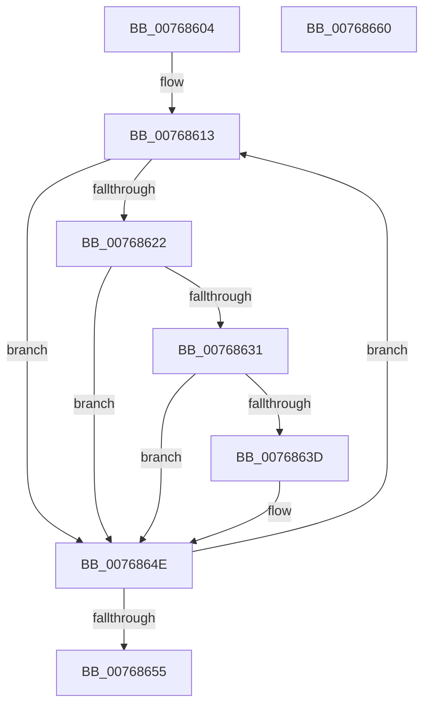

# PpmEnableWmiInterface

- RVA: `0x00768604`–`0x00768661` (길이 `93` bytes)
- VA: `0x0000000140768604`
- 실행 섹션: `PAGE`
- PDB 이름 있음: `예`; PDB Function 태그: `아니요`
- unwind 정보 RVA: `0x00068D5C`
- 디코드: `29`개 명령, `93/93` bytes 표시
- 미해석 바이트: `0` (있으면 어셈블리에 `.byte`로 보존)

> 이 문서는 커널 이미지의 기계어와 PDB 기호를 분석해 생성했습니다. 4번과 5번은 함수 원형과 자료형을 바이너리 사용 방식에서 추정한 C 해석이며 원본 소스 복구 결과는 아닙니다.

## 1. Dependencies

- 직접 호출 지점: **3**; 고유 호출 대상: **3**
- 직접 호출자로 확인된 함수: **2**
- RIP 상대 이미지 참조: **0**

### Outgoing calls
- `0x00768615` → [KeQueryGroupAffinity](../../text/47/KeQueryGroupAffinity_function_00471A60.md) (function, `0x00471A60`)
- `0x00768624` → [KeGetPrcb](../../text/2D/KeGetPrcb_function_002D85D0.md) (function, `0x002D85D0`)
- `0x00768649` → [IoWMIRegistrationControl](../9E/IoWMIRegistrationControl_function_009E2D60.md) (function, `0x009E2D60`)

### Direct callers
- [PopNewProcessorCallback](../75/PopNewProcessorCallback_function_007539A0.md) at `0x007539DA`
- [PoInitSystem](../../init/C7/PoInitSystem_function_00C72358.md) at `0x00C73178`

### Static image references
- 디코드된 RIP-relative 메모리 참조가 없습니다.

## 2. Other-region calls and transfers

- 다른 실행 섹션으로 향하는 call: **2**
  - `0x00768615` → [KeQueryGroupAffinity](../../text/47/KeQueryGroupAffinity_function_00471A60.md) (`PAGE` → `.text`)
  - `0x00768624` → [KeGetPrcb](../../text/2D/KeGetPrcb_function_002D85D0.md) (`PAGE` → `.text`)
- 별도 외부 분기/꼬리 이동을 확인하지 못했습니다.

## 3. Assembly (complete function range)

```asm
00768604  48 89 5C 24 10                  mov qword ptr [rsp + 0x10], rbx
00768609  57                              push rdi
0076860A  48 83 EC 20                     sub rsp, 0x20
0076860E  33 DB                           xor ebx, ebx
00768610  8D 7B 01                        lea edi, [rbx + 1]
00768613  33 C9                           xor ecx, ecx
00768615  E8 46 94 D0 FF                  call 0x140471a60
0076861A  8B CB                           mov ecx, ebx
0076861C  48 0F A3 C8                     bt rax, rcx
00768620  73 2C                           jae 0x14076864e
00768622  8B CB                           mov ecx, ebx
00768624  E8 A7 FF B6 FF                  call 0x1402d85d0
00768629  48 8B C8                        mov rcx, rax
0076862C  48 85 C0                        test rax, rax
0076862F  74 1D                           je 0x14076864e
00768631  33 C0                           xor eax, eax
00768633  F0 0F B1 B9 30 89 00 00         lock cmpxchg dword ptr [rcx + 0x8930], edi
0076863B  75 11                           jne 0x14076864e
0076863D  48 81 C1 28 89 00 00            add rcx, 0x8928
00768644  BA 01 00 00 80                  mov edx, 0x80000001
00768649  E8 12 A7 27 00                  call 0x1409e2d60
0076864E  03 DF                           add ebx, edi
00768650  83 FB 40                        cmp ebx, 0x40
00768653  72 BE                           jb 0x140768613
00768655  48 8B 5C 24 38                  mov rbx, qword ptr [rsp + 0x38]
0076865A  48 83 C4 20                     add rsp, 0x20
0076865E  5F                              pop rdi
0076865F  C3                              ret
00768660  CC                              int3
```

## 4. C-style interpretation (structured pseudocode)

```c
__int64 __fastcall PpmEnableWmiInterface(int a1)
{
    __int64 result;
    __int64 v_rbx;
    __int64 v_rsp;
    unsigned __int64 v_stack_p10;

    v_stack_p10 = v_rbx;
    v_rsp = (v_rsp) - (32);
    v_rbx = 0;
loc_00768613:
    a1 = 0;
    result = KeQueryGroupAffinity(a1, a2, a3, a4);
    if (condition_is_above_or_equal) goto loc_0076864E;
    result = KeGetPrcb(0, a2, a3, a4);
    if (result == 0) goto loc_0076864E;
    result = 0;
    if (!(condition_is_not_equal)) {
        a1 = (result) + (0x8928ULL);
        a2 = 0x80000001ULL;
        result = IoWMIRegistrationControl(a1, a2, a3, a4);
    }
    v_rbx = (unsigned int)((v_rbx) + ((unsigned int)(v_rbx + 1)));
    if (((unsigned int)(v_rbx)) < 64) goto loc_00768613;
    v_rsp = (v_rsp) + (32);
    return result;
}
```

## 5. (Beta) C Style

```c
int64_t PpmEnableWmiInterface(int32_t Arg1)
{
    int64_t result;
    int64_t local_rbx;
    int64_t local_rsp;
    uint64_t v_stack_p10;

    v_stack_p10 = local_rbx;
    local_rsp = (local_rsp) - (32);
    local_rbx = 0;
loc_00768613:
    Arg1 = 0;
    result = KeQueryGroupAffinity(Arg1, a2, a3, a4);
    if (condition_is_above_or_equal) goto loc_0076864E;
    result = KeGetPrcb(0, a2, a3, a4);
    if (result == 0) goto loc_0076864E;
    result = 0;
    if (!(condition_is_not_equal)) {
        Arg1 = (result) + (0x8928ULL);
        a2 = 0x80000001ULL;
        result = IoWMIRegistrationControl(Arg1, a2, a3, a4);
    }
    local_rbx = (uint32_t)((local_rbx) + ((uint32_t)(local_rbx + 1)));
    if (((uint32_t)(local_rbx)) < 64) goto loc_00768613;
    local_rsp = (local_rsp) + (32);
    return result;
}
```

## 6. Execution-region graph

[열기: 2D/3D 그래프와 함수 탐색 컨트롤 패널](../../../control-panel.html?section=page&rva=0x00768604&view=graph)

- 2D 그래프는 위에서 아래로 흐르고, 3D 그래프는 빈 공간을 드래그해 회전합니다. Shift+드래그는 이동, 휠은 확대·축소, 함수 노드 선택은 대상 보고서 이동입니다.

### Static fallback


