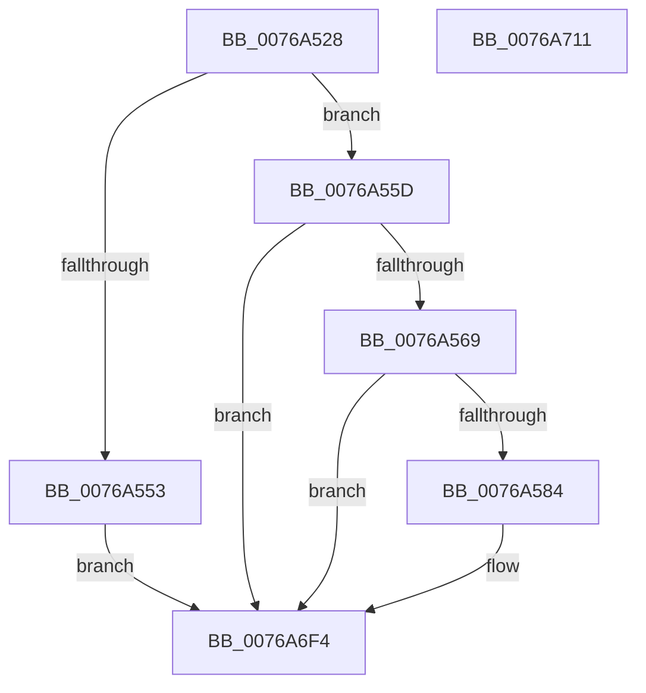

# PpmEventStaticPolicyRundown

- RVA: `0x0076A528`–`0x0076A712` (길이 `490` bytes)
- VA: `0x000000014076A528`
- 실행 섹션: `PAGE`
- PDB 이름 있음: `예`; PDB Function 태그: `아니요`
- unwind 정보 RVA: `0x000BD570`
- 디코드: `89`개 명령, `490/490` bytes 표시
- 미해석 바이트: `0` (있으면 어셈블리에 `.byte`로 보존)

> 이 문서는 커널 이미지의 기계어와 PDB 기호를 분석해 생성했습니다. 4번과 5번은 함수 원형과 자료형을 바이너리 사용 방식에서 추정한 C 해석이며 원본 소스 복구 결과는 아닙니다.

## 1. Dependencies

- 직접 호출 지점: **5**; 고유 호출 대상: **5**
- 직접 호출자로 확인된 함수: **1**
- RIP 상대 이미지 참조: **19**

### Outgoing calls
- `0x0076A548` → [Feature_PpmParkEx__private_IsEnabledDeviceUsageNoInline](../../text/4F/Feature_PpmParkEx__private_IsEnabledDeviceUsageNoInline_function_004F135C.md) (function, `0x004F135C`)
- `0x0076A553` → [PpmEventStaticPolicyRundownEx](../77/PpmEventStaticPolicyRundownEx_function_00772C88.md) (function, `0x00772C88`)
- `0x0076A577` → [EtwEventEnabled](../../text/39/EtwEventEnabled_function_00392450.md) (function, `0x00392450`)
- `0x0076A6EF` → [EtwWrite](../../text/41/EtwWrite_function_0041C720.md) (function, `0x0041C720`)
- `0x0076A6FB` → [_security_check_cookie](../../text/6A/_security_check_cookie_function_006AC640.md) (function, `0x006AC640`)

### Direct callers
- [PpmEventTraceControlCallback](../A5/PpmEventTraceControlCallback_function_00A51F60.md) at `0x00A520CF`

### Static image references
- `0x0076A53A` → RVA `0x00E0A740` (`.data`; read)
- `0x0076A55D` → RVA `0x00E67A39` (`.data`; read)
- `0x0076A569` → RVA `0x00F083E8` (`.data`; read)
- `0x0076A570` → RVA `0x00020FF8` (`.rdata`; read)
- `0x0076A584` → RVA `0x00FC5050` (`ALMOSTRO`; read)
- `0x0076A58A` → RVA `0x00FC6CC8` (`ALMOSTRO`; read)
- `0x0076A59D` → RVA `0x00FC5178` (`ALMOSTRO`; read)
- `0x0076A5B0` → RVA `0x00FC50E0` (`ALMOSTRO`; read)
- `0x0076A5C0` → RVA `0x00FC506C` (`ALMOSTRO`; read)
- `0x0076A5D5` → RVA `0x00FC517C` (`ALMOSTRO`; read)
- `0x0076A5EC` → RVA `0x00FC6CD4` (`ALMOSTRO`; read)
- `0x0076A600` → RVA `0x00E0B978` (`.data`; read)
- `0x0076A60B` → RVA `0x00FC5100` (`ALMOSTRO`; read)
- `0x0076A616` → RVA `0x00FC50B0` (`ALMOSTRO`; read)
- `0x0076A62A` → RVA `0x00FC50B8` (`ALMOSTRO`; read)
- `0x0076A635` → RVA `0x00F083A2` (`.data`; read)
- `0x0076A648` → RVA `0x00F083A0` (`.data`; read)
- `0x0076A65C` → RVA `0x00FC6C34` (`ALMOSTRO`; read)
- `0x0076A667` → RVA `0x00FC6C88` (`ALMOSTRO`; read)

## 2. Other-region calls and transfers

- 다른 실행 섹션으로 향하는 call: **4**
  - `0x0076A548` → [Feature_PpmParkEx__private_IsEnabledDeviceUsageNoInline](../../text/4F/Feature_PpmParkEx__private_IsEnabledDeviceUsageNoInline_function_004F135C.md) (`PAGE` → `.text`)
  - `0x0076A577` → [EtwEventEnabled](../../text/39/EtwEventEnabled_function_00392450.md) (`PAGE` → `.text`)
  - `0x0076A6EF` → [EtwWrite](../../text/41/EtwWrite_function_0041C720.md) (`PAGE` → `.text`)
  - `0x0076A6FB` → [_security_check_cookie](../../text/6A/_security_check_cookie_function_006AC640.md) (`PAGE` → `.text`)
- 별도 외부 분기/꼬리 이동을 확인하지 못했습니다.

## 3. Assembly (complete function range)

```asm
0076A528  48 89 5C 24 08                  mov qword ptr [rsp + 8], rbx
0076A52D  55                              push rbp
0076A52E  48 8D 6C 24 C0                  lea rbp, [rsp - 0x40]
0076A533  48 81 EC 40 01 00 00            sub rsp, 0x140
0076A53A  48 8B 05 FF 01 6A 00            mov rax, qword ptr [rip + 0x6a01ff]
0076A541  48 33 C4                        xor rax, rsp
0076A544  48 89 45 30                     mov qword ptr [rbp + 0x30], rax
0076A548  E8 0F 6E D8 FF                  call 0x1404f135c
0076A54D  33 DB                           xor ebx, ebx
0076A54F  85 C0                           test eax, eax
0076A551  74 0A                           je 0x14076a55d
0076A553  E8 30 87 00 00                  call 0x140772c88
0076A558  E9 97 01 00 00                  jmp 0x14076a6f4
0076A55D  38 1D D6 D4 6F 00               cmp byte ptr [rip + 0x6fd4d6], bl
0076A563  0F 84 8B 01 00 00               je 0x14076a6f4
0076A569  48 8B 0D 78 DE 79 00            mov rcx, qword ptr [rip + 0x79de78]
0076A570  48 8D 15 81 6A 8B FF            lea rdx, [rip - 0x74957f]
0076A577  E8 D4 7E C2 FF                  call 0x140392450
0076A57C  84 C0                           test al, al
0076A57E  0F 84 70 01 00 00               je 0x14076a6f4
0076A584  8B 0D C6 AA 85 00               mov ecx, dword ptr [rip + 0x85aac6]
0076A58A  48 8D 05 37 C7 85 00            lea rax, [rip + 0x85c737]
0076A591  48 89 44 24 40                  mov qword ptr [rsp + 0x40], rax
0076A596  48 8D 15 5B 6A 8B FF            lea rdx, [rip - 0x7495a5]
0076A59D  48 8D 05 D4 AB 85 00            lea rax, [rip + 0x85abd4]
0076A5A4  89 5C 24 34                     mov dword ptr [rsp + 0x34], ebx
0076A5A8  48 89 44 24 50                  mov qword ptr [rsp + 0x50], rax
0076A5AD  83 F9 FF                        cmp ecx, -1
0076A5B0  48 8D 05 29 AB 85 00            lea rax, [rip + 0x85ab29]
0076A5B7  48 C7 44 24 48 04 00 00 00      mov qword ptr [rsp + 0x48], 4
0076A5C0  0F 44 0D A5 AA 85 00            cmove ecx, dword ptr [rip + 0x85aaa5]
0076A5C7  41 B9 0F 00 00 00               mov r9d, 0xf
0076A5CD  48 89 44 24 60                  mov qword ptr [rsp + 0x60], rax
0076A5D2  45 33 C0                        xor r8d, r8d
0076A5D5  48 8D 05 A0 AB 85 00            lea rax, [rip + 0x85aba0]
0076A5DC  89 4C 24 38                     mov dword ptr [rsp + 0x38], ecx
0076A5E0  48 8B 0D 01 DE 79 00            mov rcx, qword ptr [rip + 0x79de01]
0076A5E7  48 89 44 24 70                  mov qword ptr [rsp + 0x70], rax
0076A5EC  48 8D 05 E1 C6 85 00            lea rax, [rip + 0x85c6e1]
0076A5F3  48 89 45 80                     mov qword ptr [rbp - 0x80], rax
0076A5F7  48 8D 44 24 34                  lea rax, [rsp + 0x34]
0076A5FC  48 89 45 90                     mov qword ptr [rbp - 0x70], rax
0076A600  48 8D 05 71 13 6A 00            lea rax, [rip + 0x6a1371]
0076A607  48 89 45 A0                     mov qword ptr [rbp - 0x60], rax
0076A60B  48 8D 05 EE AA 85 00            lea rax, [rip + 0x85aaee]
0076A612  48 89 45 B0                     mov qword ptr [rbp - 0x50], rax
0076A616  48 8D 05 93 AA 85 00            lea rax, [rip + 0x85aa93]
0076A61D  48 89 45 C0                     mov qword ptr [rbp - 0x40], rax
0076A621  48 8D 44 24 38                  lea rax, [rsp + 0x38]
0076A626  48 89 45 D0                     mov qword ptr [rbp - 0x30], rax
0076A62A  48 8D 05 87 AA 85 00            lea rax, [rip + 0x85aa87]
0076A631  48 89 45 E0                     mov qword ptr [rbp - 0x20], rax
0076A635  8A 05 67 DD 79 00               mov al, byte ptr [rip + 0x79dd67]
0076A63B  88 44 24 30                     mov byte ptr [rsp + 0x30], al
0076A63F  48 8D 44 24 30                  lea rax, [rsp + 0x30]
0076A644  48 89 45 F0                     mov qword ptr [rbp - 0x10], rax
0076A648  0F B6 05 51 DD 79 00            movzx eax, byte ptr [rip + 0x79dd51]
0076A64F  89 44 24 3C                     mov dword ptr [rsp + 0x3c], eax
0076A653  48 8D 44 24 3C                  lea rax, [rsp + 0x3c]
0076A658  48 89 45 00                     mov qword ptr [rbp], rax
0076A65C  48 8D 05 D1 C5 85 00            lea rax, [rip + 0x85c5d1]
0076A663  48 89 45 10                     mov qword ptr [rbp + 0x10], rax
0076A667  48 8D 05 1A C6 85 00            lea rax, [rip + 0x85c61a]
0076A66E  48 89 45 20                     mov qword ptr [rbp + 0x20], rax
0076A672  48 8D 44 24 40                  lea rax, [rsp + 0x40]
0076A677  48 89 44 24 20                  mov qword ptr [rsp + 0x20], rax
0076A67C  48 C7 44 24 58 04 00 00 00      mov qword ptr [rsp + 0x58], 4
0076A685  48 C7 44 24 68 04 00 00 00      mov qword ptr [rsp + 0x68], 4
0076A68E  48 C7 44 24 78 04 00 00 00      mov qword ptr [rsp + 0x78], 4
0076A697  48 C7 45 88 04 00 00 00         mov qword ptr [rbp - 0x78], 4
0076A69F  48 C7 45 98 04 00 00 00         mov qword ptr [rbp - 0x68], 4
0076A6A7  48 C7 45 A8 04 00 00 00         mov qword ptr [rbp - 0x58], 4
0076A6AF  48 C7 45 B8 04 00 00 00         mov qword ptr [rbp - 0x48], 4
0076A6B7  48 C7 45 C8 04 00 00 00         mov qword ptr [rbp - 0x38], 4
0076A6BF  48 C7 45 D8 04 00 00 00         mov qword ptr [rbp - 0x28], 4
0076A6C7  48 C7 45 E8 04 00 00 00         mov qword ptr [rbp - 0x18], 4
0076A6CF  48 C7 45 F8 01 00 00 00         mov qword ptr [rbp - 8], 1
0076A6D7  48 C7 45 08 04 00 00 00         mov qword ptr [rbp + 8], 4
0076A6DF  48 C7 45 18 04 00 00 00         mov qword ptr [rbp + 0x18], 4
0076A6E7  48 C7 45 28 04 00 00 00         mov qword ptr [rbp + 0x28], 4
0076A6EF  E8 2C 20 CB FF                  call 0x14041c720
0076A6F4  48 8B 4D 30                     mov rcx, qword ptr [rbp + 0x30]
0076A6F8  48 33 CC                        xor rcx, rsp
0076A6FB  E8 40 1F F4 FF                  call 0x1406ac640
0076A700  48 8B 9C 24 50 01 00 00         mov rbx, qword ptr [rsp + 0x150]
0076A708  48 81 C4 40 01 00 00            add rsp, 0x140
0076A70F  5D                              pop rbp
0076A710  C3                              ret
0076A711  CC                              int3
```

## 4. C-style interpretation (structured pseudocode)

```c
__int64 __fastcall PpmEventStaticPolicyRundown(__int64 a1, __int64 a2, int a3)
{
    __int64 result;
    __int64 v_rbx;
    __int64 v_rsp;
    unsigned __int64 v_stack_m100;
    unsigned __int64 v_stack_m108;
    unsigned int v_stack_m10C;
    unsigned int v_stack_m110;
    unsigned int v_stack_m114;
    unsigned __int8 v_stack_m118;
    unsigned __int64 v_stack_m128;
    unsigned __int64 v_stack_m18;
    unsigned __int64 v_stack_m20;
    unsigned __int64 v_stack_m28;
    unsigned __int64 v_stack_m30;
    unsigned __int64 v_stack_m38;
    unsigned __int64 v_stack_m40;
    unsigned __int64 v_stack_m48;
    unsigned __int64 v_stack_m50;
    unsigned __int64 v_stack_m58;
    unsigned __int64 v_stack_m60;
    unsigned __int64 v_stack_m68;
    unsigned __int64 v_stack_m70;
    unsigned __int64 v_stack_m78;
    unsigned __int64 v_stack_m80;
    unsigned __int64 v_stack_m88;
    unsigned __int64 v_stack_m90;
    unsigned __int64 v_stack_m98;
    unsigned __int64 v_stack_mA0;
    unsigned __int64 v_stack_mA8;
    unsigned __int64 v_stack_mB0;
    unsigned __int64 v_stack_mB8;
    unsigned __int64 v_stack_mC0;
    unsigned __int64 v_stack_mC8;
    unsigned __int64 v_stack_mD0;
    unsigned __int64 v_stack_mD8;
    unsigned __int64 v_stack_mE0;
    unsigned __int64 v_stack_mE8;
    unsigned __int64 v_stack_mF0;
    unsigned __int64 v_stack_mF8;
    unsigned __int64 v_stack_p8;

    v_stack_p8 = v_rbx;
    v_rsp = (v_rsp) - (320);
    result = (*(unsigned __int64 *)(v_rip + 6947327)) ^ (v_rsp);
    v_stack_m18 = result;
    result = Feature_PpmParkEx__private_IsEnabledDeviceUsageNoInline(a1, a2, a3, a4);
    v_rbx = 0;
    if ((unsigned int)(result) == 0) goto loc_0076A55D;
    result = PpmEventStaticPolicyRundownEx(a1, a2, a3, a4);
    goto loc_0076A6F4;
loc_0076A55D:
    if ((*(unsigned __int8 *)(v_rip + 7328982)) == 0) goto loc_0076A6F4;
    result = EtwEventEnabled(*(unsigned __int64 *)(v_rip + 7986808), v_rip - 7640447, a3, a4);
    if ((unsigned __int8)(result) != 0) {
        a1 = *(unsigned int *)(v_rip + 8760006);
        result = v_rip + 8767287;
        v_stack_m108 = result;
        a2 = v_rip - 7640485;
        result = v_rip + 8760276;
        v_stack_m114 = 0;
        v_stack_mF8 = result;
        result = v_rip + 8760105;
        v_stack_m100 = 4;
        if (((unsigned int)(a1)) == -1) { a1 = *(unsigned int *)(v_rip + 8759973); }
        a4 = 15;
        v_stack_mE8 = result;
        a3 = 0;
        result = v_rip + 8760224;
        v_stack_m110 = (unsigned int)(a1);
        a1 = *(unsigned __int64 *)(v_rip + 7986689);
        v_stack_mD8 = result;
        result = v_rip + 8767201;
        v_stack_mC8 = result;
        result = v_stack_m114;
        v_stack_mB8 = result;
        result = v_rip + 6951793;
        v_stack_mA8 = result;
        result = v_rip + 8760046;
        v_stack_m98 = result;
        result = v_rip + 8759955;
        v_stack_m88 = result;
        result = v_stack_m110;
        v_stack_m78 = result;
        result = v_rip + 8759943;
        v_stack_m68 = result;
        result = *(unsigned __int8 *)(v_rip + 7986535);
        v_stack_m118 = (unsigned __int8)(result);
        result = v_stack_m118;
        v_stack_m58 = result;
        result = *(unsigned __int8 *)(v_rip + 7986513);
        v_stack_m10C = (unsigned int)(result);
        result = v_stack_m10C;
        v_stack_m48 = result;
        result = v_rip + 8766929;
        v_stack_m38 = result;
        result = v_rip + 8767002;
        v_stack_m28 = result;
        result = v_stack_m108;
        v_stack_m128 = result;
        v_stack_mF0 = 4;
        v_stack_mE0 = 4;
        v_stack_mD0 = 4;
        v_stack_mC0 = 4;
        v_stack_mB0 = 4;
        v_stack_mA0 = 4;
        v_stack_m90 = 4;
        v_stack_m80 = 4;
        v_stack_m70 = 4;
        v_stack_m60 = 4;
        v_stack_m50 = 1;
        v_stack_m40 = 4;
        v_stack_m30 = 4;
        v_stack_m20 = 4;
        result = EtwWrite(a1, a2, a3, a4);
    }
    a1 = (v_stack_m18) ^ (v_rsp);
    result = _security_check_cookie(a1, a2, a3, a4);
    v_rsp = (v_rsp) + (320);
    return result;
}
```

## 5. (Beta) C Style

```c
int64_t PpmEventStaticPolicyRundown(int64_t Arg1, int64_t Arg2, int32_t Arg3)
{
    int64_t result;
    int64_t local_rbx;
    int64_t local_rsp;
    uint64_t v_stack_m100;
    uint64_t v_stack_m108;
    uint32_t v_stack_m10C;
    uint32_t v_stack_m110;
    uint32_t v_stack_m114;
    uint8_t v_stack_m118;
    uint64_t v_stack_m128;
    uint64_t v_stack_m18;
    uint64_t v_stack_m20;
    uint64_t v_stack_m28;
    uint64_t v_stack_m30;
    uint64_t v_stack_m38;
    uint64_t v_stack_m40;
    uint64_t v_stack_m48;
    uint64_t v_stack_m50;
    uint64_t v_stack_m58;
    uint64_t v_stack_m60;
    uint64_t v_stack_m68;
    uint64_t v_stack_m70;
    uint64_t v_stack_m78;
    uint64_t v_stack_m80;
    uint64_t v_stack_m88;
    uint64_t v_stack_m90;
    uint64_t v_stack_m98;
    uint64_t v_stack_mA0;
    uint64_t v_stack_mA8;
    uint64_t v_stack_mB0;
    uint64_t v_stack_mB8;
    uint64_t v_stack_mC0;
    uint64_t v_stack_mC8;
    uint64_t v_stack_mD0;
    uint64_t v_stack_mD8;
    uint64_t v_stack_mE0;
    uint64_t v_stack_mE8;
    uint64_t v_stack_mF0;
    uint64_t v_stack_mF8;
    uint64_t v_stack_p8;

    v_stack_p8 = local_rbx;
    local_rsp = (local_rsp) - (320);
    result = (*(uint64_t *)(v_rip + 0x6A01FF)) ^ (local_rsp);
    v_stack_m18 = result;
    result = Feature_PpmParkEx__private_IsEnabledDeviceUsageNoInline(Arg1, Arg2, Arg3, a4);
    local_rbx = 0;
    if ((uint32_t)(result) == 0) goto loc_0076A55D;
    result = PpmEventStaticPolicyRundownEx(Arg1, Arg2, Arg3, a4);
    goto loc_0076A6F4;
loc_0076A55D:
    if ((*(uint8_t *)(v_rip + 0x6FD4D6)) == 0) goto loc_0076A6F4;
    result = EtwEventEnabled(*(uint64_t *)(v_rip + 0x79DE78), v_rip - 7640447, Arg3, a4);
    if ((uint8_t)(result) != 0) {
        Arg1 = *(uint32_t *)(v_rip + 0x85AAC6);
        result = v_rip + 8767287;
        v_stack_m108 = result;
        Arg2 = v_rip - 7640485;
        result = v_rip + 8760276;
        v_stack_m114 = 0;
        v_stack_mF8 = result;
        result = v_rip + 8760105;
        v_stack_m100 = 4;
        if (((uint32_t)(Arg1)) == -1) { Arg1 = *(uint32_t *)(v_rip + 0x85AAA5); }
        a4 = 15;
        v_stack_mE8 = result;
        Arg3 = 0;
        result = v_rip + 8760224;
        v_stack_m110 = (uint32_t)(Arg1);
        Arg1 = *(uint64_t *)(v_rip + 0x79DE01);
        v_stack_mD8 = result;
        result = v_rip + 8767201;
        v_stack_mC8 = result;
        result = v_stack_m114;
        v_stack_mB8 = result;
        result = v_rip + 6951793;
        v_stack_mA8 = result;
        result = v_rip + 8760046;
        v_stack_m98 = result;
        result = v_rip + 8759955;
        v_stack_m88 = result;
        result = v_stack_m110;
        v_stack_m78 = result;
        result = v_rip + 8759943;
        v_stack_m68 = result;
        result = *(uint8_t *)(v_rip + 0x79DD67);
        v_stack_m118 = (uint8_t)(result);
        result = v_stack_m118;
        v_stack_m58 = result;
        result = *(uint8_t *)(v_rip + 0x79DD51);
        v_stack_m10C = (uint32_t)(result);
        result = v_stack_m10C;
        v_stack_m48 = result;
        result = v_rip + 8766929;
        v_stack_m38 = result;
        result = v_rip + 8767002;
        v_stack_m28 = result;
        result = v_stack_m108;
        v_stack_m128 = result;
        v_stack_mF0 = 4;
        v_stack_mE0 = 4;
        v_stack_mD0 = 4;
        v_stack_mC0 = 4;
        v_stack_mB0 = 4;
        v_stack_mA0 = 4;
        v_stack_m90 = 4;
        v_stack_m80 = 4;
        v_stack_m70 = 4;
        v_stack_m60 = 4;
        v_stack_m50 = 1;
        v_stack_m40 = 4;
        v_stack_m30 = 4;
        v_stack_m20 = 4;
        result = EtwWrite(Arg1, Arg2, Arg3, a4);
    }
    Arg1 = (v_stack_m18) ^ (local_rsp);
    result = _security_check_cookie(Arg1, Arg2, Arg3, a4);
    local_rsp = (local_rsp) + (320);
    return result;
}
```

## 6. Execution-region graph

[열기: 2D/3D 그래프와 함수 탐색 컨트롤 패널](../../../control-panel.html?section=page&rva=0x0076A528&view=graph)

- 2D 그래프는 위에서 아래로 흐르고, 3D 그래프는 빈 공간을 드래그해 회전합니다. Shift+드래그는 이동, 휠은 확대·축소, 함수 노드 선택은 대상 보고서 이동입니다.

### Static fallback


