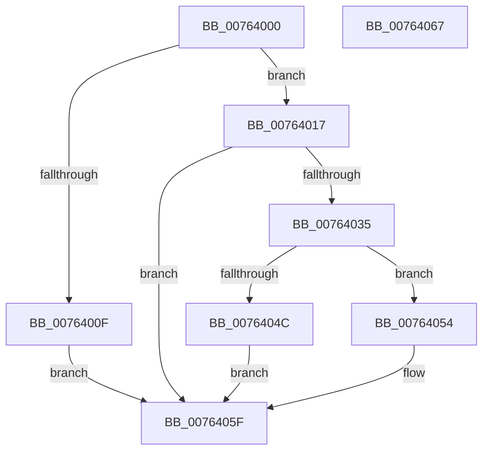

# PpmHeteroDispatchRegisterWpsUpdates

- RVA: `0x00764000`–`0x00764068` (길이 `104` bytes)
- VA: `0x0000000140764000`
- 실행 섹션: `PAGE`
- PDB 이름 있음: `예`; PDB Function 태그: `아니요`
- unwind 정보 RVA: `0x0005C788`
- 디코드: `29`개 명령, `104/104` bytes 표시
- 미해석 바이트: `0` (있으면 어셈블리에 `.byte`로 보존)

> 이 문서는 커널 이미지의 기계어와 PDB 기호를 분석해 생성했습니다. 4번과 5번은 함수 원형과 자료형을 바이너리 사용 방식에서 추정한 C 해석이며 원본 소스 복구 결과는 아닙니다.

## 1. Dependencies

- 직접 호출 지점: **1**; 고유 호출 대상: **1**
- 직접 호출자로 확인된 함수: **0**
- RIP 상대 이미지 참조: **4**

### Outgoing calls
- `0x00764057` → [guard_dispatch_icall](../../text/6B/guard_dispatch_icall_function_006BAAD0.md) (function, `0x006BAAD0`)

### Direct callers
- 이 함수 시작 RVA로 연결되는 직접 call은 확인되지 않았습니다. 간접 호출은 완전히 역산할 수 없습니다.

### Static image references
- `0x0076401D` → RVA `0x00FC6A94` (`ALMOSTRO`; read)
- `0x00764027` → RVA `0x00E0B804` (`.data`; read)
- `0x00764035` → RVA `0x004BE5E0` (`PpmHeteroDispatchHgsInterrupt`; read)
- `0x00764040` → RVA `0x00F0B218` (`.data`; read)

## 2. Other-region calls and transfers

- 다른 실행 섹션으로 향하는 call: **1**
  - `0x00764057` → [guard_dispatch_icall](../../text/6B/guard_dispatch_icall_function_006BAAD0.md) (`PAGE` → `.text`)
- 별도 외부 분기/꼬리 이동을 확인하지 못했습니다.

## 3. Assembly (complete function range)

```asm
00764000  48 83 EC 28                     sub rsp, 0x28
00764004  45 33 C0                        xor r8d, r8d
00764007  4C 8B C9                        mov r9, rcx
0076400A  48 85 C9                        test rcx, rcx
0076400D  75 08                           jne 0x140764017
0076400F  41 B8 0D 00 00 C0               mov r8d, 0xc000000d
00764015  EB 48                           jmp 0x14076405f
00764017  0F 57 C0                        xorps xmm0, xmm0
0076401A  0F 11 01                        movups xmmword ptr [rcx], xmm0
0076401D  0F B6 0D 70 2A 86 00            movzx ecx, byte ptr [rip + 0x862a70]
00764024  41 89 09                        mov dword ptr [r9], ecx
00764027  8B 05 D7 77 6A 00               mov eax, dword ptr [rip + 0x6a77d7]
0076402D  41 89 41 04                     mov dword ptr [r9 + 4], eax
00764031  84 C9                           test cl, cl
00764033  74 2A                           je 0x14076405f
00764035  48 8D 05 A4 A5 D5 FF            lea rax, [rip - 0x2a5a5c]
0076403C  49 89 41 08                     mov qword ptr [r9 + 8], rax
00764040  48 8B 05 D1 71 7A 00            mov rax, qword ptr [rip + 0x7a71d1]
00764047  48 85 C0                        test rax, rax
0076404A  75 08                           jne 0x140764054
0076404C  41 B8 A3 00 00 C0               mov r8d, 0xc00000a3
00764052  EB 0B                           jmp 0x14076405f
00764054  49 8B C9                        mov rcx, r9
00764057  E8 74 6A F5 FF                  call 0x1406baad0
0076405C  44 8B C0                        mov r8d, eax
0076405F  41 8B C0                        mov eax, r8d
00764062  48 83 C4 28                     add rsp, 0x28
00764066  C3                              ret
00764067  CC                              int3
```

## 4. C-style interpretation (structured pseudocode)

```c
__int64 __fastcall PpmHeteroDispatchRegisterWpsUpdates(__int64 a1, __int64 a2, int a3)
{
    __int64 result;
    __int64 v_rsp;

    v_rsp = (v_rsp) - (40);
    a3 = 0;
    if (a1 != 0) goto loc_00764017;
    goto loc_0076405F;
loc_00764017:
    *(unsigned __int64 *)(a1) = v_xmm0;
    *(unsigned int *)(a1) = (unsigned int)(*(unsigned __int8 *)(v_rip + 8792688));
    *(unsigned int *)(a1 + 4) = (unsigned int)((unsigned int)(*(unsigned int *)(v_rip + 6977495)));
    if ((unsigned __int8)(*(unsigned __int8 *)(v_rip + 8792688)) == 0) goto loc_0076405F;
    *(unsigned __int64 *)(a1 + 8) = v_rip - 2775644;
    if (*(unsigned __int64 *)(v_rip + 8024529) != 0) goto loc_00764054;
    goto loc_0076405F;
loc_00764054:
    result = guard_dispatch_icall(a1, a2, (unsigned int)(0xC00000A3ULL), a1);
loc_0076405F:
    v_rsp = (v_rsp) + (40);
    return (unsigned int)((unsigned int)((unsigned int)((unsigned int)(result))));
}
```

## 5. (Beta) C Style

```c
int64_t PpmHeteroDispatchRegisterWpsUpdates(void *Arg1, int64_t Arg2, int32_t Arg3)
{
    uint8_t *arg1 = (uint8_t *)Arg1;

    int64_t result;
    int64_t local_rsp;

    local_rsp = (local_rsp) - (40);
    Arg3 = 0;
    if (Arg1 != NULL) goto loc_00764017;
    goto loc_0076405F;
loc_00764017:
    *(uint64_t *)(arg1) = v_xmm0;
    *(uint32_t *)(arg1) = (uint32_t)(*(uint8_t *)(v_rip + 0x862A70));
    *(uint32_t *)(arg1 + 0x4) = (uint32_t)((uint32_t)(*(uint32_t *)(v_rip + 0x6A77D7)));
    if ((uint8_t)(*(uint8_t *)(v_rip + 0x862A70)) == 0) goto loc_0076405F;
    *(uint64_t *)(arg1 + 0x8) = v_rip - 2775644;
    if (*(uint64_t *)(v_rip + 0x7A71D1) != 0) goto loc_00764054;
    goto loc_0076405F;
loc_00764054:
    result = guard_dispatch_icall(Arg1, Arg2, (uint32_t)(0xC00000A3ULL), Arg1);
loc_0076405F:
    local_rsp = (local_rsp) + (40);
    return (uint32_t)((uint32_t)((uint32_t)((uint32_t)(result))));
}
```

### 관측된 메모리 오프셋

구조체 형식이 확인되지 않은 접근은 인자 기준의 오프셋으로만 기록했습니다.

| 기준 인자 | 오프셋 표현 | 폭 (bit) | 접근 |
|---|---:|---:|---|
| `Arg1` | `+ 0x0` | `32` | `W` |
| `Arg1` | `+ 0x4` | `32` | `W` |
| `Arg1` | `+ 0x8` | `64` | `W` |

## 6. Execution-region graph

[열기: 2D/3D 그래프와 함수 탐색 컨트롤 패널](../../../control-panel.html?section=page&rva=0x00764000&view=graph)

- 2D 그래프는 위에서 아래로 흐르고, 3D 그래프는 빈 공간을 드래그해 회전합니다. Shift+드래그는 이동, 휠은 확대·축소, 함수 노드 선택은 대상 보고서 이동입니다.

### Static fallback


