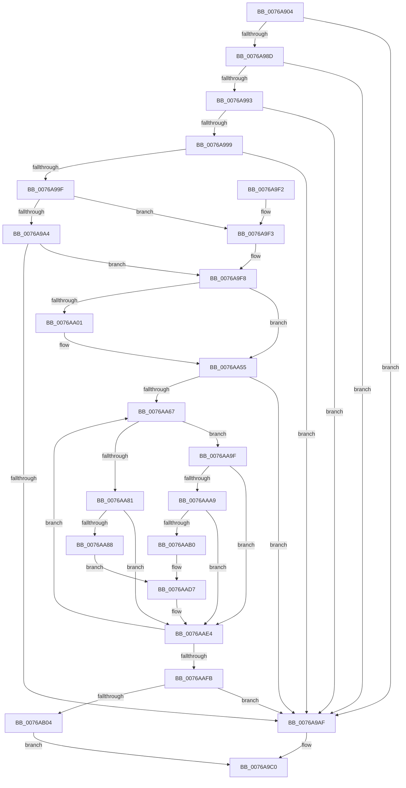

# PpmParkApplyForcedMask

- RVA: `0x0076A904`–`0x0076AB18` (길이 `532` bytes)
- VA: `0x000000014076A904`
- 실행 섹션: `PAGE`
- PDB 이름 있음: `예`; PDB Function 태그: `아니요`
- unwind 정보 RVA: `0x000CD328`
- 디코드: `134`개 명령, `532/532` bytes 표시
- 미해석 바이트: `0` (있으면 어셈블리에 `.byte`로 보존)

> 이 문서는 커널 이미지의 기계어와 PDB 기호를 분석해 생성했습니다. 4번과 5번은 함수 원형과 자료형을 바이너리 사용 방식에서 추정한 C 해석이며 원본 소스 복구 결과는 아닙니다.

## 1. Dependencies

- 직접 호출 지점: **16**; 고유 호출 대상: **10**
- 직접 호출자로 확인된 함수: **1**
- RIP 상대 이미지 참조: **4**

### Outgoing calls
- `0x0076A950` → [memset](../../text/6C/memset_function_006C6C40.md) (function, `0x006C6C40`)
- `0x0076A965` → [memset](../../text/6C/memset_function_006C6C40.md) (function, `0x006C6C40`)
- `0x0076A97E` → [PpmAcquireLock](../../text/2D/PpmAcquireLock_function_002D9AA4.md) (function, `0x002D9AA4`)
- `0x0076A9BB` → [PpmReleaseLock](../../text/2D/PpmReleaseLock_function_002DA428.md) (function, `0x002DA428`)
- `0x0076A9CC` → [_security_check_cookie](../../text/6A/_security_check_cookie_function_006AC640.md) (function, `0x006AC640`)
- `0x0076A9F8` → [Feature_PpmParkEx__private_IsEnabledDeviceUsageNoInline](../../text/4F/Feature_PpmParkEx__private_IsEnabledDeviceUsageNoInline_function_004F135C.md) (function, `0x004F135C`)
- `0x0076AA19` → [memset](../../text/6C/memset_function_006C6C40.md) (function, `0x006C6C40`)
- `0x0076AA2F` → [memset](../../text/6C/memset_function_006C6C40.md) (function, `0x006C6C40`)
- `0x0076AA40` → [KeAddGroupAffinityEx](../../text/25/KeAddGroupAffinityEx_function_0025B6C0.md) (function, `0x0025B6C0`)
- `0x0076AA50` → [KeAddGroupAffinityEx](../../text/25/KeAddGroupAffinityEx_function_0025B6C0.md) (function, `0x0025B6C0`)
- `0x0076AA78` → [Feature_PpmParkEx__private_IsEnabledDeviceUsageNoInline](../../text/4F/Feature_PpmParkEx__private_IsEnabledDeviceUsageNoInline_function_004F135C.md) (function, `0x004F135C`)
- `0x0076AABF` → [KeAndAffinityEx2](../../text/3C/KeAndAffinityEx2_function_003C0740.md) (function, `0x003C0740`)
- `0x0076AAD2` → [KeAndAffinityEx2](../../text/3C/KeAndAffinityEx2_function_003C0740.md) (function, `0x003C0740`)
- `0x0076AB04` → [PpmParkApplyPolicy](../../text/4B/PpmParkApplyPolicy_function_004B613C.md) (function, `0x004B613C`)
- `0x0076AB09` → [PpmParkParkingAvailable](../A8/PpmParkParkingAvailable_function_00A84F58.md) (function, `0x00A84F58`)
- `0x0076AB0E` → [PpmCheckApplyParkConstraints](../../text/3B/PpmCheckApplyParkConstraints_function_003BE994.md) (function, `0x003BE994`)

### Direct callers
- [NtPowerInformation](../95/NtPowerInformation_function_00955D80.md) at `0x009570E7`

### Static image references
- `0x0076A92A` → RVA `0x00E0A740` (`.data`; read)
- `0x0076A96D` → RVA `0x00F0CC00` (`.data`; read)
- `0x0076AA55` → RVA `0x00F083E0` (`.data`; read)
- `0x0076AA71` → RVA `0x00F083D8` (`.data`; read)

## 2. Other-region calls and transfers

- 다른 실행 섹션으로 향하는 call: **15**
  - `0x0076A950` → [memset](../../text/6C/memset_function_006C6C40.md) (`PAGE` → `.text`)
  - `0x0076A965` → [memset](../../text/6C/memset_function_006C6C40.md) (`PAGE` → `.text`)
  - `0x0076A97E` → [PpmAcquireLock](../../text/2D/PpmAcquireLock_function_002D9AA4.md) (`PAGE` → `.text`)
  - `0x0076A9BB` → [PpmReleaseLock](../../text/2D/PpmReleaseLock_function_002DA428.md) (`PAGE` → `.text`)
  - `0x0076A9CC` → [_security_check_cookie](../../text/6A/_security_check_cookie_function_006AC640.md) (`PAGE` → `.text`)
  - `0x0076A9F8` → [Feature_PpmParkEx__private_IsEnabledDeviceUsageNoInline](../../text/4F/Feature_PpmParkEx__private_IsEnabledDeviceUsageNoInline_function_004F135C.md) (`PAGE` → `.text`)
  - `0x0076AA19` → [memset](../../text/6C/memset_function_006C6C40.md) (`PAGE` → `.text`)
  - `0x0076AA2F` → [memset](../../text/6C/memset_function_006C6C40.md) (`PAGE` → `.text`)
  - `0x0076AA40` → [KeAddGroupAffinityEx](../../text/25/KeAddGroupAffinityEx_function_0025B6C0.md) (`PAGE` → `.text`)
  - `0x0076AA50` → [KeAddGroupAffinityEx](../../text/25/KeAddGroupAffinityEx_function_0025B6C0.md) (`PAGE` → `.text`)
  - `0x0076AA78` → [Feature_PpmParkEx__private_IsEnabledDeviceUsageNoInline](../../text/4F/Feature_PpmParkEx__private_IsEnabledDeviceUsageNoInline_function_004F135C.md) (`PAGE` → `.text`)
  - `0x0076AABF` → [KeAndAffinityEx2](../../text/3C/KeAndAffinityEx2_function_003C0740.md) (`PAGE` → `.text`)
  - `0x0076AAD2` → [KeAndAffinityEx2](../../text/3C/KeAndAffinityEx2_function_003C0740.md) (`PAGE` → `.text`)
  - `0x0076AB04` → [PpmParkApplyPolicy](../../text/4B/PpmParkApplyPolicy_function_004B613C.md) (`PAGE` → `.text`)
  - `0x0076AB0E` → [PpmCheckApplyParkConstraints](../../text/3B/PpmCheckApplyParkConstraints_function_003BE994.md) (`PAGE` → `.text`)
- 별도 외부 분기/꼬리 이동을 확인하지 못했습니다.

## 3. Assembly (complete function range)

```asm
0076A904  48 8B C4                        mov rax, rsp
0076A907  48 89 58 10                     mov qword ptr [rax + 0x10], rbx
0076A90B  48 89 70 18                     mov qword ptr [rax + 0x18], rsi
0076A90F  48 89 78 20                     mov qword ptr [rax + 0x20], rdi
0076A913  55                              push rbp
0076A914  41 54                           push r12
0076A916  41 55                           push r13
0076A918  41 56                           push r14
0076A91A  41 57                           push r15
0076A91C  48 8D A8 78 FE FF FF            lea rbp, [rax - 0x188]
0076A923  48 81 EC 60 02 00 00            sub rsp, 0x260
0076A92A  48 8B 05 0F FE 69 00            mov rax, qword ptr [rip + 0x69fe0f]
0076A931  48 33 C4                        xor rax, rsp
0076A934  48 89 85 50 01 00 00            mov qword ptr [rbp + 0x150], rax
0076A93B  4C 8B F2                        mov r14, rdx
0076A93E  48 8B F9                        mov rdi, rcx
0076A941  BE 08 01 00 00                  mov esi, 0x108
0076A946  48 8D 4C 24 30                  lea rcx, [rsp + 0x30]
0076A94B  44 8B C6                        mov r8d, esi
0076A94E  33 D2                           xor edx, edx
0076A950  E8 EB C2 F5 FF                  call 0x1406c6c40
0076A955  33 DB                           xor ebx, ebx
0076A957  48 8D 4D 40                     lea rcx, [rbp + 0x40]
0076A95B  44 8B C6                        mov r8d, esi
0076A95E  48 89 5C 24 20                  mov qword ptr [rsp + 0x20], rbx
0076A963  33 D2                           xor edx, edx
0076A965  E8 D6 C2 F5 FF                  call 0x1406c6c40
0076A96A  4C 8B 3F                        mov r15, qword ptr [rdi]
0076A96D  48 8D 0D 8C 22 7A 00            lea rcx, [rip + 0x7a228c]
0076A974  44 0F B7 67 08                  movzx r12d, word ptr [rdi + 8]
0076A979  4C 89 7C 24 28                  mov qword ptr [rsp + 0x28], r15
0076A97E  E8 21 F1 B6 FF                  call 0x1402d9aa4
0076A983  44 8D 6B 20                     lea r13d, [rbx + 0x20]
0076A987  66 45 3B E5                     cmp r12w, r13w
0076A98B  77 22                           ja 0x14076a9af
0076A98D  66 39 5F 0A                     cmp word ptr [rdi + 0xa], bx
0076A991  75 1C                           jne 0x14076a9af
0076A993  66 39 5F 0C                     cmp word ptr [rdi + 0xc], bx
0076A997  75 16                           jne 0x14076a9af
0076A999  66 39 5F 0E                     cmp word ptr [rdi + 0xe], bx
0076A99D  75 10                           jne 0x14076a9af
0076A99F  4D 85 F6                        test r14, r14
0076A9A2  74 4F                           je 0x14076a9f3
0076A9A4  49 8B C7                        mov rax, r15
0076A9A7  48 F7 D0                        not rax
0076A9AA  49 85 06                        test qword ptr [r14], rax
0076A9AD  74 49                           je 0x14076a9f8
0076A9AF  BB 0D 00 00 C0                  mov ebx, 0xc000000d
0076A9B4  48 8D 0D 45 22 7A 00            lea rcx, [rip + 0x7a2245]
0076A9BB  E8 68 FA B6 FF                  call 0x1402da428
0076A9C0  8B C3                           mov eax, ebx
0076A9C2  48 8B 8D 50 01 00 00            mov rcx, qword ptr [rbp + 0x150]
0076A9C9  48 33 CC                        xor rcx, rsp
0076A9CC  E8 6F 1C F4 FF                  call 0x1406ac640
0076A9D1  4C 8D 9C 24 60 02 00 00         lea r11, [rsp + 0x260]
0076A9D9  49 8B 5B 38                     mov rbx, qword ptr [r11 + 0x38]
0076A9DD  49 8B 73 40                     mov rsi, qword ptr [r11 + 0x40]
0076A9E1  49 8B 7B 48                     mov rdi, qword ptr [r11 + 0x48]
0076A9E5  49 8B E3                        mov rsp, r11
0076A9E8  41 5F                           pop r15
0076A9EA  41 5E                           pop r14
0076A9EC  41 5D                           pop r13
0076A9EE  41 5C                           pop r12
0076A9F0  5D                              pop rbp
0076A9F1  C3                              ret
0076A9F2  CC                              int3
0076A9F3  4C 8D 74 24 20                  lea r14, [rsp + 0x20]
0076A9F8  E8 5F 69 D8 FF                  call 0x1404f135c
0076A9FD  85 C0                           test eax, eax
0076A9FF  74 54                           je 0x14076aa55
0076AA01  BF 00 01 00 00                  mov edi, 0x100
0076AA06  48 C7 44 24 30 01 00 20 00      mov qword ptr [rsp + 0x30], 0x200001
0076AA0F  44 8B C7                        mov r8d, edi
0076AA12  48 8D 4C 24 38                  lea rcx, [rsp + 0x38]
0076AA17  33 D2                           xor edx, edx
0076AA19  E8 22 C2 F5 FF                  call 0x1406c6c40
0076AA1E  44 8B C7                        mov r8d, edi
0076AA21  48 C7 45 40 01 00 20 00         mov qword ptr [rbp + 0x40], 0x200001
0076AA29  33 D2                           xor edx, edx
0076AA2B  48 8D 4D 48                     lea rcx, [rbp + 0x48]
0076AA2F  E8 0C C2 F5 FF                  call 0x1406c6c40
0076AA34  4D 8B C7                        mov r8, r15
0076AA37  48 8D 4C 24 30                  lea rcx, [rsp + 0x30]
0076AA3C  41 0F B7 D4                     movzx edx, r12w
0076AA40  E8 7B 0C AF FF                  call 0x14025b6c0
0076AA45  4D 8B 06                        mov r8, qword ptr [r14]
0076AA48  48 8D 4D 40                     lea rcx, [rbp + 0x40]
0076AA4C  41 0F B7 D4                     movzx edx, r12w
0076AA50  E8 6B 0C AF FF                  call 0x14025b6c0
0076AA55  39 1D 85 D9 79 00               cmp dword ptr [rip + 0x79d985], ebx
0076AA5B  44 8A EB                        mov r13b, bl
0076AA5E  0F B7 F3                        movzx esi, bx
0076AA61  0F 86 48 FF FF FF               jbe 0x14076a9af
0076AA67  0F B7 C6                        movzx eax, si
0076AA6A  48 69 F8 10 05 00 00            imul rdi, rax, 0x510
0076AA71  48 03 3D 60 D9 79 00            add rdi, qword ptr [rip + 0x79d960]
0076AA78  E8 DF 68 D8 FF                  call 0x1404f135c
0076AA7D  85 C0                           test eax, eax
0076AA7F  75 1E                           jne 0x14076aa9f
0076AA81  66 44 39 67 04                  cmp word ptr [rdi + 4], r12w
0076AA86  75 5C                           jne 0x14076aae4
0076AA88  48 8B 4F 10                     mov rcx, qword ptr [rdi + 0x10]
0076AA8C  48 8B C1                        mov rax, rcx
0076AA8F  49 23 C7                        and rax, r15
0076AA92  48 89 47 18                     mov qword ptr [rdi + 0x18], rax
0076AA96  49 23 0E                        and rcx, qword ptr [r14]
0076AA99  48 89 4F 28                     mov qword ptr [rdi + 0x28], rcx
0076AA9D  EB 38                           jmp 0x14076aad7
0076AA9F  4C 8D 7F 30                     lea r15, [rdi + 0x30]
0076AAA3  66 45 3B 27                     cmp r12w, word ptr [r15]
0076AAA7  73 3B                           jae 0x14076aae4
0076AAA9  4B 39 5C E7 08                  cmp qword ptr [r15 + r12*8 + 8], rbx
0076AAAE  74 34                           je 0x14076aae4
0076AAB0  4C 8D 87 38 01 00 00            lea r8, [rdi + 0x138]
0076AAB7  49 8B CF                        mov rcx, r15
0076AABA  48 8D 54 24 30                  lea rdx, [rsp + 0x30]
0076AABF  E8 7C 5C C5 FF                  call 0x1403c0740
0076AAC4  4C 8D 87 48 03 00 00            lea r8, [rdi + 0x348]
0076AACB  49 8B CF                        mov rcx, r15
0076AACE  48 8D 55 40                     lea rdx, [rbp + 0x40]
0076AAD2  E8 69 5C C5 FF                  call 0x1403c0740
0076AAD7  41 BD 01 00 00 00               mov r13d, 1
0076AADD  44 08 AF A0 04 00 00            or byte ptr [rdi + 0x4a0], r13b
0076AAE4  4C 8B 7C 24 28                  mov r15, qword ptr [rsp + 0x28]
0076AAE9  66 FF C6                        inc si
0076AAEC  0F B7 C6                        movzx eax, si
0076AAEF  3B 05 EB D8 79 00               cmp eax, dword ptr [rip + 0x79d8eb]
0076AAF5  0F 82 6C FF FF FF               jb 0x14076aa67
0076AAFB  45 84 ED                        test r13b, r13b
0076AAFE  0F 84 AB FE FF FF               je 0x14076a9af
0076AB04  E8 33 B6 D4 FF                  call 0x1404b613c
0076AB09  E8 4A A4 31 00                  call 0x140a84f58
0076AB0E  E8 81 3E C5 FF                  call 0x1403be994
0076AB13  E9 A8 FE FF FF                  jmp 0x14076a9c0
```

## 4. C-style interpretation (structured pseudocode)

```c
__int64 __fastcall PpmParkApplyForcedMask(__int64 a1, __int64 a2)
{
    __int64 result;
    __int64 v_rbx;
    __int64 v_rdi;
    __int64 v_rsi;
    __int64 v_rsp;
    unsigned __int64 v_stack_m228;
    unsigned __int64 v_stack_m230;
    unsigned __int64 v_stack_m238;
    unsigned __int64 v_stack_m240;
    unsigned __int64 v_stack_m258;
    unsigned __int64 v_stack_m260;
    unsigned __int64 v_stack_m268;
    unsigned __int64 v_stack_m28;

    *(unsigned __int64 *)(v_rsp + 16) = v_rbx;
    *(unsigned __int64 *)(v_rsp + 24) = v_rsi;
    *(unsigned __int64 *)(v_rsp + 32) = v_rdi;
    v_rsp = (v_rsp) - (608);
    result = (*(unsigned __int64 *)(v_rip + 6946319)) ^ (v_rsp);
    *(unsigned __int64 *)(v_rsp - 392 + 336) = result;
    a2 = 0;
    result = memset(v_stack_m258, a2, 264, a4);
    v_rbx = 0;
    v_stack_m268 = 0;
    a2 = 0;
    result = memset(v_rsp - 392 + 64, a2, 264, a4);
    v_stack_m260 = *(unsigned __int64 *)(a1);
    result = PpmAcquireLock(v_rip + 8004236, a2, 264, a4);
    if (((unsigned __int16)(*(unsigned __int16 *)(a1 + 8))) > ((unsigned __int16)(v_rbx + 32))) goto loc_0076A9AF;
    if ((*(unsigned __int16 *)(a1 + 10)) != 0) goto loc_0076A9AF;
    if ((*(unsigned __int16 *)(a1 + 12)) != 0) goto loc_0076A9AF;
    if ((*(unsigned __int16 *)(a1 + 14)) != 0) goto loc_0076A9AF;
    if (0 == 0) goto loc_0076A9F3;
    result = ~(*(unsigned __int64 *)(a1));
    if (((*(unsigned __int64 *)(a2)) & (result)) == 0) goto loc_0076A9F8;
loc_0076A9AF:
    result = PpmReleaseLock(v_rip + 8004165, a2, 264, a4);
loc_0076A9C0:
    a1 = (*(unsigned __int64 *)(v_rsp - 392 + 336)) ^ (v_rsp);
    result = _security_check_cookie(a1, a2, 264, a4);
    return result;
loc_0076A9F3:
loc_0076A9F8:
    result = Feature_PpmParkEx__private_IsEnabledDeviceUsageNoInline(a1, a2, 264, a4);
    v_rdi = *(unsigned __int64 *)(v_stack_m28 + 72);
    if ((unsigned int)(result) != 0) {
        v_rdi = 256;
        v_stack_m230 = 0x200001ULL;
        a3 = (unsigned int)(v_rdi);
        a1 = v_stack_m228;
        a2 = 0;
        result = memset(a1, a2, a3, a4);
        a3 = (unsigned int)(v_rdi);
        *(unsigned __int64 *)(v_rsp - 392 + 64) = 0x200001ULL;
        a2 = 0;
        a1 = v_rsp - 392 + 72;
        result = memset(a1, a2, a3, a4);
        a3 = *(unsigned __int64 *)(a1);
        a1 = v_stack_m230;
        a2 = (unsigned __int16)(*(unsigned __int16 *)(a1 + 8));
        result = KeAddGroupAffinityEx(a1, a2, a3, a4);
        a3 = *(unsigned __int64 *)(v_stack_m240);
        a1 = v_rsp - 392 + 64;
        a2 = (unsigned __int16)(*(unsigned __int16 *)(a1 + 8));
        result = KeAddGroupAffinityEx(a1, a2, a3, a4);
    }
    if ((*(unsigned int *)(v_rip + 7985541)) <= ((unsigned int)(*(unsigned __int64 *)(v_stack_m28 + 56)))) goto loc_0076A9AF;
loc_0076AA67:
    v_rdi = (v_rdi) * ((unsigned __int16)((unsigned __int16)(*(unsigned __int64 *)(v_stack_m28 + 56))));
    v_rdi = (v_rdi) + (*(unsigned __int64 *)(v_rip + 7985504));
    result = Feature_PpmParkEx__private_IsEnabledDeviceUsageNoInline(a1, a2, a3, a4);
    if ((unsigned int)(result) != 0) goto loc_0076AA9F;
    if ((*(unsigned __int16 *)(v_rdi + 4)) != ((unsigned __int16)(*(unsigned __int16 *)(a1 + 8)))) goto loc_0076AAE4;
    result = (*(unsigned __int64 *)(v_rdi + 16)) & (*(unsigned __int64 *)(a1));
    *(unsigned __int64 *)(v_rdi + 24) = result;
    a1 = (*(unsigned __int64 *)(v_rdi + 16)) & (*(unsigned __int64 *)(v_stack_m240));
    *(unsigned __int64 *)(v_rdi + 40) = a1;
    goto loc_0076AAD7;
loc_0076AA9F:
    if (((unsigned __int16)(*(unsigned __int16 *)(a1 + 8))) >= (*(unsigned __int16 *)(v_rdi + 48))) goto loc_0076AAE4;
    if ((*(unsigned __int64 *)(v_rdi + 48 + *(unsigned __int16 *)(a1 + 8) * 8 + 8)) == (*(unsigned __int64 *)(v_stack_m28 + 56))) goto loc_0076AAE4;
    result = KeAndAffinityEx2(v_rdi + 48, v_stack_m230, v_rdi + 312, a4);
    result = KeAndAffinityEx2(v_rdi + 48, v_rsp - 392 + 64, v_rdi + 840, a4);
loc_0076AAD7:
loc_0076AAE4:
    v_rsi = (unsigned __int16)(((unsigned __int16)(*(unsigned __int64 *)(v_stack_m28 + 56))) + 1);
    if (((unsigned int)((unsigned __int16)(v_rsi))) < (*(unsigned int *)(v_rip + 7985387))) goto loc_0076AA67;
    if (1 == 0) goto loc_0076A9AF;
    result = PpmParkApplyPolicy(v_rdi + 48, v_rsp - 392 + 64, v_rdi + 840, a4);
    result = PpmParkParkingAvailable(v_rdi + 48, v_rsp - 392 + 64, v_rdi + 840, a4);
    result = PpmCheckApplyParkConstraints(v_rdi + 48, v_rsp - 392 + 64, v_rdi + 840, a4);
    goto loc_0076A9C0;
}
```

## 5. (Beta) C Style

```c
int64_t PpmParkApplyForcedMask(void *Arg1, int64_t Arg2)
{
    uint8_t *arg1 = (uint8_t *)Arg1;

    int64_t result;
    int64_t local_rbx;
    int64_t local_rdi;
    int64_t local_rsi;
    int64_t local_rsp;
    uint64_t v_stack_m228;
    uint64_t v_stack_m230;
    uint64_t v_stack_m238;
    uint64_t v_stack_m240;
    uint64_t v_stack_m258;
    uint64_t v_stack_m260;
    uint64_t v_stack_m268;
    uint64_t v_stack_m28;

    *(uint64_t *)(local_rsp + 0x10) = local_rbx;
    *(uint64_t *)(local_rsp + 0x18) = local_rsi;
    *(uint64_t *)(local_rsp + 0x20) = local_rdi;
    local_rsp = (local_rsp) - (608);
    result = (*(uint64_t *)(v_rip + 0x69FE0F)) ^ (local_rsp);
    *(uint64_t *)(local_rsp - 0x188 + 0x150) = result;
    Arg2 = 0;
    result = memset(v_stack_m258, Arg2, 264, a4);
    local_rbx = 0;
    v_stack_m268 = 0;
    Arg2 = 0;
    result = memset(local_rsp - 392 + 64, Arg2, 264, a4);
    v_stack_m260 = *(uint64_t *)(arg1);
    result = PpmAcquireLock(v_rip + 8004236, Arg2, 264, a4);
    if (((uint16_t)(*(uint16_t *)(arg1 + 0x8))) > ((uint16_t)(local_rbx + 32))) goto loc_0076A9AF;
    if ((*(uint16_t *)(arg1 + 0xA)) != 0) goto loc_0076A9AF;
    if ((*(uint16_t *)(arg1 + 0xC)) != 0) goto loc_0076A9AF;
    if ((*(uint16_t *)(arg1 + 0xE)) != 0) goto loc_0076A9AF;
    if (0 == 0) goto loc_0076A9F3;
    result = ~(*(uint64_t *)(arg1));
    if (((*(uint64_t *)(Arg2)) & (result)) == 0) goto loc_0076A9F8;
loc_0076A9AF:
    result = PpmReleaseLock(v_rip + 8004165, Arg2, 264, a4);
loc_0076A9C0:
    Arg1 = (*(uint64_t *)(local_rsp - 0x188 + 0x150)) ^ (local_rsp);
    result = _security_check_cookie(Arg1, Arg2, 264, a4);
    return result;
loc_0076A9F3:
loc_0076A9F8:
    result = Feature_PpmParkEx__private_IsEnabledDeviceUsageNoInline(Arg1, Arg2, 264, a4);
    local_rdi = *(uint64_t *)(v_stack_m28 + 0x48);
    if ((uint32_t)(result) != 0) {
        local_rdi = 256;
        v_stack_m230 = 0x200001ULL;
        a3 = (uint32_t)(local_rdi);
        Arg1 = v_stack_m228;
        Arg2 = 0;
        result = memset(Arg1, Arg2, a3, a4);
        a3 = (uint32_t)(local_rdi);
        *(uint64_t *)(local_rsp - 0x188 + 0x40) = 0x200001ULL;
        Arg2 = 0;
        Arg1 = local_rsp - 392 + 72;
        result = memset(Arg1, Arg2, a3, a4);
        a3 = *(uint64_t *)(arg1);
        Arg1 = v_stack_m230;
        Arg2 = (uint16_t)(*(uint16_t *)(arg1 + 0x8));
        result = KeAddGroupAffinityEx(Arg1, Arg2, a3, a4);
        a3 = *(uint64_t *)(v_stack_m240);
        Arg1 = local_rsp - 392 + 64;
        Arg2 = (uint16_t)(*(uint16_t *)(arg1 + 0x8));
        result = KeAddGroupAffinityEx(Arg1, Arg2, a3, a4);
    }
    if ((*(uint32_t *)(v_rip + 0x79D985)) <= ((uint32_t)(*(uint64_t *)(v_stack_m28 + 0x38)))) goto loc_0076A9AF;
loc_0076AA67:
    local_rdi = (local_rdi) * ((uint16_t)((uint16_t)(*(uint64_t *)(v_stack_m28 + 0x38))));
    local_rdi = (local_rdi) + (*(uint64_t *)(v_rip + 0x79D960));
    result = Feature_PpmParkEx__private_IsEnabledDeviceUsageNoInline(Arg1, Arg2, a3, a4);
    if ((uint32_t)(result) != 0) goto loc_0076AA9F;
    if ((*(uint16_t *)(local_rdi + 0x4)) != ((uint16_t)(*(uint16_t *)(arg1 + 0x8)))) goto loc_0076AAE4;
    result = (*(uint64_t *)(local_rdi + 0x10)) & (*(uint64_t *)(arg1));
    *(uint64_t *)(local_rdi + 0x18) = result;
    Arg1 = (*(uint64_t *)(local_rdi + 0x10)) & (*(uint64_t *)(v_stack_m240));
    *(void **)(local_rdi + 0x28) = Arg1;
    goto loc_0076AAD7;
loc_0076AA9F:
    if (((uint16_t)(*(uint16_t *)(arg1 + 0x8))) >= (*(uint16_t *)(local_rdi + 0x30))) goto loc_0076AAE4;
    if ((*(uint64_t *)(local_rdi + 0x30 + *(uint16_t *)(arg1 + 0x8) * 8 + 0x8)) == (*(uint64_t *)(v_stack_m28 + 0x38))) goto loc_0076AAE4;
    result = KeAndAffinityEx2(local_rdi + 48, v_stack_m230, local_rdi + 312, a4);
    result = KeAndAffinityEx2(local_rdi + 48, local_rsp - 392 + 64, local_rdi + 840, a4);
loc_0076AAD7:
loc_0076AAE4:
    local_rsi = (uint16_t)(((uint16_t)(*(uint64_t *)(v_stack_m28 + 0x38))) + 1);
    if (((uint32_t)((uint16_t)(local_rsi))) < (*(uint32_t *)(v_rip + 0x79D8EB))) goto loc_0076AA67;
    if (1 == 0) goto loc_0076A9AF;
    result = PpmParkApplyPolicy(local_rdi + 48, local_rsp - 392 + 64, local_rdi + 840, a4);
    result = PpmParkParkingAvailable(local_rdi + 48, local_rsp - 392 + 64, local_rdi + 840, a4);
    result = PpmCheckApplyParkConstraints(local_rdi + 48, local_rsp - 392 + 64, local_rdi + 840, a4);
    goto loc_0076A9C0;
}
```

### 관측된 메모리 오프셋

구조체 형식이 확인되지 않은 접근은 인자 기준의 오프셋으로만 기록했습니다.

| 기준 인자 | 오프셋 표현 | 폭 (bit) | 접근 |
|---|---:|---:|---|
| `Arg1` | `+ 0x0` | `64` | `R` |
| `Arg1` | `+ 0x8` | `16` | `R` |
| `Arg1` | `+ 0xA` | `16` | `R` |
| `Arg1` | `+ 0xC` | `16` | `R` |
| `Arg1` | `+ 0xE` | `16` | `R` |

## 6. Execution-region graph

[열기: 2D/3D 그래프와 함수 탐색 컨트롤 패널](../../../control-panel.html?section=page&rva=0x0076A904&view=graph)

- 2D 그래프는 위에서 아래로 흐르고, 3D 그래프는 빈 공간을 드래그해 회전합니다. Shift+드래그는 이동, 휠은 확대·축소, 함수 노드 선택은 대상 보고서 이동입니다.

### Static fallback


