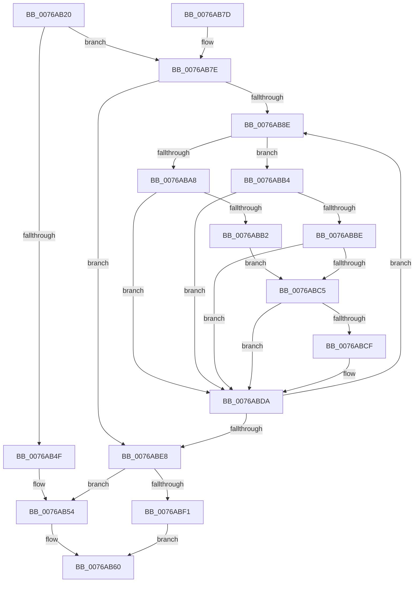

# PpmParkClearForcedMask

- RVA: `0x0076AB20`–`0x0076AC05` (길이 `229` bytes)
- VA: `0x000000014076AB20`
- 실행 섹션: `PAGE`
- PDB 이름 있음: `예`; PDB Function 태그: `아니요`
- unwind 정보 RVA: `0x000CD354`
- 디코드: `60`개 명령, `229/229` bytes 표시
- 미해석 바이트: `0` (있으면 어셈블리에 `.byte`로 보존)

> 이 문서는 커널 이미지의 기계어와 PDB 기호를 분석해 생성했습니다. 4번과 5번은 함수 원형과 자료형을 바이너리 사용 방식에서 추정한 C 해석이며 원본 소스 복구 결과는 아닙니다.

## 1. Dependencies

- 직접 호출 지점: **6**; 고유 호출 대상: **6**
- 직접 호출자로 확인된 함수: **1**
- RIP 상대 이미지 참조: **3**

### Outgoing calls
- `0x0076AB43` → [PpmAcquireLock](../../text/2D/PpmAcquireLock_function_002D9AA4.md) (function, `0x002D9AA4`)
- `0x0076AB5B` → [PpmReleaseLock](../../text/2D/PpmReleaseLock_function_002DA428.md) (function, `0x002DA428`)
- `0x0076AB9F` → [Feature_PpmParkEx__private_IsEnabledDeviceUsageNoInline](../../text/4F/Feature_PpmParkEx__private_IsEnabledDeviceUsageNoInline_function_004F135C.md) (function, `0x004F135C`)
- `0x0076ABF1` → [PpmParkApplyPolicy](../../text/4B/PpmParkApplyPolicy_function_004B613C.md) (function, `0x004B613C`)
- `0x0076ABF6` → [PpmParkParkingAvailable](../A8/PpmParkParkingAvailable_function_00A84F58.md) (function, `0x00A84F58`)
- `0x0076ABFB` → [PpmCheckApplyParkConstraints](../../text/3B/PpmCheckApplyParkConstraints_function_003BE994.md) (function, `0x003BE994`)

### Direct callers
- [NtPowerInformation](../95/NtPowerInformation_function_00955D80.md) at `0x009570FE`

### Static image references
- `0x0076AB3C` → RVA `0x00F0CC00` (`.data`; read)
- `0x0076AB80` → RVA `0x00F083E0` (`.data`; read)
- `0x0076AB98` → RVA `0x00F083D8` (`.data`; read)

## 2. Other-region calls and transfers

- 다른 실행 섹션으로 향하는 call: **5**
  - `0x0076AB43` → [PpmAcquireLock](../../text/2D/PpmAcquireLock_function_002D9AA4.md) (`PAGE` → `.text`)
  - `0x0076AB5B` → [PpmReleaseLock](../../text/2D/PpmReleaseLock_function_002DA428.md) (`PAGE` → `.text`)
  - `0x0076AB9F` → [Feature_PpmParkEx__private_IsEnabledDeviceUsageNoInline](../../text/4F/Feature_PpmParkEx__private_IsEnabledDeviceUsageNoInline_function_004F135C.md) (`PAGE` → `.text`)
  - `0x0076ABF1` → [PpmParkApplyPolicy](../../text/4B/PpmParkApplyPolicy_function_004B613C.md) (`PAGE` → `.text`)
  - `0x0076ABFB` → [PpmCheckApplyParkConstraints](../../text/3B/PpmCheckApplyParkConstraints_function_003BE994.md) (`PAGE` → `.text`)
- 별도 외부 분기/꼬리 이동을 확인하지 못했습니다.

## 3. Assembly (complete function range)

```asm
0076AB20  48 8B C4                        mov rax, rsp
0076AB23  48 89 58 08                     mov qword ptr [rax + 8], rbx
0076AB27  48 89 68 10                     mov qword ptr [rax + 0x10], rbp
0076AB2B  48 89 70 18                     mov qword ptr [rax + 0x18], rsi
0076AB2F  48 89 78 20                     mov qword ptr [rax + 0x20], rdi
0076AB33  41 56                           push r14
0076AB35  48 83 EC 20                     sub rsp, 0x20
0076AB39  4C 8B F1                        mov r14, rcx
0076AB3C  48 8D 0D BD 20 7A 00            lea rcx, [rip + 0x7a20bd]
0076AB43  E8 5C EF B6 FF                  call 0x1402d9aa4
0076AB48  66 41 83 3E 20                  cmp word ptr [r14], 0x20
0076AB4D  72 2F                           jb 0x14076ab7e
0076AB4F  BB 0D 00 00 C0                  mov ebx, 0xc000000d
0076AB54  48 8D 0D A5 20 7A 00            lea rcx, [rip + 0x7a20a5]
0076AB5B  E8 C8 F8 B6 FF                  call 0x1402da428
0076AB60  48 8B 6C 24 38                  mov rbp, qword ptr [rsp + 0x38]
0076AB65  8B C3                           mov eax, ebx
0076AB67  48 8B 5C 24 30                  mov rbx, qword ptr [rsp + 0x30]
0076AB6C  48 8B 74 24 40                  mov rsi, qword ptr [rsp + 0x40]
0076AB71  48 8B 7C 24 48                  mov rdi, qword ptr [rsp + 0x48]
0076AB76  48 83 C4 20                     add rsp, 0x20
0076AB7A  41 5E                           pop r14
0076AB7C  C3                              ret
0076AB7D  CC                              int3
0076AB7E  33 DB                           xor ebx, ebx
0076AB80  39 1D 5A D8 79 00               cmp dword ptr [rip + 0x79d85a], ebx
0076AB86  40 8A EB                        mov bpl, bl
0076AB89  0F B7 F3                        movzx esi, bx
0076AB8C  76 5A                           jbe 0x14076abe8
0076AB8E  0F B7 C6                        movzx eax, si
0076AB91  48 69 F8 10 05 00 00            imul rdi, rax, 0x510
0076AB98  48 03 3D 39 D8 79 00            add rdi, qword ptr [rip + 0x79d839]
0076AB9F  E8 B8 67 D8 FF                  call 0x1404f135c
0076ABA4  85 C0                           test eax, eax
0076ABA6  75 0C                           jne 0x14076abb4
0076ABA8  41 0F B7 06                     movzx eax, word ptr [r14]
0076ABAC  66 39 47 04                     cmp word ptr [rdi + 4], ax
0076ABB0  75 28                           jne 0x14076abda
0076ABB2  EB 11                           jmp 0x14076abc5
0076ABB4  41 0F B7 06                     movzx eax, word ptr [r14]
0076ABB8  66 3B 47 30                     cmp ax, word ptr [rdi + 0x30]
0076ABBC  73 1C                           jae 0x14076abda
0076ABBE  48 39 5C C7 38                  cmp qword ptr [rdi + rax*8 + 0x38], rbx
0076ABC3  74 15                           je 0x14076abda
0076ABC5  8A 87 A0 04 00 00               mov al, byte ptr [rdi + 0x4a0]
0076ABCB  A8 01                           test al, 1
0076ABCD  74 0B                           je 0x14076abda
0076ABCF  24 FE                           and al, 0xfe
0076ABD1  40 B5 01                        mov bpl, 1
0076ABD4  88 87 A0 04 00 00               mov byte ptr [rdi + 0x4a0], al
0076ABDA  66 FF C6                        inc si
0076ABDD  0F B7 C6                        movzx eax, si
0076ABE0  3B 05 FA D7 79 00               cmp eax, dword ptr [rip + 0x79d7fa]
0076ABE6  72 A6                           jb 0x14076ab8e
0076ABE8  40 84 ED                        test bpl, bpl
0076ABEB  0F 84 63 FF FF FF               je 0x14076ab54
0076ABF1  E8 46 B5 D4 FF                  call 0x1404b613c
0076ABF6  E8 5D A3 31 00                  call 0x140a84f58
0076ABFB  E8 94 3D C5 FF                  call 0x1403be994
0076AC00  E9 5B FF FF FF                  jmp 0x14076ab60
```

## 4. C-style interpretation (structured pseudocode)

```c
__int64 __fastcall PpmParkClearForcedMask(__int64 a1)
{
    __int64 result;
    __int64 v_rbp;
    __int64 v_rbx;
    __int64 v_rdi;
    __int64 v_rsi;
    __int64 v_rsp;
    unsigned __int64 v_stack_p10;
    unsigned __int64 v_stack_p18;
    unsigned __int64 v_stack_p20;
    unsigned __int64 v_stack_p8;

    *(unsigned __int64 *)(v_rsp + 8) = v_rbx;
    *(unsigned __int64 *)(v_rsp + 16) = v_rbp;
    *(unsigned __int64 *)(v_rsp + 24) = v_rsi;
    *(unsigned __int64 *)(v_rsp + 32) = v_rdi;
    v_rsp = (v_rsp) - (32);
    result = PpmAcquireLock(v_rip + 8003773, a2, a3, a4);
    if ((*(unsigned __int16 *)(a1)) < 32) goto loc_0076AB7E;
loc_0076AB54:
    result = PpmReleaseLock(v_rip + 8003749, a2, a3, a4);
loc_0076AB60:
    v_rsp = (v_rsp) + (32);
    return (unsigned int)((unsigned int)((unsigned int)(0xC000000DULL)));
loc_0076AB7E:
    v_rbx = 0;
    if ((*(unsigned int *)(v_rip + 7985242)) <= 0) goto loc_0076ABE8;
loc_0076AB8E:
    v_rdi = (v_stack_p20) * (0);
    v_rdi = (v_rdi) + (*(unsigned __int64 *)(v_rip + 7985209));
    result = Feature_PpmParkEx__private_IsEnabledDeviceUsageNoInline(v_rip + 8003749, a2, a3, a4);
    if ((unsigned int)(result) != 0) goto loc_0076ABB4;
    if ((*(unsigned __int16 *)(v_rdi + 4)) != ((unsigned __int16)(*(unsigned __int16 *)(a1)))) goto loc_0076ABDA;
    goto loc_0076ABC5;
loc_0076ABB4:
    if (((unsigned __int16)(*(unsigned __int16 *)(a1))) >= (*(unsigned __int16 *)(v_rdi + 48))) goto loc_0076ABDA;
    if ((*(unsigned __int64 *)(v_rdi + *(unsigned __int16 *)(a1) * 8 + 56)) == 0) goto loc_0076ABDA;
loc_0076ABC5:
    result = *(unsigned __int8 *)(v_rdi + 1184);
    v_rbp = 0;
    if ((((unsigned __int8)(*(unsigned __int8 *)(v_rdi + 1184))) & (1)) != 0) {
        result = (unsigned __int8)((*(unsigned __int8 *)(v_rdi + 1184)) & (254));
        v_rbp = 1;
        *(unsigned __int8 *)(v_rdi + 1184) = (unsigned __int8)(result);
    }
    v_rsi = (unsigned __int16)((0) + 1);
    if (((unsigned int)((unsigned __int16)(v_rsi))) < (*(unsigned int *)(v_rip + 7985146))) goto loc_0076AB8E;
loc_0076ABE8:
    if ((unsigned __int8)(v_rbp) == 0) goto loc_0076AB54;
    result = PpmParkApplyPolicy(v_rip + 8003749, a2, a3, a4);
    result = PpmParkParkingAvailable(v_rip + 8003749, a2, a3, a4);
    result = PpmCheckApplyParkConstraints(v_rip + 8003749, a2, a3, a4);
    goto loc_0076AB60;
}
```

## 5. (Beta) C Style

```c
int64_t PpmParkClearForcedMask(void *Arg1)
{
    uint8_t *arg1 = (uint8_t *)Arg1;

    int64_t result;
    int64_t local_rbp;
    int64_t local_rbx;
    int64_t local_rdi;
    int64_t local_rsi;
    int64_t local_rsp;
    uint64_t v_stack_p10;
    uint64_t v_stack_p18;
    uint64_t v_stack_p20;
    uint64_t v_stack_p8;

    *(uint64_t *)(local_rsp + 0x8) = local_rbx;
    *(uint64_t *)(local_rsp + 0x10) = local_rbp;
    *(uint64_t *)(local_rsp + 0x18) = local_rsi;
    *(uint64_t *)(local_rsp + 0x20) = local_rdi;
    local_rsp = (local_rsp) - (32);
    result = PpmAcquireLock(v_rip + 8003773, a2, a3, a4);
    if ((*(uint16_t *)(arg1)) < 32) goto loc_0076AB7E;
loc_0076AB54:
    result = PpmReleaseLock(v_rip + 8003749, a2, a3, a4);
loc_0076AB60:
    local_rsp = (local_rsp) + (32);
    return (uint32_t)((uint32_t)((uint32_t)(0xC000000DULL)));
loc_0076AB7E:
    local_rbx = 0;
    if ((*(uint32_t *)(v_rip + 0x79D85A)) <= 0) goto loc_0076ABE8;
loc_0076AB8E:
    local_rdi = (v_stack_p20) * (0);
    local_rdi = (local_rdi) + (*(uint64_t *)(v_rip + 0x79D839));
    result = Feature_PpmParkEx__private_IsEnabledDeviceUsageNoInline(v_rip + 8003749, a2, a3, a4);
    if ((uint32_t)(result) != 0) goto loc_0076ABB4;
    if ((*(uint16_t *)(local_rdi + 0x4)) != ((uint16_t)(*(uint16_t *)(arg1)))) goto loc_0076ABDA;
    goto loc_0076ABC5;
loc_0076ABB4:
    if (((uint16_t)(*(uint16_t *)(arg1))) >= (*(uint16_t *)(local_rdi + 0x30))) goto loc_0076ABDA;
    if ((*(uint64_t *)(local_rdi + *(uint16_t *)(arg1) * 8 + 0x38)) == 0) goto loc_0076ABDA;
loc_0076ABC5:
    result = *(uint8_t *)(local_rdi + 0x4A0);
    local_rbp = 0;
    if ((((uint8_t)(*(uint8_t *)(local_rdi + 0x4A0))) & (1)) != 0) {
        result = (uint8_t)((*(uint8_t *)(local_rdi + 0x4A0)) & (254));
        local_rbp = 1;
        *(uint8_t *)(local_rdi + 0x4A0) = (uint8_t)(result);
    }
    local_rsi = (uint16_t)((0) + 1);
    if (((uint32_t)((uint16_t)(local_rsi))) < (*(uint32_t *)(v_rip + 0x79D7FA))) goto loc_0076AB8E;
loc_0076ABE8:
    if ((uint8_t)(local_rbp) == 0) goto loc_0076AB54;
    result = PpmParkApplyPolicy(v_rip + 8003749, a2, a3, a4);
    result = PpmParkParkingAvailable(v_rip + 8003749, a2, a3, a4);
    result = PpmCheckApplyParkConstraints(v_rip + 8003749, a2, a3, a4);
    goto loc_0076AB60;
}
```

### 관측된 메모리 오프셋

구조체 형식이 확인되지 않은 접근은 인자 기준의 오프셋으로만 기록했습니다.

| 기준 인자 | 오프셋 표현 | 폭 (bit) | 접근 |
|---|---:|---:|---|
| `Arg1` | `+ 0x0` | `16` | `R` |

## 6. Execution-region graph

[열기: 2D/3D 그래프와 함수 탐색 컨트롤 패널](../../../control-panel.html?section=page&rva=0x0076AB20&view=graph)

- 2D 그래프는 위에서 아래로 흐르고, 3D 그래프는 빈 공간을 드래그해 회전합니다. Shift+드래그는 이동, 휠은 확대·축소, 함수 노드 선택은 대상 보고서 이동입니다.

### Static fallback


