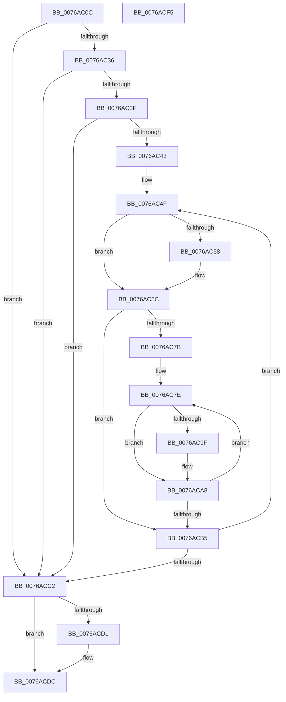

# PpmParkFreeAllParkNodes

- RVA: `0x0076AC0C`–`0x0076ACF6` (길이 `234` bytes)
- VA: `0x000000014076AC0C`
- 실행 섹션: `PAGE`
- PDB 이름 있음: `예`; PDB Function 태그: `아니요`
- unwind 정보 RVA: `0x00060300`
- 디코드: `61`개 명령, `234/234` bytes 표시
- 미해석 바이트: `0` (있으면 어셈블리에 `.byte`로 보존)

> 이 문서는 커널 이미지의 기계어와 PDB 기호를 분석해 생성했습니다. 4번과 5번은 함수 원형과 자료형을 바이너리 사용 방식에서 추정한 C 해석이며 원본 소스 복구 결과는 아닙니다.

## 1. Dependencies

- 직접 호출 지점: **2**; 고유 호출 대상: **1**
- 직접 호출자로 확인된 함수: **2**
- RIP 상대 이미지 참조: **0**

### Outgoing calls
- `0x0076ACC5` → [PpmParkFreeParkNodes](PpmParkFreeParkNodes_function_0076ACFC.md) (function, `0x0076ACFC`)
- `0x0076ACD7` → [PpmParkFreeParkNodes](PpmParkFreeParkNodes_function_0076ACFC.md) (function, `0x0076ACFC`)

### Direct callers
- [PpmParkRegisterParking](../../text/5D/PpmParkRegisterParking_function_005DB508.md) at `0x005DBD6A`
- [PpmParkRegisterParkingEx](../../text/5E/PpmParkRegisterParkingEx_function_005E183C.md) at `0x005E1D52`

### Static image references
- 디코드된 RIP-relative 메모리 참조가 없습니다.

## 2. Other-region calls and transfers

- 다른 실행 섹션으로 향하는 call: **0**
- 별도 외부 분기/꼬리 이동을 확인하지 못했습니다.

## 3. Assembly (complete function range)

```asm
0076AC0C  48 89 5C 24 08                  mov qword ptr [rsp + 8], rbx
0076AC11  48 89 6C 24 10                  mov qword ptr [rsp + 0x10], rbp
0076AC16  48 89 74 24 18                  mov qword ptr [rsp + 0x18], rsi
0076AC1B  57                              push rdi
0076AC1C  41 56                           push r14
0076AC1E  41 57                           push r15
0076AC20  48 83 EC 20                     sub rsp, 0x20
0076AC24  45 8B F9                        mov r15d, r9d
0076AC27  49 8B D8                        mov rbx, r8
0076AC2A  4C 8B D1                        mov r10, rcx
0076AC2D  48 85 C9                        test rcx, rcx
0076AC30  0F 84 8C 00 00 00               je 0x14076acc2
0076AC36  48 85 DB                        test rbx, rbx
0076AC39  0F 84 83 00 00 00               je 0x14076acc2
0076AC3F  85 D2                           test edx, edx
0076AC41  74 7F                           je 0x14076acc2
0076AC43  4C 8D 89 50 04 00 00            lea r9, [rcx + 0x450]
0076AC4A  8B F2                           mov esi, edx
0076AC4C  4C 2B C1                        sub r8, rcx
0076AC4F  49 8B 01                        mov rax, qword ptr [r9]
0076AC52  4B 39 04 08                     cmp qword ptr [r8 + r9], rax
0076AC56  75 04                           jne 0x14076ac5c
0076AC58  49 83 21 00                     and qword ptr [r9], 0
0076AC5C  43 0F B6 8C 08 BC FB FF FF      movzx ecx, byte ptr [r8 + r9 - 0x444]
0076AC65  41 0F B6 81 BC FB FF FF         movzx eax, byte ptr [r9 - 0x444]
0076AC6D  3A C8                           cmp cl, al
0076AC6F  0F 43 C8                        cmovae ecx, eax
0076AC72  33 FF                           xor edi, edi
0076AC74  0F B6 E9                        movzx ebp, cl
0076AC77  84 C9                           test cl, cl
0076AC79  74 3A                           je 0x14076acb5
0076AC7B  45 33 DB                        xor r11d, r11d
0076AC7E  4D 8B B1 B8 00 00 00            mov r14, qword ptr [r9 + 0xb8]
0076AC85  4B 8B 8C 08 B8 00 00 00         mov rcx, qword ptr [r8 + r9 + 0xb8]
0076AC8D  4B 8B 84 33 38 02 00 00         mov rax, qword ptr [r11 + r14 + 0x238]
0076AC95  49 39 84 0B 38 02 00 00         cmp qword ptr [r11 + rcx + 0x238], rax
0076AC9D  75 09                           jne 0x14076aca8
0076AC9F  4B 83 A4 33 38 02 00 00 00      and qword ptr [r11 + r14 + 0x238], 0
0076ACA8  FF C7                           inc edi
0076ACAA  49 81 C3 80 02 00 00            add r11, 0x280
0076ACB1  3B FD                           cmp edi, ebp
0076ACB3  72 C9                           jb 0x14076ac7e
0076ACB5  49 81 C1 10 05 00 00            add r9, 0x510
0076ACBC  48 83 EE 01                     sub rsi, 1
0076ACC0  75 8D                           jne 0x14076ac4f
0076ACC2  49 8B CA                        mov rcx, r10
0076ACC5  E8 32 00 00 00                  call 0x14076acfc
0076ACCA  80 7C 24 60 00                  cmp byte ptr [rsp + 0x60], 0
0076ACCF  75 0B                           jne 0x14076acdc
0076ACD1  41 8B D7                        mov edx, r15d
0076ACD4  48 8B CB                        mov rcx, rbx
0076ACD7  E8 20 00 00 00                  call 0x14076acfc
0076ACDC  48 8B 5C 24 40                  mov rbx, qword ptr [rsp + 0x40]
0076ACE1  48 8B 6C 24 48                  mov rbp, qword ptr [rsp + 0x48]
0076ACE6  48 8B 74 24 50                  mov rsi, qword ptr [rsp + 0x50]
0076ACEB  48 83 C4 20                     add rsp, 0x20
0076ACEF  41 5F                           pop r15
0076ACF1  41 5E                           pop r14
0076ACF3  5F                              pop rdi
0076ACF4  C3                              ret
0076ACF5  CC                              int3
```

## 4. C-style interpretation (structured pseudocode)

```c
__int64 __fastcall PpmParkFreeAllParkNodes(__int64 a1, int a2, __int64 a3, int a4, unsigned __int8 a5)
{
    __int64 result;
    __int64 v_r11;
    __int64 v_rdi;
    __int64 v_rsi;
    __int64 v_rsp;
    unsigned __int64 v_stack_p10;
    unsigned __int64 v_stack_p18;
    unsigned __int64 v_stack_p8;

    v_stack_p8 = v_rbx;
    v_stack_p10 = v_rbp;
    v_stack_p18 = v_rsi;
    v_rsp = (v_rsp) - (32);
    if (a1 == 0) goto loc_0076ACC2;
    if (a3 == 0) goto loc_0076ACC2;
    if (a2 == 0) goto loc_0076ACC2;
    a3 = (a3) - (a1);
loc_0076AC4F:
    if ((*(unsigned __int64 *)(a3 + a1 + 1104 * 1)) == (*(unsigned __int64 *)(a1 + 1104))) {
    }
    a1 = *(unsigned __int8 *)(a3 + a1 + 1104 * 1 - 1092);
    if (((unsigned __int8)(*(unsigned __int8 *)(a3 + a1 + 1104 * 1 - 1092))) >= ((unsigned __int8)(*(unsigned __int8 *)(a1 + 1104 - 1092)))) { a1 = (unsigned int)(*(unsigned __int8 *)(a1 + 1104 - 1092)); }
    v_rdi = 0;
    if ((unsigned __int8)(a1) == 0) goto loc_0076ACB5;
    v_r11 = 0;
loc_0076AC7E:
    if ((*(unsigned __int64 *)(v_r11 + *(unsigned __int64 *)(a3 + a1 + 1104 * 1 + 184) * 1 + 568)) == (*(unsigned __int64 *)(v_r11 + *(unsigned __int64 *)(a1 + 1104 + 184) * 1 + 568))) {
    }
    v_rdi = (unsigned int)((v_rdi) + 1);
    v_r11 = (v_r11) + (640);
    if (((unsigned int)(v_rdi)) < ((unsigned int)((unsigned __int8)(a1)))) goto loc_0076AC7E;
loc_0076ACB5:
    a4 = (a1 + 1104) + (0x510ULL);
    v_rsi = ((unsigned int)(a2)) - (1);
    if (condition_is_not_equal) goto loc_0076AC4F;
loc_0076ACC2:
    result = PpmParkFreeParkNodes(a1, a2, a3, a4);
    if (a5 == 0) {
        a2 = (unsigned int)((unsigned int)(a4));
        a1 = a3;
        result = PpmParkFreeParkNodes(a1, a2, a3, a4);
    }
    v_rsp = (v_rsp) + (32);
    return result;
}
```

## 5. (Beta) C Style

```c
int64_t PpmParkFreeAllParkNodes(int64_t Arg1, int32_t Arg2, void *Arg3, int32_t Arg4, uint8_t Arg5)
{
    uint8_t *arg3 = (uint8_t *)Arg3;

    int64_t result;
    int64_t local_r11;
    int64_t local_rdi;
    int64_t local_rsi;
    int64_t local_rsp;
    uint64_t v_stack_p10;
    uint64_t v_stack_p18;
    uint64_t v_stack_p8;

    v_stack_p8 = local_rbx;
    v_stack_p10 = local_rbp;
    v_stack_p18 = local_rsi;
    local_rsp = (local_rsp) - (32);
    if (Arg1 == 0) goto loc_0076ACC2;
    if (Arg3 == NULL) goto loc_0076ACC2;
    if (Arg2 == 0) goto loc_0076ACC2;
    Arg3 = (Arg3) - (Arg1);
loc_0076AC4F:
    if ((*(uint64_t *)(arg3 + Arg1 + 0x450 * 1)) == (*(uint64_t *)(Arg1 + 0x450))) {
    }
    Arg1 = *(uint8_t *)(arg3 + Arg1 + 0x450 * 1 - 0x444);
    if (((uint8_t)(*(uint8_t *)(arg3 + Arg1 + 0x450 * 1 - 0x444))) >= ((uint8_t)(*(uint8_t *)(Arg1 + 0x450 - 0x444)))) { Arg1 = (uint32_t)(*(uint8_t *)(Arg1 + 0x450 - 0x444)); }
    local_rdi = 0;
    if ((uint8_t)(Arg1) == 0) goto loc_0076ACB5;
    local_r11 = 0;
loc_0076AC7E:
    if ((*(uint64_t *)(local_r11 + *(uint64_t *)(arg3 + Arg1 + 0x450 * 1 + 0xB8) * 1 + 0x238)) == (*(uint64_t *)(local_r11 + *(uint64_t *)(Arg1 + 0x450 + 0xB8) * 1 + 0x238))) {
    }
    local_rdi = (uint32_t)((local_rdi) + 1);
    local_r11 = (local_r11) + (640);
    if (((uint32_t)(local_rdi)) < ((uint32_t)((uint8_t)(Arg1)))) goto loc_0076AC7E;
loc_0076ACB5:
    Arg4 = (Arg1 + 1104) + (0x510ULL);
    local_rsi = ((uint32_t)(Arg2)) - (1);
    if (condition_is_not_equal) goto loc_0076AC4F;
loc_0076ACC2:
    result = PpmParkFreeParkNodes(Arg1, Arg2, Arg3, Arg4);
    if (Arg5 == 0) {
        Arg2 = (uint32_t)((uint32_t)(Arg4));
        Arg1 = Arg3;
        result = PpmParkFreeParkNodes(Arg1, Arg2, Arg3, Arg4);
    }
    local_rsp = (local_rsp) + (32);
    return result;
}
```

### 관측된 메모리 오프셋

구조체 형식이 확인되지 않은 접근은 인자 기준의 오프셋으로만 기록했습니다.

| 기준 인자 | 오프셋 표현 | 폭 (bit) | 접근 |
|---|---:|---:|---|
| `Arg3` | `- 0x444 + r9*1` | `8` | `R` |
| `Arg3` | `+ 0x0 + r9*1` | `64` | `R` |
| `Arg3` | `+ 0xB8 + r9*1` | `64` | `R` |

## 6. Execution-region graph

[열기: 2D/3D 그래프와 함수 탐색 컨트롤 패널](../../../control-panel.html?section=page&rva=0x0076AC0C&view=graph)

- 2D 그래프는 위에서 아래로 흐르고, 3D 그래프는 빈 공간을 드래그해 회전합니다. Shift+드래그는 이동, 휠은 확대·축소, 함수 노드 선택은 대상 보고서 이동입니다.

### Static fallback


