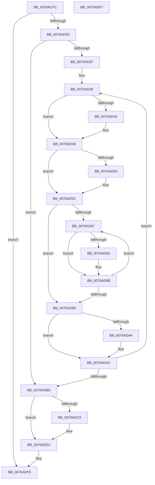

# PpmParkFreeParkNodes

- RVA: `0x0076ACFC`–`0x0076ADF8` (길이 `252` bytes)
- VA: `0x000000014076ACFC`
- 실행 섹션: `PAGE`
- PDB 이름 있음: `예`; PDB Function 태그: `아니요`
- unwind 정보 RVA: `0x000A851C`
- 디코드: `64`개 명령, `252/252` bytes 표시
- 미해석 바이트: `0` (있으면 어셈블리에 `.byte`로 보존)

> 이 문서는 커널 이미지의 기계어와 PDB 기호를 분석해 생성했습니다. 4번과 5번은 함수 원형과 자료형을 바이너리 사용 방식에서 추정한 C 해석이며 원본 소스 복구 결과는 아닙니다.

## 1. Dependencies

- 직접 호출 지점: **6**; 고유 호출 대상: **1**
- 직접 호출자로 확인된 함수: **1**
- RIP 상대 이미지 참조: **0**

### Outgoing calls
- `0x0076AD43` → [ExFreePoolWithTag](../../poolcode/B8/ExFreePoolWithTag_function_00B82870.md) (function, `0x00B82870`)
- `0x0076AD57` → [ExFreePoolWithTag](../../poolcode/B8/ExFreePoolWithTag_function_00B82870.md) (function, `0x00B82870`)
- `0x0076AD86` → [ExFreePoolWithTag](../../poolcode/B8/ExFreePoolWithTag_function_00B82870.md) (function, `0x00B82870`)
- `0x0076ADA7` → [ExFreePoolWithTag](../../poolcode/B8/ExFreePoolWithTag_function_00B82870.md) (function, `0x00B82870`)
- `0x0076ADCC` → [ExFreePoolWithTag](../../poolcode/B8/ExFreePoolWithTag_function_00B82870.md) (function, `0x00B82870`)
- `0x0076ADD7` → [ExFreePoolWithTag](../../poolcode/B8/ExFreePoolWithTag_function_00B82870.md) (function, `0x00B82870`)

### Direct callers
- [PpmParkFreeAllParkNodes](PpmParkFreeAllParkNodes_function_0076AC0C.md) at `0x0076ACC5`
- [PpmParkFreeAllParkNodes](PpmParkFreeAllParkNodes_function_0076AC0C.md) at `0x0076ACD7`

### Static image references
- 디코드된 RIP-relative 메모리 참조가 없습니다.

## 2. Other-region calls and transfers

- 다른 실행 섹션으로 향하는 call: **6**
  - `0x0076AD43` → [ExFreePoolWithTag](../../poolcode/B8/ExFreePoolWithTag_function_00B82870.md) (`PAGE` → `POOLCODE`)
  - `0x0076AD57` → [ExFreePoolWithTag](../../poolcode/B8/ExFreePoolWithTag_function_00B82870.md) (`PAGE` → `POOLCODE`)
  - `0x0076AD86` → [ExFreePoolWithTag](../../poolcode/B8/ExFreePoolWithTag_function_00B82870.md) (`PAGE` → `POOLCODE`)
  - `0x0076ADA7` → [ExFreePoolWithTag](../../poolcode/B8/ExFreePoolWithTag_function_00B82870.md) (`PAGE` → `POOLCODE`)
  - `0x0076ADCC` → [ExFreePoolWithTag](../../poolcode/B8/ExFreePoolWithTag_function_00B82870.md) (`PAGE` → `POOLCODE`)
  - `0x0076ADD7` → [ExFreePoolWithTag](../../poolcode/B8/ExFreePoolWithTag_function_00B82870.md) (`PAGE` → `POOLCODE`)
- 별도 외부 분기/꼬리 이동을 확인하지 못했습니다.

## 3. Assembly (complete function range)

```asm
0076ACFC  48 85 C9                        test rcx, rcx
0076ACFF  0F 84 F1 00 00 00               je 0x14076adf6
0076AD05  48 8B C4                        mov rax, rsp
0076AD08  48 89 58 08                     mov qword ptr [rax + 8], rbx
0076AD0C  48 89 68 10                     mov qword ptr [rax + 0x10], rbp
0076AD10  48 89 70 18                     mov qword ptr [rax + 0x18], rsi
0076AD14  48 89 78 20                     mov qword ptr [rax + 0x20], rdi
0076AD18  41 56                           push r14
0076AD1A  48 83 EC 20                     sub rsp, 0x20
0076AD1E  48 8B F9                        mov rdi, rcx
0076AD21  41 BE 50 50 4D 70               mov r14d, 0x704d5050
0076AD27  85 D2                           test edx, edx
0076AD29  0F 84 8E 00 00 00               je 0x14076adbd
0076AD2F  48 8D 99 50 04 00 00            lea rbx, [rcx + 0x450]
0076AD36  8B EA                           mov ebp, edx
0076AD38  48 8B 0B                        mov rcx, qword ptr [rbx]
0076AD3B  48 85 C9                        test rcx, rcx
0076AD3E  74 08                           je 0x14076ad48
0076AD40  41 8B D6                        mov edx, r14d
0076AD43  E8 28 7B 41 00                  call 0x140b82870
0076AD48  48 8B 8B B0 00 00 00            mov rcx, qword ptr [rbx + 0xb0]
0076AD4F  48 85 C9                        test rcx, rcx
0076AD52  74 08                           je 0x14076ad5c
0076AD54  41 8B D6                        mov edx, r14d
0076AD57  E8 14 7B 41 00                  call 0x140b82870
0076AD5C  33 F6                           xor esi, esi
0076AD5E  40 38 B3 BC FB FF FF            cmp byte ptr [rbx - 0x444], sil
0076AD65  76 31                           jbe 0x14076ad98
0076AD67  48 8B 83 B8 00 00 00            mov rax, qword ptr [rbx + 0xb8]
0076AD6E  48 8D 0C B6                     lea rcx, [rsi + rsi*4]
0076AD72  48 C1 E1 07                     shl rcx, 7
0076AD76  48 8B 8C 01 38 02 00 00         mov rcx, qword ptr [rcx + rax + 0x238]
0076AD7E  48 85 C9                        test rcx, rcx
0076AD81  74 08                           je 0x14076ad8b
0076AD83  41 8B D6                        mov edx, r14d
0076AD86  E8 E5 7A 41 00                  call 0x140b82870
0076AD8B  0F B6 83 BC FB FF FF            movzx eax, byte ptr [rbx - 0x444]
0076AD92  FF C6                           inc esi
0076AD94  3B F0                           cmp esi, eax
0076AD96  72 CF                           jb 0x14076ad67
0076AD98  48 8B 8B 98 00 00 00            mov rcx, qword ptr [rbx + 0x98]
0076AD9F  48 85 C9                        test rcx, rcx
0076ADA2  74 08                           je 0x14076adac
0076ADA4  41 8B D6                        mov edx, r14d
0076ADA7  E8 C4 7A 41 00                  call 0x140b82870
0076ADAC  48 81 C3 10 05 00 00            add rbx, 0x510
0076ADB3  48 83 ED 01                     sub rbp, 1
0076ADB7  0F 85 7B FF FF FF               jne 0x14076ad38
0076ADBD  48 8B 8F 08 05 00 00            mov rcx, qword ptr [rdi + 0x508]
0076ADC4  48 85 C9                        test rcx, rcx
0076ADC7  74 08                           je 0x14076add1
0076ADC9  41 8B D6                        mov edx, r14d
0076ADCC  E8 9F 7A 41 00                  call 0x140b82870
0076ADD1  41 8B D6                        mov edx, r14d
0076ADD4  48 8B CF                        mov rcx, rdi
0076ADD7  E8 94 7A 41 00                  call 0x140b82870
0076ADDC  48 8B 5C 24 30                  mov rbx, qword ptr [rsp + 0x30]
0076ADE1  48 8B 6C 24 38                  mov rbp, qword ptr [rsp + 0x38]
0076ADE6  48 8B 74 24 40                  mov rsi, qword ptr [rsp + 0x40]
0076ADEB  48 8B 7C 24 48                  mov rdi, qword ptr [rsp + 0x48]
0076ADF0  48 83 C4 20                     add rsp, 0x20
0076ADF4  41 5E                           pop r14
0076ADF6  C3                              ret
0076ADF7  CC                              int3
```

## 4. C-style interpretation (structured pseudocode)

```c
__int64 __fastcall PpmParkFreeParkNodes(__int64 a1, int a2)
{
    __int64 result;
    __int64 v_rbp;
    __int64 v_rbx;
    __int64 v_rsi;
    __int64 v_rsp;
    unsigned __int64 v_stack_p10;
    unsigned __int64 v_stack_p18;
    unsigned __int64 v_stack_p20;
    unsigned __int64 v_stack_p8;

    if (a1 == 0) goto loc_0076ADF6;
    *(unsigned __int64 *)(v_rsp + 8) = v_rbx;
    *(unsigned __int64 *)(v_rsp + 16) = v_rbp;
    *(unsigned __int64 *)(v_rsp + 24) = v_rsi;
    *(unsigned __int64 *)(v_rsp + 32) = v_rdi;
    v_rsp = (v_rsp) - (32);
    if (a2 == 0) goto loc_0076ADBD;
loc_0076AD38:
    result = v_rsp;
    if (*(unsigned __int64 *)(a1 + 1104) != 0) {
        a2 = (unsigned int)((unsigned int)(0x704D5050ULL));
        result = ExFreePoolWithTag(*(unsigned __int64 *)(a1 + 1104), a2, a3, a4);
    }
    if (*(unsigned __int64 *)(a1 + 1104 + 176) != 0) {
        a2 = (unsigned int)((unsigned int)(0x704D5050ULL));
        result = ExFreePoolWithTag(*(unsigned __int64 *)(a1 + 1104 + 176), a2, a3, a4);
    }
    v_rsi = 0;
    if ((*(unsigned __int8 *)(a1 + 1104 - 1092)) <= 0) goto loc_0076AD98;
loc_0076AD67:
    a1 = (v_rsi + v_rsi * 4) << (7);
    result = *(unsigned __int64 *)(a1 + 1104 + 184);
    if (*(unsigned __int64 *)(a1 + *(unsigned __int64 *)(a1 + 1104 + 184) * 1 + 568) != 0) {
        a2 = (unsigned int)((unsigned int)(0x704D5050ULL));
        result = ExFreePoolWithTag(*(unsigned __int64 *)(a1 + *(unsigned __int64 *)(a1 + 1104 + 184) * 1 + 568), a2, a3, a4);
    }
    v_rsi = (unsigned int)((v_rsi) + 1);
    if (((unsigned int)(v_rsi)) < ((unsigned int)(*(unsigned __int8 *)(a1 + 1104 - 1092)))) goto loc_0076AD67;
loc_0076AD98:
    result = *(unsigned __int8 *)(a1 + 1104 - 1092);
    if (*(unsigned __int64 *)(a1 + 1104 + 152) != 0) {
        a2 = (unsigned int)((unsigned int)(0x704D5050ULL));
        result = ExFreePoolWithTag(*(unsigned __int64 *)(a1 + 1104 + 152), a2, a3, a4);
    }
    v_rbx = (a1 + 1104) + (0x510ULL);
    v_rbp = ((unsigned int)(a2)) - (1);
    if (condition_is_not_equal) goto loc_0076AD38;
loc_0076ADBD:
    if (*(unsigned __int64 *)(a1 + 1288) != 0) {
        a2 = (unsigned int)((unsigned int)(0x704D5050ULL));
        result = ExFreePoolWithTag(*(unsigned __int64 *)(a1 + 1288), a2, a3, a4);
    }
    result = ExFreePoolWithTag(a1, (unsigned int)((unsigned int)((unsigned int)(0x704D5050ULL))), a3, a4);
    v_rsp = (v_rsp) + (32);
loc_0076ADF6:
    return result;
}
```

## 5. (Beta) C Style

```c
int64_t PpmParkFreeParkNodes(int64_t Arg1, int32_t Arg2)
{
    int64_t result;
    int64_t local_rbp;
    int64_t local_rbx;
    int64_t local_rsi;
    int64_t local_rsp;
    uint64_t v_stack_p10;
    uint64_t v_stack_p18;
    uint64_t v_stack_p20;
    uint64_t v_stack_p8;

    if (Arg1 == 0) goto loc_0076ADF6;
    *(uint64_t *)(local_rsp + 0x8) = local_rbx;
    *(uint64_t *)(local_rsp + 0x10) = local_rbp;
    *(uint64_t *)(local_rsp + 0x18) = local_rsi;
    *(uint64_t *)(local_rsp + 0x20) = local_rdi;
    local_rsp = (local_rsp) - (32);
    if (Arg2 == 0) goto loc_0076ADBD;
loc_0076AD38:
    result = local_rsp;
    if (*(uint64_t *)(Arg1 + 0x450) != 0) {
        Arg2 = (uint32_t)((uint32_t)(0x704D5050ULL));
        result = ExFreePoolWithTag(*(uint64_t *)(Arg1 + 0x450), Arg2, a3, a4);
    }
    if (*(uint64_t *)(Arg1 + 0x450 + 0xB0) != 0) {
        Arg2 = (uint32_t)((uint32_t)(0x704D5050ULL));
        result = ExFreePoolWithTag(*(uint64_t *)(Arg1 + 0x450 + 0xB0), Arg2, a3, a4);
    }
    local_rsi = 0;
    if ((*(uint8_t *)(Arg1 + 0x450 - 0x444)) <= 0) goto loc_0076AD98;
loc_0076AD67:
    Arg1 = (local_rsi + local_rsi * 4) << (7);
    result = *(uint64_t *)(Arg1 + 0x450 + 0xB8);
    if (*(uint64_t *)(Arg1 + *(uint64_t *)(Arg1 + 0x450 + 0xB8) * 1 + 0x238) != 0) {
        Arg2 = (uint32_t)((uint32_t)(0x704D5050ULL));
        result = ExFreePoolWithTag(*(uint64_t *)(Arg1 + *(uint64_t *)(Arg1 + 0x450 + 0xB8) * 1 + 0x238), Arg2, a3, a4);
    }
    local_rsi = (uint32_t)((local_rsi) + 1);
    if (((uint32_t)(local_rsi)) < ((uint32_t)(*(uint8_t *)(Arg1 + 0x450 - 0x444)))) goto loc_0076AD67;
loc_0076AD98:
    result = *(uint8_t *)(Arg1 + 0x450 - 0x444);
    if (*(uint64_t *)(Arg1 + 0x450 + 0x98) != 0) {
        Arg2 = (uint32_t)((uint32_t)(0x704D5050ULL));
        result = ExFreePoolWithTag(*(uint64_t *)(Arg1 + 0x450 + 0x98), Arg2, a3, a4);
    }
    local_rbx = (Arg1 + 1104) + (0x510ULL);
    local_rbp = ((uint32_t)(Arg2)) - (1);
    if (condition_is_not_equal) goto loc_0076AD38;
loc_0076ADBD:
    if (*(uint64_t *)(Arg1 + 0x508) != 0) {
        Arg2 = (uint32_t)((uint32_t)(0x704D5050ULL));
        result = ExFreePoolWithTag(*(uint64_t *)(Arg1 + 0x508), Arg2, a3, a4);
    }
    result = ExFreePoolWithTag(Arg1, (uint32_t)((uint32_t)((uint32_t)(0x704D5050ULL))), a3, a4);
    local_rsp = (local_rsp) + (32);
loc_0076ADF6:
    return result;
}
```

## 6. Execution-region graph

[열기: 2D/3D 그래프와 함수 탐색 컨트롤 패널](../../../control-panel.html?section=page&rva=0x0076ACFC&view=graph)

- 2D 그래프는 위에서 아래로 흐르고, 3D 그래프는 빈 공간을 드래그해 회전합니다. Shift+드래그는 이동, 휠은 확대·축소, 함수 노드 선택은 대상 보고서 이동입니다.

### Static fallback


