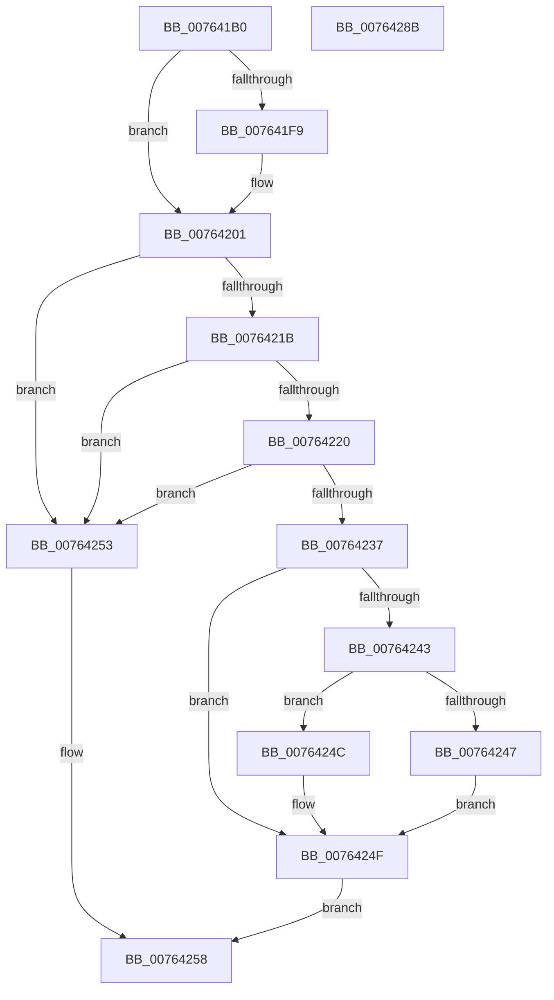

# PpmPerfProcCapFloorSettingCallback

- RVA: `0x007641B0`–`0x0076428C` (길이 `220` bytes)
- VA: `0x00000001407641B0`
- 실행 섹션: `PAGE`
- PDB 이름 있음: `예`; PDB Function 태그: `아니요`
- unwind 정보 RVA: `0x000CCCB0`
- 디코드: `66`개 명령, `220/220` bytes 표시
- 미해석 바이트: `0` (있으면 어셈블리에 `.byte`로 보존)

> 이 문서는 커널 이미지의 기계어와 PDB 기호를 분석해 생성했습니다. 4번과 5번은 함수 원형과 자료형을 바이너리 사용 방식에서 추정한 C 해석이며 원본 소스 복구 결과는 아닙니다.

## 1. Dependencies

- 직접 호출 지점: **4**; 고유 호출 대상: **4**
- 직접 호출자로 확인된 함수: **0**
- RIP 상대 이미지 참조: **3**

### Outgoing calls
- `0x00764211` → [PpmAcquireLock](../../text/2D/PpmAcquireLock_function_002D9AA4.md) (function, `0x002D9AA4`)
- `0x0076422D` → [KeGetPrcb](../../text/2D/KeGetPrcb_function_002D85D0.md) (function, `0x002D85D0`)
- `0x00764264` → [PpmReapplyPerfPolicy](../A5/PpmReapplyPerfPolicy_function_00A53148.md) (function, `0x00A53148`)
- `0x00764273` → [_security_check_cookie](../../text/6A/_security_check_cookie_function_006AC640.md) (function, `0x006AC640`)

### Direct callers
- 이 함수 시작 RVA로 연결되는 직접 call은 확인되지 않았습니다. 간접 호출은 완전히 역산할 수 없습니다.

### Static image references
- `0x007641C3` → RVA `0x00E0A740` (`.data`; read)
- `0x007641D2` → RVA `0x00026AB8` (`.rdata`; read)
- `0x00764204` → RVA `0x00F0CC00` (`.data`; read)

## 2. Other-region calls and transfers

- 다른 실행 섹션으로 향하는 call: **3**
  - `0x00764211` → [PpmAcquireLock](../../text/2D/PpmAcquireLock_function_002D9AA4.md) (`PAGE` → `.text`)
  - `0x0076422D` → [KeGetPrcb](../../text/2D/KeGetPrcb_function_002D85D0.md) (`PAGE` → `.text`)
  - `0x00764273` → [_security_check_cookie](../../text/6A/_security_check_cookie_function_006AC640.md) (`PAGE` → `.text`)
- 별도 외부 분기/꼬리 이동을 확인하지 못했습니다.

## 3. Assembly (complete function range)

```asm
007641B0  4C 8B DC                        mov r11, rsp
007641B3  49 89 5B 10                     mov qword ptr [r11 + 0x10], rbx
007641B7  49 89 6B 18                     mov qword ptr [r11 + 0x18], rbp
007641BB  56                              push rsi
007641BC  57                              push rdi
007641BD  41 56                           push r14
007641BF  48 83 EC 40                     sub rsp, 0x40
007641C3  48 8B 05 76 65 6A 00            mov rax, qword ptr [rip + 0x6a6576]
007641CA  48 33 C4                        xor rax, rsp
007641CD  48 89 44 24 38                  mov qword ptr [rsp + 0x38], rax
007641D2  0F 10 05 DF 28 8C FF            movups xmm0, xmmword ptr [rip - 0x73d721]
007641D9  44 0F B6 71 0F                  movzx r14d, byte ptr [rcx + 0xf]
007641DE  41 8B E8                        mov ebp, r8d
007641E1  33 DB                           xor ebx, ebx
007641E3  48 8B FA                        mov rdi, rdx
007641E6  F3 0F 7F 44 24 28               movdqu xmmword ptr [rsp + 0x28], xmm0
007641EC  4D 8B 43 D0                     mov r8, qword ptr [r11 - 0x30]
007641F0  45 88 73 DF                     mov byte ptr [r11 - 0x21], r14b
007641F4  4C 2B 01                        sub r8, qword ptr [rcx]
007641F7  75 08                           jne 0x140764201
007641F9  4D 8B 43 D8                     mov r8, qword ptr [r11 - 0x28]
007641FD  4C 2B 41 08                     sub r8, qword ptr [rcx + 8]
00764201  4D 85 C0                        test r8, r8
00764204  48 8D 0D F5 89 7A 00            lea rcx, [rip + 0x7a89f5]
0076420B  8B F3                           mov esi, ebx
0076420D  40 0F 94 C6                     sete sil
00764211  E8 8E 58 B7 FF                  call 0x1402d9aa4
00764216  83 FD 04                        cmp ebp, 4
00764219  75 38                           jne 0x140764253
0076421B  48 85 FF                        test rdi, rdi
0076421E  74 33                           je 0x140764253
00764220  8B 3F                           mov edi, dword ptr [rdi]
00764222  8D 45 60                        lea eax, [rbp + 0x60]
00764225  3B F8                           cmp edi, eax
00764227  41 8B CE                        mov ecx, r14d
0076422A  0F 47 F8                        cmova edi, eax
0076422D  E8 9E 43 B7 FF                  call 0x1402d85d0
00764232  48 85 C0                        test rax, rax
00764235  74 1C                           je 0x140764253
00764237  48 8B 80 B8 89 00 00            mov rax, qword ptr [rax + 0x89b8]
0076423E  48 85 C0                        test rax, rax
00764241  74 0C                           je 0x14076424f
00764243  85 F6                           test esi, esi
00764245  74 05                           je 0x14076424c
00764247  89 78 30                        mov dword ptr [rax + 0x30], edi
0076424A  EB 03                           jmp 0x14076424f
0076424C  89 78 34                        mov dword ptr [rax + 0x34], edi
0076424F  8B FB                           mov edi, ebx
00764251  EB 05                           jmp 0x140764258
00764253  BF 0D 00 00 C0                  mov edi, 0xc000000d
00764258  83 CB 0E                        or ebx, 0xe
0076425B  48 8D 4C 24 20                  lea rcx, [rsp + 0x20]
00764260  89 5C 24 20                     mov dword ptr [rsp + 0x20], ebx
00764264  E8 DF EE 2E 00                  call 0x140a53148
00764269  8B C7                           mov eax, edi
0076426B  48 8B 4C 24 38                  mov rcx, qword ptr [rsp + 0x38]
00764270  48 33 CC                        xor rcx, rsp
00764273  E8 C8 83 F4 FF                  call 0x1406ac640
00764278  48 8B 5C 24 68                  mov rbx, qword ptr [rsp + 0x68]
0076427D  48 8B 6C 24 70                  mov rbp, qword ptr [rsp + 0x70]
00764282  48 83 C4 40                     add rsp, 0x40
00764286  41 5E                           pop r14
00764288  5F                              pop rdi
00764289  5E                              pop rsi
0076428A  C3                              ret
0076428B  CC                              int3
```

## 4. C-style interpretation (structured pseudocode)

```c
__int64 __fastcall PpmPerfProcCapFloorSettingCallback(__int64 a1, __int64 a2, int a3)
{
    __int64 result;
    __int64 v_rbx;
    __int64 v_rdi;
    __int64 v_rsi;
    __int64 v_rsp;
    unsigned __int64 v_stack_m20;
    unsigned __int64 v_stack_m30;
    unsigned __int64 v_stack_m38;
    unsigned __int64 v_stack_p10;
    unsigned __int64 v_stack_p18;

    *(unsigned __int64 *)(v_rsp + 16) = v_rbx;
    *(unsigned __int64 *)(v_rsp + 24) = v_rbp;
    v_rsp = (v_rsp) - (64);
    result = (*(unsigned __int64 *)(v_rip + 6972790)) ^ (v_rsp);
    v_stack_m20 = result;
    v_rbx = 0;
    v_stack_m30 = v_xmm0;
    *(unsigned __int8 *)(v_rsp - 33) = (unsigned __int8)(*(unsigned __int8 *)(a1 + 15));
    a3 = (*(unsigned __int64 *)(v_rsp - 48)) - (*(unsigned __int64 *)(a1));
    if (!(condition_is_not_equal)) {
        a3 = *(unsigned __int64 *)(v_rsp - 40);
        a3 = (a3) - (*(unsigned __int64 *)(a1 + 8));
    }
    v_rsi = (a3 == 0) ? 1 : 0;
    result = PpmAcquireLock(v_rip + 8030709, a2, a3, a4);
    if (((unsigned int)((unsigned int)(a3))) != 4) goto loc_00764253;
    if (a2 == 0) goto loc_00764253;
    v_rdi = (unsigned int)(*(unsigned int *)(a2));
    if (((unsigned int)((unsigned int)(*(unsigned int *)(a2)))) > ((unsigned int)((unsigned int)(a3) + 96))) { v_rdi = (unsigned int)((unsigned int)(a3) + 96); }
    result = KeGetPrcb((unsigned int)((unsigned int)(*(unsigned __int8 *)(a1 + 15))), a2, a3, a4);
    if (result == 0) goto loc_00764253;
    if (*(unsigned __int64 *)(result + 35256) == 0) goto loc_0076424F;
    if ((unsigned int)(v_rsi) == 0) goto loc_0076424C;
    *(unsigned int *)(*(unsigned __int64 *)(result + 35256) + 48) = (unsigned int)(v_rdi);
    goto loc_0076424F;
loc_0076424C:
    *(unsigned int *)(*(unsigned __int64 *)(result + 35256) + 52) = (unsigned int)(v_rdi);
loc_0076424F:
    goto loc_00764258;
loc_00764253:
loc_00764258:
    v_rbx = (unsigned int)((v_rbx) | (14));
    v_stack_m38 = (unsigned int)(v_rbx);
    result = PpmReapplyPerfPolicy(v_stack_m38, a2, a3, a4);
    a1 = (v_stack_m20) ^ (v_rsp);
    result = _security_check_cookie(a1, a2, a3, a4);
    v_rsp = (v_rsp) + (64);
    return result;
}
```

## 5. (Beta) C Style

```c
int64_t PpmPerfProcCapFloorSettingCallback(void *Arg1, int64_t Arg2, int32_t Arg3)
{
    uint8_t *arg1 = (uint8_t *)Arg1;

    int64_t result;
    int64_t local_rbx;
    int64_t local_rdi;
    int64_t local_rsi;
    int64_t local_rsp;
    uint64_t v_stack_m20;
    uint64_t v_stack_m30;
    uint64_t v_stack_m38;
    uint64_t v_stack_p10;
    uint64_t v_stack_p18;

    *(uint64_t *)(local_rsp + 0x10) = local_rbx;
    *(uint64_t *)(local_rsp + 0x18) = local_rbp;
    local_rsp = (local_rsp) - (64);
    result = (*(uint64_t *)(v_rip + 0x6A6576)) ^ (local_rsp);
    v_stack_m20 = result;
    local_rbx = 0;
    v_stack_m30 = v_xmm0;
    *(uint8_t *)(local_rsp - 0x21) = (uint8_t)(*(uint8_t *)(arg1 + 0xF));
    Arg3 = (*(uint64_t *)(local_rsp - 0x30)) - (*(uint64_t *)(arg1));
    if (!(condition_is_not_equal)) {
        Arg3 = *(uint64_t *)(local_rsp - 0x28);
        Arg3 = (Arg3) - (*(uint64_t *)(arg1 + 0x8));
    }
    local_rsi = (Arg3 == 0) ? 1 : 0;
    result = PpmAcquireLock(v_rip + 8030709, Arg2, Arg3, a4);
    if (((uint32_t)((uint32_t)(Arg3))) != 4) goto loc_00764253;
    if (Arg2 == 0) goto loc_00764253;
    local_rdi = (uint32_t)(*(uint32_t *)(Arg2));
    if (((uint32_t)((uint32_t)(*(uint32_t *)(Arg2)))) > ((uint32_t)((uint32_t)(Arg3) + 96))) { local_rdi = (uint32_t)((uint32_t)(Arg3) + 96); }
    result = KeGetPrcb((uint32_t)((uint32_t)(*(uint8_t *)(arg1 + 0xF))), Arg2, Arg3, a4);
    if (result == 0) goto loc_00764253;
    if (*(uint64_t *)(result + 0x89B8) == 0) goto loc_0076424F;
    if ((uint32_t)(local_rsi) == 0) goto loc_0076424C;
    *(uint32_t *)(*(uint64_t *)(result + 0x89B8) + 0x30) = (uint32_t)(local_rdi);
    goto loc_0076424F;
loc_0076424C:
    *(uint32_t *)(*(uint64_t *)(result + 0x89B8) + 0x34) = (uint32_t)(local_rdi);
loc_0076424F:
    goto loc_00764258;
loc_00764253:
loc_00764258:
    local_rbx = (uint32_t)((local_rbx) | (14));
    v_stack_m38 = (uint32_t)(local_rbx);
    result = PpmReapplyPerfPolicy(v_stack_m38, Arg2, Arg3, a4);
    Arg1 = (v_stack_m20) ^ (local_rsp);
    result = _security_check_cookie(Arg1, Arg2, Arg3, a4);
    local_rsp = (local_rsp) + (64);
    return result;
}
```

### 관측된 메모리 오프셋

구조체 형식이 확인되지 않은 접근은 인자 기준의 오프셋으로만 기록했습니다.

| 기준 인자 | 오프셋 표현 | 폭 (bit) | 접근 |
|---|---:|---:|---|
| `Arg1` | `+ 0x0` | `64` | `R` |
| `Arg1` | `+ 0x8` | `64` | `R` |
| `Arg1` | `+ 0xF` | `8` | `R` |

## 6. Execution-region graph

[열기: 2D/3D 그래프와 함수 탐색 컨트롤 패널](../../../control-panel.html?section=page&rva=0x007641B0&view=graph)

- 2D 그래프는 위에서 아래로 흐르고, 3D 그래프는 빈 공간을 드래그해 회전합니다. Shift+드래그는 이동, 휠은 확대·축소, 함수 노드 선택은 대상 보고서 이동입니다.

### Static fallback


