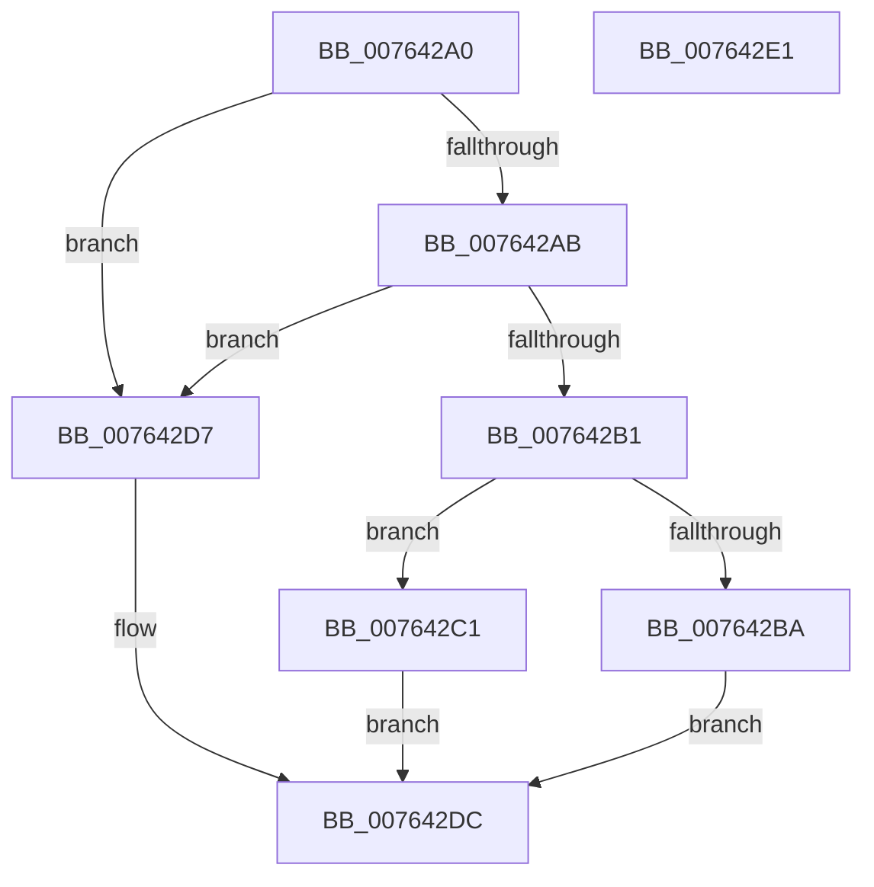

# PpmRegisterProvSocIdentifier

- RVA: `0x007642A0`–`0x007642E2` (길이 `66` bytes)
- VA: `0x00000001407642A0`
- 실행 섹션: `PAGE`
- PDB 이름 있음: `예`; PDB Function 태그: `아니요`
- unwind 정보 RVA: `0x0005C788`
- 디코드: `19`개 명령, `66/66` bytes 표시
- 미해석 바이트: `0` (있으면 어셈블리에 `.byte`로 보존)

> 이 문서는 커널 이미지의 기계어와 PDB 기호를 분석해 생성했습니다. 4번과 5번은 함수 원형과 자료형을 바이너리 사용 방식에서 추정한 C 해석이며 원본 소스 복구 결과는 아닙니다.

## 1. Dependencies

- 직접 호출 지점: **1**; 고유 호출 대상: **1**
- 직접 호출자로 확인된 함수: **0**
- RIP 상대 이미지 참조: **1**

### Outgoing calls
- `0x007642D0` → [RtlDuplicateUnicodeString](../93/RtlDuplicateUnicodeString_function_009321F0.md) (function, `0x009321F0`)

### Direct callers
- 이 함수 시작 RVA로 연결되는 직접 call은 확인되지 않았습니다. 간접 호출은 완전히 역산할 수 없습니다.

### Static image references
- `0x007642B1` → RVA `0x00F0C890` (`.data`; read)

## 2. Other-region calls and transfers

- 다른 실행 섹션으로 향하는 call: **0**
- 별도 외부 분기/꼬리 이동을 확인하지 못했습니다.

## 3. Assembly (complete function range)

```asm
007642A0  48 83 EC 28                     sub rsp, 0x28
007642A4  33 C0                           xor eax, eax
007642A6  48 85 C9                        test rcx, rcx
007642A9  74 2C                           je 0x1407642d7
007642AB  48 39 41 08                     cmp qword ptr [rcx + 8], rax
007642AF  74 26                           je 0x1407642d7
007642B1  66 39 05 D8 85 7A 00            cmp word ptr [rip + 0x7a85d8], ax
007642B8  74 07                           je 0x1407642c1
007642BA  B8 18 07 00 C0                  mov eax, 0xc0000718
007642BF  EB 1B                           jmp 0x1407642dc
007642C1  48 8B D1                        mov rdx, rcx
007642C4  4C 8D 05 C5 85 7A 00            lea r8, [rip + 0x7a85c5]
007642CB  B9 01 00 00 00                  mov ecx, 1
007642D0  E8 1B DF 1C 00                  call 0x1409321f0
007642D5  EB 05                           jmp 0x1407642dc
007642D7  B8 0D 00 00 C0                  mov eax, 0xc000000d
007642DC  48 83 C4 28                     add rsp, 0x28
007642E0  C3                              ret
007642E1  CC                              int3
```

## 4. C-style interpretation (structured pseudocode)

```c
__int64 __fastcall PpmRegisterProvSocIdentifier(__int64 a1)
{
    __int64 result;
    __int64 v_rsp;

    v_rsp = (v_rsp) - (40);
    result = 0;
    if (a1 == 0) goto loc_007642D7;
    if ((*(unsigned __int64 *)(a1 + 8)) == 0) goto loc_007642D7;
    if ((*(unsigned __int16 *)(v_rip + 8029656)) == 0) goto loc_007642C1;
    goto loc_007642DC;
loc_007642C1:
    result = RtlDuplicateUnicodeString(1, a1, v_rip + 8029637, a4);
    goto loc_007642DC;
loc_007642D7:
loc_007642DC:
    v_rsp = (v_rsp) + (40);
    return (unsigned int)(0xC000000DULL);
}
```

## 5. (Beta) C Style

```c
int64_t PpmRegisterProvSocIdentifier(int64_t Arg1)
{
    int64_t result;
    int64_t local_rsp;

    local_rsp = (local_rsp) - (40);
    result = 0;
    if (Arg1 == 0) goto loc_007642D7;
    if ((*(uint64_t *)(Arg1 + 0x8)) == 0) goto loc_007642D7;
    if ((*(uint16_t *)(v_rip + 0x7A85D8)) == 0) goto loc_007642C1;
    goto loc_007642DC;
loc_007642C1:
    result = RtlDuplicateUnicodeString(1, Arg1, v_rip + 8029637, a4);
    goto loc_007642DC;
loc_007642D7:
loc_007642DC:
    local_rsp = (local_rsp) + (40);
    return (uint32_t)(0xC000000DULL);
}
```

## 6. Execution-region graph

[열기: 2D/3D 그래프와 함수 탐색 컨트롤 패널](../../../control-panel.html?section=page&rva=0x007642A0&view=graph)

- 2D 그래프는 위에서 아래로 흐르고, 3D 그래프는 빈 공간을 드래그해 회전합니다. Shift+드래그는 이동, 휠은 확대·축소, 함수 노드 선택은 대상 보고서 이동입니다.

### Static fallback


