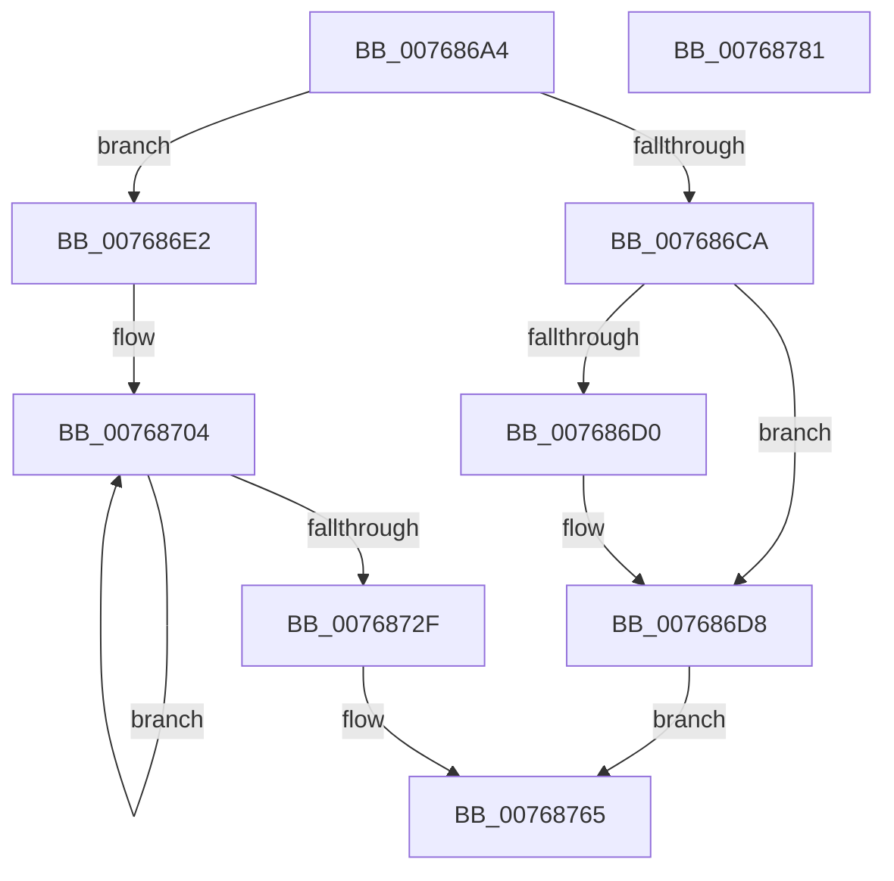

# PpmWmiRegisterInfo

- RVA: `0x007686A4`–`0x00768782` (길이 `222` bytes)
- VA: `0x00000001407686A4`
- 실행 섹션: `PAGE`
- PDB 이름 있음: `예`; PDB Function 태그: `아니요`
- unwind 정보 RVA: `0x00066400`
- 디코드: `57`개 명령, `222/222` bytes 표시
- 미해석 바이트: `0` (있으면 어셈블리에 `.byte`로 보존)

> 이 문서는 커널 이미지의 기계어와 PDB 기호를 분석해 생성했습니다. 4번과 5번은 함수 원형과 자료형을 바이너리 사용 방식에서 추정한 C 해석이며 원본 소스 복구 결과는 아닙니다.

## 1. Dependencies

- 직접 호출 지점: **2**; 고유 호출 대상: **2**
- 직접 호출자로 확인된 함수: **1**
- RIP 상대 이미지 참조: **3**

### Outgoing calls
- `0x007686EA` → [memset](../../text/6C/memset_function_006C6C40.md) (function, `0x006C6C40`)
- `0x00768759` → [RtlStringCbPrintfW](../../text/40/RtlStringCbPrintfW_function_0040FB40.md) (function, `0x0040FB40`)

### Direct callers
- [PpmWmiDispatch](../9E/PpmWmiDispatch_function_009E13A0.md) at `0x009E145F`

### Static image references
- `0x007686F5` → RVA `0x0000B45C` (`.rdata`; read)
- `0x00768747` → RVA `0x00B02C90` (` ?? ::NNGAKEGL::`string'`; read)
- `0x00768752` → RVA `0x00B02C80` (` ?? ::NNGAKEGL::`string'`; read)

## 2. Other-region calls and transfers

- 다른 실행 섹션으로 향하는 call: **2**
  - `0x007686EA` → [memset](../../text/6C/memset_function_006C6C40.md) (`PAGE` → `.text`)
  - `0x00768759` → [RtlStringCbPrintfW](../../text/40/RtlStringCbPrintfW_function_0040FB40.md) (`PAGE` → `.text`)
- 별도 외부 분기/꼬리 이동을 확인하지 못했습니다.

## 3. Assembly (complete function range)

```asm
007686A4  48 89 5C 24 08                  mov qword ptr [rsp + 8], rbx
007686A9  48 89 6C 24 10                  mov qword ptr [rsp + 0x10], rbp
007686AE  48 89 74 24 18                  mov qword ptr [rsp + 0x18], rsi
007686B3  57                              push rdi
007686B4  48 83 EC 30                     sub rsp, 0x30
007686B8  BB 4C 01 00 00                  mov ebx, 0x14c
007686BD  49 8B F9                        mov rdi, r9
007686C0  41 8B F0                        mov esi, r8d
007686C3  8B E9                           mov ebp, ecx
007686C5  44 3B C3                        cmp r8d, ebx
007686C8  73 18                           jae 0x1407686e2
007686CA  41 83 F8 04                     cmp r8d, 4
007686CE  72 08                           jb 0x1407686d8
007686D0  41 89 19                        mov dword ptr [r9], ebx
007686D3  BB 04 00 00 00                  mov ebx, 4
007686D8  B8 23 00 00 C0                  mov eax, 0xc0000023
007686DD  E9 83 00 00 00                  jmp 0x140768765
007686E2  4C 8B C3                        mov r8, rbx
007686E5  33 D2                           xor edx, edx
007686E7  48 8B CF                        mov rcx, rdi
007686EA  E8 51 E5 F5 FF                  call 0x1406c6c40
007686EF  41 B8 08 00 00 00               mov r8d, 8
007686F5  48 8D 15 60 2D 8A FF            lea rdx, [rip - 0x75d2a0]
007686FC  44 89 47 10                     mov dword ptr [rdi + 0x10], r8d
00768700  48 8D 4F 2C                     lea rcx, [rdi + 0x2c]
00768704  48 8B 42 F4                     mov rax, qword ptr [rdx - 0xc]
00768708  0F 10 00                        movups xmm0, xmmword ptr [rax]
0076870B  F3 0F 7F 41 EC                  movdqu xmmword ptr [rcx - 0x14], xmm0
00768710  8B 02                           mov eax, dword ptr [rdx]
00768712  48 8D 52 10                     lea rdx, [rdx + 0x10]
00768716  89 41 FC                        mov dword ptr [rcx - 4], eax
00768719  8B 42 EC                        mov eax, dword ptr [rdx - 0x14]
0076871C  89 01                           mov dword ptr [rcx], eax
0076871E  C7 41 04 18 01 00 00            mov dword ptr [rcx + 4], 0x118
00768725  48 8D 49 20                     lea rcx, [rcx + 0x20]
00768729  49 83 E8 01                     sub r8, 1
0076872D  75 D5                           jne 0x140768704
0076872F  89 1F                           mov dword ptr [rdi], ebx
00768731  8D 96 E6 FE FF FF               lea edx, [rsi - 0x11a]
00768737  48 8D 8F 1A 01 00 00            lea rcx, [rdi + 0x11a]
0076873E  66 C7 87 18 01 00 00 32 00      mov word ptr [rdi + 0x118], 0x32
00768747  4C 8D 0D 42 A5 39 00            lea r9, [rip + 0x39a542]
0076874E  89 6C 24 20                     mov dword ptr [rsp + 0x20], ebp
00768752  4C 8D 05 27 A5 39 00            lea r8, [rip + 0x39a527]
00768759  E8 E2 73 CA FF                  call 0x14040fb40
0076875E  33 C9                           xor ecx, ecx
00768760  85 C0                           test eax, eax
00768762  0F 49 C1                        cmovns eax, ecx
00768765  48 8B 4C 24 60                  mov rcx, qword ptr [rsp + 0x60]
0076876A  48 8B 6C 24 48                  mov rbp, qword ptr [rsp + 0x48]
0076876F  48 8B 74 24 50                  mov rsi, qword ptr [rsp + 0x50]
00768774  89 19                           mov dword ptr [rcx], ebx
00768776  48 8B 5C 24 40                  mov rbx, qword ptr [rsp + 0x40]
0076877B  48 83 C4 30                     add rsp, 0x30
0076877F  5F                              pop rdi
00768780  C3                              ret
00768781  CC                              int3
```

## 4. C-style interpretation (structured pseudocode)

```c
__int64 __fastcall PpmWmiRegisterInfo(int a1, int a2, int a3, __int64 a4, __int64 a5)
{
    __int64 result;
    __int64 v_rbx;
    __int64 v_rsp;
    unsigned int v_stack_m18;
    unsigned __int64 v_stack_p10;
    unsigned __int64 v_stack_p18;
    unsigned __int64 v_stack_p8;

    v_stack_p8 = v_rbx;
    v_stack_p10 = v_rbp;
    v_stack_p18 = v_rsi;
    v_rsp = (v_rsp) - (48);
    if (a3 >= 332) goto loc_007686E2;
    v_rbx = 332;
    if (a3 >= 4) {
        *(unsigned int *)(a4) = 332;
        v_rbx = 4;
    }
    goto loc_00768765;
loc_007686E2:
    a2 = 0;
    result = memset(a4, a2, v_rbx, a4);
    *(unsigned int *)(a4 + 16) = 8;
loc_00768704:
    *(unsigned __int64 *)(a4 + 44 - 20) = v_xmm0;
    *(unsigned int *)(a4 + 44 - 4) = (unsigned int)((unsigned int)(*(unsigned int *)(v_rip - 7721632)));
    *(unsigned int *)(a4 + 44) = (unsigned int)((unsigned int)(*(unsigned int *)(v_rip - 7721632 + 16 - 20)));
    *(unsigned int *)(a4 + 44 + 4) = 280;
    a3 = (8) - (1);
    if (condition_is_not_equal) goto loc_00768704;
    *(unsigned int *)(a4) = (unsigned int)(v_rbx);
    *(unsigned __int16 *)(a4 + 280) = 50;
    v_stack_m18 = (unsigned int)((unsigned int)(a1));
    result = RtlStringCbPrintfW(a4 + 282, (unsigned int)(a3) - 282, v_rip + 3777831, v_rip + 3777858);
    a1 = 0;
    if (!sign_flag) { result = 0; }
loc_00768765:
    *(unsigned int *)(a5) = (unsigned int)(v_rbx);
    v_rsp = (v_rsp) + (48);
    return result;
}
```

## 5. (Beta) C Style

```c
int64_t PpmWmiRegisterInfo(int32_t Arg1, int32_t Arg2, void *Arg3, void *Arg4, void *Arg5)
{
    uint8_t *arg3 = (uint8_t *)Arg3;
    uint8_t *arg4 = (uint8_t *)Arg4;
    uint8_t *arg5 = (uint8_t *)Arg5;

    int64_t result;
    int64_t local_rbx;
    int64_t local_rsp;
    uint32_t v_stack_m18;
    uint64_t v_stack_p10;
    uint64_t v_stack_p18;
    uint64_t v_stack_p8;

    v_stack_p8 = local_rbx;
    v_stack_p10 = local_rbp;
    v_stack_p18 = local_rsi;
    local_rsp = (local_rsp) - (48);
    if (Arg3 >= 332) goto loc_007686E2;
    local_rbx = 332;
    if (Arg3 >= 4) {
        *(uint32_t *)(arg4) = 332;
        local_rbx = 4;
    }
    goto loc_00768765;
loc_007686E2:
    Arg2 = 0;
    result = memset(Arg4, Arg2, local_rbx, Arg4);
    *(uint32_t *)(arg4 + 0x10) = 8;
loc_00768704:
    *(uint64_t *)(arg4 + 0x2C - 0x14) = v_xmm0;
    *(uint32_t *)(arg4 + 0x2C - 0x4) = (uint32_t)((uint32_t)(*(uint32_t *)(v_rip - 0x75D2A0)));
    *(uint32_t *)(arg4 + 0x2C) = (uint32_t)((uint32_t)(*(uint32_t *)(v_rip - 0x75D2A0 + 0x10 - 0x14)));
    *(uint32_t *)(arg4 + 0x2C + 0x4) = 280;
    Arg3 = (8) - (1);
    if (condition_is_not_equal) goto loc_00768704;
    *(uint32_t *)(arg4) = (uint32_t)(local_rbx);
    *(uint16_t *)(arg4 + 0x118) = 50;
    v_stack_m18 = (uint32_t)((uint32_t)(Arg1));
    result = RtlStringCbPrintfW(Arg4 + 282, (uint32_t)(Arg3) - 282, v_rip + 3777831, v_rip + 3777858);
    Arg1 = 0;
    if (!sign_flag) { result = 0; }
loc_00768765:
    *(uint32_t *)(arg5) = (uint32_t)(local_rbx);
    local_rsp = (local_rsp) + (48);
    return result;
}
```

### 관측된 메모리 오프셋

구조체 형식이 확인되지 않은 접근은 인자 기준의 오프셋으로만 기록했습니다.

| 기준 인자 | 오프셋 표현 | 폭 (bit) | 접근 |
|---|---:|---:|---|
| `Arg3` | `- 0x11A` | `32` | `R` |
| `Arg4` | `- 0x14` | `128` | `W` |
| `Arg4` | `- 0x4` | `32` | `W` |
| `Arg4` | `+ 0x0` | `32` | `W` |
| `Arg4` | `+ 0x4` | `32` | `W` |
| `Arg4` | `+ 0x10` | `32` | `W` |
| `Arg4` | `+ 0x20` | `64` | `R` |
| `Arg4` | `+ 0x2C` | `64` | `R` |
| `Arg4` | `+ 0x118` | `16` | `W` |
| `Arg4` | `+ 0x11A` | `64` | `R` |
| `Arg5` | `+ 0x0` | `32` | `W` |

## 6. Execution-region graph

[열기: 2D/3D 그래프와 함수 탐색 컨트롤 패널](../../../control-panel.html?section=page&rva=0x007686A4&view=graph)

- 2D 그래프는 위에서 아래로 흐르고, 3D 그래프는 빈 공간을 드래그해 회전합니다. Shift+드래그는 이동, 휠은 확대·축소, 함수 노드 선택은 대상 보고서 이동입니다.

### Static fallback


