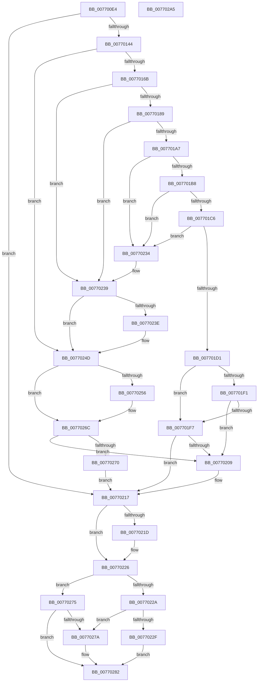

# PopBcdEstablishResumeObject

- RVA: `0x007700E4`–`0x007702A6` (길이 `450` bytes)
- VA: `0x00000001407700E4`
- 실행 섹션: `PAGE`
- PDB 이름 있음: `예`; PDB Function 태그: `아니요`
- unwind 정보 RVA: `0x000CD678`
- 디코드: `130`개 명령, `450/450` bytes 표시
- 미해석 바이트: `0` (있으면 어셈블리에 `.byte`로 보존)

> 이 문서는 커널 이미지의 기계어와 PDB 기호를 분석해 생성했습니다. 4번과 5번은 함수 원형과 자료형을 바이너리 사용 방식에서 추정한 C 해석이며 원본 소스 복구 결과는 아닙니다.

## 1. Dependencies

- 직접 호출 지점: **12**; 고유 호출 대상: **8**
- 직접 호출자로 확인된 함수: **2**
- RIP 상대 이미지 참조: **3**

### Outgoing calls
- `0x00770135` → [BcdOpenObject](../91/BcdOpenObject_function_00916704.md) (function, `0x00916704`)
- `0x0077015C` → [BcdGetElementData](../A3/BcdGetElementData_function_00A3E390.md) (function, `0x00A3E390`)
- `0x00770176` → [BcdOpenObject](../91/BcdOpenObject_function_00916704.md) (function, `0x00916704`)
- `0x00770198` → [BcdQueryObject](../82/BcdQueryObject_function_0082385C.md) (function, `0x0082385C`)
- `0x007701E8` → [BcdGetElementData](../A3/BcdGetElementData_function_00A3E390.md) (function, `0x00A3E390`)
- `0x007701FE` → [PopBcdSetDefaultResumeObjectElements](../A3/PopBcdSetDefaultResumeObjectElements_function_00A3C7F8.md) (function, `0x00A3C7F8`)
- `0x00770210` → [PopBcdCopyLoaderObjectSettings](../76/PopBcdCopyLoaderObjectSettings_function_0076FFF4.md) (function, `0x0076FFF4`)
- `0x00770221` → [BcdCloseObject](../A3/BcdCloseObject_function_00A3FB08.md) (function, `0x00A3FB08`)
- `0x00770241` → [BcdCloseObject](../A3/BcdCloseObject_function_00A3FB08.md) (function, `0x00A3FB08`)
- `0x00770261` → [PopBcdRegenerateResumeObject](PopBcdRegenerateResumeObject_function_007704BC.md) (function, `0x007704BC`)
- `0x0077027D` → [BcdCloseObject](../A3/BcdCloseObject_function_00A3FB08.md) (function, `0x00A3FB08`)
- `0x0077028B` → [_security_check_cookie](../../text/6A/_security_check_cookie_function_006AC640.md) (function, `0x006AC640`)

### Direct callers
- [PoInitHiberServices](../75/PoInitHiberServices_function_007537C4.md) at `0x0075387F`
- [PopAllocateHiberContext](../AD/PopAllocateHiberContext_function_00ADC05C.md) at `0x00ADC303`

### Static image references
- `0x007700F8` → RVA `0x00E0A740` (`.data`; read)
- `0x00770123` → RVA `0x0001A4A0` (`.rdata`; read)
- `0x0077024D` → RVA `0x00FC4148` (`.data`; read)

## 2. Other-region calls and transfers

- 다른 실행 섹션으로 향하는 call: **1**
  - `0x0077028B` → [_security_check_cookie](../../text/6A/_security_check_cookie_function_006AC640.md) (`PAGE` → `.text`)
- 별도 외부 분기/꼬리 이동을 확인하지 못했습니다.

## 3. Assembly (complete function range)

```asm
007700E4  48 89 5C 24 18                  mov qword ptr [rsp + 0x18], rbx
007700E9  55                              push rbp
007700EA  57                              push rdi
007700EB  41 54                           push r12
007700ED  41 56                           push r14
007700EF  41 57                           push r15
007700F1  48 8B EC                        mov rbp, rsp
007700F4  48 83 EC 60                     sub rsp, 0x60
007700F8  48 8B 05 41 A6 69 00            mov rax, qword ptr [rip + 0x69a641]
007700FF  48 33 C4                        xor rax, rsp
00770102  48 89 45 F0                     mov qword ptr [rbp - 0x10], rax
00770106  45 33 E4                        xor r12d, r12d
00770109  4C 8D 45 C8                     lea r8, [rbp - 0x38]
0077010D  4C 8B FA                        mov r15, rdx
00770110  66 44 89 65 C0                  mov word ptr [rbp - 0x40], r12w
00770115  0F 57 C0                        xorps xmm0, xmm0
00770118  4C 89 65 D8                     mov qword ptr [rbp - 0x28], r12
0077011C  41 8B DC                        mov ebx, r12d
0077011F  4C 89 65 C8                     mov qword ptr [rbp - 0x38], r12
00770123  48 8D 15 76 A3 8A FF            lea rdx, [rip - 0x755c8a]
0077012A  48 89 5D D0                     mov qword ptr [rbp - 0x30], rbx
0077012E  4C 8B F1                        mov r14, rcx
00770131  0F 11 45 E0                     movups xmmword ptr [rbp - 0x20], xmm0
00770135  E8 CA 65 1A 00                  call 0x140916704
0077013A  8B F8                           mov edi, eax
0077013C  85 C0                           test eax, eax
0077013E  0F 88 D3 00 00 00               js 0x140770217
00770144  48 8B 4D C8                     mov rcx, qword ptr [rbp - 0x38]
00770148  4C 8D 4D C4                     lea r9, [rbp - 0x3c]
0077014C  4C 8D 45 E0                     lea r8, [rbp - 0x20]
00770150  C7 45 C4 10 00 00 00            mov dword ptr [rbp - 0x3c], 0x10
00770157  BA 03 00 00 23                  mov edx, 0x23000003
0077015C  E8 2F E2 2C 00                  call 0x140a3e390
00770161  8B F8                           mov edi, eax
00770163  85 C0                           test eax, eax
00770165  0F 88 E2 00 00 00               js 0x14077024d
0077016B  4C 8D 45 D0                     lea r8, [rbp - 0x30]
0077016F  49 8B CE                        mov rcx, r14
00770172  48 8D 55 E0                     lea rdx, [rbp - 0x20]
00770176  E8 89 65 1A 00                  call 0x140916704
0077017B  48 8B 5D D0                     mov rbx, qword ptr [rbp - 0x30]
0077017F  8B F8                           mov edi, eax
00770181  85 C0                           test eax, eax
00770183  0F 88 B0 00 00 00               js 0x140770239
00770189  45 33 C9                        xor r9d, r9d
0077018C  4C 8D 45 D8                     lea r8, [rbp - 0x28]
00770190  41 8D 54 24 01                  lea edx, [r12 + 1]
00770195  48 8B CB                        mov rcx, rbx
00770198  E8 BF 36 0B 00                  call 0x14082385c
0077019D  8B F8                           mov edi, eax
0077019F  85 C0                           test eax, eax
007701A1  0F 88 92 00 00 00               js 0x140770239
007701A7  8B 4D DC                        mov ecx, dword ptr [rbp - 0x24]
007701AA  8B C1                           mov eax, ecx
007701AC  25 00 00 00 F0                  and eax, 0xf0000000
007701B1  3D 00 00 00 10                  cmp eax, 0x10000000
007701B6  75 7C                           jne 0x140770234
007701B8  8B C1                           mov eax, ecx
007701BA  25 00 00 F0 00                  and eax, 0xf00000
007701BF  3D 00 00 20 00                  cmp eax, 0x200000
007701C4  75 6E                           jne 0x140770234
007701C6  81 E1 FF FF 0F 00               and ecx, 0xfffff
007701CC  83 F9 04                        cmp ecx, 4
007701CF  75 63                           jne 0x140770234
007701D1  4C 8D 4D C4                     lea r9, [rbp - 0x3c]
007701D5  C7 45 C4 02 00 00 00            mov dword ptr [rbp - 0x3c], 2
007701DC  4C 8D 45 C0                     lea r8, [rbp - 0x40]
007701E0  BA 03 00 00 26                  mov edx, 0x26000003
007701E5  48 8B CB                        mov rcx, rbx
007701E8  E8 A3 E1 2C 00                  call 0x140a3e390
007701ED  85 C0                           test eax, eax
007701EF  78 06                           js 0x1407701f7
007701F1  44 38 65 C0                     cmp byte ptr [rbp - 0x40], r12b
007701F5  75 12                           jne 0x140770209
007701F7  48 8B 55 C8                     mov rdx, qword ptr [rbp - 0x38]
007701FB  48 8B CB                        mov rcx, rbx
007701FE  E8 F5 C5 2C 00                  call 0x140a3c7f8
00770203  8B F8                           mov edi, eax
00770205  85 C0                           test eax, eax
00770207  78 0E                           js 0x140770217
00770209  48 8B 4D C8                     mov rcx, qword ptr [rbp - 0x38]
0077020D  48 8B D3                        mov rdx, rbx
00770210  E8 DF FD FF FF                  call 0x14076fff4
00770215  8B F8                           mov edi, eax
00770217  4C 39 65 C8                     cmp qword ptr [rbp - 0x38], r12
0077021B  74 09                           je 0x140770226
0077021D  48 8B 4D C8                     mov rcx, qword ptr [rbp - 0x38]
00770221  E8 E2 F8 2C 00                  call 0x140a3fb08
00770226  85 FF                           test edi, edi
00770228  78 4B                           js 0x140770275
0077022A  4D 85 FF                        test r15, r15
0077022D  74 4B                           je 0x14077027a
0077022F  49 89 1F                        mov qword ptr [r15], rbx
00770232  EB 4E                           jmp 0x140770282
00770234  BF 25 02 00 C0                  mov edi, 0xc0000225
00770239  48 85 DB                        test rbx, rbx
0077023C  74 0F                           je 0x14077024d
0077023E  48 8B CB                        mov rcx, rbx
00770241  E8 C2 F8 2C 00                  call 0x140a3fb08
00770246  49 8B DC                        mov rbx, r12
00770249  48 89 5D D0                     mov qword ptr [rbp - 0x30], rbx
0077024D  44 38 25 F4 3E 85 00            cmp byte ptr [rip + 0x853ef4], r12b
00770254  75 16                           jne 0x14077026c
00770256  48 8B 55 C8                     mov rdx, qword ptr [rbp - 0x38]
0077025A  4C 8D 45 D0                     lea r8, [rbp - 0x30]
0077025E  49 8B CE                        mov rcx, r14
00770261  E8 56 02 00 00                  call 0x1407704bc
00770266  48 8B 5D D0                     mov rbx, qword ptr [rbp - 0x30]
0077026A  8B F8                           mov edi, eax
0077026C  85 FF                           test edi, edi
0077026E  79 99                           jns 0x140770209
00770270  49 8B DC                        mov rbx, r12
00770273  EB A2                           jmp 0x140770217
00770275  48 85 DB                        test rbx, rbx
00770278  74 08                           je 0x140770282
0077027A  48 8B CB                        mov rcx, rbx
0077027D  E8 86 F8 2C 00                  call 0x140a3fb08
00770282  8B C7                           mov eax, edi
00770284  48 8B 4D F0                     mov rcx, qword ptr [rbp - 0x10]
00770288  48 33 CC                        xor rcx, rsp
0077028B  E8 B0 C3 F3 FF                  call 0x1406ac640
00770290  48 8B 9C 24 A0 00 00 00         mov rbx, qword ptr [rsp + 0xa0]
00770298  48 83 C4 60                     add rsp, 0x60
0077029C  41 5F                           pop r15
0077029E  41 5E                           pop r14
007702A0  41 5C                           pop r12
007702A2  5F                              pop rdi
007702A3  5D                              pop rbp
007702A4  C3                              ret
007702A5  CC                              int3
```

## 4. C-style interpretation (structured pseudocode)

```c
__int64 __fastcall PopBcdEstablishResumeObject(__int64 a1, __int64 a2)
{
    __int64 result;
    __int64 v_r12;
    __int64 v_rbx;
    __int64 v_rdi;
    __int64 v_rsp;
    unsigned __int64 v_stack_m38;
    unsigned __int64 v_stack_m48;
    unsigned int v_stack_m4C;
    unsigned __int64 v_stack_m50;
    unsigned __int64 v_stack_m58;
    unsigned __int64 v_stack_m60;
    unsigned __int64 v_stack_m64;
    unsigned __int16 v_stack_m68;
    unsigned __int64 v_stack_p18;

    v_stack_p18 = v_rbx;
    v_rsp = (v_rsp) - (96);
    result = (*(unsigned __int64 *)(v_rip + 6923841)) ^ (v_rsp);
    v_stack_m38 = result;
    v_r12 = 0;
    v_stack_m68 = 0;
    v_stack_m50 = 0;
    v_stack_m60 = 0;
    v_stack_m58 = 0;
    v_stack_m48 = v_xmm0;
    result = BcdOpenObject(a1, v_rip - 7691402, v_stack_m60, a4);
    if (sign_flag) goto loc_00770217;
    v_stack_m64 = 16;
    result = BcdGetElementData(v_stack_m60, (unsigned int)(0x23000003ULL), v_stack_m48, v_stack_m64);
    if (sign_flag) goto loc_0077024D;
    result = BcdOpenObject(a1, v_stack_m48, v_stack_m58, v_stack_m64);
    if (sign_flag) goto loc_00770239;
    a4 = 0;
    result = BcdQueryObject(v_stack_m58, v_r12 + 1, v_stack_m50, a4);
    if (sign_flag) goto loc_00770239;
    result = (unsigned int)(((unsigned int)((unsigned int)((unsigned int)(v_stack_m4C)))) & (0xF0000000ULL));
    if (((unsigned int)(result)) != 0x10000000ULL) goto loc_00770234;
    result = (unsigned int)(((unsigned int)((unsigned int)((unsigned int)(v_stack_m4C)))) & (0xF00000ULL));
    if (((unsigned int)(result)) != 0x200000ULL) goto loc_00770234;
    a1 = (unsigned int)(((unsigned int)(v_stack_m4C)) & (0xFFFFFULL));
    if (((unsigned int)(a1)) != 4) goto loc_00770234;
    v_stack_m64 = 2;
    result = BcdGetElementData(v_stack_m58, (unsigned int)(0x26000003ULL), v_stack_m68, v_stack_m64);
    if (sign_flag) goto loc_007701F7;
    if (v_stack_m68 != 0) goto loc_00770209;
loc_007701F7:
    result = PopBcdSetDefaultResumeObjectElements(v_stack_m58, v_stack_m60, v_stack_m68, v_stack_m64);
    v_rdi = (unsigned int)((unsigned int)(result));
    if (!(sign_flag)) {
        a1 = v_stack_m60;
        a2 = v_stack_m58;
        result = PopBcdCopyLoaderObjectSettings(a1, a2, v_stack_m68, v_stack_m64);
        v_rdi = (unsigned int)(result);
    }
    if (v_stack_m60 != 0) {
        a1 = v_stack_m60;
        result = BcdCloseObject(a1, a2, v_stack_m68, v_stack_m64);
    }
    if (sign_flag) goto loc_00770275;
    if (a2 == 0) goto loc_0077027A;
    *(unsigned __int64 *)(a2) = v_stack_m58;
    goto loc_00770282;
loc_00770234:
loc_00770239:
    v_rbx = v_stack_m58;
    if (v_stack_m58 != 0) {
        a1 = v_stack_m58;
        result = BcdCloseObject(a1, a2, v_stack_m68, v_stack_m64);
        v_rbx = 0;
        v_stack_m58 = v_rbx;
    }
    v_rdi = (unsigned int)(0xC0000225ULL);
    if ((*(unsigned __int8 *)(v_rip + 8732404)) == 0) {
        a2 = v_stack_m60;
        a3 = v_stack_m58;
        a1 = a1;
        result = PopBcdRegenerateResumeObject(a1, a2, a3, v_stack_m64);
        v_rbx = v_stack_m58;
        v_rdi = (unsigned int)(result);
    }
    if (!sign_flag) goto loc_00770209;
    goto loc_00770217;
loc_00770275:
    if (0 != 0) {
        a1 = 0;
        result = BcdCloseObject(a1, a2, a3, v_stack_m64);
    }
    a1 = (v_stack_m38) ^ (v_rsp);
    result = _security_check_cookie(a1, a2, a3, v_stack_m64);
    v_rsp = (v_rsp) + (96);
    return result;
}
```

## 5. (Beta) C Style

```c
int64_t PopBcdEstablishResumeObject(int64_t Arg1, int64_t Arg2)
{
    int64_t result;
    int64_t local_r12;
    int64_t local_rbx;
    int64_t local_rdi;
    int64_t local_rsp;
    uint64_t v_stack_m38;
    uint64_t v_stack_m48;
    uint32_t v_stack_m4C;
    uint64_t v_stack_m50;
    uint64_t v_stack_m58;
    uint64_t v_stack_m60;
    uint64_t v_stack_m64;
    uint16_t v_stack_m68;
    uint64_t v_stack_p18;

    v_stack_p18 = local_rbx;
    local_rsp = (local_rsp) - (96);
    result = (*(uint64_t *)(v_rip + 0x69A641)) ^ (local_rsp);
    v_stack_m38 = result;
    local_r12 = 0;
    v_stack_m68 = 0;
    v_stack_m50 = 0;
    v_stack_m60 = 0;
    v_stack_m58 = 0;
    v_stack_m48 = v_xmm0;
    result = BcdOpenObject(Arg1, v_rip - 7691402, v_stack_m60, a4);
    if (sign_flag) goto loc_00770217;
    v_stack_m64 = 16;
    result = BcdGetElementData(v_stack_m60, (uint32_t)(0x23000003ULL), v_stack_m48, v_stack_m64);
    if (sign_flag) goto loc_0077024D;
    result = BcdOpenObject(Arg1, v_stack_m48, v_stack_m58, v_stack_m64);
    if (sign_flag) goto loc_00770239;
    a4 = 0;
    result = BcdQueryObject(v_stack_m58, local_r12 + 1, v_stack_m50, a4);
    if (sign_flag) goto loc_00770239;
    result = (uint32_t)(((uint32_t)((uint32_t)((uint32_t)(v_stack_m4C)))) & (0xF0000000ULL));
    if (((uint32_t)(result)) != 0x10000000ULL) goto loc_00770234;
    result = (uint32_t)(((uint32_t)((uint32_t)((uint32_t)(v_stack_m4C)))) & (0xF00000ULL));
    if (((uint32_t)(result)) != 0x200000ULL) goto loc_00770234;
    Arg1 = (uint32_t)(((uint32_t)(v_stack_m4C)) & (0xFFFFFULL));
    if (((uint32_t)(Arg1)) != 4) goto loc_00770234;
    v_stack_m64 = 2;
    result = BcdGetElementData(v_stack_m58, (uint32_t)(0x26000003ULL), v_stack_m68, v_stack_m64);
    if (sign_flag) goto loc_007701F7;
    if (v_stack_m68 != 0) goto loc_00770209;
loc_007701F7:
    result = PopBcdSetDefaultResumeObjectElements(v_stack_m58, v_stack_m60, v_stack_m68, v_stack_m64);
    local_rdi = (uint32_t)((uint32_t)(result));
    if (!(sign_flag)) {
        Arg1 = v_stack_m60;
        Arg2 = v_stack_m58;
        result = PopBcdCopyLoaderObjectSettings(Arg1, Arg2, v_stack_m68, v_stack_m64);
        local_rdi = (uint32_t)(result);
    }
    if (v_stack_m60 != 0) {
        Arg1 = v_stack_m60;
        result = BcdCloseObject(Arg1, Arg2, v_stack_m68, v_stack_m64);
    }
    if (sign_flag) goto loc_00770275;
    if (Arg2 == 0) goto loc_0077027A;
    *(uint64_t *)(Arg2) = v_stack_m58;
    goto loc_00770282;
loc_00770234:
loc_00770239:
    local_rbx = v_stack_m58;
    if (v_stack_m58 != 0) {
        Arg1 = v_stack_m58;
        result = BcdCloseObject(Arg1, Arg2, v_stack_m68, v_stack_m64);
        local_rbx = 0;
        v_stack_m58 = local_rbx;
    }
    local_rdi = (uint32_t)(0xC0000225ULL);
    if ((*(uint8_t *)(v_rip + 0x853EF4)) == 0) {
        Arg2 = v_stack_m60;
        a3 = v_stack_m58;
        Arg1 = Arg1;
        result = PopBcdRegenerateResumeObject(Arg1, Arg2, a3, v_stack_m64);
        local_rbx = v_stack_m58;
        local_rdi = (uint32_t)(result);
    }
    if (!sign_flag) goto loc_00770209;
    goto loc_00770217;
loc_00770275:
    if (0 != 0) {
        Arg1 = 0;
        result = BcdCloseObject(Arg1, Arg2, a3, v_stack_m64);
    }
    Arg1 = (v_stack_m38) ^ (local_rsp);
    result = _security_check_cookie(Arg1, Arg2, a3, v_stack_m64);
    local_rsp = (local_rsp) + (96);
    return result;
}
```

## 6. Execution-region graph

[열기: 2D/3D 그래프와 함수 탐색 컨트롤 패널](../../../control-panel.html?section=page&rva=0x007700E4&view=graph)

- 2D 그래프는 위에서 아래로 흐르고, 3D 그래프는 빈 공간을 드래그해 회전합니다. Shift+드래그는 이동, 휠은 확대·축소, 함수 노드 선택은 대상 보고서 이동입니다.

### Static fallback


