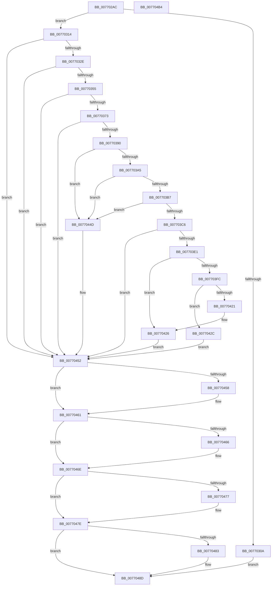

# PopBcdGetApplicationPathFromResumeObject

- RVA: `0x007702AC`–`0x007704B5` (길이 `521` bytes)
- VA: `0x00000001407702AC`
- 실행 섹션: `PAGE`
- PDB 이름 있음: `예`; PDB Function 태그: `아니요`
- unwind 정보 RVA: `0x000CD654`
- 디코드: `143`개 명령, `521/521` bytes 표시
- 미해석 바이트: `0` (있으면 어셈블리에 `.byte`로 보존)

> 이 문서는 커널 이미지의 기계어와 PDB 기호를 분석해 생성했습니다. 4번과 5번은 함수 원형과 자료형을 바이너리 사용 방식에서 추정한 C 해석이며 원본 소스 복구 결과는 아닙니다.

## 1. Dependencies

- 직접 호출 지점: **14**; 고유 호출 대상: **9**
- 직접 호출자로 확인된 함수: **1**
- RIP 상대 이미지 참조: **2**

### Outgoing calls
- `0x0077031F` → [BcdOpenObject](../91/BcdOpenObject_function_00916704.md) (function, `0x00916704`)
- `0x00770346` → [BcdGetElementData](../A3/BcdGetElementData_function_00A3E390.md) (function, `0x00A3E390`)
- `0x00770360` → [BcdOpenObject](../91/BcdOpenObject_function_00916704.md) (function, `0x00916704`)
- `0x00770381` → [BcdQueryObject](../82/BcdQueryObject_function_0082385C.md) (function, `0x0082385C`)
- `0x007703D6` → [PopBcdReadElement](../A3/PopBcdReadElement_function_00A3C740.md) (function, `0x00A3C740`)
- `0x007703F1` → [PopBcdReadElement](../A3/PopBcdReadElement_function_00A3C740.md) (function, `0x00A3C740`)
- `0x00770413` → [ExAllocatePool2](../../poolcode/B8/ExAllocatePool2_function_00B820F0.md) (function, `0x00B820F0`)
- `0x00770437` → [RtlAppendUnicodeToString](../../text/40/RtlAppendUnicodeToString_function_0040F990.md) (function, `0x0040F990`)
- `0x00770446` → [RtlAppendUnicodeToString](../../text/40/RtlAppendUnicodeToString_function_0040F990.md) (function, `0x0040F990`)
- `0x0077045C` → [BcdCloseObject](../A3/BcdCloseObject_function_00A3FB08.md) (function, `0x00A3FB08`)
- `0x00770469` → [BcdCloseObject](../A3/BcdCloseObject_function_00A3FB08.md) (function, `0x00A3FB08`)
- `0x00770479` → [ExFreePoolWithTag](../../poolcode/B8/ExFreePoolWithTag_function_00B82870.md) (function, `0x00B82870`)
- `0x00770488` → [ExFreePoolWithTag](../../poolcode/B8/ExFreePoolWithTag_function_00B82870.md) (function, `0x00B82870`)
- `0x00770496` → [_security_check_cookie](../../text/6A/_security_check_cookie_function_006AC640.md) (function, `0x006AC640`)

### Direct callers
- [PopValidateWinresume](../75/PopValidateWinresume_function_0075DFF4.md) at `0x0075E176`

### Static image references
- `0x007702C5` → RVA `0x00E0A740` (`.data`; read)
- `0x00770318` → RVA `0x0001A4A0` (`.rdata`; read)

## 2. Other-region calls and transfers

- 다른 실행 섹션으로 향하는 call: **6**
  - `0x00770413` → [ExAllocatePool2](../../poolcode/B8/ExAllocatePool2_function_00B820F0.md) (`PAGE` → `POOLCODE`)
  - `0x00770437` → [RtlAppendUnicodeToString](../../text/40/RtlAppendUnicodeToString_function_0040F990.md) (`PAGE` → `.text`)
  - `0x00770446` → [RtlAppendUnicodeToString](../../text/40/RtlAppendUnicodeToString_function_0040F990.md) (`PAGE` → `.text`)
  - `0x00770479` → [ExFreePoolWithTag](../../poolcode/B8/ExFreePoolWithTag_function_00B82870.md) (`PAGE` → `POOLCODE`)
  - `0x00770488` → [ExFreePoolWithTag](../../poolcode/B8/ExFreePoolWithTag_function_00B82870.md) (`PAGE` → `POOLCODE`)
  - `0x00770496` → [_security_check_cookie](../../text/6A/_security_check_cookie_function_006AC640.md) (`PAGE` → `.text`)
- 별도 외부 분기/꼬리 이동을 확인하지 못했습니다.

## 3. Assembly (complete function range)

```asm
007702AC  48 89 5C 24 18                  mov qword ptr [rsp + 0x18], rbx
007702B1  48 89 74 24 20                  mov qword ptr [rsp + 0x20], rsi
007702B6  55                              push rbp
007702B7  57                              push rdi
007702B8  41 54                           push r12
007702BA  41 55                           push r13
007702BC  41 56                           push r14
007702BE  48 8B EC                        mov rbp, rsp
007702C1  48 83 EC 70                     sub rsp, 0x70
007702C5  48 8B 05 74 A4 69 00            mov rax, qword ptr [rip + 0x69a474]
007702CC  48 33 C4                        xor rax, rsp
007702CF  48 89 45 F8                     mov qword ptr [rbp - 8], rax
007702D3  45 33 ED                        xor r13d, r13d
007702D6  0F 57 C0                        xorps xmm0, xmm0
007702D9  4C 89 6D E0                     mov qword ptr [rbp - 0x20], r13
007702DD  4C 8B F2                        mov r14, rdx
007702E0  4C 89 6D D8                     mov qword ptr [rbp - 0x28], r13
007702E4  4C 8B E1                        mov r12, rcx
007702E7  44 89 6D C4                     mov dword ptr [rbp - 0x3c], r13d
007702EB  41 8B F5                        mov esi, r13d
007702EE  4C 89 6D B8                     mov qword ptr [rbp - 0x48], r13
007702F2  41 8B FD                        mov edi, r13d
007702F5  4C 89 6D B0                     mov qword ptr [rbp - 0x50], r13
007702F9  44 89 6D C8                     mov dword ptr [rbp - 0x38], r13d
007702FD  4C 89 6D D0                     mov qword ptr [rbp - 0x30], r13
00770301  0F 11 45 E8                     movups xmmword ptr [rbp - 0x18], xmm0
00770305  48 85 D2                        test rdx, rdx
00770308  75 0A                           jne 0x140770314
0077030A  BB 0D 00 00 C0                  mov ebx, 0xc000000d
0077030F  E9 79 01 00 00                  jmp 0x14077048d
00770314  4C 8D 45 B8                     lea r8, [rbp - 0x48]
00770318  48 8D 15 81 A1 8A FF            lea rdx, [rip - 0x755e7f]
0077031F  E8 E0 63 1A 00                  call 0x140916704
00770324  8B D8                           mov ebx, eax
00770326  85 C0                           test eax, eax
00770328  0F 88 24 01 00 00               js 0x140770452
0077032E  48 8B 4D B8                     mov rcx, qword ptr [rbp - 0x48]
00770332  4C 8D 4D C0                     lea r9, [rbp - 0x40]
00770336  4C 8D 45 E8                     lea r8, [rbp - 0x18]
0077033A  C7 45 C0 10 00 00 00            mov dword ptr [rbp - 0x40], 0x10
00770341  BA 03 00 00 23                  mov edx, 0x23000003
00770346  E8 45 E0 2C 00                  call 0x140a3e390
0077034B  8B D8                           mov ebx, eax
0077034D  85 C0                           test eax, eax
0077034F  0F 88 FD 00 00 00               js 0x140770452
00770355  4C 8D 45 D0                     lea r8, [rbp - 0x30]
00770359  49 8B CC                        mov rcx, r12
0077035C  48 8D 55 E8                     lea rdx, [rbp - 0x18]
00770360  E8 9F 63 1A 00                  call 0x140916704
00770365  48 8B 7D D0                     mov rdi, qword ptr [rbp - 0x30]
00770369  8B D8                           mov ebx, eax
0077036B  85 C0                           test eax, eax
0077036D  0F 88 DF 00 00 00               js 0x140770452
00770373  45 33 C9                        xor r9d, r9d
00770376  4C 8D 45 E0                     lea r8, [rbp - 0x20]
0077037A  48 8B CF                        mov rcx, rdi
0077037D  41 8D 51 01                     lea edx, [r9 + 1]
00770381  E8 D6 34 0B 00                  call 0x14082385c
00770386  8B D8                           mov ebx, eax
00770388  85 C0                           test eax, eax
0077038A  0F 88 C2 00 00 00               js 0x140770452
00770390  8B 4D E4                        mov ecx, dword ptr [rbp - 0x1c]
00770393  8B C1                           mov eax, ecx
00770395  25 00 00 00 F0                  and eax, 0xf0000000
0077039A  3D 00 00 00 10                  cmp eax, 0x10000000
0077039F  0F 85 A8 00 00 00               jne 0x14077044d
007703A5  8B C1                           mov eax, ecx
007703A7  25 00 00 F0 00                  and eax, 0xf00000
007703AC  3D 00 00 20 00                  cmp eax, 0x200000
007703B1  0F 85 96 00 00 00               jne 0x14077044d
007703B7  81 E1 FF FF 0F 00               and ecx, 0xfffff
007703BD  83 F9 04                        cmp ecx, 4
007703C0  0F 85 87 00 00 00               jne 0x14077044d
007703C6  4C 8D 4D C4                     lea r9, [rbp - 0x3c]
007703CA  BA 01 00 00 11                  mov edx, 0x11000001
007703CF  4C 8D 45 D8                     lea r8, [rbp - 0x28]
007703D3  48 8B CF                        mov rcx, rdi
007703D6  E8 65 C3 2C 00                  call 0x140a3c740
007703DB  8B D8                           mov ebx, eax
007703DD  85 C0                           test eax, eax
007703DF  78 71                           js 0x140770452
007703E1  4C 8D 4D C8                     lea r9, [rbp - 0x38]
007703E5  BA 02 00 00 12                  mov edx, 0x12000002
007703EA  4C 8D 45 B0                     lea r8, [rbp - 0x50]
007703EE  48 8B CF                        mov rcx, rdi
007703F1  E8 4A C3 2C 00                  call 0x140a3c740
007703F6  8B D8                           mov ebx, eax
007703F8  85 C0                           test eax, eax
007703FA  78 2A                           js 0x140770426
007703FC  BA 08 02 00 00                  mov edx, 0x208
00770401  41 C7 06 00 00 08 02            mov dword ptr [r14], 0x2080000
00770408  B9 00 01 00 00                  mov ecx, 0x100
0077040D  41 B8 50 42 63 64               mov r8d, 0x64634250
00770413  E8 D8 1C 41 00                  call 0x140b820f0
00770418  49 89 46 08                     mov qword ptr [r14 + 8], rax
0077041C  48 85 C0                        test rax, rax
0077041F  75 0B                           jne 0x14077042c
00770421  BB 9A 00 00 C0                  mov ebx, 0xc000009a
00770426  48 8B 75 B0                     mov rsi, qword ptr [rbp - 0x50]
0077042A  EB 26                           jmp 0x140770452
0077042C  48 8B 55 D8                     mov rdx, qword ptr [rbp - 0x28]
00770430  49 8B CE                        mov rcx, r14
00770433  48 83 C2 14                     add rdx, 0x14
00770437  E8 54 F5 C9 FF                  call 0x14040f990
0077043C  48 8B 75 B0                     mov rsi, qword ptr [rbp - 0x50]
00770440  49 8B CE                        mov rcx, r14
00770443  48 8B D6                        mov rdx, rsi
00770446  E8 45 F5 C9 FF                  call 0x14040f990
0077044B  EB 05                           jmp 0x140770452
0077044D  BB 25 02 00 C0                  mov ebx, 0xc0000225
00770452  4C 39 6D B8                     cmp qword ptr [rbp - 0x48], r13
00770456  74 09                           je 0x140770461
00770458  48 8B 4D B8                     mov rcx, qword ptr [rbp - 0x48]
0077045C  E8 A7 F6 2C 00                  call 0x140a3fb08
00770461  48 85 FF                        test rdi, rdi
00770464  74 08                           je 0x14077046e
00770466  48 8B CF                        mov rcx, rdi
00770469  E8 9A F6 2C 00                  call 0x140a3fb08
0077046E  48 8B 4D D8                     mov rcx, qword ptr [rbp - 0x28]
00770472  48 85 C9                        test rcx, rcx
00770475  74 07                           je 0x14077047e
00770477  33 D2                           xor edx, edx
00770479  E8 F2 23 41 00                  call 0x140b82870
0077047E  48 85 F6                        test rsi, rsi
00770481  74 0A                           je 0x14077048d
00770483  33 D2                           xor edx, edx
00770485  48 8B CE                        mov rcx, rsi
00770488  E8 E3 23 41 00                  call 0x140b82870
0077048D  8B C3                           mov eax, ebx
0077048F  48 8B 4D F8                     mov rcx, qword ptr [rbp - 8]
00770493  48 33 CC                        xor rcx, rsp
00770496  E8 A5 C1 F3 FF                  call 0x1406ac640
0077049B  4C 8D 5C 24 70                  lea r11, [rsp + 0x70]
007704A0  49 8B 5B 40                     mov rbx, qword ptr [r11 + 0x40]
007704A4  49 8B 73 48                     mov rsi, qword ptr [r11 + 0x48]
007704A8  49 8B E3                        mov rsp, r11
007704AB  41 5E                           pop r14
007704AD  41 5D                           pop r13
007704AF  41 5C                           pop r12
007704B1  5F                              pop rdi
007704B2  5D                              pop rbp
007704B3  C3                              ret
007704B4  CC                              int3
```

## 4. C-style interpretation (structured pseudocode)

```c
__int64 __fastcall PopBcdGetApplicationPathFromResumeObject(__int64 a1, __int64 a2)
{
    __int64 result;
    __int64 v_r13;
    __int64 v_rsp;
    unsigned __int64 v_stack_m28;
    unsigned __int64 v_stack_m30;
    unsigned __int64 v_stack_m40;
    unsigned int v_stack_m44;
    unsigned __int64 v_stack_m48;
    unsigned __int64 v_stack_m50;
    unsigned __int64 v_stack_m58;
    unsigned int v_stack_m60;
    unsigned int v_stack_m64;
    unsigned __int64 v_stack_m68;
    unsigned __int64 v_stack_m70;
    unsigned __int64 v_stack_m78;
    unsigned __int64 v_stack_p18;
    unsigned __int64 v_stack_p20;

    v_stack_p18 = v_rbx;
    v_stack_p20 = v_rsi;
    v_rsp = (v_rsp) - (112);
    result = (*(unsigned __int64 *)(v_rip + 6923380)) ^ (v_rsp);
    v_stack_m30 = result;
    v_r13 = 0;
    v_stack_m48 = 0;
    v_stack_m50 = 0;
    v_stack_m64 = 0;
    v_stack_m70 = 0;
    v_stack_m78 = 0;
    v_stack_m60 = 0;
    v_stack_m58 = 0;
    v_stack_m40 = v_xmm0;
    if (a2 != 0) goto loc_00770314;
    goto loc_0077048D;
loc_00770314:
    result = BcdOpenObject(a1, v_rip - 7691903, v_stack_m70, a4);
    if (sign_flag) goto loc_00770452;
    v_stack_m68 = 16;
    result = BcdGetElementData(v_stack_m70, (unsigned int)(0x23000003ULL), v_stack_m40, v_stack_m68);
    if (sign_flag) goto loc_00770452;
    result = BcdOpenObject(a1, v_stack_m40, v_stack_m58, v_stack_m68);
    if (sign_flag) goto loc_00770452;
    a4 = 0;
    result = BcdQueryObject(v_stack_m58, a4 + 1, v_stack_m48, a4);
    if (sign_flag) goto loc_00770452;
    result = (unsigned int)(((unsigned int)((unsigned int)((unsigned int)(v_stack_m44)))) & (0xF0000000ULL));
    if (((unsigned int)(result)) != 0x10000000ULL) goto loc_0077044D;
    result = (unsigned int)(((unsigned int)((unsigned int)((unsigned int)(v_stack_m44)))) & (0xF00000ULL));
    if (((unsigned int)(result)) != 0x200000ULL) goto loc_0077044D;
    a1 = (unsigned int)(((unsigned int)(v_stack_m44)) & (0xFFFFFULL));
    if (((unsigned int)(a1)) != 4) goto loc_0077044D;
    result = PopBcdReadElement(v_stack_m58, (unsigned int)(0x11000001ULL), v_stack_m50, v_stack_m64);
    if (sign_flag) goto loc_00770452;
    result = PopBcdReadElement(v_stack_m58, (unsigned int)(0x12000002ULL), v_stack_m78, v_stack_m60);
    if (sign_flag) goto loc_00770426;
    *(unsigned int *)(a2) = 0x2080000ULL;
    result = ExAllocatePool2(256, 520, (unsigned int)(0x64634250ULL), v_stack_m60);
    *(unsigned __int64 *)(a2 + 8) = result;
    if (result != 0) goto loc_0077042C;
loc_00770426:
    goto loc_00770452;
loc_0077042C:
    a2 = (v_stack_m50) + (20);
    result = RtlAppendUnicodeToString(a2, a2, (unsigned int)(0x64634250ULL), v_stack_m60);
    result = RtlAppendUnicodeToString(a2, v_stack_m78, (unsigned int)(0x64634250ULL), v_stack_m60);
    goto loc_00770452;
loc_0077044D:
loc_00770452:
    if (v_stack_m70 != 0) {
        a1 = v_stack_m70;
        result = BcdCloseObject(a1, v_stack_m78, (unsigned int)(0x64634250ULL), v_stack_m60);
    }
    if (v_stack_m58 != 0) {
        a1 = v_stack_m58;
        result = BcdCloseObject(a1, v_stack_m78, (unsigned int)(0x64634250ULL), v_stack_m60);
    }
    if (v_stack_m50 != 0) {
        a2 = 0;
        result = ExFreePoolWithTag(v_stack_m50, a2, (unsigned int)(0x64634250ULL), v_stack_m60);
    }
    if (v_stack_m78 != 0) {
        a2 = 0;
        a1 = v_stack_m78;
        result = ExFreePoolWithTag(a1, a2, (unsigned int)(0x64634250ULL), v_stack_m60);
    }
    a1 = (v_stack_m30) ^ (v_rsp);
    result = _security_check_cookie(a1, a2, (unsigned int)(0x64634250ULL), v_stack_m60);
    return result;
}
```

## 5. (Beta) C Style

```c
int64_t PopBcdGetApplicationPathFromResumeObject(int64_t Arg1, void *Arg2)
{
    uint8_t *arg2 = (uint8_t *)Arg2;

    int64_t result;
    int64_t local_r13;
    int64_t local_rsp;
    uint64_t v_stack_m28;
    uint64_t v_stack_m30;
    uint64_t v_stack_m40;
    uint32_t v_stack_m44;
    uint64_t v_stack_m48;
    uint64_t v_stack_m50;
    uint64_t v_stack_m58;
    uint32_t v_stack_m60;
    uint32_t v_stack_m64;
    uint64_t v_stack_m68;
    uint64_t v_stack_m70;
    uint64_t v_stack_m78;
    uint64_t v_stack_p18;
    uint64_t v_stack_p20;

    v_stack_p18 = local_rbx;
    v_stack_p20 = local_rsi;
    local_rsp = (local_rsp) - (112);
    result = (*(uint64_t *)(v_rip + 0x69A474)) ^ (local_rsp);
    v_stack_m30 = result;
    local_r13 = 0;
    v_stack_m48 = 0;
    v_stack_m50 = 0;
    v_stack_m64 = 0;
    v_stack_m70 = 0;
    v_stack_m78 = 0;
    v_stack_m60 = 0;
    v_stack_m58 = 0;
    v_stack_m40 = v_xmm0;
    if (Arg2 != NULL) goto loc_00770314;
    goto loc_0077048D;
loc_00770314:
    result = BcdOpenObject(Arg1, v_rip - 7691903, v_stack_m70, a4);
    if (sign_flag) goto loc_00770452;
    v_stack_m68 = 16;
    result = BcdGetElementData(v_stack_m70, (uint32_t)(0x23000003ULL), v_stack_m40, v_stack_m68);
    if (sign_flag) goto loc_00770452;
    result = BcdOpenObject(Arg1, v_stack_m40, v_stack_m58, v_stack_m68);
    if (sign_flag) goto loc_00770452;
    a4 = 0;
    result = BcdQueryObject(v_stack_m58, a4 + 1, v_stack_m48, a4);
    if (sign_flag) goto loc_00770452;
    result = (uint32_t)(((uint32_t)((uint32_t)((uint32_t)(v_stack_m44)))) & (0xF0000000ULL));
    if (((uint32_t)(result)) != 0x10000000ULL) goto loc_0077044D;
    result = (uint32_t)(((uint32_t)((uint32_t)((uint32_t)(v_stack_m44)))) & (0xF00000ULL));
    if (((uint32_t)(result)) != 0x200000ULL) goto loc_0077044D;
    Arg1 = (uint32_t)(((uint32_t)(v_stack_m44)) & (0xFFFFFULL));
    if (((uint32_t)(Arg1)) != 4) goto loc_0077044D;
    result = PopBcdReadElement(v_stack_m58, (uint32_t)(0x11000001ULL), v_stack_m50, v_stack_m64);
    if (sign_flag) goto loc_00770452;
    result = PopBcdReadElement(v_stack_m58, (uint32_t)(0x12000002ULL), v_stack_m78, v_stack_m60);
    if (sign_flag) goto loc_00770426;
    *(uint32_t *)(arg2) = 0x2080000ULL;
    result = ExAllocatePool2(256, 520, (uint32_t)(0x64634250ULL), v_stack_m60);
    *(uint64_t *)(arg2 + 0x8) = result;
    if (result != 0) goto loc_0077042C;
loc_00770426:
    goto loc_00770452;
loc_0077042C:
    Arg2 = (v_stack_m50) + (20);
    result = RtlAppendUnicodeToString(Arg2, Arg2, (uint32_t)(0x64634250ULL), v_stack_m60);
    result = RtlAppendUnicodeToString(Arg2, v_stack_m78, (uint32_t)(0x64634250ULL), v_stack_m60);
    goto loc_00770452;
loc_0077044D:
loc_00770452:
    if (v_stack_m70 != 0) {
        Arg1 = v_stack_m70;
        result = BcdCloseObject(Arg1, v_stack_m78, (uint32_t)(0x64634250ULL), v_stack_m60);
    }
    if (v_stack_m58 != 0) {
        Arg1 = v_stack_m58;
        result = BcdCloseObject(Arg1, v_stack_m78, (uint32_t)(0x64634250ULL), v_stack_m60);
    }
    if (v_stack_m50 != 0) {
        Arg2 = 0;
        result = ExFreePoolWithTag(v_stack_m50, Arg2, (uint32_t)(0x64634250ULL), v_stack_m60);
    }
    if (v_stack_m78 != 0) {
        Arg2 = 0;
        Arg1 = v_stack_m78;
        result = ExFreePoolWithTag(Arg1, Arg2, (uint32_t)(0x64634250ULL), v_stack_m60);
    }
    Arg1 = (v_stack_m30) ^ (local_rsp);
    result = _security_check_cookie(Arg1, Arg2, (uint32_t)(0x64634250ULL), v_stack_m60);
    return result;
}
```

### 관측된 메모리 오프셋

구조체 형식이 확인되지 않은 접근은 인자 기준의 오프셋으로만 기록했습니다.

| 기준 인자 | 오프셋 표현 | 폭 (bit) | 접근 |
|---|---:|---:|---|
| `Arg2` | `+ 0x0` | `32` | `W` |
| `Arg2` | `+ 0x8` | `64` | `W` |

## 6. Execution-region graph

[열기: 2D/3D 그래프와 함수 탐색 컨트롤 패널](../../../control-panel.html?section=page&rva=0x007702AC&view=graph)

- 2D 그래프는 위에서 아래로 흐르고, 3D 그래프는 빈 공간을 드래그해 회전합니다. Shift+드래그는 이동, 휠은 확대·축소, 함수 노드 선택은 대상 보고서 이동입니다.

### Static fallback


