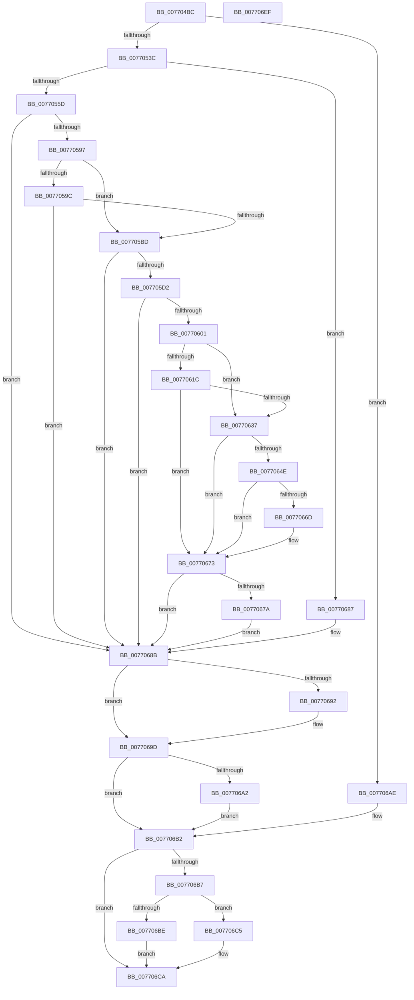

# PopBcdRegenerateResumeObject

- RVA: `0x007704BC`–`0x007706F0` (길이 `564` bytes)
- VA: `0x00000001407704BC`
- 실행 섹션: `PAGE`
- PDB 이름 있음: `예`; PDB Function 태그: `아니요`
- unwind 정보 RVA: `0x000CD5F4`
- 디코드: `161`개 명령, `564/564` bytes 표시
- 미해석 바이트: `0` (있으면 어셈블리에 `.byte`로 보존)

> 이 문서는 커널 이미지의 기계어와 PDB 기호를 분석해 생성했습니다. 4번과 5번은 함수 원형과 자료형을 바이너리 사용 방식에서 추정한 C 해석이며 원본 소스 복구 결과는 아닙니다.

## 1. Dependencies

- 직접 호출 지점: **17**; 고유 호출 대상: **9**
- 직접 호출자로 확인된 함수: **1**
- RIP 상대 이미지 참조: **2**

### Outgoing calls
- `0x0077052D` → [BcdCreateObject](../A3/BcdCreateObject_function_00A3D890.md) (function, `0x00A3D890`)
- `0x0077054E` → [PopBcdReadElement](../A3/PopBcdReadElement_function_00A3C740.md) (function, `0x00A3C740`)
- `0x0077056B` → [PopBcdReadElement](../A3/PopBcdReadElement_function_00A3C740.md) (function, `0x00A3C740`)
- `0x00770584` → [BcdSetElementDataWithFlags](../A3/BcdSetElementDataWithFlags_function_00A3F080.md) (function, `0x00A3F080`)
- `0x007705AE` → [BcdSetElementDataWithFlags](../A3/BcdSetElementDataWithFlags_function_00A3F080.md) (function, `0x00A3F080`)
- `0x007705C3` → [PopBcdSetDefaultResumeObjectElements](../A3/PopBcdSetDefaultResumeObjectElements_function_00A3C7F8.md) (function, `0x00A3C7F8`)
- `0x007705F2` → [BcdSetElementDataWithFlags](../A3/BcdSetElementDataWithFlags_function_00A3F080.md) (function, `0x00A3F080`)
- `0x00770613` → [PopBcdReadElement](../A3/PopBcdReadElement_function_00A3C740.md) (function, `0x00A3C740`)
- `0x0077062C` → [BcdSetElementDataWithFlags](../A3/BcdSetElementDataWithFlags_function_00A3F080.md) (function, `0x00A3F080`)
- `0x00770643` → [BcdQueryObject](../82/BcdQueryObject_function_0082385C.md) (function, `0x0082385C`)
- `0x00770662` → [BcdSetElementDataWithFlags](../A3/BcdSetElementDataWithFlags_function_00A3F080.md) (function, `0x00A3F080`)
- `0x00770680` → [ExFreePoolWithTag](../../poolcode/B8/ExFreePoolWithTag_function_00B82870.md) (function, `0x00B82870`)
- `0x00770698` → [ExFreePoolWithTag](../../poolcode/B8/ExFreePoolWithTag_function_00B82870.md) (function, `0x00B82870`)
- `0x007706A7` → [ExFreePoolWithTag](../../poolcode/B8/ExFreePoolWithTag_function_00B82870.md) (function, `0x00B82870`)
- `0x007706BE` → [BcdCloseObject](../A3/BcdCloseObject_function_00A3FB08.md) (function, `0x00A3FB08`)
- `0x007706C5` → [BcdDeleteObject](../A3/BcdDeleteObject_function_00A3C578.md) (function, `0x00A3C578`)
- `0x007706D3` → [_security_check_cookie](../../text/6A/_security_check_cookie_function_006AC640.md) (function, `0x006AC640`)

### Direct callers
- [PopBcdEstablishResumeObject](PopBcdEstablishResumeObject_function_007700E4.md) at `0x00770261`

### Static image references
- `0x007704D4` → RVA `0x00E0A740` (`.data`; read)
- `0x007705D2` → RVA `0x0002AEA0` (`.rdata`; read)

## 2. Other-region calls and transfers

- 다른 실행 섹션으로 향하는 call: **4**
  - `0x00770680` → [ExFreePoolWithTag](../../poolcode/B8/ExFreePoolWithTag_function_00B82870.md) (`PAGE` → `POOLCODE`)
  - `0x00770698` → [ExFreePoolWithTag](../../poolcode/B8/ExFreePoolWithTag_function_00B82870.md) (`PAGE` → `POOLCODE`)
  - `0x007706A7` → [ExFreePoolWithTag](../../poolcode/B8/ExFreePoolWithTag_function_00B82870.md) (`PAGE` → `POOLCODE`)
  - `0x007706D3` → [_security_check_cookie](../../text/6A/_security_check_cookie_function_006AC640.md) (`PAGE` → `.text`)
- 별도 외부 분기/꼬리 이동을 확인하지 못했습니다.

## 3. Assembly (complete function range)

```asm
007704BC  48 89 5C 24 20                  mov qword ptr [rsp + 0x20], rbx
007704C1  55                              push rbp
007704C2  56                              push rsi
007704C3  57                              push rdi
007704C4  41 55                           push r13
007704C6  41 56                           push r14
007704C8  48 8D 6C 24 C9                  lea rbp, [rsp - 0x37]
007704CD  48 81 EC 90 00 00 00            sub rsp, 0x90
007704D4  48 8B 05 65 A2 69 00            mov rax, qword ptr [rip + 0x69a265]
007704DB  48 33 C4                        xor rax, rsp
007704DE  48 89 45 2F                     mov qword ptr [rbp + 0x2f], rax
007704E2  48 83 65 E7 00                  and qword ptr [rbp - 0x19], 0
007704E7  4C 8D 4D F7                     lea r9, [rbp - 9]
007704EB  83 65 DF 00                     and dword ptr [rbp - 0x21], 0
007704EF  33 F6                           xor esi, esi
007704F1  21 75 DB                        and dword ptr [rbp - 0x25], esi
007704F4  4D 8B E8                        mov r13, r8
007704F7  48 21 75 F7                     and qword ptr [rbp - 9], rsi
007704FB  4C 8D 45 07                     lea r8, [rbp + 7]
007704FF  48 83 65 EF 00                  and qword ptr [rbp - 0x11], 0
00770504  4C 8B F2                        mov r14, rdx
00770507  83 65 D7 00                     and dword ptr [rbp - 0x29], 0
0077050B  0F 57 C0                        xorps xmm0, xmm0
0077050E  0F 57 C9                        xorps xmm1, xmm1
00770511  48 89 75 FF                     mov qword ptr [rbp - 1], rsi
00770515  33 D2                           xor edx, edx
00770517  C7 45 07 01 00 00 00            mov dword ptr [rbp + 7], 1
0077051E  0F 11 45 1F                     movups xmmword ptr [rbp + 0x1f], xmm0
00770522  C7 45 0B 04 00 20 10            mov dword ptr [rbp + 0xb], 0x10200004
00770529  0F 11 4D 0F                     movups xmmword ptr [rbp + 0xf], xmm1
0077052D  E8 5E D3 2C 00                  call 0x140a3d890
00770532  8B D8                           mov ebx, eax
00770534  85 C0                           test eax, eax
00770536  0F 88 72 01 00 00               js 0x1407706ae
0077053C  BF 04 00 00 12                  mov edi, 0x12000004
00770541  4C 8D 4D D7                     lea r9, [rbp - 0x29]
00770545  8B D7                           mov edx, edi
00770547  4C 8D 45 EF                     lea r8, [rbp - 0x11]
0077054B  49 8B CE                        mov rcx, r14
0077054E  E8 ED C1 2C 00                  call 0x140a3c740
00770553  8B D8                           mov ebx, eax
00770555  85 C0                           test eax, eax
00770557  0F 88 2A 01 00 00               js 0x140770687
0077055D  4C 8D 4D DB                     lea r9, [rbp - 0x25]
00770561  49 8B CE                        mov rcx, r14
00770564  4C 8D 45 FF                     lea r8, [rbp - 1]
00770568  8D 57 01                        lea edx, [rdi + 1]
0077056B  E8 D0 C1 2C 00                  call 0x140a3c740
00770570  8B 45 D7                        mov eax, dword ptr [rbp - 0x29]
00770573  8B D7                           mov edx, edi
00770575  48 8B 7D F7                     mov rdi, qword ptr [rbp - 9]
00770579  4C 8B 4D EF                     mov r9, qword ptr [rbp - 0x11]
0077057D  48 8B CF                        mov rcx, rdi
00770580  89 44 24 20                     mov dword ptr [rsp + 0x20], eax
00770584  E8 F7 EA 2C 00                  call 0x140a3f080
00770589  48 8B 75 FF                     mov rsi, qword ptr [rbp - 1]
0077058D  8B D8                           mov ebx, eax
0077058F  85 C0                           test eax, eax
00770591  0F 88 F4 00 00 00               js 0x14077068b
00770597  48 85 F6                        test rsi, rsi
0077059A  74 21                           je 0x1407705bd
0077059C  8B 45 DB                        mov eax, dword ptr [rbp - 0x25]
0077059F  4C 8B CE                        mov r9, rsi
007705A2  BA 05 00 00 12                  mov edx, 0x12000005
007705A7  89 44 24 20                     mov dword ptr [rsp + 0x20], eax
007705AB  48 8B CF                        mov rcx, rdi
007705AE  E8 CD EA 2C 00                  call 0x140a3f080
007705B3  8B D8                           mov ebx, eax
007705B5  85 C0                           test eax, eax
007705B7  0F 88 CE 00 00 00               js 0x14077068b
007705BD  49 8B D6                        mov rdx, r14
007705C0  48 8B CF                        mov rcx, rdi
007705C3  E8 30 C2 2C 00                  call 0x140a3c7f8
007705C8  8B D8                           mov ebx, eax
007705CA  85 C0                           test eax, eax
007705CC  0F 88 B9 00 00 00               js 0x14077068b
007705D2  0F 10 05 C7 A8 8B FF            movups xmm0, xmmword ptr [rip - 0x745739]
007705D9  4C 8D 4D 0F                     lea r9, [rbp + 0xf]
007705DD  C7 44 24 20 10 00 00 00         mov dword ptr [rsp + 0x20], 0x10
007705E5  BA 06 00 00 14                  mov edx, 0x14000006
007705EA  48 8B CF                        mov rcx, rdi
007705ED  F3 0F 7F 45 0F                  movdqu xmmword ptr [rbp + 0xf], xmm0
007705F2  E8 89 EA 2C 00                  call 0x140a3f080
007705F7  8B D8                           mov ebx, eax
007705F9  85 C0                           test eax, eax
007705FB  0F 88 8A 00 00 00               js 0x14077068b
00770601  BB 77 00 00 17                  mov ebx, 0x17000077
00770606  4C 8D 4D DF                     lea r9, [rbp - 0x21]
0077060A  8B D3                           mov edx, ebx
0077060C  4C 8D 45 E7                     lea r8, [rbp - 0x19]
00770610  49 8B CE                        mov rcx, r14
00770613  E8 28 C1 2C 00                  call 0x140a3c740
00770618  85 C0                           test eax, eax
0077061A  78 1B                           js 0x140770637
0077061C  8B 45 DF                        mov eax, dword ptr [rbp - 0x21]
0077061F  8B D3                           mov edx, ebx
00770621  4C 8B 4D E7                     mov r9, qword ptr [rbp - 0x19]
00770625  48 8B CF                        mov rcx, rdi
00770628  89 44 24 20                     mov dword ptr [rsp + 0x20], eax
0077062C  E8 4F EA 2C 00                  call 0x140a3f080
00770631  8B D8                           mov ebx, eax
00770633  85 C0                           test eax, eax
00770635  78 3C                           js 0x140770673
00770637  4C 8D 4D 1F                     lea r9, [rbp + 0x1f]
0077063B  45 33 C0                        xor r8d, r8d
0077063E  33 D2                           xor edx, edx
00770640  48 8B CF                        mov rcx, rdi
00770643  E8 14 32 0B 00                  call 0x14082385c
00770648  8B D8                           mov ebx, eax
0077064A  85 C0                           test eax, eax
0077064C  78 25                           js 0x140770673
0077064E  4C 8D 4D 1F                     lea r9, [rbp + 0x1f]
00770652  C7 44 24 20 10 00 00 00         mov dword ptr [rsp + 0x20], 0x10
0077065A  BA 03 00 00 23                  mov edx, 0x23000003
0077065F  49 8B CE                        mov rcx, r14
00770662  E8 19 EA 2C 00                  call 0x140a3f080
00770667  8B D8                           mov ebx, eax
00770669  85 C0                           test eax, eax
0077066B  78 06                           js 0x140770673
0077066D  49 89 7D 00                     mov qword ptr [r13], rdi
00770671  33 FF                           xor edi, edi
00770673  48 83 7D E7 00                  cmp qword ptr [rbp - 0x19], 0
00770678  74 11                           je 0x14077068b
0077067A  48 8B 4D E7                     mov rcx, qword ptr [rbp - 0x19]
0077067E  33 D2                           xor edx, edx
00770680  E8 EB 21 41 00                  call 0x140b82870
00770685  EB 04                           jmp 0x14077068b
00770687  48 8B 7D F7                     mov rdi, qword ptr [rbp - 9]
0077068B  48 83 7D EF 00                  cmp qword ptr [rbp - 0x11], 0
00770690  74 0B                           je 0x14077069d
00770692  48 8B 4D EF                     mov rcx, qword ptr [rbp - 0x11]
00770696  33 D2                           xor edx, edx
00770698  E8 D3 21 41 00                  call 0x140b82870
0077069D  48 85 F6                        test rsi, rsi
007706A0  74 10                           je 0x1407706b2
007706A2  33 D2                           xor edx, edx
007706A4  48 8B CE                        mov rcx, rsi
007706A7  E8 C4 21 41 00                  call 0x140b82870
007706AC  EB 04                           jmp 0x1407706b2
007706AE  48 8B 7D F7                     mov rdi, qword ptr [rbp - 9]
007706B2  48 85 FF                        test rdi, rdi
007706B5  74 13                           je 0x1407706ca
007706B7  48 8B CF                        mov rcx, rdi
007706BA  85 DB                           test ebx, ebx
007706BC  78 07                           js 0x1407706c5
007706BE  E8 45 F4 2C 00                  call 0x140a3fb08
007706C3  EB 05                           jmp 0x1407706ca
007706C5  E8 AE BE 2C 00                  call 0x140a3c578
007706CA  8B C3                           mov eax, ebx
007706CC  48 8B 4D 2F                     mov rcx, qword ptr [rbp + 0x2f]
007706D0  48 33 CC                        xor rcx, rsp
007706D3  E8 68 BF F3 FF                  call 0x1406ac640
007706D8  48 8B 9C 24 D8 00 00 00         mov rbx, qword ptr [rsp + 0xd8]
007706E0  48 81 C4 90 00 00 00            add rsp, 0x90
007706E7  41 5E                           pop r14
007706E9  41 5D                           pop r13
007706EB  5F                              pop rdi
007706EC  5E                              pop rsi
007706ED  5D                              pop rbp
007706EE  C3                              ret
007706EF  CC                              int3
```

## 4. C-style interpretation (structured pseudocode)

```c
__int64 __fastcall PopBcdRegenerateResumeObject(__int64 a1, __int64 a2, __int64 a3)
{
    __int64 result;
    __int64 v_rdi;
    __int64 v_rsi;
    __int64 v_rsp;
    unsigned __int64 v_stack_m30;
    unsigned __int64 v_stack_m40;
    unsigned __int64 v_stack_m50;
    unsigned int v_stack_m54;
    unsigned __int64 v_stack_m58;
    unsigned __int64 v_stack_m5F;
    unsigned __int64 v_stack_m60;
    unsigned __int64 v_stack_m68;
    unsigned __int64 v_stack_m70;
    unsigned __int64 v_stack_m78;
    unsigned int v_stack_m80;
    unsigned int v_stack_m84;
    unsigned int v_stack_m88;
    unsigned int v_stack_m98;
    unsigned __int64 v_stack_p20;

    v_stack_p20 = v_rbx;
    v_rsp = (v_rsp) - (144);
    result = (*(unsigned __int64 *)(v_rip + 6922853)) ^ (v_rsp);
    v_stack_m30 = result;
    v_rsi = 0;
    v_stack_m60 = 0;
    a2 = 0;
    v_stack_m58 = 1;
    v_stack_m40 = v_xmm0;
    v_stack_m54 = 0x10200004ULL;
    v_stack_m50 = v_xmm1;
    result = BcdCreateObject(a1, a2, v_stack_m58, v_stack_m68);
    if (sign_flag) goto loc_007706AE;
    result = PopBcdReadElement(0, (unsigned int)((unsigned int)((unsigned int)(0x12000004ULL))), v_stack_m70, v_stack_m88);
    if (sign_flag) goto loc_00770687;
    result = PopBcdReadElement(0, (unsigned int)(0x12000004ULL) + 1, v_stack_m60, v_stack_m84);
    v_stack_m98 = (unsigned int)((unsigned int)(v_stack_m88));
    result = BcdSetElementDataWithFlags(v_stack_m68, (unsigned int)((unsigned int)((unsigned int)(0x12000004ULL))), v_stack_m60, v_stack_m70);
    if (sign_flag) goto loc_0077068B;
    if (v_stack_m60 == 0) goto loc_007705BD;
    v_stack_m98 = (unsigned int)((unsigned int)(v_stack_m84));
    result = BcdSetElementDataWithFlags(v_stack_m68, (unsigned int)(0x12000005ULL), v_stack_m60, v_stack_m60);
    if (sign_flag) goto loc_0077068B;
loc_007705BD:
    result = PopBcdSetDefaultResumeObjectElements(v_stack_m68, 0, v_stack_m60, v_stack_m60);
    if (sign_flag) goto loc_0077068B;
    v_stack_m98 = 16;
    v_stack_m50 = v_xmm0;
    result = BcdSetElementDataWithFlags(v_stack_m68, (unsigned int)(0x14000006ULL), v_stack_m60, v_stack_m50);
    if (sign_flag) goto loc_0077068B;
    result = PopBcdReadElement(0, (unsigned int)((unsigned int)((unsigned int)(0x17000077ULL))), v_stack_m78, v_stack_m80);
    if (sign_flag) goto loc_00770637;
    v_stack_m98 = (unsigned int)((unsigned int)(v_stack_m80));
    result = BcdSetElementDataWithFlags(v_stack_m68, (unsigned int)((unsigned int)((unsigned int)(0x17000077ULL))), v_stack_m78, v_stack_m78);
    if (sign_flag) goto loc_00770673;
loc_00770637:
    a3 = 0;
    a2 = 0;
    result = BcdQueryObject(v_stack_m68, a2, a3, v_stack_m40);
    if (sign_flag) goto loc_00770673;
    v_stack_m98 = 16;
    result = BcdSetElementDataWithFlags(0, (unsigned int)(0x23000003ULL), a3, v_stack_m40);
    v_rdi = v_stack_m68;
    if (!(sign_flag)) {
        *(unsigned __int64 *)(a3) = v_stack_m68;
        v_rdi = 0;
    }
    if (v_stack_m78 == 0) goto loc_0077068B;
    a2 = 0;
    result = ExFreePoolWithTag(v_stack_m78, a2, a3, v_stack_m40);
    goto loc_0077068B;
loc_00770687:
loc_0077068B:
    if (v_stack_m70 != 0) {
        a1 = v_stack_m70;
        a2 = 0;
        result = ExFreePoolWithTag(a1, a2, a3, v_stack_m40);
    }
    if (v_stack_m60 == 0) goto loc_007706B2;
    a2 = 0;
    result = ExFreePoolWithTag(v_stack_m60, a2, a3, v_stack_m40);
    goto loc_007706B2;
loc_007706AE:
loc_007706B2:
    if (v_stack_m68 == 0) goto loc_007706CA;
    if (sign_flag) goto loc_007706C5;
    result = BcdCloseObject(v_stack_m68, a2, a3, v_stack_m40);
    goto loc_007706CA;
loc_007706C5:
    result = BcdDeleteObject(v_stack_m68, a2, a3, v_stack_m40);
loc_007706CA:
    a1 = (v_stack_m30) ^ (v_rsp);
    result = _security_check_cookie(a1, a2, a3, v_stack_m40);
    v_rsp = (v_rsp) + (144);
    return result;
}
```

## 5. (Beta) C Style

```c
int64_t PopBcdRegenerateResumeObject(int64_t Arg1, int64_t Arg2, void *Arg3)
{
    uint8_t *arg3 = (uint8_t *)Arg3;

    int64_t result;
    int64_t local_rdi;
    int64_t local_rsi;
    int64_t local_rsp;
    uint64_t v_stack_m30;
    uint64_t v_stack_m40;
    uint64_t v_stack_m50;
    uint32_t v_stack_m54;
    uint64_t v_stack_m58;
    uint64_t v_stack_m5F;
    uint64_t v_stack_m60;
    uint64_t v_stack_m68;
    uint64_t v_stack_m70;
    uint64_t v_stack_m78;
    uint32_t v_stack_m80;
    uint32_t v_stack_m84;
    uint32_t v_stack_m88;
    uint32_t v_stack_m98;
    uint64_t v_stack_p20;

    v_stack_p20 = local_rbx;
    local_rsp = (local_rsp) - (144);
    result = (*(uint64_t *)(v_rip + 0x69A265)) ^ (local_rsp);
    v_stack_m30 = result;
    local_rsi = 0;
    v_stack_m60 = 0;
    Arg2 = 0;
    v_stack_m58 = 1;
    v_stack_m40 = v_xmm0;
    v_stack_m54 = 0x10200004ULL;
    v_stack_m50 = v_xmm1;
    result = BcdCreateObject(Arg1, Arg2, v_stack_m58, v_stack_m68);
    if (sign_flag) goto loc_007706AE;
    result = PopBcdReadElement(0, (uint32_t)((uint32_t)((uint32_t)(0x12000004ULL))), v_stack_m70, v_stack_m88);
    if (sign_flag) goto loc_00770687;
    result = PopBcdReadElement(0, (uint32_t)(0x12000004ULL) + 1, v_stack_m60, v_stack_m84);
    v_stack_m98 = (uint32_t)((uint32_t)(v_stack_m88));
    result = BcdSetElementDataWithFlags(v_stack_m68, (uint32_t)((uint32_t)((uint32_t)(0x12000004ULL))), v_stack_m60, v_stack_m70);
    if (sign_flag) goto loc_0077068B;
    if (v_stack_m60 == 0) goto loc_007705BD;
    v_stack_m98 = (uint32_t)((uint32_t)(v_stack_m84));
    result = BcdSetElementDataWithFlags(v_stack_m68, (uint32_t)(0x12000005ULL), v_stack_m60, v_stack_m60);
    if (sign_flag) goto loc_0077068B;
loc_007705BD:
    result = PopBcdSetDefaultResumeObjectElements(v_stack_m68, 0, v_stack_m60, v_stack_m60);
    if (sign_flag) goto loc_0077068B;
    v_stack_m98 = 16;
    v_stack_m50 = v_xmm0;
    result = BcdSetElementDataWithFlags(v_stack_m68, (uint32_t)(0x14000006ULL), v_stack_m60, v_stack_m50);
    if (sign_flag) goto loc_0077068B;
    result = PopBcdReadElement(0, (uint32_t)((uint32_t)((uint32_t)(0x17000077ULL))), v_stack_m78, v_stack_m80);
    if (sign_flag) goto loc_00770637;
    v_stack_m98 = (uint32_t)((uint32_t)(v_stack_m80));
    result = BcdSetElementDataWithFlags(v_stack_m68, (uint32_t)((uint32_t)((uint32_t)(0x17000077ULL))), v_stack_m78, v_stack_m78);
    if (sign_flag) goto loc_00770673;
loc_00770637:
    Arg3 = 0;
    Arg2 = 0;
    result = BcdQueryObject(v_stack_m68, Arg2, Arg3, v_stack_m40);
    if (sign_flag) goto loc_00770673;
    v_stack_m98 = 16;
    result = BcdSetElementDataWithFlags(0, (uint32_t)(0x23000003ULL), Arg3, v_stack_m40);
    local_rdi = v_stack_m68;
    if (!(sign_flag)) {
        *(uint64_t *)(arg3) = v_stack_m68;
        local_rdi = 0;
    }
    if (v_stack_m78 == 0) goto loc_0077068B;
    Arg2 = 0;
    result = ExFreePoolWithTag(v_stack_m78, Arg2, Arg3, v_stack_m40);
    goto loc_0077068B;
loc_00770687:
loc_0077068B:
    if (v_stack_m70 != 0) {
        Arg1 = v_stack_m70;
        Arg2 = 0;
        result = ExFreePoolWithTag(Arg1, Arg2, Arg3, v_stack_m40);
    }
    if (v_stack_m60 == 0) goto loc_007706B2;
    Arg2 = 0;
    result = ExFreePoolWithTag(v_stack_m60, Arg2, Arg3, v_stack_m40);
    goto loc_007706B2;
loc_007706AE:
loc_007706B2:
    if (v_stack_m68 == 0) goto loc_007706CA;
    if (sign_flag) goto loc_007706C5;
    result = BcdCloseObject(v_stack_m68, Arg2, Arg3, v_stack_m40);
    goto loc_007706CA;
loc_007706C5:
    result = BcdDeleteObject(v_stack_m68, Arg2, Arg3, v_stack_m40);
loc_007706CA:
    Arg1 = (v_stack_m30) ^ (local_rsp);
    result = _security_check_cookie(Arg1, Arg2, Arg3, v_stack_m40);
    local_rsp = (local_rsp) + (144);
    return result;
}
```

### 관측된 메모리 오프셋

구조체 형식이 확인되지 않은 접근은 인자 기준의 오프셋으로만 기록했습니다.

| 기준 인자 | 오프셋 표현 | 폭 (bit) | 접근 |
|---|---:|---:|---|
| `Arg3` | `+ 0x0` | `64` | `W` |

## 6. Execution-region graph

[열기: 2D/3D 그래프와 함수 탐색 컨트롤 패널](../../../control-panel.html?section=page&rva=0x007704BC&view=graph)

- 2D 그래프는 위에서 아래로 흐르고, 3D 그래프는 빈 공간을 드래그해 회전합니다. Shift+드래그는 이동, 휠은 확대·축소, 함수 노드 선택은 대상 보고서 이동입니다.

### Static fallback


