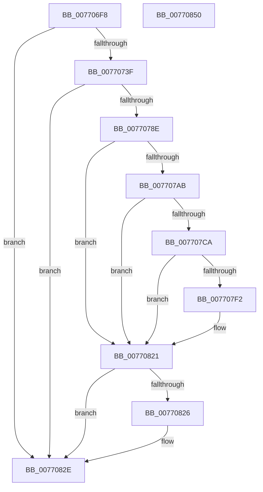

# PopBcdSetPendingResume

- RVA: `0x007706F8`–`0x00770851` (길이 `345` bytes)
- VA: `0x00000001407706F8`
- 실행 섹션: `PAGE`
- PDB 이름 있음: `예`; PDB Function 태그: `아니요`
- unwind 정보 RVA: `0x000CD634`
- 디코드: `95`개 명령, `345/345` bytes 표시
- 미해석 바이트: `0` (있으면 어셈블리에 `.byte`로 보존)

> 이 문서는 커널 이미지의 기계어와 PDB 기호를 분석해 생성했습니다. 4번과 5번은 함수 원형과 자료형을 바이너리 사용 방식에서 추정한 C 해석이며 원본 소스 복구 결과는 아닙니다.

## 1. Dependencies

- 직접 호출 지점: **9**; 고유 호출 대상: **6**
- 직접 호출자로 확인된 함수: **1**
- RIP 상대 이미지 참조: **4**

### Outgoing calls
- `0x00770730` → [PopBcdSetupResumeObject](../A3/PopBcdSetupResumeObject_function_00A3D158.md) (function, `0x00A3D158`)
- `0x0077076E` → [BcdSetElementDataWithFlags](../A3/BcdSetElementDataWithFlags_function_00A3F080.md) (function, `0x00A3F080`)
- `0x0077077F` → [BcdQueryObject](../82/BcdQueryObject_function_0082385C.md) (function, `0x0082385C`)
- `0x0077079C` → [BcdOpenObject](../91/BcdOpenObject_function_00916704.md) (function, `0x00916704`)
- `0x007707BF` → [BcdSetElementDataWithFlags](../A3/BcdSetElementDataWithFlags_function_00A3F080.md) (function, `0x00A3F080`)
- `0x007707E7` → [BcdSetElementDataWithFlags](../A3/BcdSetElementDataWithFlags_function_00A3F080.md) (function, `0x00A3F080`)
- `0x00770814` → [BcdSetElementDataWithFlags](../A3/BcdSetElementDataWithFlags_function_00A3F080.md) (function, `0x00A3F080`)
- `0x00770829` → [BcdCloseObject](../A3/BcdCloseObject_function_00A3FB08.md) (function, `0x00A3FB08`)
- `0x00770837` → [_security_check_cookie](../../text/6A/_security_check_cookie_function_006AC640.md) (function, `0x006AC640`)

### Direct callers
- [PopAllocateHiberContext](../AD/PopAllocateHiberContext_function_00ADC05C.md) at `0x00ADC32A`

### Static image references
- `0x0077070B` → RVA `0x00E0A740` (`.data`; read)
- `0x0077073F` → RVA `0x00F475F8` (`.data`; read)
- `0x00770795` → RVA `0x0001A4D0` (`.rdata`; read)
- `0x007707F2` → RVA `0x00F0BF60` (`.data`; read)

## 2. Other-region calls and transfers

- 다른 실행 섹션으로 향하는 call: **1**
  - `0x00770837` → [_security_check_cookie](../../text/6A/_security_check_cookie_function_006AC640.md) (`PAGE` → `.text`)
- 별도 외부 분기/꼬리 이동을 확인하지 못했습니다.

## 3. Assembly (complete function range)

```asm
007706F8  48 89 5C 24 10                  mov qword ptr [rsp + 0x10], rbx
007706FD  55                              push rbp
007706FE  56                              push rsi
007706FF  57                              push rdi
00770700  41 54                           push r12
00770702  41 56                           push r14
00770704  48 8B EC                        mov rbp, rsp
00770707  48 83 EC 60                     sub rsp, 0x60
0077070B  48 8B 05 2E A0 69 00            mov rax, qword ptr [rip + 0x69a02e]
00770712  48 33 C4                        xor rax, rsp
00770715  48 89 45 F0                     mov qword ptr [rbp - 0x10], rax
00770719  48 8B F1                        mov rsi, rcx
0077071C  0F 57 C0                        xorps xmm0, xmm0
0077071F  45 33 F6                        xor r14d, r14d
00770722  49 8B C9                        mov rcx, r9
00770725  0F 11 45 E0                     movups xmmword ptr [rbp - 0x20], xmm0
00770729  4C 89 75 D8                     mov qword ptr [rbp - 0x28], r14
0077072D  49 8B F9                        mov rdi, r9
00770730  E8 23 CA 2C 00                  call 0x140a3d158
00770735  8B D8                           mov ebx, eax
00770737  85 C0                           test eax, eax
00770739  0F 88 EF 00 00 00               js 0x14077082e
0077073F  44 38 35 B2 6E 7D 00            cmp byte ptr [rip + 0x7d6eb2], r14b
00770746  45 8D 66 01                     lea r12d, [r14 + 1]
0077074A  41 0F B6 C6                     movzx eax, r14b
0077074E  4C 8D 4D D0                     lea r9, [rbp - 0x30]
00770752  41 0F 45 C4                     cmovne eax, r12d
00770756  66 44 89 75 D0                  mov word ptr [rbp - 0x30], r14w
0077075B  BA 06 00 00 26                  mov edx, 0x26000006
00770760  88 45 D0                        mov byte ptr [rbp - 0x30], al
00770763  48 8B CF                        mov rcx, rdi
00770766  C7 44 24 20 02 00 00 00         mov dword ptr [rsp + 0x20], 2
0077076E  E8 0D E9 2C 00                  call 0x140a3f080
00770773  4C 8D 4D E0                     lea r9, [rbp - 0x20]
00770777  45 33 C0                        xor r8d, r8d
0077077A  33 D2                           xor edx, edx
0077077C  48 8B CF                        mov rcx, rdi
0077077F  E8 D8 30 0B 00                  call 0x14082385c
00770784  8B D8                           mov ebx, eax
00770786  85 C0                           test eax, eax
00770788  0F 88 A0 00 00 00               js 0x14077082e
0077078E  4C 8D 45 D8                     lea r8, [rbp - 0x28]
00770792  48 8B CE                        mov rcx, rsi
00770795  48 8D 15 34 9D 8A FF            lea rdx, [rip - 0x7562cc]
0077079C  E8 63 5F 1A 00                  call 0x140916704
007707A1  48 8B 7D D8                     mov rdi, qword ptr [rbp - 0x28]
007707A5  8B D8                           mov ebx, eax
007707A7  85 C0                           test eax, eax
007707A9  78 76                           js 0x140770821
007707AB  4C 8D 4D E0                     lea r9, [rbp - 0x20]
007707AF  C7 44 24 20 10 00 00 00         mov dword ptr [rsp + 0x20], 0x10
007707B7  BA 06 00 00 23                  mov edx, 0x23000006
007707BC  48 8B CF                        mov rcx, rdi
007707BF  E8 BC E8 2C 00                  call 0x140a3f080
007707C4  8B D8                           mov ebx, eax
007707C6  85 C0                           test eax, eax
007707C8  78 57                           js 0x140770821
007707CA  66 44 89 75 D0                  mov word ptr [rbp - 0x30], r14w
007707CF  4C 8D 4D D0                     lea r9, [rbp - 0x30]
007707D3  BA 05 00 00 26                  mov edx, 0x26000005
007707D8  44 88 65 D0                     mov byte ptr [rbp - 0x30], r12b
007707DC  48 8B CF                        mov rcx, rdi
007707DF  C7 44 24 20 02 00 00 00         mov dword ptr [rsp + 0x20], 2
007707E7  E8 94 E8 2C 00                  call 0x140a3f080
007707EC  8B D8                           mov ebx, eax
007707EE  85 C0                           test eax, eax
007707F0  78 2F                           js 0x140770821
007707F2  8A 05 68 B7 79 00               mov al, byte ptr [rip + 0x79b768]
007707F8  4C 8D 4D D0                     lea r9, [rbp - 0x30]
007707FC  66 44 89 75 D0                  mov word ptr [rbp - 0x30], r14w
00770801  BA 25 00 00 26                  mov edx, 0x26000025
00770806  48 8B CF                        mov rcx, rdi
00770809  88 45 D0                        mov byte ptr [rbp - 0x30], al
0077080C  C7 44 24 20 02 00 00 00         mov dword ptr [rsp + 0x20], 2
00770814  E8 67 E8 2C 00                  call 0x140a3f080
00770819  85 C0                           test eax, eax
0077081B  8B D8                           mov ebx, eax
0077081D  41 0F 49 DE                     cmovns ebx, r14d
00770821  48 85 FF                        test rdi, rdi
00770824  74 08                           je 0x14077082e
00770826  48 8B CF                        mov rcx, rdi
00770829  E8 DA F2 2C 00                  call 0x140a3fb08
0077082E  8B C3                           mov eax, ebx
00770830  48 8B 4D F0                     mov rcx, qword ptr [rbp - 0x10]
00770834  48 33 CC                        xor rcx, rsp
00770837  E8 04 BE F3 FF                  call 0x1406ac640
0077083C  48 8B 9C 24 98 00 00 00         mov rbx, qword ptr [rsp + 0x98]
00770844  48 83 C4 60                     add rsp, 0x60
00770848  41 5E                           pop r14
0077084A  41 5C                           pop r12
0077084C  5F                              pop rdi
0077084D  5E                              pop rsi
0077084E  5D                              pop rbp
0077084F  C3                              ret
00770850  CC                              int3
```

## 4. C-style interpretation (structured pseudocode)

```c
__int64 __fastcall PopBcdSetPendingResume(__int64 a1, __int64 a2, int a3, __int64 a4)
{
    __int64 result;
    __int64 v_r14;
    __int64 v_rbx;
    __int64 v_rsp;
    unsigned __int64 v_stack_m38;
    unsigned __int64 v_stack_m48;
    unsigned __int64 v_stack_m50;
    unsigned __int64 v_stack_m58;
    unsigned int v_stack_m68;
    unsigned __int64 v_stack_p10;

    v_stack_p10 = v_rbx;
    v_rsp = (v_rsp) - (96);
    result = (*(unsigned __int64 *)(v_rip + 6922286)) ^ (v_rsp);
    v_stack_m38 = result;
    v_r14 = 0;
    v_stack_m48 = v_xmm0;
    v_stack_m50 = 0;
    result = PopBcdSetupResumeObject(a4, a2, a3, a4);
    if (sign_flag) goto loc_0077082E;
    result = 0;
    if ((*(unsigned __int8 *)(v_rip + 8220338)) != 0) { result = (unsigned int)(v_r14 + 1); }
    v_stack_m58 = 0;
    v_stack_m58 = (unsigned __int8)(result);
    v_stack_m68 = 2;
    result = BcdSetElementDataWithFlags(a4, (unsigned int)(0x26000006ULL), a3, v_stack_m58);
    a3 = 0;
    a2 = 0;
    result = BcdQueryObject(a4, a2, a3, v_stack_m48);
    if (sign_flag) goto loc_0077082E;
    result = BcdOpenObject(a1, v_rip - 7693004, v_stack_m50, v_stack_m48);
    if (sign_flag) goto loc_00770821;
    v_stack_m68 = 16;
    result = BcdSetElementDataWithFlags(v_stack_m50, (unsigned int)(0x23000006ULL), v_stack_m50, v_stack_m48);
    if (sign_flag) goto loc_00770821;
    v_stack_m58 = 0;
    v_stack_m58 = (unsigned __int8)(v_r14 + 1);
    v_stack_m68 = 2;
    result = BcdSetElementDataWithFlags(v_stack_m50, (unsigned int)(0x26000005ULL), v_stack_m50, v_stack_m58);
    v_rbx = (unsigned int)((unsigned int)(result));
    if (!(sign_flag)) {
        result = *(unsigned __int8 *)(v_rip + 7976808);
        a4 = v_stack_m58;
        v_stack_m58 = 0;
        a2 = 0x26000025ULL;
        a1 = v_stack_m50;
        v_stack_m58 = (unsigned __int8)(result);
        v_stack_m68 = 2;
        result = BcdSetElementDataWithFlags(a1, a2, v_stack_m50, a4);
        v_rbx = (unsigned int)(result);
        if (!sign_flag) { v_rbx = 0; }
    }
    if (v_stack_m50 != 0) {
        a1 = v_stack_m50;
        result = BcdCloseObject(a1, a2, v_stack_m50, a4);
    }
    a1 = (v_stack_m38) ^ (v_rsp);
    result = _security_check_cookie(a1, a2, v_stack_m50, a4);
    v_rsp = (v_rsp) + (96);
    return result;
}
```

## 5. (Beta) C Style

```c
int64_t PopBcdSetPendingResume(int64_t Arg1, int64_t Arg2, int32_t Arg3, int64_t Arg4)
{
    int64_t result;
    int64_t local_r14;
    int64_t local_rbx;
    int64_t local_rsp;
    uint64_t v_stack_m38;
    uint64_t v_stack_m48;
    uint64_t v_stack_m50;
    uint64_t v_stack_m58;
    uint32_t v_stack_m68;
    uint64_t v_stack_p10;

    v_stack_p10 = local_rbx;
    local_rsp = (local_rsp) - (96);
    result = (*(uint64_t *)(v_rip + 0x69A02E)) ^ (local_rsp);
    v_stack_m38 = result;
    local_r14 = 0;
    v_stack_m48 = v_xmm0;
    v_stack_m50 = 0;
    result = PopBcdSetupResumeObject(Arg4, Arg2, Arg3, Arg4);
    if (sign_flag) goto loc_0077082E;
    result = 0;
    if ((*(uint8_t *)(v_rip + 0x7D6EB2)) != 0) { result = (uint32_t)(local_r14 + 1); }
    v_stack_m58 = 0;
    v_stack_m58 = (uint8_t)(result);
    v_stack_m68 = 2;
    result = BcdSetElementDataWithFlags(Arg4, (uint32_t)(0x26000006ULL), Arg3, v_stack_m58);
    Arg3 = 0;
    Arg2 = 0;
    result = BcdQueryObject(Arg4, Arg2, Arg3, v_stack_m48);
    if (sign_flag) goto loc_0077082E;
    result = BcdOpenObject(Arg1, v_rip - 7693004, v_stack_m50, v_stack_m48);
    if (sign_flag) goto loc_00770821;
    v_stack_m68 = 16;
    result = BcdSetElementDataWithFlags(v_stack_m50, (uint32_t)(0x23000006ULL), v_stack_m50, v_stack_m48);
    if (sign_flag) goto loc_00770821;
    v_stack_m58 = 0;
    v_stack_m58 = (uint8_t)(local_r14 + 1);
    v_stack_m68 = 2;
    result = BcdSetElementDataWithFlags(v_stack_m50, (uint32_t)(0x26000005ULL), v_stack_m50, v_stack_m58);
    local_rbx = (uint32_t)((uint32_t)(result));
    if (!(sign_flag)) {
        result = *(uint8_t *)(v_rip + 0x79B768);
        Arg4 = v_stack_m58;
        v_stack_m58 = 0;
        Arg2 = 0x26000025ULL;
        Arg1 = v_stack_m50;
        v_stack_m58 = (uint8_t)(result);
        v_stack_m68 = 2;
        result = BcdSetElementDataWithFlags(Arg1, Arg2, v_stack_m50, Arg4);
        local_rbx = (uint32_t)(result);
        if (!sign_flag) { local_rbx = 0; }
    }
    if (v_stack_m50 != 0) {
        Arg1 = v_stack_m50;
        result = BcdCloseObject(Arg1, Arg2, v_stack_m50, Arg4);
    }
    Arg1 = (v_stack_m38) ^ (local_rsp);
    result = _security_check_cookie(Arg1, Arg2, v_stack_m50, Arg4);
    local_rsp = (local_rsp) + (96);
    return result;
}
```

## 6. Execution-region graph

[열기: 2D/3D 그래프와 함수 탐색 컨트롤 패널](../../../control-panel.html?section=page&rva=0x007706F8&view=graph)

- 2D 그래프는 위에서 아래로 흐르고, 3D 그래프는 빈 공간을 드래그해 회전합니다. Shift+드래그는 이동, 휠은 확대·축소, 함수 노드 선택은 대상 보고서 이동입니다.

### Static fallback


