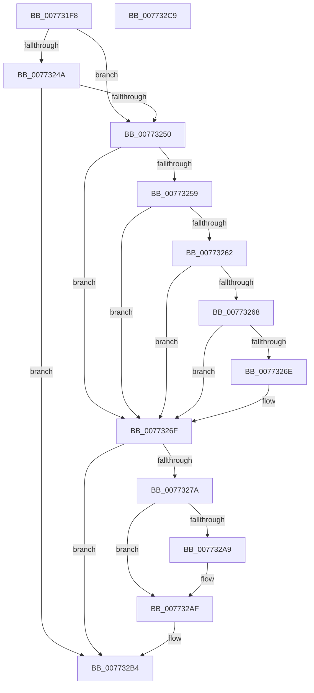

# PopDeepSleepWatchdogTakeAction

- RVA: `0x007731F8`–`0x007732CA` (길이 `210` bytes)
- VA: `0x00000001407731F8`
- 실행 섹션: `PAGE`
- PDB 이름 있음: `예`; PDB Function 태그: `아니요`
- unwind 정보 RVA: `0x0006F874`
- 디코드: `56`개 명령, `210/210` bytes 표시
- 미해석 바이트: `0` (있으면 어셈블리에 `.byte`로 보존)

> 이 문서는 커널 이미지의 기계어와 PDB 기호를 분석해 생성했습니다. 4번과 5번은 함수 원형과 자료형을 바이너리 사용 방식에서 추정한 C 해석이며 원본 소스 복구 결과는 아닙니다.

## 1. Dependencies

- 직접 호출 지점: **3**; 고유 호출 대상: **3**
- 직접 호출자로 확인된 함수: **1**
- RIP 상대 이미지 참조: **3**

### Outgoing calls
- `0x0077321B` → [PopPowerSettingPendingUpdateWatchdog](../../text/5D/PopPowerSettingPendingUpdateWatchdog_function_005D47A8.md) (function, `0x005D47A8`)
- `0x0077323F` → [PopDiagTraceCsDeepSleepWatchdog](../../text/5D/PopDiagTraceCsDeepSleepWatchdog_function_005D5E24.md) (function, `0x005D5E24`)
- `0x007732AF` → [DbgkWerCaptureLiveKernelDump](../AC/DbgkWerCaptureLiveKernelDump_function_00AC1E90.md) (function, `0x00AC1E90`)

### Direct callers
- [PopDripsWatchdogDiagnosticWorker](../76/PopDripsWatchdogDiagnosticWorker_function_0076C600.md) at `0x0076C795`

### Static image references
- `0x00773250` → RVA `0x00F475F8` (`.data`; read)
- `0x00773259` → RVA `0x00F475DC` (`.data`; read)
- `0x0077328E` → RVA `0x00B03F40` (` ?? ::NNGAKEGL::`string'`; read)

## 2. Other-region calls and transfers

- 다른 실행 섹션으로 향하는 call: **2**
  - `0x0077321B` → [PopPowerSettingPendingUpdateWatchdog](../../text/5D/PopPowerSettingPendingUpdateWatchdog_function_005D47A8.md) (`PAGE` → `.text`)
  - `0x0077323F` → [PopDiagTraceCsDeepSleepWatchdog](../../text/5D/PopDiagTraceCsDeepSleepWatchdog_function_005D5E24.md) (`PAGE` → `.text`)
- 별도 외부 분기/꼬리 이동을 확인하지 못했습니다.

## 3. Assembly (complete function range)

```asm
007731F8  48 89 5C 24 08                  mov qword ptr [rsp + 8], rbx
007731FD  48 89 6C 24 10                  mov qword ptr [rsp + 0x10], rbp
00773202  48 89 74 24 18                  mov qword ptr [rsp + 0x18], rsi
00773207  57                              push rdi
00773208  48 83 EC 50                     sub rsp, 0x50
0077320C  8B 41 08                        mov eax, dword ptr [rcx + 8]
0077320F  48 8B D9                        mov rbx, rcx
00773212  48 69 C8 10 27 00 00            imul rcx, rax, 0x2710
00773219  8B FA                           mov edi, edx
0077321B  E8 88 15 E6 FF                  call 0x1405d47a8
00773220  44 8B 43 08                     mov r8d, dword ptr [rbx + 8]
00773224  33 ED                           xor ebp, ebp
00773226  40 38 6B 18                     cmp byte ptr [rbx + 0x18], bpl
0077322A  40 8A F0                        mov sil, al
0077322D  8B 53 0C                        mov edx, dword ptr [rbx + 0xc]
00773230  8B 4B 04                        mov ecx, dword ptr [rbx + 4]
00773233  41 0F 95 C1                     setne r9b
00773237  88 44 24 28                     mov byte ptr [rsp + 0x28], al
0077323B  89 7C 24 20                     mov dword ptr [rsp + 0x20], edi
0077323F  E8 E0 2B E6 FF                  call 0x1405d5e24
00773244  40 38 6B 18                     cmp byte ptr [rbx + 0x18], bpl
00773248  74 06                           je 0x140773250
0077324A  40 F6 C7 01                     test dil, 1
0077324E  74 64                           je 0x1407732b4
00773250  40 38 2D A1 43 7D 00            cmp byte ptr [rip + 0x7d43a1], bpl
00773257  74 16                           je 0x14077326f
00773259  40 38 2D 7C 43 7D 00            cmp byte ptr [rip + 0x7d437c], bpl
00773260  75 0D                           jne 0x14077326f
00773262  40 F6 C7 08                     test dil, 8
00773266  74 07                           je 0x14077326f
00773268  83 7B 10 64                     cmp dword ptr [rbx + 0x10], 0x64
0077326C  77 01                           ja 0x14077326f
0077326E  CC                              int3
0077326F  41 B8 04 00 00 00               mov r8d, 4
00773275  41 84 F8                        test r8b, dil
00773278  74 3A                           je 0x1407732b4
0077327A  8B 43 04                        mov eax, dword ptr [rbx + 4]
0077327D  4C 8B CB                        mov r9, rbx
00773280  89 6C 24 40                     mov dword ptr [rsp + 0x40], ebp
00773284  BA 5F 01 00 00                  mov edx, 0x15f
00773289  48 89 6C 24 38                  mov qword ptr [rsp + 0x38], rbp
0077328E  48 8D 0D AB 0C 39 00            lea rcx, [rip + 0x390cab]
00773295  48 89 6C 24 30                  mov qword ptr [rsp + 0x30], rbp
0077329A  48 89 6C 24 28                  mov qword ptr [rsp + 0x28], rbp
0077329F  48 89 44 24 20                  mov qword ptr [rsp + 0x20], rax
007732A4  40 84 F6                        test sil, sil
007732A7  74 06                           je 0x1407732af
007732A9  41 B8 05 00 00 00               mov r8d, 5
007732AF  E8 DC EB 34 00                  call 0x140ac1e90
007732B4  48 8B 5C 24 60                  mov rbx, qword ptr [rsp + 0x60]
007732B9  48 8B 6C 24 68                  mov rbp, qword ptr [rsp + 0x68]
007732BE  48 8B 74 24 70                  mov rsi, qword ptr [rsp + 0x70]
007732C3  48 83 C4 50                     add rsp, 0x50
007732C7  5F                              pop rdi
007732C8  C3                              ret
007732C9  CC                              int3
```

## 4. C-style interpretation (structured pseudocode)

```c
__int64 __fastcall PopDeepSleepWatchdogTakeAction(__int64 a1, int a2)
{
    __int64 result;
    __int64 v_rbp;
    __int64 v_rsp;
    unsigned int v_stack_m18;
    unsigned __int64 v_stack_m20;
    unsigned __int64 v_stack_m28;
    unsigned __int8 v_stack_m30;
    unsigned int v_stack_m38;
    unsigned __int64 v_stack_p10;
    unsigned __int64 v_stack_p18;
    unsigned __int64 v_stack_p8;

    v_stack_p8 = v_rbx;
    v_stack_p10 = v_rbp;
    v_stack_p18 = v_rsi;
    v_rsp = (v_rsp) - (80);
    a1 = (a1) * ((unsigned int)(*(unsigned int *)(a1 + 8)));
    result = PopPowerSettingPendingUpdateWatchdog(a1, a2, a3, a4);
    v_rbp = 0;
    a4 = ((*(unsigned __int8 *)(a1 + 24)) != 0) ? 1 : 0;
    v_stack_m30 = (unsigned __int8)(result);
    v_stack_m38 = (unsigned int)((unsigned int)(a2));
    result = PopDiagTraceCsDeepSleepWatchdog((unsigned int)(*(unsigned int *)(a1 + 4)), (unsigned int)(*(unsigned int *)(a1 + 12)), (unsigned int)(*(unsigned int *)(a1 + 8)), a4);
    if ((*(unsigned __int8 *)(a1 + 24)) == 0) goto loc_00773250;
    if ((((unsigned __int8)((unsigned int)(a2))) & (1)) == 0) goto loc_007732B4;
loc_00773250:
    if ((*(unsigned __int8 *)(v_rip + 8209313)) == 0) goto loc_0077326F;
    if ((*(unsigned __int8 *)(v_rip + 8209276)) != 0) goto loc_0077326F;
    if ((((unsigned __int8)((unsigned int)(a2))) & (8)) == 0) goto loc_0077326F;
    if ((*(unsigned int *)(a1 + 16)) <= 100) {
    }
    if (((4) & ((unsigned __int8)((unsigned int)(a2)))) == 0) goto loc_007732B4;
    v_stack_m18 = 0;
    v_stack_m20 = 0;
    v_stack_m28 = 0;
    v_stack_m30 = 0;
    v_stack_m38 = (unsigned int)(*(unsigned int *)(a1 + 4));
    if ((unsigned __int8)((unsigned __int8)(result)) != 0) {
        a3 = 5;
    }
    result = DbgkWerCaptureLiveKernelDump(v_rip + 3738795, 351, a3, a1);
loc_007732B4:
    v_rsp = (v_rsp) + (80);
    return result;
}
```

## 5. (Beta) C Style

```c
int64_t PopDeepSleepWatchdogTakeAction(void *Arg1, int32_t Arg2)
{
    uint8_t *arg1 = (uint8_t *)Arg1;

    int64_t result;
    int64_t local_rbp;
    int64_t local_rsp;
    uint32_t v_stack_m18;
    uint64_t v_stack_m20;
    uint64_t v_stack_m28;
    uint8_t v_stack_m30;
    uint32_t v_stack_m38;
    uint64_t v_stack_p10;
    uint64_t v_stack_p18;
    uint64_t v_stack_p8;

    v_stack_p8 = local_rbx;
    v_stack_p10 = local_rbp;
    v_stack_p18 = local_rsi;
    local_rsp = (local_rsp) - (80);
    Arg1 = (Arg1) * ((uint32_t)(*(uint32_t *)(arg1 + 0x8)));
    result = PopPowerSettingPendingUpdateWatchdog(Arg1, Arg2, a3, a4);
    local_rbp = 0;
    a4 = ((*(uint8_t *)(arg1 + 0x18)) != 0) ? 1 : 0;
    v_stack_m30 = (uint8_t)(result);
    v_stack_m38 = (uint32_t)((uint32_t)(Arg2));
    result = PopDiagTraceCsDeepSleepWatchdog((uint32_t)(*(uint32_t *)(arg1 + 0x4)), (uint32_t)(*(uint32_t *)(arg1 + 0xC)), (uint32_t)(*(uint32_t *)(arg1 + 0x8)), a4);
    if ((*(uint8_t *)(arg1 + 0x18)) == 0) goto loc_00773250;
    if ((((uint8_t)((uint32_t)(Arg2))) & (1)) == 0) goto loc_007732B4;
loc_00773250:
    if ((*(uint8_t *)(v_rip + 0x7D43A1)) == 0) goto loc_0077326F;
    if ((*(uint8_t *)(v_rip + 0x7D437C)) != 0) goto loc_0077326F;
    if ((((uint8_t)((uint32_t)(Arg2))) & (8)) == 0) goto loc_0077326F;
    if ((*(uint32_t *)(arg1 + 0x10)) <= 100) {
    }
    if (((4) & ((uint8_t)((uint32_t)(Arg2)))) == 0) goto loc_007732B4;
    v_stack_m18 = 0;
    v_stack_m20 = 0;
    v_stack_m28 = 0;
    v_stack_m30 = 0;
    v_stack_m38 = (uint32_t)(*(uint32_t *)(arg1 + 0x4));
    if ((uint8_t)((uint8_t)(result)) != 0) {
        a3 = 5;
    }
    result = DbgkWerCaptureLiveKernelDump(v_rip + 3738795, 351, a3, Arg1);
loc_007732B4:
    local_rsp = (local_rsp) + (80);
    return result;
}
```

### 관측된 메모리 오프셋

구조체 형식이 확인되지 않은 접근은 인자 기준의 오프셋으로만 기록했습니다.

| 기준 인자 | 오프셋 표현 | 폭 (bit) | 접근 |
|---|---:|---:|---|
| `Arg1` | `+ 0x4` | `32` | `R` |
| `Arg1` | `+ 0x8` | `32` | `R` |
| `Arg1` | `+ 0xC` | `32` | `R` |
| `Arg1` | `+ 0x10` | `32` | `R` |
| `Arg1` | `+ 0x18` | `8` | `R` |

## 6. Execution-region graph

[열기: 2D/3D 그래프와 함수 탐색 컨트롤 패널](../../../control-panel.html?section=page&rva=0x007731F8&view=graph)

- 2D 그래프는 위에서 아래로 흐르고, 3D 그래프는 빈 공간을 드래그해 회전합니다. Shift+드래그는 이동, 휠은 확대·축소, 함수 노드 선택은 대상 보고서 이동입니다.

### Static fallback


