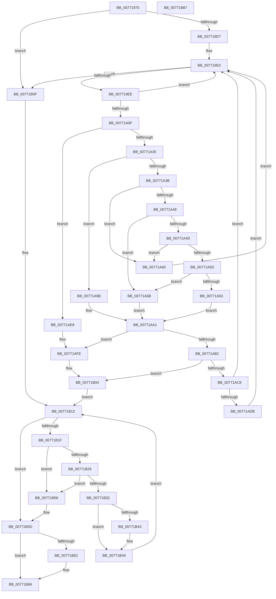

# PopDirectedDripsBuildBroadcastTreeFull

- RVA: `0x00771970`–`0x00771B88` (길이 `536` bytes)
- VA: `0x0000000140771970`
- 실행 섹션: `PAGE`
- PDB 이름 있음: `예`; PDB Function 태그: `아니요`
- unwind 정보 RVA: `0x000CD730`
- 디코드: `150`개 명령, `536/536` bytes 표시
- 미해석 바이트: `0` (있으면 어셈블리에 `.byte`로 보존)

> 이 문서는 커널 이미지의 기계어와 PDB 기호를 분석해 생성했습니다. 4번과 5번은 함수 원형과 자료형을 바이너리 사용 방식에서 추정한 C 해석이며 원본 소스 복구 결과는 아닙니다.

## 1. Dependencies

- 직접 호출 지점: **11**; 고유 호출 대상: **10**
- 직접 호출자로 확인된 함수: **1**
- RIP 상대 이미지 참조: **0**

### Outgoing calls
- `0x007719DB` → [PopDirectedDripsInsertQueueDevice](PopDirectedDripsInsertQueueDevice_function_00771E28.md) (function, `0x00771E28`)
- `0x007719F2` → [PopDirectedDripsRemoveQueueDevice](PopDirectedDripsRemoveQueueDevice_function_00771EB0.md) (function, `0x00771EB0`)
- `0x00771A1C` → [PopDirectedDripsVisitDevice](../70/PopDirectedDripsVisitDevice_function_00703068.md) (function, `0x00703068`)
- `0x00771A28` → [PopDirectedDripsIsLikelySpecialDevice](PopDirectedDripsIsLikelySpecialDevice_function_00771E68.md) (function, `0x00771E68`)
- `0x00771A3F` → [PopDirectedDripsIsPnpSoftwareDeviceNode](../75/PopDirectedDripsIsPnpSoftwareDeviceNode_function_007578E4.md) (function, `0x007578E4`)
- `0x00771A54` → [PopFxIsDirectedPowerTransitionSupported](../../text/5D/PopFxIsDirectedPowerTransitionSupported_function_005D2DD8.md) (function, `0x005D2DD8`)
- `0x00771A8E` → [PopDirectedDripsMarkDfxDevice](../AA/PopDirectedDripsMarkDfxDevice_function_00AACA44.md) (function, `0x00AACA44`)
- `0x00771AA7` → [PopDirectedDripsDiagTraceProblemDevice](PopDirectedDripsDiagTraceProblemDevice_function_0077135C.md) (function, `0x0077135C`)
- `0x00771ABC` → [PopDirectedDripsBuildPs4BroadcastTree](PopDirectedDripsBuildPs4BroadcastTree_function_00771C90.md) (function, `0x00771C90`)
- `0x00771AF9` → [PopDirectedDripsDiagTraceProblemDevice](PopDirectedDripsDiagTraceProblemDevice_function_0077135C.md) (function, `0x0077135C`)
- `0x00771B08` → [PopDirectedDripsFlushDeviceQueue](PopDirectedDripsFlushDeviceQueue_function_00771E04.md) (function, `0x00771E04`)

### Direct callers
- [PopDirectedDripsBuildBroadcastTreePartial](PopDirectedDripsBuildBroadcastTreePartial_function_00771B90.md) at `0x00771BFE`

### Static image references
- 디코드된 RIP-relative 메모리 참조가 없습니다.

## 2. Other-region calls and transfers

- 다른 실행 섹션으로 향하는 call: **1**
  - `0x00771A54` → [PopFxIsDirectedPowerTransitionSupported](../../text/5D/PopFxIsDirectedPowerTransitionSupported_function_005D2DD8.md) (`PAGE` → `.text`)
- 별도 외부 분기/꼬리 이동을 확인하지 못했습니다.

## 3. Assembly (complete function range)

```asm
00771970  48 89 5C 24 10                  mov qword ptr [rsp + 0x10], rbx
00771975  48 89 74 24 18                  mov qword ptr [rsp + 0x18], rsi
0077197A  48 89 7C 24 20                  mov qword ptr [rsp + 0x20], rdi
0077197F  55                              push rbp
00771980  41 54                           push r12
00771982  41 55                           push r13
00771984  41 56                           push r14
00771986  41 57                           push r15
00771988  48 8B EC                        mov rbp, rsp
0077198B  48 83 EC 50                     sub rsp, 0x50
0077198F  83 65 D0 00                     and dword ptr [rbp - 0x30], 0
00771993  48 8D 45 E8                     lea rax, [rbp - 0x18]
00771997  83 65 30 00                     and dword ptr [rbp + 0x30], 0
0077199B  4C 8B F2                        mov r14, rdx
0077199E  48 89 45 F0                     mov qword ptr [rbp - 0x10], rax
007719A2  48 8D 91 D8 02 00 00            lea rdx, [rcx + 0x2d8]
007719A9  48 8D 45 E8                     lea rax, [rbp - 0x18]
007719AD  33 F6                           xor esi, esi
007719AF  48 89 45 E8                     mov qword ptr [rbp - 0x18], rax
007719B3  4D 8B E1                        mov r12, r9
007719B6  48 8D 45 D8                     lea rax, [rbp - 0x28]
007719BA  45 8B E8                        mov r13d, r8d
007719BD  48 89 45 E0                     mov qword ptr [rbp - 0x20], rax
007719C1  48 8D 45 D8                     lea rax, [rbp - 0x28]
007719C5  48 89 45 D8                     mov qword ptr [rbp - 0x28], rax
007719C9  8B 42 20                        mov eax, dword ptr [rdx + 0x20]
007719CC  A9 00 00 03 00                  test eax, 0x30000
007719D1  0F 85 38 01 00 00               jne 0x140771b0f
007719D7  48 8D 4D E8                     lea rcx, [rbp - 0x18]
007719DB  E8 48 04 00 00                  call 0x140771e28
007719E0  48 8D 45 E8                     lea rax, [rbp - 0x18]
007719E4  48 39 45 E8                     cmp qword ptr [rbp - 0x18], rax
007719E8  0F 84 21 01 00 00               je 0x140771b0f
007719EE  48 8D 4D E8                     lea rcx, [rbp - 0x18]
007719F2  E8 B9 04 00 00                  call 0x140771eb0
007719F7  48 8B D8                        mov rbx, rax
007719FA  48 8D B8 28 FD FF FF            lea rdi, [rax - 0x2d8]
00771A01  8B 40 20                        mov eax, dword ptr [rax + 0x20]
00771A04  4C 8B 7F 50                     mov r15, qword ptr [rdi + 0x50]
00771A08  A9 00 00 03 00                  test eax, 0x30000
00771A0D  75 D1                           jne 0x1407719e0
00771A0F  45 33 C9                        xor r9d, r9d
00771A12  48 8D 4D D8                     lea rcx, [rbp - 0x28]
00771A16  4D 8B C6                        mov r8, r14
00771A19  48 8B D3                        mov rdx, rbx
00771A1C  E8 47 16 F9 FF                  call 0x140703068
00771A21  48 8D 55 D0                     lea rdx, [rbp - 0x30]
00771A25  48 8B CF                        mov rcx, rdi
00771A28  E8 3B 04 00 00                  call 0x140771e68
00771A2D  84 C0                           test al, al
00771A2F  0F 85 B3 00 00 00               jne 0x140771ae8
00771A35  41 F6 C5 01                     test r13b, 1
00771A39  74 60                           je 0x140771a9b
00771A3B  83 65 30 00                     and dword ptr [rbp + 0x30], 0
00771A3F  E8 A0 5E FE FF                  call 0x1407578e4
00771A44  84 C0                           test al, al
00771A46  75 38                           jne 0x140771a80
00771A48  4D 85 FF                        test r15, r15
00771A4B  74 1E                           je 0x140771a6b
00771A4D  48 8D 55 30                     lea rdx, [rbp + 0x30]
00771A51  49 8B CF                        mov rcx, r15
00771A54  E8 7F 13 E6 FF                  call 0x1405d2dd8
00771A59  84 C0                           test al, al
00771A5B  75 23                           jne 0x140771a80
00771A5D  83 7D 30 02                     cmp dword ptr [rbp + 0x30], 2
00771A61  75 08                           jne 0x140771a6b
00771A63  41 B8 04 00 00 00               mov r8d, 4
00771A69  EB 36                           jmp 0x140771aa1
00771A6B  8B 43 20                        mov eax, dword ptr [rbx + 0x20]
00771A6E  44 0F B6 C0                     movzx r8d, al
00771A72  41 83 E0 02                     and r8d, 2
00771A76  41 C1 E0 02                     shl r8d, 2
00771A7A  41 83 C8 01                     or r8d, 1
00771A7E  EB 21                           jmp 0x140771aa1
00771A80  4D 8B CE                        mov r9, r14
00771A83  48 8D 55 D8                     lea rdx, [rbp - 0x28]
00771A87  4C 8B C3                        mov r8, rbx
00771A8A  48 8D 4D E8                     lea rcx, [rbp - 0x18]
00771A8E  E8 B1 AF 33 00                  call 0x140aaca44
00771A93  83 CE 01                        or esi, 1
00771A96  E9 45 FF FF FF                  jmp 0x1407719e0
00771A9B  41 B8 08 00 00 00               mov r8d, 8
00771AA1  49 8B D6                        mov rdx, r14
00771AA4  48 8B CF                        mov rcx, rdi
00771AA7  E8 B0 F8 FF FF                  call 0x14077135c
00771AAC  41 F6 C5 02                     test r13b, 2
00771AB0  74 4C                           je 0x140771afe
00771AB2  4D 8B C6                        mov r8, r14
00771AB5  48 8D 55 D8                     lea rdx, [rbp - 0x28]
00771AB9  48 8B CF                        mov rcx, rdi
00771ABC  E8 CF 01 00 00                  call 0x140771c90
00771AC1  44 8B C8                        mov r9d, eax
00771AC4  85 C0                           test eax, eax
00771AC6  78 3C                           js 0x140771b04
00771AC8  48 8B 87 08 03 00 00            mov rax, qword ptr [rdi + 0x308]
00771ACF  83 CE 02                        or esi, 2
00771AD2  48 85 C0                        test rax, rax
00771AD5  0F 84 05 FF FF FF               je 0x1407719e0
00771ADB  0F BA A8 98 00 00 00 10         bts dword ptr [rax + 0x98], 0x10
00771AE3  E9 F8 FE FF FF                  jmp 0x1407719e0
00771AE8  8B 43 20                        mov eax, dword ptr [rbx + 0x20]
00771AEB  49 8B D6                        mov rdx, r14
00771AEE  44 8B 45 D0                     mov r8d, dword ptr [rbp - 0x30]
00771AF2  0F BA E8 12                     bts eax, 0x12
00771AF6  89 43 20                        mov dword ptr [rbx + 0x20], eax
00771AF9  E8 5E F8 FF FF                  call 0x14077135c
00771AFE  41 B9 BB 00 00 C0               mov r9d, 0xc00000bb
00771B04  48 8D 4D E8                     lea rcx, [rbp - 0x18]
00771B08  E8 F7 02 00 00                  call 0x140771e04
00771B0D  EB 03                           jmp 0x140771b12
00771B0F  45 33 C9                        xor r9d, r9d
00771B12  48 8B 4D D8                     mov rcx, qword ptr [rbp - 0x28]
00771B16  48 8D 45 D8                     lea rax, [rbp - 0x28]
00771B1A  48 3B C8                        cmp rcx, rax
00771B1D  74 3E                           je 0x140771b5d
00771B1F  48 8D 45 D8                     lea rax, [rbp - 0x28]
00771B23  48 39 41 08                     cmp qword ptr [rcx + 8], rax
00771B27  75 2D                           jne 0x140771b56
00771B29  48 8B 01                        mov rax, qword ptr [rcx]
00771B2C  48 39 48 08                     cmp qword ptr [rax + 8], rcx
00771B30  75 24                           jne 0x140771b56
00771B32  48 89 45 D8                     mov qword ptr [rbp - 0x28], rax
00771B36  48 8D 55 D8                     lea rdx, [rbp - 0x28]
00771B3A  48 89 50 08                     mov qword ptr [rax + 8], rdx
00771B3E  45 85 C9                        test r9d, r9d
00771B41  79 06                           jns 0x140771b49
00771B43  8B 41 14                        mov eax, dword ptr [rcx + 0x14]
00771B46  89 41 10                        mov dword ptr [rcx + 0x10], eax
00771B49  48 89 49 08                     mov qword ptr [rcx + 8], rcx
00771B4D  48 89 09                        mov qword ptr [rcx], rcx
00771B50  83 61 14 00                     and dword ptr [rcx + 0x14], 0
00771B54  EB BC                           jmp 0x140771b12
00771B56  B9 03 00 00 00                  mov ecx, 3
00771B5B  CD 29                           int 0x29
00771B5D  45 85 C9                        test r9d, r9d
00771B60  78 04                           js 0x140771b66
00771B62  41 09 34 24                     or dword ptr [r12], esi
00771B66  4C 8D 5C 24 50                  lea r11, [rsp + 0x50]
00771B6B  41 8B C1                        mov eax, r9d
00771B6E  49 8B 5B 38                     mov rbx, qword ptr [r11 + 0x38]
00771B72  49 8B 73 40                     mov rsi, qword ptr [r11 + 0x40]
00771B76  49 8B 7B 48                     mov rdi, qword ptr [r11 + 0x48]
00771B7A  49 8B E3                        mov rsp, r11
00771B7D  41 5F                           pop r15
00771B7F  41 5E                           pop r14
00771B81  41 5D                           pop r13
00771B83  41 5C                           pop r12
00771B85  5D                              pop rbp
00771B86  C3                              ret
00771B87  CC                              int3
```

## 4. C-style interpretation (structured pseudocode)

```c
__int64 __fastcall PopDirectedDripsBuildBroadcastTreeFull(__int64 a1, __int64 a2, int a3, __int64 a4)
{
    __int64 result;
    __int64 v_rsi;
    __int64 v_rsp;
    unsigned __int64 v_stack_m28;
    unsigned __int64 v_stack_m38;
    unsigned __int64 v_stack_m40;
    unsigned __int64 v_stack_m48;
    unsigned __int64 v_stack_m50;
    unsigned int v_stack_m58;
    unsigned __int64 v_stack_p10;
    unsigned __int64 v_stack_p18;
    unsigned __int64 v_stack_p20;
    unsigned int v_stack_p8;

    v_stack_p10 = v_rbx;
    v_stack_p18 = v_rsi;
    v_stack_p20 = v_rdi;
    v_rsp = (v_rsp) - (80);
    v_stack_m38 = v_stack_m40;
    v_rsi = 0;
    v_stack_m40 = v_stack_m40;
    v_stack_m48 = v_stack_m50;
    v_stack_m50 = v_stack_m50;
    if ((((unsigned int)((unsigned int)(*(unsigned int *)(a1 + 728 + 32)))) & (0x30000ULL)) != 0) goto loc_00771B0F;
    result = PopDirectedDripsInsertQueueDevice(v_stack_m40, a1 + 728, a3, a4);
loc_007719E0:
    if (v_stack_m40 == v_stack_m40) goto loc_00771B0F;
    result = PopDirectedDripsRemoveQueueDevice(v_stack_m40, a1 + 728, a3, a4);
    if ((((unsigned int)((unsigned int)(*(unsigned int *)(result + 32)))) & (0x30000ULL)) != 0) goto loc_007719E0;
    a4 = 0;
    result = PopDirectedDripsVisitDevice(v_stack_m50, result, a2, a4);
    result = PopDirectedDripsIsLikelySpecialDevice(result - 728, v_stack_m58, a2, a4);
    if ((unsigned __int8)(result) != 0) goto loc_00771AE8;
    if ((((unsigned __int8)((unsigned int)(a3))) & (1)) == 0) goto loc_00771A9B;
    result = PopDirectedDripsIsPnpSoftwareDeviceNode(result - 728, v_stack_m58, a2, a4);
    if ((unsigned __int8)(result) != 0) goto loc_00771A80;
    if (*(unsigned __int64 *)(result - 728 + 80) == 0) goto loc_00771A6B;
    result = PopFxIsDirectedPowerTransitionSupported(*(unsigned __int64 *)(result - 728 + 80), v_stack_p8, a2, a4);
    if ((unsigned __int8)(result) != 0) goto loc_00771A80;
    if (v_stack_p8 != 2) goto loc_00771A6B;
    goto loc_00771AA1;
loc_00771A6B:
    a3 = (unsigned int)(((unsigned __int8)((unsigned int)(*(unsigned int *)(result + 32)))) & (2));
    a3 = (unsigned int)((a3) << (2));
    a3 = (unsigned int)((a3) | (1));
    goto loc_00771AA1;
loc_00771A80:
    result = PopDirectedDripsMarkDfxDevice(v_stack_m40, v_stack_m50, result, a2);
    v_rsi = (unsigned int)((v_rsi) | (1));
    goto loc_007719E0;
loc_00771A9B:
loc_00771AA1:
    result = PopDirectedDripsDiagTraceProblemDevice(result - 728, a2, 8, a2);
    if ((((unsigned __int8)((unsigned int)(a3))) & (2)) == 0) goto loc_00771AFE;
    result = PopDirectedDripsBuildPs4BroadcastTree(result - 728, v_stack_m50, a2, a2);
    if (sign_flag) goto loc_00771B04;
    v_rsi = (unsigned int)((v_rsi) | (2));
    if (*(unsigned __int64 *)(result - 728 + 776) == 0) goto loc_007719E0;
    goto loc_007719E0;
loc_00771AE8:
    *(unsigned int *)(result + 32) = (unsigned int)((unsigned int)(*(unsigned int *)(result + 32)));
    result = PopDirectedDripsDiagTraceProblemDevice(result - 728, a2, (unsigned int)(v_stack_m58), (unsigned int)((unsigned int)(result)));
loc_00771AFE:
loc_00771B04:
    result = PopDirectedDripsFlushDeviceQueue(v_stack_m40, a2, (unsigned int)(v_stack_m58), (unsigned int)(0xC00000BBULL));
    goto loc_00771B12;
loc_00771B0F:
    a4 = 0;
loc_00771B12:
    if (v_stack_m50 == v_stack_m50) goto loc_00771B5D;
    if ((*(unsigned __int64 *)(v_stack_m50 + 8)) != v_stack_m50) goto loc_00771B56;
    if ((*(unsigned __int64 *)(*(unsigned __int64 *)(v_stack_m50) + 8)) != v_stack_m50) goto loc_00771B56;
    v_stack_m50 = *(unsigned __int64 *)(v_stack_m50);
    *(unsigned __int64 *)(*(unsigned __int64 *)(v_stack_m50) + 8) = v_stack_m50;
    result = *(unsigned __int64 *)(v_stack_m50);
    if (sign_flag) {
        result = *(unsigned int *)(v_stack_m50 + 20);
        *(unsigned int *)(v_stack_m50 + 16) = (unsigned int)(result);
    }
    *(unsigned __int64 *)(v_stack_m50 + 8) = v_stack_m50;
    *(unsigned __int64 *)(v_stack_m50) = v_stack_m50;
    goto loc_00771B12;
loc_00771B56:
loc_00771B5D:
    if (!(sign_flag)) {
    }
    return 0;
}
```

## 5. (Beta) C Style

```c
int64_t PopDirectedDripsBuildBroadcastTreeFull(void *Arg1, int64_t Arg2, int32_t Arg3, void *Arg4)
{
    uint8_t *arg1 = (uint8_t *)Arg1;
    uint8_t *arg4 = (uint8_t *)Arg4;

    int64_t result;
    int64_t local_rsi;
    int64_t local_rsp;
    uint64_t v_stack_m28;
    uint64_t v_stack_m38;
    uint64_t v_stack_m40;
    uint64_t v_stack_m48;
    uint64_t v_stack_m50;
    uint32_t v_stack_m58;
    uint64_t v_stack_p10;
    uint64_t v_stack_p18;
    uint64_t v_stack_p20;
    uint32_t v_stack_p8;

    v_stack_p10 = local_rbx;
    v_stack_p18 = local_rsi;
    v_stack_p20 = local_rdi;
    local_rsp = (local_rsp) - (80);
    v_stack_m38 = v_stack_m40;
    local_rsi = 0;
    v_stack_m40 = v_stack_m40;
    v_stack_m48 = v_stack_m50;
    v_stack_m50 = v_stack_m50;
    if ((((uint32_t)((uint32_t)(*(uint32_t *)(arg1 + 0x2D8 + 0x20)))) & (0x30000ULL)) != 0) goto loc_00771B0F;
    result = PopDirectedDripsInsertQueueDevice(v_stack_m40, Arg1 + 728, Arg3, Arg4);
loc_007719E0:
    if (v_stack_m40 == v_stack_m40) goto loc_00771B0F;
    result = PopDirectedDripsRemoveQueueDevice(v_stack_m40, Arg1 + 728, Arg3, Arg4);
    if ((((uint32_t)((uint32_t)(*(uint32_t *)(result + 0x20)))) & (0x30000ULL)) != 0) goto loc_007719E0;
    Arg4 = 0;
    result = PopDirectedDripsVisitDevice(v_stack_m50, result, Arg2, Arg4);
    result = PopDirectedDripsIsLikelySpecialDevice(result - 728, v_stack_m58, Arg2, Arg4);
    if ((uint8_t)(result) != 0) goto loc_00771AE8;
    if ((((uint8_t)((uint32_t)(Arg3))) & (1)) == 0) goto loc_00771A9B;
    result = PopDirectedDripsIsPnpSoftwareDeviceNode(result - 728, v_stack_m58, Arg2, Arg4);
    if ((uint8_t)(result) != 0) goto loc_00771A80;
    if (*(uint64_t *)(result - 0x2D8 + 0x50) == 0) goto loc_00771A6B;
    result = PopFxIsDirectedPowerTransitionSupported(*(uint64_t *)(result - 0x2D8 + 0x50), v_stack_p8, Arg2, Arg4);
    if ((uint8_t)(result) != 0) goto loc_00771A80;
    if (v_stack_p8 != 2) goto loc_00771A6B;
    goto loc_00771AA1;
loc_00771A6B:
    Arg3 = (uint32_t)(((uint8_t)((uint32_t)(*(uint32_t *)(result + 0x20)))) & (2));
    Arg3 = (uint32_t)((Arg3) << (2));
    Arg3 = (uint32_t)((Arg3) | (1));
    goto loc_00771AA1;
loc_00771A80:
    result = PopDirectedDripsMarkDfxDevice(v_stack_m40, v_stack_m50, result, Arg2);
    local_rsi = (uint32_t)((local_rsi) | (1));
    goto loc_007719E0;
loc_00771A9B:
loc_00771AA1:
    result = PopDirectedDripsDiagTraceProblemDevice(result - 728, Arg2, 8, Arg2);
    if ((((uint8_t)((uint32_t)(Arg3))) & (2)) == 0) goto loc_00771AFE;
    result = PopDirectedDripsBuildPs4BroadcastTree(result - 728, v_stack_m50, Arg2, Arg2);
    if (sign_flag) goto loc_00771B04;
    local_rsi = (uint32_t)((local_rsi) | (2));
    if (*(uint64_t *)(result - 0x2D8 + 0x308) == 0) goto loc_007719E0;
    goto loc_007719E0;
loc_00771AE8:
    *(uint32_t *)(result + 0x20) = (uint32_t)((uint32_t)(*(uint32_t *)(result + 0x20)));
    result = PopDirectedDripsDiagTraceProblemDevice(result - 728, Arg2, (uint32_t)(v_stack_m58), (uint32_t)((uint32_t)(result)));
loc_00771AFE:
loc_00771B04:
    result = PopDirectedDripsFlushDeviceQueue(v_stack_m40, Arg2, (uint32_t)(v_stack_m58), (uint32_t)(0xC00000BBULL));
    goto loc_00771B12;
loc_00771B0F:
    Arg4 = 0;
loc_00771B12:
    if (v_stack_m50 == v_stack_m50) goto loc_00771B5D;
    if ((*(uint64_t *)(v_stack_m50 + 0x8)) != v_stack_m50) goto loc_00771B56;
    if ((*(uint64_t *)(*(uint64_t *)(v_stack_m50) + 0x8)) != v_stack_m50) goto loc_00771B56;
    v_stack_m50 = *(uint64_t *)(v_stack_m50);
    *(uint64_t *)(*(uint64_t *)(v_stack_m50) + 0x8) = v_stack_m50;
    result = *(uint64_t *)(v_stack_m50);
    if (sign_flag) {
        result = *(uint32_t *)(v_stack_m50 + 0x14);
        *(uint32_t *)(v_stack_m50 + 0x10) = (uint32_t)(result);
    }
    *(uint64_t *)(v_stack_m50 + 0x8) = v_stack_m50;
    *(uint64_t *)(v_stack_m50) = v_stack_m50;
    goto loc_00771B12;
loc_00771B56:
loc_00771B5D:
    if (!(sign_flag)) {
    }
    return 0;
}
```

### 관측된 메모리 오프셋

구조체 형식이 확인되지 않은 접근은 인자 기준의 오프셋으로만 기록했습니다.

| 기준 인자 | 오프셋 표현 | 폭 (bit) | 접근 |
|---|---:|---:|---|
| `Arg1` | `+ 0x20` | `32` | `R` |
| `Arg1` | `+ 0x2D8` | `64` | `R` |
| `Arg4` | `+ 0x0` | `32` | `R/W` |

## 6. Execution-region graph

[열기: 2D/3D 그래프와 함수 탐색 컨트롤 패널](../../../control-panel.html?section=page&rva=0x00771970&view=graph)

- 2D 그래프는 위에서 아래로 흐르고, 3D 그래프는 빈 공간을 드래그해 회전합니다. Shift+드래그는 이동, 휠은 확대·축소, 함수 노드 선택은 대상 보고서 이동입니다.

### Static fallback


