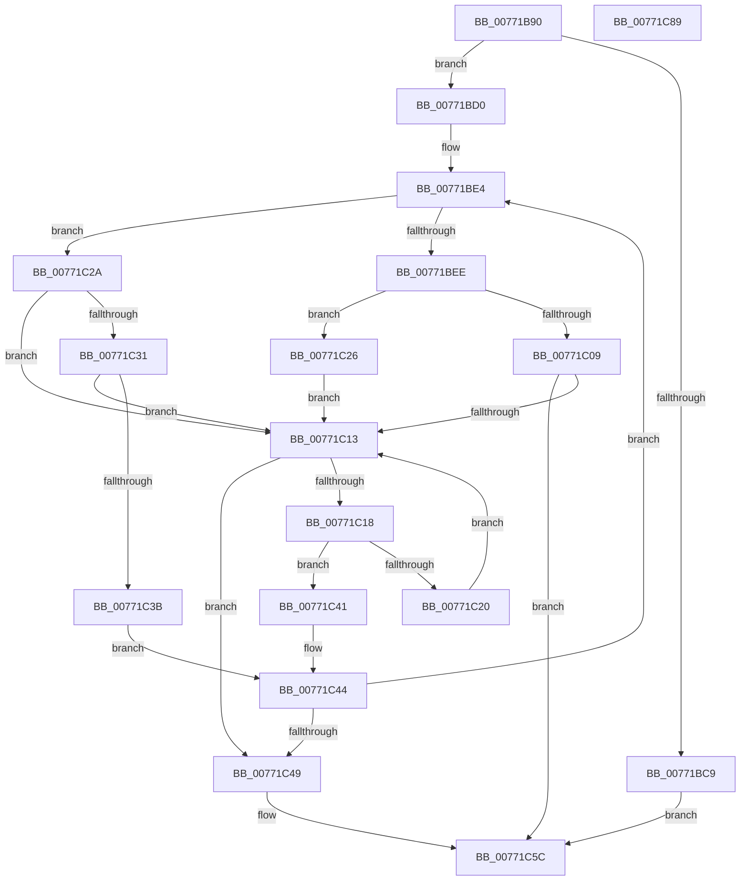

# PopDirectedDripsBuildBroadcastTreePartial

- RVA: `0x00771B90`–`0x00771C8A` (길이 `250` bytes)
- VA: `0x0000000140771B90`
- 실행 섹션: `PAGE`
- PDB 이름 있음: `예`; PDB Function 태그: `아니요`
- unwind 정보 RVA: `0x000CD750`
- 디코드: `80`개 명령, `250/250` bytes 표시
- 미해석 바이트: `0` (있으면 어셈블리에 `.byte`로 보존)

> 이 문서는 커널 이미지의 기계어와 PDB 기호를 분석해 생성했습니다. 4번과 5번은 함수 원형과 자료형을 바이너리 사용 방식에서 추정한 C 해석이며 원본 소스 복구 결과는 아닙니다.

## 1. Dependencies

- 직접 호출 지점: **3**; 고유 호출 대상: **3**
- 직접 호출자로 확인된 함수: **1**
- RIP 상대 이미지 참조: **0**

### Outgoing calls
- `0x00771BD5` → [PopDirectedDripsDiagBroadcastTreeBegin](../A9/PopDirectedDripsDiagBroadcastTreeBegin_function_00A955E8.md) (function, `0x00A955E8`)
- `0x00771BFE` → [PopDirectedDripsBuildBroadcastTreeFull](PopDirectedDripsBuildBroadcastTreeFull_function_00771970.md) (function, `0x00771970`)
- `0x00771C6B` → [PopDirectedDripsDiagBroadcastTreeEnd](PopDirectedDripsDiagBroadcastTreeEnd_function_00770E10.md) (function, `0x00770E10`)

### Direct callers
- [PopDirectedDripsInitializeBroadcast](../A4/PopDirectedDripsInitializeBroadcast_function_00A4D634.md) at `0x00A4D7D8`

### Static image references
- 디코드된 RIP-relative 메모리 참조가 없습니다.

## 2. Other-region calls and transfers

- 다른 실행 섹션으로 향하는 call: **0**
- 별도 외부 분기/꼬리 이동을 확인하지 못했습니다.

## 3. Assembly (complete function range)

```asm
00771B90  48 8B C4                        mov rax, rsp
00771B93  48 89 58 10                     mov qword ptr [rax + 0x10], rbx
00771B97  48 89 68 18                     mov qword ptr [rax + 0x18], rbp
00771B9B  56                              push rsi
00771B9C  57                              push rdi
00771B9D  41 54                           push r12
00771B9F  41 56                           push r14
00771BA1  41 57                           push r15
00771BA3  48 83 EC 20                     sub rsp, 0x20
00771BA7  48 83 60 20 00                  and qword ptr [rax + 0x20], 0
00771BAC  45 32 FF                        xor r15b, r15b
00771BAF  83 60 08 00                     and dword ptr [rax + 8], 0
00771BB3  4D 8B F0                        mov r14, r8
00771BB6  8B 81 F8 02 00 00               mov eax, dword ptr [rcx + 0x2f8]
00771BBC  44 8B E2                        mov r12d, edx
00771BBF  48 8B F1                        mov rsi, rcx
00771BC2  A9 00 00 03 00                  test eax, 0x30000
00771BC7  74 07                           je 0x140771bd0
00771BC9  33 DB                           xor ebx, ebx
00771BCB  E9 8C 00 00 00                  jmp 0x140771c5c
00771BD0  4C 8D 44 24 68                  lea r8, [rsp + 0x68]
00771BD5  E8 0E 3A 32 00                  call 0x140a955e8
00771BDA  83 64 24 50 00                  and dword ptr [rsp + 0x50], 0
00771BDF  48 8B FE                        mov rdi, rsi
00771BE2  33 ED                           xor ebp, ebp
00771BE4  8B 87 F8 02 00 00               mov eax, dword ptr [rdi + 0x2f8]
00771BEA  A8 02                           test al, 2
00771BEC  75 3C                           jne 0x140771c2a
00771BEE  48 8B 54 24 68                  mov rdx, qword ptr [rsp + 0x68]
00771BF3  4C 8D 4C 24 50                  lea r9, [rsp + 0x50]
00771BF8  45 8B C4                        mov r8d, r12d
00771BFB  48 8B CF                        mov rcx, rdi
00771BFE  E8 6D FD FF FF                  call 0x140771970
00771C03  8B D8                           mov ebx, eax
00771C05  85 C0                           test eax, eax
00771C07  79 1D                           jns 0x140771c26
00771C09  41 B7 01                        mov r15b, 1
00771C0C  3D BB 00 00 C0                  cmp eax, 0xc00000bb
00771C11  75 49                           jne 0x140771c5c
00771C13  48 3B FE                        cmp rdi, rsi
00771C16  74 31                           je 0x140771c49
00771C18  48 8B 07                        mov rax, qword ptr [rdi]
00771C1B  48 85 C0                        test rax, rax
00771C1E  75 21                           jne 0x140771c41
00771C20  48 8B 7F 10                     mov rdi, qword ptr [rdi + 0x10]
00771C24  EB ED                           jmp 0x140771c13
00771C26  FF C5                           inc ebp
00771C28  EB E9                           jmp 0x140771c13
00771C2A  48 83 7F 08 00                  cmp qword ptr [rdi + 8], 0
00771C2F  74 E2                           je 0x140771c13
00771C31  8B 87 F8 02 00 00               mov eax, dword ptr [rdi + 0x2f8]
00771C37  A8 04                           test al, 4
00771C39  75 D8                           jne 0x140771c13
00771C3B  48 8B 7F 08                     mov rdi, qword ptr [rdi + 8]
00771C3F  EB 03                           jmp 0x140771c44
00771C41  48 8B F8                        mov rdi, rax
00771C44  48 3B FE                        cmp rdi, rsi
00771C47  75 9B                           jne 0x140771be4
00771C49  8B 44 24 50                     mov eax, dword ptr [rsp + 0x50]
00771C4D  41 09 06                        or dword ptr [r14], eax
00771C50  F7 DD                           neg ebp
00771C52  1B DB                           sbb ebx, ebx
00771C54  F7 D3                           not ebx
00771C56  81 E3 BB 00 00 C0               and ebx, 0xc00000bb
00771C5C  44 8B 44 24 50                  mov r8d, dword ptr [rsp + 0x50]
00771C61  45 8A CF                        mov r9b, r15b
00771C64  48 8B 4C 24 68                  mov rcx, qword ptr [rsp + 0x68]
00771C69  8B D3                           mov edx, ebx
00771C6B  E8 A0 F1 FF FF                  call 0x140770e10
00771C70  48 8B 6C 24 60                  mov rbp, qword ptr [rsp + 0x60]
00771C75  8B C3                           mov eax, ebx
00771C77  48 8B 5C 24 58                  mov rbx, qword ptr [rsp + 0x58]
00771C7C  48 83 C4 20                     add rsp, 0x20
00771C80  41 5F                           pop r15
00771C82  41 5E                           pop r14
00771C84  41 5C                           pop r12
00771C86  5F                              pop rdi
00771C87  5E                              pop rsi
00771C88  C3                              ret
00771C89  CC                              int3
```

## 4. C-style interpretation (structured pseudocode)

```c
__int64 __fastcall PopDirectedDripsBuildBroadcastTreePartial(__int64 a1, int a2, __int64 a3)
{
    __int64 result;
    __int64 v_r15;
    __int64 v_rbp;
    __int64 v_rbx;
    __int64 v_rsp;
    unsigned __int64 v_stack_p10;
    unsigned __int64 v_stack_p18;
    unsigned __int64 v_stack_p20;
    unsigned int v_stack_p8;

    *(unsigned __int64 *)(v_rsp + 16) = v_rbx;
    *(unsigned __int64 *)(v_rsp + 24) = v_rbp;
    v_rsp = (v_rsp) - (32);
    v_r15 = 0;
    if ((((unsigned int)((unsigned int)(*(unsigned int *)(a1 + 760)))) & (0x30000ULL)) == 0) goto loc_00771BD0;
    v_rbx = 0;
    goto loc_00771C5C;
loc_00771BD0:
    result = PopDirectedDripsDiagBroadcastTreeBegin(a1, a2, v_stack_p20, a4);
    v_rbp = 0;
loc_00771BE4:
    if ((((unsigned __int8)((unsigned int)(*(unsigned int *)(a1 + 760)))) & (2)) != 0) goto loc_00771C2A;
    result = PopDirectedDripsBuildBroadcastTreeFull(a1, v_stack_p20, (unsigned int)((unsigned int)((unsigned int)(a2))), v_stack_p8);
    if (!sign_flag) goto loc_00771C26;
    if (((unsigned int)(result)) != 0xC00000BBULL) goto loc_00771C5C;
loc_00771C13:
    if (a1 == a1) goto loc_00771C49;
    if (*(unsigned __int64 *)(a1) != 0) goto loc_00771C41;
    goto loc_00771C13;
loc_00771C26:
    v_rbp = (unsigned int)((v_rbp) + 1);
    goto loc_00771C13;
loc_00771C2A:
    if ((*(unsigned __int64 *)(*(unsigned __int64 *)(a1 + 16) + 8)) == 0) goto loc_00771C13;
    if ((((unsigned __int8)((unsigned int)(*(unsigned int *)(*(unsigned __int64 *)(a1 + 16) + 760)))) & (4)) != 0) goto loc_00771C13;
    goto loc_00771C44;
loc_00771C41:
loc_00771C44:
    if (((unsigned int)(*(unsigned int *)(*(unsigned __int64 *)(a1 + 16) + 760))) != a1) goto loc_00771BE4;
loc_00771C49:
    v_rbp = (unsigned int)(-(v_rbp));
    v_rbx = (unsigned int)(~((unsigned int)((unsigned int)(result))));
    v_rbx = (unsigned int)((v_rbx) & (0xC00000BBULL));
loc_00771C5C:
    result = PopDirectedDripsDiagBroadcastTreeEnd(v_stack_p20, (unsigned int)((unsigned int)(v_rbx)), (unsigned int)(v_stack_p8), 1);
    v_rsp = (v_rsp) + (32);
    return (unsigned int)((unsigned int)(v_rbx));
}
```

## 5. (Beta) C Style

```c
int64_t PopDirectedDripsBuildBroadcastTreePartial(void *Arg1, int32_t Arg2, void *Arg3)
{
    uint8_t *arg1 = (uint8_t *)Arg1;
    uint8_t *arg3 = (uint8_t *)Arg3;

    int64_t result;
    int64_t local_r15;
    int64_t local_rbp;
    int64_t local_rbx;
    int64_t local_rsp;
    uint64_t v_stack_p10;
    uint64_t v_stack_p18;
    uint64_t v_stack_p20;
    uint32_t v_stack_p8;

    *(uint64_t *)(local_rsp + 0x10) = local_rbx;
    *(uint64_t *)(local_rsp + 0x18) = local_rbp;
    local_rsp = (local_rsp) - (32);
    local_r15 = 0;
    if ((((uint32_t)((uint32_t)(*(uint32_t *)(arg1 + 0x2F8)))) & (0x30000ULL)) == 0) goto loc_00771BD0;
    local_rbx = 0;
    goto loc_00771C5C;
loc_00771BD0:
    result = PopDirectedDripsDiagBroadcastTreeBegin(Arg1, Arg2, v_stack_p20, a4);
    local_rbp = 0;
loc_00771BE4:
    if ((((uint8_t)((uint32_t)(*(uint32_t *)(arg1 + 0x2F8)))) & (2)) != 0) goto loc_00771C2A;
    result = PopDirectedDripsBuildBroadcastTreeFull(Arg1, v_stack_p20, (uint32_t)((uint32_t)((uint32_t)(Arg2))), v_stack_p8);
    if (!sign_flag) goto loc_00771C26;
    if (((uint32_t)(result)) != 0xC00000BBULL) goto loc_00771C5C;
loc_00771C13:
    if (Arg1 == Arg1) goto loc_00771C49;
    if (*(uint64_t *)(arg1) != 0) goto loc_00771C41;
    goto loc_00771C13;
loc_00771C26:
    local_rbp = (uint32_t)((local_rbp) + 1);
    goto loc_00771C13;
loc_00771C2A:
    if ((*(uint64_t *)(*(uint64_t *)(arg1 + 0x10) + 0x8)) == 0) goto loc_00771C13;
    if ((((uint8_t)((uint32_t)(*(uint32_t *)(*(uint64_t *)(arg1 + 0x10) + 0x2F8)))) & (4)) != 0) goto loc_00771C13;
    goto loc_00771C44;
loc_00771C41:
loc_00771C44:
    if (((uint32_t)(*(uint32_t *)(*(uint64_t *)(arg1 + 0x10) + 0x2F8))) != Arg1) goto loc_00771BE4;
loc_00771C49:
    local_rbp = (uint32_t)(-(local_rbp));
    local_rbx = (uint32_t)(~((uint32_t)((uint32_t)(result))));
    local_rbx = (uint32_t)((local_rbx) & (0xC00000BBULL));
loc_00771C5C:
    result = PopDirectedDripsDiagBroadcastTreeEnd(v_stack_p20, (uint32_t)((uint32_t)(local_rbx)), (uint32_t)(v_stack_p8), 1);
    local_rsp = (local_rsp) + (32);
    return (uint32_t)((uint32_t)(local_rbx));
}
```

### 관측된 메모리 오프셋

구조체 형식이 확인되지 않은 접근은 인자 기준의 오프셋으로만 기록했습니다.

| 기준 인자 | 오프셋 표현 | 폭 (bit) | 접근 |
|---|---:|---:|---|
| `Arg1` | `+ 0x2F8` | `32` | `R` |
| `Arg3` | `+ 0x0` | `32` | `R/W` |

## 6. Execution-region graph

[열기: 2D/3D 그래프와 함수 탐색 컨트롤 패널](../../../control-panel.html?section=page&rva=0x00771B90&view=graph)

- 2D 그래프는 위에서 아래로 흐르고, 3D 그래프는 빈 공간을 드래그해 회전합니다. Shift+드래그는 이동, 휠은 확대·축소, 함수 노드 선택은 대상 보고서 이동입니다.

### Static fallback


