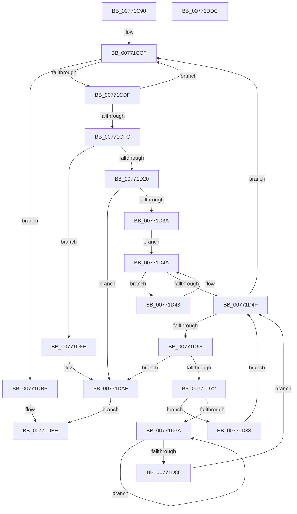

# PopDirectedDripsBuildPs4BroadcastTree

- RVA: `0x00771C90`–`0x00771DDD` (길이 `333` bytes)
- VA: `0x0000000140771C90`
- 실행 섹션: `PAGE`
- PDB 이름 있음: `예`; PDB Function 태그: `아니요`
- unwind 정보 RVA: `0x0005D7BC`
- 디코드: `92`개 명령, `333/333` bytes 표시
- 미해석 바이트: `0` (있으면 어셈블리에 `.byte`로 보존)

> 이 문서는 커널 이미지의 기계어와 PDB 기호를 분석해 생성했습니다. 4번과 5번은 함수 원형과 자료형을 바이너리 사용 방식에서 추정한 C 해석이며 원본 소스 복구 결과는 아닙니다.

## 1. Dependencies

- 직접 호출 지점: **8**; 고유 호출 대상: **7**
- 직접 호출자로 확인된 함수: **1**
- RIP 상대 이미지 참조: **0**

### Outgoing calls
- `0x00771CCA` → [PopDirectedDripsInsertQueueDevice](PopDirectedDripsInsertQueueDevice_function_00771E28.md) (function, `0x00771E28`)
- `0x00771CE4` → [PopDirectedDripsRemoveQueueDevice](PopDirectedDripsRemoveQueueDevice_function_00771EB0.md) (function, `0x00771EB0`)
- `0x00771D0B` → [PopDirectedDripsVisitDevice](../70/PopDirectedDripsVisitDevice_function_00703068.md) (function, `0x00703068`)
- `0x00771D13` → [PopDirectedDripsFindPs4RootDevice](PopDirectedDripsFindPs4RootDevice_function_00771DE4.md) (function, `0x00771DE4`)
- `0x00771D2E` → [PopDirectedDripsVisitPs4Device](PopDirectedDripsVisitPs4Device_function_00771EE0.md) (function, `0x00771EE0`)
- `0x00771D66` → [PopDirectedDripsVisitPs4Device](PopDirectedDripsVisitPs4Device_function_00771EE0.md) (function, `0x00771EE0`)
- `0x00771DA4` → [PopDirectedDripsDiagTraceProblemDevice](PopDirectedDripsDiagTraceProblemDevice_function_0077135C.md) (function, `0x0077135C`)
- `0x00771DB4` → [PopDirectedDripsFlushDeviceQueue](PopDirectedDripsFlushDeviceQueue_function_00771E04.md) (function, `0x00771E04`)

### Direct callers
- [PopDirectedDripsBuildBroadcastTreeFull](PopDirectedDripsBuildBroadcastTreeFull_function_00771970.md) at `0x00771ABC`

### Static image references
- 디코드된 RIP-relative 메모리 참조가 없습니다.

## 2. Other-region calls and transfers

- 다른 실행 섹션으로 향하는 call: **0**
- 별도 외부 분기/꼬리 이동을 확인하지 못했습니다.

## 3. Assembly (complete function range)

```asm
00771C90  4C 8B DC                        mov r11, rsp
00771C93  49 89 5B 08                     mov qword ptr [r11 + 8], rbx
00771C97  49 89 6B 10                     mov qword ptr [r11 + 0x10], rbp
00771C9B  49 89 73 18                     mov qword ptr [r11 + 0x18], rsi
00771C9F  49 89 7B 20                     mov qword ptr [r11 + 0x20], rdi
00771CA3  41 56                           push r14
00771CA5  48 83 EC 30                     sub rsp, 0x30
00771CA9  49 8D 43 E8                     lea rax, [r11 - 0x18]
00771CAD  4C 8B F2                        mov r14, rdx
00771CB0  49 89 43 F0                     mov qword ptr [r11 - 0x10], rax
00771CB4  48 8D 91 D8 02 00 00            lea rdx, [rcx + 0x2d8]
00771CBB  49 8D 43 E8                     lea rax, [r11 - 0x18]
00771CBF  49 8B E8                        mov rbp, r8
00771CC2  49 8D 4B E8                     lea rcx, [r11 - 0x18]
00771CC6  49 89 43 E8                     mov qword ptr [r11 - 0x18], rax
00771CCA  E8 59 01 00 00                  call 0x140771e28
00771CCF  48 8D 44 24 20                  lea rax, [rsp + 0x20]
00771CD4  48 39 44 24 20                  cmp qword ptr [rsp + 0x20], rax
00771CD9  0F 84 DC 00 00 00               je 0x140771dbb
00771CDF  48 8D 4C 24 20                  lea rcx, [rsp + 0x20]
00771CE4  E8 C7 01 00 00                  call 0x140771eb0
00771CE9  48 8B D8                        mov rbx, rax
00771CEC  8B 48 20                        mov ecx, dword ptr [rax + 0x20]
00771CEF  48 8D B0 28 FD FF FF            lea rsi, [rax - 0x2d8]
00771CF6  0F BA E1 11                     bt ecx, 0x11
00771CFA  72 D3                           jb 0x140771ccf
00771CFC  41 B9 04 00 00 00               mov r9d, 4
00771D02  4C 8B C5                        mov r8, rbp
00771D05  48 8B D0                        mov rdx, rax
00771D08  49 8B CE                        mov rcx, r14
00771D0B  E8 58 13 F9 FF                  call 0x140703068
00771D10  48 8B CE                        mov rcx, rsi
00771D13  E8 CC 00 00 00                  call 0x140771de4
00771D18  48 8B F8                        mov rdi, rax
00771D1B  48 85 C0                        test rax, rax
00771D1E  74 6E                           je 0x140771d8e
00771D20  4C 8B CD                        mov r9, rbp
00771D23  48 8D 54 24 20                  lea rdx, [rsp + 0x20]
00771D28  4D 8B C6                        mov r8, r14
00771D2B  48 8B C8                        mov rcx, rax
00771D2E  E8 AD 01 00 00                  call 0x140771ee0
00771D33  44 8B C8                        mov r9d, eax
00771D36  85 C0                           test eax, eax
00771D38  78 75                           js 0x140771daf
00771D3A  48 8B 4F 08                     mov rcx, qword ptr [rdi + 8]
00771D3E  48 8B DF                        mov rbx, rdi
00771D41  EB 07                           jmp 0x140771d4a
00771D43  48 8B D9                        mov rbx, rcx
00771D46  48 8B 49 08                     mov rcx, qword ptr [rcx + 8]
00771D4A  48 85 C9                        test rcx, rcx
00771D4D  75 F4                           jne 0x140771d43
00771D4F  48 3B DF                        cmp rbx, rdi
00771D52  0F 84 77 FF FF FF               je 0x140771ccf
00771D58  4C 8B CD                        mov r9, rbp
00771D5B  48 8D 54 24 20                  lea rdx, [rsp + 0x20]
00771D60  4D 8B C6                        mov r8, r14
00771D63  48 8B CB                        mov rcx, rbx
00771D66  E8 75 01 00 00                  call 0x140771ee0
00771D6B  44 8B C8                        mov r9d, eax
00771D6E  85 C0                           test eax, eax
00771D70  78 3D                           js 0x140771daf
00771D72  48 8B 03                        mov rax, qword ptr [rbx]
00771D75  48 85 C0                        test rax, rax
00771D78  74 0E                           je 0x140771d88
00771D7A  48 8B D8                        mov rbx, rax
00771D7D  48 8B 40 08                     mov rax, qword ptr [rax + 8]
00771D81  48 85 C0                        test rax, rax
00771D84  75 F4                           jne 0x140771d7a
00771D86  EB C7                           jmp 0x140771d4f
00771D88  48 8B 5B 10                     mov rbx, qword ptr [rbx + 0x10]
00771D8C  EB C1                           jmp 0x140771d4f
00771D8E  8B 43 20                        mov eax, dword ptr [rbx + 0x20]
00771D91  41 B8 03 00 00 00               mov r8d, 3
00771D97  0F BA E8 12                     bts eax, 0x12
00771D9B  48 8B D5                        mov rdx, rbp
00771D9E  48 8B CE                        mov rcx, rsi
00771DA1  89 43 20                        mov dword ptr [rbx + 0x20], eax
00771DA4  E8 B3 F5 FF FF                  call 0x14077135c
00771DA9  41 B9 BB 00 00 C0               mov r9d, 0xc00000bb
00771DAF  48 8D 4C 24 20                  lea rcx, [rsp + 0x20]
00771DB4  E8 4B 00 00 00                  call 0x140771e04
00771DB9  EB 03                           jmp 0x140771dbe
00771DBB  45 33 C9                        xor r9d, r9d
00771DBE  48 8B 5C 24 40                  mov rbx, qword ptr [rsp + 0x40]
00771DC3  41 8B C1                        mov eax, r9d
00771DC6  48 8B 6C 24 48                  mov rbp, qword ptr [rsp + 0x48]
00771DCB  48 8B 74 24 50                  mov rsi, qword ptr [rsp + 0x50]
00771DD0  48 8B 7C 24 58                  mov rdi, qword ptr [rsp + 0x58]
00771DD5  48 83 C4 30                     add rsp, 0x30
00771DD9  41 5E                           pop r14
00771DDB  C3                              ret
00771DDC  CC                              int3
```

## 4. C-style interpretation (structured pseudocode)

```c
__int64 __fastcall PopDirectedDripsBuildPs4BroadcastTree(__int64 a1, __int64 a2, __int64 a3)
{
    __int64 result;
    __int64 v_rsp;
    unsigned __int64 v_stack_m18;
    unsigned __int64 v_stack_p10;
    unsigned __int64 v_stack_p18;
    unsigned __int64 v_stack_p20;
    unsigned __int64 v_stack_p8;

    *(unsigned __int64 *)(v_rsp + 8) = v_rbx;
    *(unsigned __int64 *)(v_rsp + 16) = v_rbp;
    *(unsigned __int64 *)(v_rsp + 24) = v_rsi;
    *(unsigned __int64 *)(v_rsp + 32) = v_rdi;
    v_rsp = (v_rsp) - (48);
    *(unsigned __int64 *)(v_rsp - 16) = v_rsp - 24;
    *(unsigned __int64 *)(v_rsp - 24) = v_rsp - 24;
    result = PopDirectedDripsInsertQueueDevice(v_rsp - 24, a1 + 728, a3, a4);
loc_00771CCF:
    if (v_stack_m18 == v_stack_m18) goto loc_00771DBB;
    result = PopDirectedDripsRemoveQueueDevice(v_stack_m18, a1 + 728, a3, a4);
    if (v_stack_m18 < v_stack_m18) goto loc_00771CCF;
    result = PopDirectedDripsVisitDevice(a2, result, a3, 4);
    result = PopDirectedDripsFindPs4RootDevice(result - 728, result, a3, 4);
    if (result == 0) goto loc_00771D8E;
    result = PopDirectedDripsVisitPs4Device(result, v_stack_m18, a2, a3);
    if (sign_flag) goto loc_00771DAF;
    goto loc_00771D4A;
loc_00771D43:
loc_00771D4A:
    if (*(unsigned __int64 *)(*(unsigned __int64 *)(result + 8) + 8) != 0) goto loc_00771D43;
loc_00771D4F:
    if ((*(unsigned __int64 *)(result + 8)) == result) goto loc_00771CCF;
    result = PopDirectedDripsVisitPs4Device(*(unsigned __int64 *)(result + 8), v_stack_m18, a2, a3);
    if (sign_flag) goto loc_00771DAF;
    if (*(unsigned __int64 *)(*(unsigned __int64 *)(result + 8)) == 0) goto loc_00771D88;
loc_00771D7A:
    if (*(unsigned __int64 *)(*(unsigned __int64 *)(*(unsigned __int64 *)(result + 8)) + 8) != 0) goto loc_00771D7A;
    goto loc_00771D4F;
loc_00771D88:
    goto loc_00771D4F;
loc_00771D8E:
    *(unsigned int *)(*(unsigned __int64 *)(*(unsigned __int64 *)(*(unsigned __int64 *)(result + 8)) + 16) + 32) = (unsigned int)((unsigned int)(*(unsigned int *)(*(unsigned __int64 *)(*(unsigned __int64 *)(*(unsigned __int64 *)(result + 8)) + 16) + 32)));
    result = PopDirectedDripsDiagTraceProblemDevice(result - 728, a3, 3, (unsigned int)((unsigned int)(result)));
loc_00771DAF:
    result = PopDirectedDripsFlushDeviceQueue(v_stack_m18, a3, 3, (unsigned int)(0xC00000BBULL));
    goto loc_00771DBE;
loc_00771DBB:
    a4 = 0;
loc_00771DBE:
    v_rsp = (v_rsp) + (48);
    return 0;
}
```

## 5. (Beta) C Style

```c
int64_t PopDirectedDripsBuildPs4BroadcastTree(void *Arg1, int64_t Arg2, int64_t Arg3)
{
    uint8_t *arg1 = (uint8_t *)Arg1;

    int64_t result;
    int64_t local_rsp;
    uint64_t v_stack_m18;
    uint64_t v_stack_p10;
    uint64_t v_stack_p18;
    uint64_t v_stack_p20;
    uint64_t v_stack_p8;

    *(uint64_t *)(local_rsp + 0x8) = local_rbx;
    *(uint64_t *)(local_rsp + 0x10) = local_rbp;
    *(uint64_t *)(local_rsp + 0x18) = local_rsi;
    *(uint64_t *)(local_rsp + 0x20) = local_rdi;
    local_rsp = (local_rsp) - (48);
    *(uint64_t *)(local_rsp - 0x10) = local_rsp - 24;
    *(uint64_t *)(local_rsp - 0x18) = local_rsp - 24;
    result = PopDirectedDripsInsertQueueDevice(local_rsp - 24, Arg1 + 728, Arg3, a4);
loc_00771CCF:
    if (v_stack_m18 == v_stack_m18) goto loc_00771DBB;
    result = PopDirectedDripsRemoveQueueDevice(v_stack_m18, Arg1 + 728, Arg3, a4);
    if (v_stack_m18 < v_stack_m18) goto loc_00771CCF;
    result = PopDirectedDripsVisitDevice(Arg2, result, Arg3, 4);
    result = PopDirectedDripsFindPs4RootDevice(result - 728, result, Arg3, 4);
    if (result == 0) goto loc_00771D8E;
    result = PopDirectedDripsVisitPs4Device(result, v_stack_m18, Arg2, Arg3);
    if (sign_flag) goto loc_00771DAF;
    goto loc_00771D4A;
loc_00771D43:
loc_00771D4A:
    if (*(uint64_t *)(*(uint64_t *)(result + 0x8) + 0x8) != 0) goto loc_00771D43;
loc_00771D4F:
    if ((*(uint64_t *)(result + 0x8)) == result) goto loc_00771CCF;
    result = PopDirectedDripsVisitPs4Device(*(uint64_t *)(result + 0x8), v_stack_m18, Arg2, Arg3);
    if (sign_flag) goto loc_00771DAF;
    if (*(uint64_t *)(*(uint64_t *)(result + 0x8)) == 0) goto loc_00771D88;
loc_00771D7A:
    if (*(uint64_t *)(*(uint64_t *)(*(uint64_t *)(result + 0x8)) + 0x8) != 0) goto loc_00771D7A;
    goto loc_00771D4F;
loc_00771D88:
    goto loc_00771D4F;
loc_00771D8E:
    *(uint32_t *)(*(uint64_t *)(*(uint64_t *)(*(uint64_t *)(result + 0x8)) + 0x10) + 0x20) = (uint32_t)((uint32_t)(*(uint32_t *)(*(uint64_t *)(*(uint64_t *)(*(uint64_t *)(result + 0x8)) + 0x10) + 0x20)));
    result = PopDirectedDripsDiagTraceProblemDevice(result - 728, Arg3, 3, (uint32_t)((uint32_t)(result)));
loc_00771DAF:
    result = PopDirectedDripsFlushDeviceQueue(v_stack_m18, Arg3, 3, (uint32_t)(0xC00000BBULL));
    goto loc_00771DBE;
loc_00771DBB:
    a4 = 0;
loc_00771DBE:
    local_rsp = (local_rsp) + (48);
    return 0;
}
```

### 관측된 메모리 오프셋

구조체 형식이 확인되지 않은 접근은 인자 기준의 오프셋으로만 기록했습니다.

| 기준 인자 | 오프셋 표현 | 폭 (bit) | 접근 |
|---|---:|---:|---|
| `Arg1` | `+ 0x2D8` | `64` | `R` |

## 6. Execution-region graph

[열기: 2D/3D 그래프와 함수 탐색 컨트롤 패널](../../../control-panel.html?section=page&rva=0x00771C90&view=graph)

- 2D 그래프는 위에서 아래로 흐르고, 3D 그래프는 빈 공간을 드래그해 회전합니다. Shift+드래그는 이동, 휠은 확대·축소, 함수 노드 선택은 대상 보고서 이동입니다.

### Static fallback


