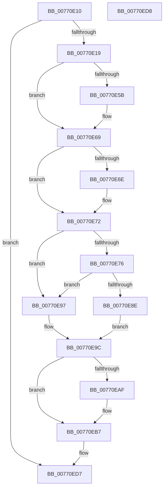

# PopDirectedDripsDiagBroadcastTreeEnd

- RVA: `0x00770E10`–`0x00770ED9` (길이 `201` bytes)
- VA: `0x0000000140770E10`
- 실행 섹션: `PAGE`
- PDB 이름 있음: `예`; PDB Function 태그: `아니요`
- unwind 정보 RVA: `0x000BDCB4`
- 디코드: `60`개 명령, `201/201` bytes 표시
- 미해석 바이트: `0` (있으면 어셈블리에 `.byte`로 보존)

> 이 문서는 커널 이미지의 기계어와 PDB 기호를 분석해 생성했습니다. 4번과 5번은 함수 원형과 자료형을 바이너리 사용 방식에서 추정한 C 해석이며 원본 소스 복구 결과는 아닙니다.

## 1. Dependencies

- 직접 호출 지점: **4**; 고유 호출 대상: **4**
- 직접 호출자로 확인된 함수: **1**
- RIP 상대 이미지 참조: **2**

### Outgoing calls
- `0x00770E4B` → [KeAbPreAcquire](../../text/21/KeAbPreAcquire_function_00210230.md) (function, `0x00210230`)
- `0x00770E64` → [ExfAcquirePushLockExclusiveEx](../../text/20/ExfAcquirePushLockExclusiveEx_function_0020FC90.md) (function, `0x0020FC90`)
- `0x00770EB2` → [ExfTryToWakePushLock](../../text/26/ExfTryToWakePushLock_function_00265DD0.md) (function, `0x00265DD0`)
- `0x00770EBA` → [KeAbPostRelease](../../text/2E/KeAbPostRelease_function_002E1600.md) (function, `0x002E1600`)

### Direct callers
- [PopDirectedDripsBuildBroadcastTreePartial](PopDirectedDripsBuildBroadcastTreePartial_function_00771B90.md) at `0x00771C6B`

### Static image references
- `0x00770E34` → RVA `0x00F07650` (`.data`; read)
- `0x00770EA0` → RVA `0x00F07650` (`.data`; read/write)

## 2. Other-region calls and transfers

- 다른 실행 섹션으로 향하는 call: **4**
  - `0x00770E4B` → [KeAbPreAcquire](../../text/21/KeAbPreAcquire_function_00210230.md) (`PAGE` → `.text`)
  - `0x00770E64` → [ExfAcquirePushLockExclusiveEx](../../text/20/ExfAcquirePushLockExclusiveEx_function_0020FC90.md) (`PAGE` → `.text`)
  - `0x00770EB2` → [ExfTryToWakePushLock](../../text/26/ExfTryToWakePushLock_function_00265DD0.md) (`PAGE` → `.text`)
  - `0x00770EBA` → [KeAbPostRelease](../../text/2E/KeAbPostRelease_function_002E1600.md) (`PAGE` → `.text`)
- 별도 외부 분기/꼬리 이동을 확인하지 못했습니다.

## 3. Assembly (complete function range)

```asm
00770E10  48 85 C9                        test rcx, rcx
00770E13  0F 84 BE 00 00 00               je 0x140770ed7
00770E19  48 89 5C 24 08                  mov qword ptr [rsp + 8], rbx
00770E1E  48 89 6C 24 10                  mov qword ptr [rsp + 0x10], rbp
00770E23  48 89 74 24 18                  mov qword ptr [rsp + 0x18], rsi
00770E28  57                              push rdi
00770E29  41 56                           push r14
00770E2B  41 57                           push r15
00770E2D  48 83 EC 20                     sub rsp, 0x20
00770E31  41 8B D8                        mov ebx, r8d
00770E34  4C 8D 3D 15 68 79 00            lea r15, [rip + 0x796815]
00770E3B  8B EA                           mov ebp, edx
00770E3D  48 8B F9                        mov rdi, rcx
00770E40  49 8B CF                        mov rcx, r15
00770E43  45 33 C0                        xor r8d, r8d
00770E46  33 D2                           xor edx, edx
00770E48  45 8A F1                        mov r14b, r9b
00770E4B  E8 E0 F3 A9 FF                  call 0x140210230
00770E50  F0 49 0F BA 2F 00               lock bts qword ptr [r15], 0
00770E56  48 8B F0                        mov rsi, rax
00770E59  73 0E                           jae 0x140770e69
00770E5B  4D 8B C7                        mov r8, r15
00770E5E  48 8B D0                        mov rdx, rax
00770E61  49 8B CF                        mov rcx, r15
00770E64  E8 27 EE A9 FF                  call 0x14020fc90
00770E69  48 85 F6                        test rsi, rsi
00770E6C  74 04                           je 0x140770e72
00770E6E  C6 46 0A 01                     mov byte ptr [rsi + 0xa], 1
00770E72  85 ED                           test ebp, ebp
00770E74  78 21                           js 0x140770e97
00770E76  8B 47 28                        mov eax, dword ptr [rdi + 0x28]
00770E79  C1 E3 04                        shl ebx, 4
00770E7C  33 D8                           xor ebx, eax
00770E7E  81 E3 F0 00 00 00               and ebx, 0xf0
00770E84  33 D8                           xor ebx, eax
00770E86  89 5F 28                        mov dword ptr [rdi + 0x28], ebx
00770E89  45 84 F6                        test r14b, r14b
00770E8C  75 09                           jne 0x140770e97
00770E8E  0F BA F3 08                     btr ebx, 8
00770E92  89 5F 28                        mov dword ptr [rdi + 0x28], ebx
00770E95  EB 05                           jmp 0x140770e9c
00770E97  0F BA 6F 28 08                  bts dword ptr [rdi + 0x28], 8
00770E9C  48 83 C8 FF                     or rax, 0xffffffffffffffff
00770EA0  F0 48 0F C1 05 A7 67 79 00      lock xadd qword ptr [rip + 0x7967a7], rax
00770EA9  24 06                           and al, 6
00770EAB  3C 02                           cmp al, 2
00770EAD  75 08                           jne 0x140770eb7
00770EAF  49 8B CF                        mov rcx, r15
00770EB2  E8 19 4F AF FF                  call 0x140265dd0
00770EB7  49 8B CF                        mov rcx, r15
00770EBA  E8 41 07 B7 FF                  call 0x1402e1600
00770EBF  48 8B 5C 24 40                  mov rbx, qword ptr [rsp + 0x40]
00770EC4  48 8B 6C 24 48                  mov rbp, qword ptr [rsp + 0x48]
00770EC9  48 8B 74 24 50                  mov rsi, qword ptr [rsp + 0x50]
00770ECE  48 83 C4 20                     add rsp, 0x20
00770ED2  41 5F                           pop r15
00770ED4  41 5E                           pop r14
00770ED6  5F                              pop rdi
00770ED7  C3                              ret
00770ED8  CC                              int3
```

## 4. C-style interpretation (structured pseudocode)

```c
__int64 __fastcall PopDirectedDripsDiagBroadcastTreeEnd(__int64 a1, int a2, int a3, unsigned __int8 a4)
{
    __int64 result;
    __int64 v_rbx;
    __int64 v_rsp;
    unsigned __int64 v_stack_p10;
    unsigned __int64 v_stack_p18;
    unsigned __int64 v_stack_p8;

    if (a1 == 0) goto loc_00770ED7;
    v_stack_p8 = v_rbx;
    v_stack_p10 = v_rbp;
    v_stack_p18 = v_rsi;
    v_rsp = (v_rsp) - (32);
    a3 = 0;
    a2 = 0;
    result = KeAbPreAcquire(v_rip + 7956501, a2, a3, a4);
    if (!(condition_is_above_or_equal)) {
        a3 = v_rip + 7956501;
        a2 = result;
        a1 = v_rip + 7956501;
        result = ExfAcquirePushLockExclusiveEx(a1, a2, a3, a4);
    }
    if (result != 0) {
        *(unsigned __int8 *)(result + 10) = 1;
    }
    if (sign_flag) goto loc_00770E97;
    v_rbx = (unsigned int)(((unsigned int)(a3)) << (4));
    v_rbx = (unsigned int)((v_rbx) ^ ((unsigned int)((unsigned int)(*(unsigned int *)(a1 + 40)))));
    v_rbx = (unsigned int)((v_rbx) & (240));
    v_rbx = (unsigned int)((v_rbx) ^ ((unsigned int)((unsigned int)(*(unsigned int *)(a1 + 40)))));
    *(unsigned int *)(a1 + 40) = (unsigned int)(v_rbx);
    if (a4 != 0) goto loc_00770E97;
    *(unsigned int *)(a1 + 40) = (unsigned int)(v_rbx);
    goto loc_00770E9C;
loc_00770E97:
loc_00770E9C:
    result = ((unsigned int)(*(unsigned int *)(a1 + 40))) | (-1);
    result = (unsigned __int8)((result) & (6));
    if (((unsigned __int8)(result)) == 2) {
        a1 = v_rip + 7956501;
        result = ExfTryToWakePushLock(a1, a2, a3, a4);
    }
    result = KeAbPostRelease(v_rip + 7956501, a2, a3, a4);
    v_rsp = (v_rsp) + (32);
loc_00770ED7:
    return result;
}
```

## 5. (Beta) C Style

```c
int64_t PopDirectedDripsDiagBroadcastTreeEnd(int64_t Arg1, int32_t Arg2, int32_t Arg3, uint8_t Arg4)
{
    int64_t result;
    int64_t local_rbx;
    int64_t local_rsp;
    uint64_t v_stack_p10;
    uint64_t v_stack_p18;
    uint64_t v_stack_p8;

    if (Arg1 == 0) goto loc_00770ED7;
    v_stack_p8 = local_rbx;
    v_stack_p10 = local_rbp;
    v_stack_p18 = local_rsi;
    local_rsp = (local_rsp) - (32);
    Arg3 = 0;
    Arg2 = 0;
    result = KeAbPreAcquire(v_rip + 7956501, Arg2, Arg3, Arg4);
    if (!(condition_is_above_or_equal)) {
        Arg3 = v_rip + 7956501;
        Arg2 = result;
        Arg1 = v_rip + 7956501;
        result = ExfAcquirePushLockExclusiveEx(Arg1, Arg2, Arg3, Arg4);
    }
    if (result != 0) {
        *(uint8_t *)(result + 0xA) = 1;
    }
    if (sign_flag) goto loc_00770E97;
    local_rbx = (uint32_t)(((uint32_t)(Arg3)) << (4));
    local_rbx = (uint32_t)((local_rbx) ^ ((uint32_t)((uint32_t)(*(uint32_t *)(Arg1 + 0x28)))));
    local_rbx = (uint32_t)((local_rbx) & (240));
    local_rbx = (uint32_t)((local_rbx) ^ ((uint32_t)((uint32_t)(*(uint32_t *)(Arg1 + 0x28)))));
    *(uint32_t *)(Arg1 + 0x28) = (uint32_t)(local_rbx);
    if (Arg4 != 0) goto loc_00770E97;
    *(uint32_t *)(Arg1 + 0x28) = (uint32_t)(local_rbx);
    goto loc_00770E9C;
loc_00770E97:
loc_00770E9C:
    result = ((uint32_t)(*(uint32_t *)(Arg1 + 0x28))) | (-1);
    result = (uint8_t)((result) & (6));
    if (((uint8_t)(result)) == 2) {
        Arg1 = v_rip + 7956501;
        result = ExfTryToWakePushLock(Arg1, Arg2, Arg3, Arg4);
    }
    result = KeAbPostRelease(v_rip + 7956501, Arg2, Arg3, Arg4);
    local_rsp = (local_rsp) + (32);
loc_00770ED7:
    return result;
}
```

## 6. Execution-region graph

[열기: 2D/3D 그래프와 함수 탐색 컨트롤 패널](../../../control-panel.html?section=page&rva=0x00770E10&view=graph)

- 2D 그래프는 위에서 아래로 흐르고, 3D 그래프는 빈 공간을 드래그해 회전합니다. Shift+드래그는 이동, 휠은 확대·축소, 함수 노드 선택은 대상 보고서 이동입니다.

### Static fallback


