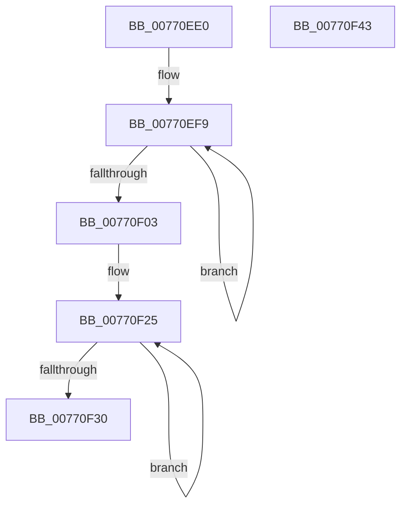

# PopDirectedDripsDiagCreateBlockerEntryBoolean

- RVA: `0x00770EE0`–`0x00770F44` (길이 `100` bytes)
- VA: `0x0000000140770EE0`
- 실행 섹션: `PAGE`
- PDB 이름 있음: `예`; PDB Function 태그: `아니요`
- unwind 정보 RVA: `0x00060BC4`
- 디코드: `27`개 명령, `100/100` bytes 표시
- 미해석 바이트: `0` (있으면 어셈블리에 `.byte`로 보존)

> 이 문서는 커널 이미지의 기계어와 PDB 기호를 분석해 생성했습니다. 4번과 5번은 함수 원형과 자료형을 바이너리 사용 방식에서 추정한 C 해석이며 원본 소스 복구 결과는 아닙니다.

## 1. Dependencies

- 직접 호출 지점: **1**; 고유 호출 대상: **1**
- 직접 호출자로 확인된 함수: **1**
- RIP 상대 이미지 참조: **2**

### Outgoing calls
- `0x00770F20` → [RtlStringCbPrintfW](../../text/40/RtlStringCbPrintfW_function_0040FB40.md) (function, `0x0040FB40`)

### Direct callers
- [PopDirectedDripsDiagRundownDevices](../A8/PopDirectedDripsDiagRundownDevices_function_00A80E08.md) at `0x00A80F62`
- [PopDirectedDripsDiagRundownDevices](../A8/PopDirectedDripsDiagRundownDevices_function_00A80E08.md) at `0x00A80F96`

### Static image references
- `0x00770F07` → RVA `0x00B03E50` (` ?? ::NNGAKEGL::`string'`; read)
- `0x00770F10` → RVA `0x00B03E60` (` ?? ::NNGAKEGL::`string'`; read)

## 2. Other-region calls and transfers

- 다른 실행 섹션으로 향하는 call: **1**
  - `0x00770F20` → [RtlStringCbPrintfW](../../text/40/RtlStringCbPrintfW_function_0040FB40.md) (`PAGE` → `.text`)
- 별도 외부 분기/꼬리 이동을 확인하지 못했습니다.

## 3. Assembly (complete function range)

```asm
00770EE0  48 89 5C 24 08                  mov qword ptr [rsp + 8], rbx
00770EE5  48 89 74 24 10                  mov qword ptr [rsp + 0x10], rsi
00770EEA  57                              push rdi
00770EEB  48 83 EC 20                     sub rsp, 0x20
00770EEF  48 83 CB FF                     or rbx, 0xffffffffffffffff
00770EF3  48 8B F9                        mov rdi, rcx
00770EF6  48 8B C3                        mov rax, rbx
00770EF9  48 FF C0                        inc rax
00770EFC  66 83 3C 42 00                  cmp word ptr [rdx + rax*2], 0
00770F01  75 F6                           jne 0x140770ef9
00770F03  48 89 51 08                     mov qword ptr [rcx + 8], rdx
00770F07  4C 8D 0D 42 2F 39 00            lea r9, [rip + 0x392f42]
00770F0E  89 01                           mov dword ptr [rcx], eax
00770F10  4C 8D 05 49 2F 39 00            lea r8, [rip + 0x392f49]
00770F17  BA 10 00 00 00                  mov edx, 0x10
00770F1C  48 83 C1 14                     add rcx, 0x14
00770F20  E8 1B EC C9 FF                  call 0x14040fb40
00770F25  48 FF C3                        inc rbx
00770F28  66 83 7C 5F 14 00               cmp word ptr [rdi + rbx*2 + 0x14], 0
00770F2E  75 F5                           jne 0x140770f25
00770F30  48 8B 74 24 38                  mov rsi, qword ptr [rsp + 0x38]
00770F35  89 5F 10                        mov dword ptr [rdi + 0x10], ebx
00770F38  48 8B 5C 24 30                  mov rbx, qword ptr [rsp + 0x30]
00770F3D  48 83 C4 20                     add rsp, 0x20
00770F41  5F                              pop rdi
00770F42  C3                              ret
00770F43  CC                              int3
```

## 4. C-style interpretation (structured pseudocode)

```c
__int64 __fastcall PopDirectedDripsDiagCreateBlockerEntryBoolean(__int64 a1, __int64 a2)
{
    __int64 result;
    __int64 v_rbx;
    __int64 v_rsp;
    unsigned __int64 v_stack_p10;
    unsigned __int64 v_stack_p8;

    v_stack_p8 = v_rbx;
    v_stack_p10 = v_rsi;
    v_rsp = (v_rsp) - (32);
    v_rbx = (v_rbx) | (-1);
loc_00770EF9:
    result = (v_rbx) + 1;
    if ((*(unsigned __int16 *)(a2 + result * 2)) != 0) goto loc_00770EF9;
    *(unsigned __int64 *)(a1 + 8) = a2;
    *(unsigned int *)(a1) = (unsigned int)(result);
    a1 = (a1) + (20);
    result = RtlStringCbPrintfW(a1, 16, v_rip + 3747657, v_rip + 3747650);
loc_00770F25:
    v_rbx = (v_rbx) + 1;
    if ((*(unsigned __int16 *)(a1 + v_rbx * 2 + 20)) != 0) goto loc_00770F25;
    *(unsigned int *)(a1 + 16) = (unsigned int)(v_rbx);
    v_rsp = (v_rsp) + (32);
    return result;
}
```

## 5. (Beta) C Style

```c
int64_t PopDirectedDripsDiagCreateBlockerEntryBoolean(void *Arg1, void *Arg2)
{
    uint8_t *arg1 = (uint8_t *)Arg1;
    uint8_t *arg2 = (uint8_t *)Arg2;

    int64_t result;
    int64_t local_rbx;
    int64_t local_rsp;
    uint64_t v_stack_p10;
    uint64_t v_stack_p8;

    v_stack_p8 = local_rbx;
    v_stack_p10 = local_rsi;
    local_rsp = (local_rsp) - (32);
    local_rbx = (local_rbx) | (-1);
loc_00770EF9:
    result = (local_rbx) + 1;
    if ((*(uint16_t *)(arg2 + result * 2)) != 0) goto loc_00770EF9;
    *(void **)(arg1 + 0x8) = Arg2;
    *(uint32_t *)(arg1) = (uint32_t)(result);
    Arg1 = (Arg1) + (20);
    result = RtlStringCbPrintfW(Arg1, 16, v_rip + 3747657, v_rip + 3747650);
loc_00770F25:
    local_rbx = (local_rbx) + 1;
    if ((*(uint16_t *)(arg1 + local_rbx * 2 + 0x14)) != 0) goto loc_00770F25;
    *(uint32_t *)(arg1 + 0x10) = (uint32_t)(local_rbx);
    local_rsp = (local_rsp) + (32);
    return result;
}
```

### 관측된 메모리 오프셋

구조체 형식이 확인되지 않은 접근은 인자 기준의 오프셋으로만 기록했습니다.

| 기준 인자 | 오프셋 표현 | 폭 (bit) | 접근 |
|---|---:|---:|---|
| `Arg1` | `+ 0x0` | `32` | `W` |
| `Arg1` | `+ 0x8` | `64` | `W` |
| `Arg1` | `+ 0x10` | `32` | `W` |
| `Arg1` | `+ 0x14 + rbx*2` | `16` | `R` |
| `Arg2` | `+ 0x0 + rax*2` | `16` | `R` |

## 6. Execution-region graph

[열기: 2D/3D 그래프와 함수 탐색 컨트롤 패널](../../../control-panel.html?section=page&rva=0x00770EE0&view=graph)

- 2D 그래프는 위에서 아래로 흐르고, 3D 그래프는 빈 공간을 드래그해 회전합니다. Shift+드래그는 이동, 휠은 확대·축소, 함수 노드 선택은 대상 보고서 이동입니다.

### Static fallback


