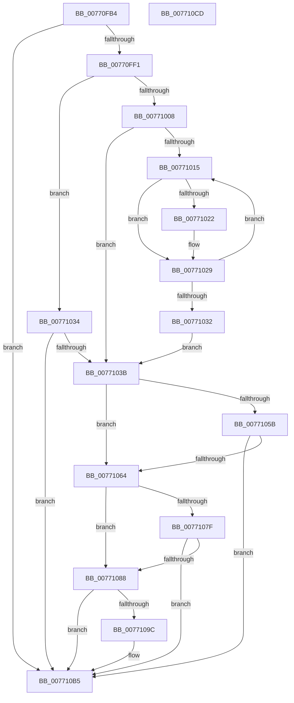

# PopDirectedDripsDiagCreateDeviceDescription

- RVA: `0x00770FB4`–`0x007710CE` (길이 `282` bytes)
- VA: `0x0000000140770FB4`
- 실행 섹션: `PAGE`
- PDB 이름 있음: `예`; PDB Function 태그: `아니요`
- unwind 정보 RVA: `0x0005C954`
- 디코드: `81`개 명령, `282/282` bytes 표시
- 미해석 바이트: `0` (있으면 어셈블리에 `.byte`로 보존)

> 이 문서는 커널 이미지의 기계어와 PDB 기호를 분석해 생성했습니다. 4번과 5번은 함수 원형과 자료형을 바이너리 사용 방식에서 추정한 C 해석이며 원본 소스 복구 결과는 아닙니다.

## 1. Dependencies

- 직접 호출 지점: **6**; 고유 호출 대상: **3**
- 직접 호출자로 확인된 함수: **1**
- RIP 상대 이미지 참조: **0**

### Outgoing calls
- `0x00770FDF` → [PopGenerateDeviceFriendlyName](../A9/PopGenerateDeviceFriendlyName_function_00A98968.md) (function, `0x00A98968`)
- `0x00770FFC` → [PopDiagQueryDevicePropertyString](../AA/PopDiagQueryDevicePropertyString_function_00AA2014.md) (function, `0x00AA2014`)
- `0x00771048` → [PopDiagQueryDevicePropertyString](../AA/PopDiagQueryDevicePropertyString_function_00AA2014.md) (function, `0x00AA2014`)
- `0x00771071` → [PopDiagQueryDevicePropertyString](../AA/PopDiagQueryDevicePropertyString_function_00AA2014.md) (function, `0x00AA2014`)
- `0x00771090` → [PopCloneUnicodeString](../AA/PopCloneUnicodeString_function_00AA3E20.md) (function, `0x00AA3E20`)
- `0x007710A7` → [PopCloneUnicodeString](../AA/PopCloneUnicodeString_function_00AA3E20.md) (function, `0x00AA3E20`)

### Direct callers
- [PopDirectedDripsDiagCreateDeviceDiagnostic](PopDirectedDripsDiagCreateDeviceDiagnostic_function_007710D4.md) at `0x0077111C`

### Static image references
- 디코드된 RIP-relative 메모리 참조가 없습니다.

## 2. Other-region calls and transfers

- 다른 실행 섹션으로 향하는 call: **0**
- 별도 외부 분기/꼬리 이동을 확인하지 못했습니다.

## 3. Assembly (complete function range)

```asm
00770FB4  48 89 5C 24 08                  mov qword ptr [rsp + 8], rbx
00770FB9  48 89 6C 24 10                  mov qword ptr [rsp + 0x10], rbp
00770FBE  48 89 74 24 18                  mov qword ptr [rsp + 0x18], rsi
00770FC3  57                              push rdi
00770FC4  48 83 EC 20                     sub rsp, 0x20
00770FC8  48 8B 41 20                     mov rax, qword ptr [rcx + 0x20]
00770FCC  4C 8D 42 30                     lea r8, [rdx + 0x30]
00770FD0  48 89 42 20                     mov qword ptr [rdx + 0x20], rax
00770FD4  48 8B DA                        mov rbx, rdx
00770FD7  BA 01 00 00 00                  mov edx, 1
00770FDC  48 8B F9                        mov rdi, rcx
00770FDF  E8 84 79 32 00                  call 0x140a98968
00770FE4  33 ED                           xor ebp, ebp
00770FE6  44 8B C0                        mov r8d, eax
00770FE9  85 C0                           test eax, eax
00770FEB  0F 88 C4 00 00 00               js 0x1407710b5
00770FF1  48 8B 4F 20                     mov rcx, qword ptr [rdi + 0x20]
00770FF5  4C 8D 43 40                     lea r8, [rbx + 0x40]
00770FF9  8D 55 01                        lea edx, [rbp + 1]
00770FFC  E8 13 10 33 00                  call 0x140aa2014
00771001  44 8B C0                        mov r8d, eax
00771004  85 C0                           test eax, eax
00771006  78 2C                           js 0x140771034
00771008  0F B7 4B 40                     movzx ecx, word ptr [rbx + 0x40]
0077100C  8B D5                           mov edx, ebp
0077100E  D1 E9                           shr ecx, 1
00771010  83 F9 02                        cmp ecx, 2
00771013  76 26                           jbe 0x14077103b
00771015  4C 8B 43 48                     mov r8, qword ptr [rbx + 0x48]
00771019  8B C2                           mov eax, edx
0077101B  66 41 39 2C 40                  cmp word ptr [r8 + rax*2], bp
00771020  75 07                           jne 0x140771029
00771022  66 41 C7 04 40 2C 00            mov word ptr [r8 + rax*2], 0x2c
00771029  FF C2                           inc edx
0077102B  8D 42 02                        lea eax, [rdx + 2]
0077102E  3B C1                           cmp eax, ecx
00771030  72 E3                           jb 0x140771015
00771032  EB 07                           jmp 0x14077103b
00771034  3D 34 00 00 C0                  cmp eax, 0xc0000034
00771039  75 7A                           jne 0x1407710b5
0077103B  48 8B 4F 20                     mov rcx, qword ptr [rdi + 0x20]
0077103F  4C 8D 43 50                     lea r8, [rbx + 0x50]
00771043  BA 05 00 00 00                  mov edx, 5
00771048  E8 C7 0F 33 00                  call 0x140aa2014
0077104D  BE 00 00 00 80                  mov esi, 0x80000000
00771052  44 8B C0                        mov r8d, eax
00771055  03 C6                           add eax, esi
00771057  85 C6                           test esi, eax
00771059  75 09                           jne 0x140771064
0077105B  41 81 F8 34 00 00 C0            cmp r8d, 0xc0000034
00771062  75 51                           jne 0x1407710b5
00771064  48 8B 4F 20                     mov rcx, qword ptr [rdi + 0x20]
00771068  4C 8D 43 60                     lea r8, [rbx + 0x60]
0077106C  BA 06 00 00 00                  mov edx, 6
00771071  E8 9E 0F 33 00                  call 0x140aa2014
00771076  44 8B C0                        mov r8d, eax
00771079  03 C6                           add eax, esi
0077107B  85 C6                           test esi, eax
0077107D  75 09                           jne 0x140771088
0077107F  41 81 F8 34 00 00 C0            cmp r8d, 0xc0000034
00771086  75 2D                           jne 0x1407710b5
00771088  48 8D 53 70                     lea rdx, [rbx + 0x70]
0077108C  48 8D 4F 28                     lea rcx, [rdi + 0x28]
00771090  E8 8B 2D 33 00                  call 0x140aa3e20
00771095  44 8B C0                        mov r8d, eax
00771098  85 C0                           test eax, eax
0077109A  78 19                           js 0x1407710b5
0077109C  48 8D 93 80 00 00 00            lea rdx, [rbx + 0x80]
007710A3  48 8D 4F 38                     lea rcx, [rdi + 0x38]
007710A7  E8 74 2D 33 00                  call 0x140aa3e20
007710AC  85 C0                           test eax, eax
007710AE  44 8B C0                        mov r8d, eax
007710B1  44 0F 49 C5                     cmovns r8d, ebp
007710B5  48 8B 5C 24 30                  mov rbx, qword ptr [rsp + 0x30]
007710BA  41 8B C0                        mov eax, r8d
007710BD  48 8B 6C 24 38                  mov rbp, qword ptr [rsp + 0x38]
007710C2  48 8B 74 24 40                  mov rsi, qword ptr [rsp + 0x40]
007710C7  48 83 C4 20                     add rsp, 0x20
007710CB  5F                              pop rdi
007710CC  C3                              ret
007710CD  CC                              int3
```

## 4. C-style interpretation (structured pseudocode)

```c
__int64 __fastcall PopDirectedDripsDiagCreateDeviceDescription(__int64 a1, __int64 a2)
{
    __int64 result;
    __int64 v_rbp;
    __int64 v_rsp;
    unsigned __int64 v_stack_p10;
    unsigned __int64 v_stack_p18;
    unsigned __int64 v_stack_p8;

    v_stack_p8 = v_rbx;
    v_stack_p10 = v_rbp;
    v_stack_p18 = v_rsi;
    v_rsp = (v_rsp) - (32);
    *(unsigned __int64 *)(a2 + 32) = *(unsigned __int64 *)(a1 + 32);
    result = PopGenerateDeviceFriendlyName(a1, 1, a2 + 48, a4);
    v_rbp = 0;
    if (sign_flag) goto loc_007710B5;
    result = PopDiagQueryDevicePropertyString(*(unsigned __int64 *)(a1 + 32), v_rbp + 1, a2 + 64, a4);
    if (sign_flag) goto loc_00771034;
    a1 = (unsigned int)((*(unsigned __int16 *)(a2 + 64)) >> (1));
    if (((unsigned int)(a1)) <= 2) goto loc_0077103B;
loc_00771015:
    if ((*(unsigned __int16 *)(*(unsigned __int64 *)(a2 + 72) + 0 * 2)) == 0) {
        *(unsigned __int16 *)(*(unsigned __int64 *)(a2 + 72) + 0 * 2) = 44;
    }
    a2 = (unsigned int)((0) + 1);
    if (((unsigned int)(a2 + 2)) < ((unsigned int)(a1))) goto loc_00771015;
    goto loc_0077103B;
loc_00771034:
    if (((unsigned int)(a2 + 2)) != 0xC0000034ULL) goto loc_007710B5;
loc_0077103B:
    result = PopDiagQueryDevicePropertyString(*(unsigned __int64 *)(a1 + 32), 5, a2 + 80, a4);
    result = (unsigned int)((result) + ((unsigned int)((unsigned int)(0x80000000ULL))));
    if ((((unsigned int)((unsigned int)(0x80000000ULL))) & ((unsigned int)(result))) != 0) goto loc_00771064;
    if (((unsigned int)((unsigned int)((unsigned int)(result)))) != 0xC0000034ULL) goto loc_007710B5;
loc_00771064:
    result = PopDiagQueryDevicePropertyString(*(unsigned __int64 *)(a1 + 32), 6, a2 + 96, a4);
    result = (unsigned int)((result) + ((unsigned int)((unsigned int)(0x80000000ULL))));
    if ((((unsigned int)((unsigned int)(0x80000000ULL))) & ((unsigned int)(result))) != 0) goto loc_00771088;
    if (((unsigned int)((unsigned int)((unsigned int)(result)))) != 0xC0000034ULL) goto loc_007710B5;
loc_00771088:
    result = PopCloneUnicodeString(a1 + 40, a2 + 112, (unsigned int)((unsigned int)(result)), a4);
    if (!(sign_flag)) {
        a2 = a2 + 128;
        a1 = a1 + 56;
        result = PopCloneUnicodeString(a1, a2, (unsigned int)((unsigned int)(result)), a4);
        a3 = (unsigned int)(result);
        if (!sign_flag) { a3 = 0; }
    }
    v_rsp = (v_rsp) + (32);
    return (unsigned int)((unsigned int)(a3));
}
```

## 5. (Beta) C Style

```c
int64_t PopDirectedDripsDiagCreateDeviceDescription(void *Arg1, void *Arg2)
{
    uint8_t *arg1 = (uint8_t *)Arg1;
    uint8_t *arg2 = (uint8_t *)Arg2;

    int64_t result;
    int64_t local_rbp;
    int64_t local_rsp;
    uint64_t v_stack_p10;
    uint64_t v_stack_p18;
    uint64_t v_stack_p8;

    v_stack_p8 = local_rbx;
    v_stack_p10 = local_rbp;
    v_stack_p18 = local_rsi;
    local_rsp = (local_rsp) - (32);
    *(uint64_t *)(arg2 + 0x20) = *(uint64_t *)(arg1 + 0x20);
    result = PopGenerateDeviceFriendlyName(Arg1, 1, Arg2 + 48, a4);
    local_rbp = 0;
    if (sign_flag) goto loc_007710B5;
    result = PopDiagQueryDevicePropertyString(*(uint64_t *)(arg1 + 0x20), local_rbp + 1, Arg2 + 64, a4);
    if (sign_flag) goto loc_00771034;
    Arg1 = (uint32_t)((*(uint16_t *)(arg2 + 0x40)) >> (1));
    if (((uint32_t)(Arg1)) <= 2) goto loc_0077103B;
loc_00771015:
    if ((*(uint16_t *)(*(uint64_t *)(arg2 + 0x48) + 0x0 * 2)) == 0) {
        *(uint16_t *)(*(uint64_t *)(arg2 + 0x48) + 0x0 * 2) = 44;
    }
    Arg2 = (uint32_t)((0) + 1);
    if (((uint32_t)(Arg2 + 2)) < ((uint32_t)(Arg1))) goto loc_00771015;
    goto loc_0077103B;
loc_00771034:
    if (((uint32_t)(Arg2 + 2)) != 0xC0000034ULL) goto loc_007710B5;
loc_0077103B:
    result = PopDiagQueryDevicePropertyString(*(uint64_t *)(arg1 + 0x20), 5, Arg2 + 80, a4);
    result = (uint32_t)((result) + ((uint32_t)((uint32_t)(0x80000000ULL))));
    if ((((uint32_t)((uint32_t)(0x80000000ULL))) & ((uint32_t)(result))) != 0) goto loc_00771064;
    if (((uint32_t)((uint32_t)((uint32_t)(result)))) != 0xC0000034ULL) goto loc_007710B5;
loc_00771064:
    result = PopDiagQueryDevicePropertyString(*(uint64_t *)(arg1 + 0x20), 6, Arg2 + 96, a4);
    result = (uint32_t)((result) + ((uint32_t)((uint32_t)(0x80000000ULL))));
    if ((((uint32_t)((uint32_t)(0x80000000ULL))) & ((uint32_t)(result))) != 0) goto loc_00771088;
    if (((uint32_t)((uint32_t)((uint32_t)(result)))) != 0xC0000034ULL) goto loc_007710B5;
loc_00771088:
    result = PopCloneUnicodeString(Arg1 + 40, Arg2 + 112, (uint32_t)((uint32_t)(result)), a4);
    if (!(sign_flag)) {
        Arg2 = Arg2 + 128;
        Arg1 = Arg1 + 56;
        result = PopCloneUnicodeString(Arg1, Arg2, (uint32_t)((uint32_t)(result)), a4);
        a3 = (uint32_t)(result);
        if (!sign_flag) { a3 = 0; }
    }
    local_rsp = (local_rsp) + (32);
    return (uint32_t)((uint32_t)(a3));
}
```

### 관측된 메모리 오프셋

구조체 형식이 확인되지 않은 접근은 인자 기준의 오프셋으로만 기록했습니다.

| 기준 인자 | 오프셋 표현 | 폭 (bit) | 접근 |
|---|---:|---:|---|
| `Arg1` | `+ 0x20` | `64` | `R` |
| `Arg1` | `+ 0x28` | `64` | `R` |
| `Arg1` | `+ 0x38` | `64` | `R` |
| `Arg2` | `+ 0x20` | `64` | `W` |
| `Arg2` | `+ 0x30` | `64` | `R` |
| `Arg2` | `+ 0x40` | `16` | `R` |
| `Arg2` | `+ 0x40` | `64` | `R` |
| `Arg2` | `+ 0x48` | `64` | `R` |
| `Arg2` | `+ 0x50` | `64` | `R` |
| `Arg2` | `+ 0x60` | `64` | `R` |
| `Arg2` | `+ 0x70` | `64` | `R` |
| `Arg2` | `+ 0x80` | `64` | `R` |

## 6. Execution-region graph

[열기: 2D/3D 그래프와 함수 탐색 컨트롤 패널](../../../control-panel.html?section=page&rva=0x00770FB4&view=graph)

- 2D 그래프는 위에서 아래로 흐르고, 3D 그래프는 빈 공간을 드래그해 회전합니다. Shift+드래그는 이동, 휠은 확대·축소, 함수 노드 선택은 대상 보고서 이동입니다.

### Static fallback


