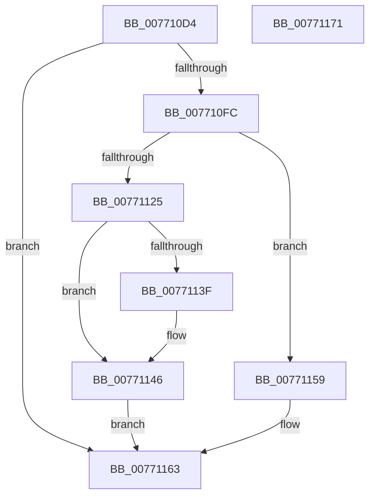

# PopDirectedDripsDiagCreateDeviceDiagnostic

- RVA: `0x007710D4`–`0x00771172` (길이 `158` bytes)
- VA: `0x00000001407710D4`
- 실행 섹션: `PAGE`
- PDB 이름 있음: `예`; PDB Function 태그: `아니요`
- unwind 정보 RVA: `0x0005CAAC`
- 디코드: `42`개 명령, `158/158` bytes 표시
- 미해석 바이트: `0` (있으면 어셈블리에 `.byte`로 보존)

> 이 문서는 커널 이미지의 기계어와 PDB 기호를 분석해 생성했습니다. 4번과 5번은 함수 원형과 자료형을 바이너리 사용 방식에서 추정한 C 해석이며 원본 소스 복구 결과는 아닙니다.

## 1. Dependencies

- 직접 호출 지점: **3**; 고유 호출 대상: **3**
- 직접 호출자로 확인된 함수: **1**
- RIP 상대 이미지 참조: **5**

### Outgoing calls
- `0x007710EF` → [ExAllocatePool2](../../poolcode/B8/ExAllocatePool2_function_00B820F0.md) (function, `0x00B820F0`)
- `0x0077111C` → [PopDirectedDripsDiagCreateDeviceDescription](PopDirectedDripsDiagCreateDeviceDescription_function_00770FB4.md) (function, `0x00770FB4`)
- `0x0077115C` → [PopDirectedDripsDiagFreeDeviceDiagnostic](PopDirectedDripsDiagFreeDeviceDiagnostic_function_007711FC.md) (function, `0x007711FC`)

### Direct callers
- [PopDirectedDripsDiagGetOrCreateDeviceDiagnostic](../70/PopDirectedDripsDiagGetOrCreateDeviceDiagnostic_function_00705170.md) at `0x00705180`

### Static image references
- `0x00771103` → RVA `0x00F07640` (`.data`; read)
- `0x0077110F` → RVA `0x00F07640` (`.data`; read/write)
- `0x0077112C` → RVA `0x00F07430` (`.data`; read)
- `0x00771133` → RVA `0x00F07438` (`.data`; read)
- `0x00771150` → RVA `0x00F07438` (`.data`; write)

## 2. Other-region calls and transfers

- 다른 실행 섹션으로 향하는 call: **1**
  - `0x007710EF` → [ExAllocatePool2](../../poolcode/B8/ExAllocatePool2_function_00B820F0.md) (`PAGE` → `POOLCODE`)
- 별도 외부 분기/꼬리 이동을 확인하지 못했습니다.

## 3. Assembly (complete function range)

```asm
007710D4  48 89 5C 24 08                  mov qword ptr [rsp + 8], rbx
007710D9  57                              push rdi
007710DA  48 83 EC 20                     sub rsp, 0x20
007710DE  BA A8 00 00 00                  mov edx, 0xa8
007710E3  48 8B F9                        mov rdi, rcx
007710E6  41 B8 50 64 69 67               mov r8d, 0x67696450
007710EC  8D 4A 58                        lea ecx, [rdx + 0x58]
007710EF  E8 FC 0F 41 00                  call 0x140b820f0
007710F4  48 8B D8                        mov rbx, rax
007710F7  48 85 C0                        test rax, rax
007710FA  74 67                           je 0x140771163
007710FC  48 89 78 10                     mov qword ptr [rax + 0x10], rdi
00771100  48 8B CF                        mov rcx, rdi
00771103  8B 15 37 65 79 00               mov edx, dword ptr [rip + 0x796537]
00771109  89 50 18                        mov dword ptr [rax + 0x18], edx
0077110C  48 8B D0                        mov rdx, rax
0077110F  FF 05 2B 65 79 00               inc dword ptr [rip + 0x79652b]
00771115  83 88 94 00 00 00 FF            or dword ptr [rax + 0x94], 0xffffffff
0077111C  E8 93 FE FF FF                  call 0x140770fb4
00771121  85 C0                           test eax, eax
00771123  78 34                           js 0x140771159
00771125  48 89 9F 08 03 00 00            mov qword ptr [rdi + 0x308], rbx
0077112C  48 8D 0D FD 62 79 00            lea rcx, [rip + 0x7962fd]
00771133  48 8B 05 FE 62 79 00            mov rax, qword ptr [rip + 0x7962fe]
0077113A  48 39 08                        cmp qword ptr [rax], rcx
0077113D  74 07                           je 0x140771146
0077113F  B9 03 00 00 00                  mov ecx, 3
00771144  CD 29                           int 0x29
00771146  48 89 0B                        mov qword ptr [rbx], rcx
00771149  48 89 43 08                     mov qword ptr [rbx + 8], rax
0077114D  48 89 18                        mov qword ptr [rax], rbx
00771150  48 89 1D E1 62 79 00            mov qword ptr [rip + 0x7962e1], rbx
00771157  EB 0A                           jmp 0x140771163
00771159  48 8B CB                        mov rcx, rbx
0077115C  E8 9B 00 00 00                  call 0x1407711fc
00771161  33 DB                           xor ebx, ebx
00771163  48 8B C3                        mov rax, rbx
00771166  48 8B 5C 24 30                  mov rbx, qword ptr [rsp + 0x30]
0077116B  48 83 C4 20                     add rsp, 0x20
0077116F  5F                              pop rdi
00771170  C3                              ret
00771171  CC                              int3
```

## 4. C-style interpretation (structured pseudocode)

```c
__int64 __fastcall PopDirectedDripsDiagCreateDeviceDiagnostic(__int64 a1)
{
    __int64 result;
    __int64 v_rbx;
    __int64 v_rsp;
    unsigned __int64 v_stack_p8;

    v_stack_p8 = v_rbx;
    v_rsp = (v_rsp) - (32);
    result = ExAllocatePool2(168 + 88, 168, (unsigned int)(0x67696450ULL), a4);
    if (result == 0) goto loc_00771163;
    *(unsigned __int64 *)(result + 16) = a1;
    *(unsigned int *)(result + 24) = (unsigned int)((unsigned int)(*(unsigned int *)(v_rip + 7955767)));
    result = PopDirectedDripsDiagCreateDeviceDescription(a1, result, (unsigned int)(0x67696450ULL), a4);
    if (sign_flag) goto loc_00771159;
    *(unsigned __int64 *)(a1 + 776) = result;
    if ((*(unsigned __int64 *)(*(unsigned __int64 *)(v_rip + 7955198))) != (v_rip + 7955197)) {
        a1 = 3;
    }
    *(unsigned __int64 *)(result) = a1;
    *(unsigned __int64 *)(result + 8) = *(unsigned __int64 *)(v_rip + 7955198);
    *(unsigned __int64 *)(*(unsigned __int64 *)(v_rip + 7955198)) = result;
    *(unsigned __int64 *)(v_rip + 7955169) = result;
    goto loc_00771163;
loc_00771159:
    result = PopDirectedDripsDiagFreeDeviceDiagnostic(result, result, (unsigned int)(0x67696450ULL), a4);
    v_rbx = 0;
loc_00771163:
    v_rsp = (v_rsp) + (32);
    return 0;
}
```

## 5. (Beta) C Style

```c
int64_t PopDirectedDripsDiagCreateDeviceDiagnostic(void *Arg1)
{
    uint8_t *arg1 = (uint8_t *)Arg1;

    int64_t result;
    int64_t local_rbx;
    int64_t local_rsp;
    uint64_t v_stack_p8;

    v_stack_p8 = local_rbx;
    local_rsp = (local_rsp) - (32);
    result = ExAllocatePool2(168 + 88, 168, (uint32_t)(0x67696450ULL), a4);
    if (result == 0) goto loc_00771163;
    *(void **)(result + 0x10) = Arg1;
    *(uint32_t *)(result + 0x18) = (uint32_t)((uint32_t)(*(uint32_t *)(v_rip + 0x796537)));
    result = PopDirectedDripsDiagCreateDeviceDescription(Arg1, result, (uint32_t)(0x67696450ULL), a4);
    if (sign_flag) goto loc_00771159;
    *(uint64_t *)(arg1 + 0x308) = result;
    if ((*(uint64_t *)(*(uint64_t *)(v_rip + 0x7962FE))) != (v_rip + 7955197)) {
        Arg1 = 3;
    }
    *(void **)(result) = Arg1;
    *(uint64_t *)(result + 0x8) = *(uint64_t *)(v_rip + 0x7962FE);
    *(uint64_t *)(*(uint64_t *)(v_rip + 0x7962FE)) = result;
    *(uint64_t *)(v_rip + 0x7962E1) = result;
    goto loc_00771163;
loc_00771159:
    result = PopDirectedDripsDiagFreeDeviceDiagnostic(result, result, (uint32_t)(0x67696450ULL), a4);
    local_rbx = 0;
loc_00771163:
    local_rsp = (local_rsp) + (32);
    return 0;
}
```

### 관측된 메모리 오프셋

구조체 형식이 확인되지 않은 접근은 인자 기준의 오프셋으로만 기록했습니다.

| 기준 인자 | 오프셋 표현 | 폭 (bit) | 접근 |
|---|---:|---:|---|
| `Arg1` | `+ 0x308` | `64` | `W` |

## 6. Execution-region graph

[열기: 2D/3D 그래프와 함수 탐색 컨트롤 패널](../../../control-panel.html?section=page&rva=0x007710D4&view=graph)

- 2D 그래프는 위에서 아래로 흐르고, 3D 그래프는 빈 공간을 드래그해 회전합니다. Shift+드래그는 이동, 휠은 확대·축소, 함수 노드 선택은 대상 보고서 이동입니다.

### Static fallback


