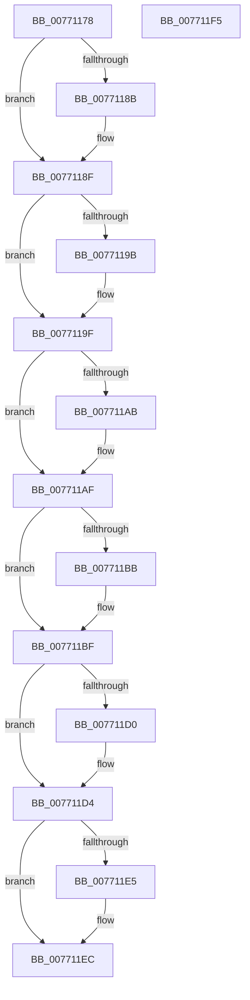

# PopDirectedDripsDiagExtractDeviceDescription

- RVA: `0x00771178`–`0x007711F6` (길이 `126` bytes)
- VA: `0x0000000140771178`
- 실행 섹션: `PAGE`
- PDB 이름 있음: `예`; PDB Function 태그: `아니요`
- unwind 정보 RVA: `0x000DB714`
- 디코드: `36`개 명령, `126/126` bytes 표시
- 미해석 바이트: `0` (있으면 어셈블리에 `.byte`로 보존)

> 이 문서는 커널 이미지의 기계어와 PDB 기호를 분석해 생성했습니다. 4번과 5번은 함수 원형과 자료형을 바이너리 사용 방식에서 추정한 C 해석이며 원본 소스 복구 결과는 아닙니다.

## 1. Dependencies

- 직접 호출 지점: **0**; 고유 호출 대상: **0**
- 직접 호출자로 확인된 함수: **1**
- RIP 상대 이미지 참조: **1**

### Outgoing calls
- 직접 디코드된 call 명령이 없습니다.

### Direct callers
- [PopDirectedDripsDiagRundownDevices](../A8/PopDirectedDripsDiagRundownDevices_function_00A80E08.md) at `0x00A80FE0`

### Static image references
- `0x0077117B` → RVA `0x00F07400` (`.data`; read)

## 2. Other-region calls and transfers

- 다른 실행 섹션으로 향하는 call: **0**
- 별도 외부 분기/꼬리 이동을 확인하지 못했습니다.

## 3. Assembly (complete function range)

```asm
00771178  45 33 DB                        xor r11d, r11d
0077117B  4C 8D 15 7E 62 79 00            lea r10, [rip + 0x79627e]
00771182  49 8B C2                        mov rax, r10
00771185  4C 39 59 38                     cmp qword ptr [rcx + 0x38], r11
00771189  74 04                           je 0x14077118f
0077118B  48 8D 41 30                     lea rax, [rcx + 0x30]
0077118F  48 89 02                        mov qword ptr [rdx], rax
00771192  49 8B C2                        mov rax, r10
00771195  4C 39 59 48                     cmp qword ptr [rcx + 0x48], r11
00771199  74 04                           je 0x14077119f
0077119B  48 8D 41 40                     lea rax, [rcx + 0x40]
0077119F  49 89 00                        mov qword ptr [r8], rax
007711A2  49 8B C2                        mov rax, r10
007711A5  4C 39 59 58                     cmp qword ptr [rcx + 0x58], r11
007711A9  74 04                           je 0x1407711af
007711AB  48 8D 41 50                     lea rax, [rcx + 0x50]
007711AF  49 89 01                        mov qword ptr [r9], rax
007711B2  49 8B D2                        mov rdx, r10
007711B5  4C 39 59 68                     cmp qword ptr [rcx + 0x68], r11
007711B9  74 04                           je 0x1407711bf
007711BB  48 8D 51 60                     lea rdx, [rcx + 0x60]
007711BF  48 8B 44 24 28                  mov rax, qword ptr [rsp + 0x28]
007711C4  48 89 10                        mov qword ptr [rax], rdx
007711C7  49 8B D2                        mov rdx, r10
007711CA  4C 39 59 78                     cmp qword ptr [rcx + 0x78], r11
007711CE  74 04                           je 0x1407711d4
007711D0  48 8D 51 70                     lea rdx, [rcx + 0x70]
007711D4  48 8B 44 24 30                  mov rax, qword ptr [rsp + 0x30]
007711D9  48 89 10                        mov qword ptr [rax], rdx
007711DC  4C 39 99 88 00 00 00            cmp qword ptr [rcx + 0x88], r11
007711E3  74 07                           je 0x1407711ec
007711E5  4C 8D 91 80 00 00 00            lea r10, [rcx + 0x80]
007711EC  48 8B 44 24 38                  mov rax, qword ptr [rsp + 0x38]
007711F1  4C 89 10                        mov qword ptr [rax], r10
007711F4  C3                              ret
007711F5  CC                              int3
```

## 4. C-style interpretation (structured pseudocode)

```c
__int64 __fastcall PopDirectedDripsDiagExtractDeviceDescription(__int64 a1, __int64 a2, __int64 a3, __int64 a4, __int64 a5, __int64 a6, __int64 a7)
{
    __int64 result;
    __int64 v_r10;
    __int64 v_r11;

    v_r11 = 0;
    result = v_rip + 7955070;
    if ((*(unsigned __int64 *)(a1 + 56)) != 0) {
        result = a1 + 48;
    }
    *(unsigned __int64 *)(a2) = result;
    result = v_rip + 7955070;
    if ((*(unsigned __int64 *)(a1 + 72)) != 0) {
        result = a1 + 64;
    }
    *(unsigned __int64 *)(a3) = result;
    result = v_rip + 7955070;
    if ((*(unsigned __int64 *)(a1 + 88)) != 0) {
        result = a1 + 80;
    }
    *(unsigned __int64 *)(a4) = result;
    if ((*(unsigned __int64 *)(a1 + 104)) != 0) {
        a2 = a1 + 96;
    }
    *(unsigned __int64 *)(a5) = a2;
    if ((*(unsigned __int64 *)(a1 + 120)) != 0) {
        a2 = a1 + 112;
    }
    *(unsigned __int64 *)(a6) = a2;
    v_r10 = v_rip + 7955070;
    if ((*(unsigned __int64 *)(a1 + 136)) != 0) {
        v_r10 = a1 + 128;
    }
    *(unsigned __int64 *)(a7) = v_r10;
    return a7;
}
```

## 5. (Beta) C Style

```c
void *PopDirectedDripsDiagExtractDeviceDescription(void *Arg1, void *Arg2, void *Arg3, void *Arg4, void *Arg5, void *Arg6, void *Arg7)
{
    uint8_t *arg1 = (uint8_t *)Arg1;
    uint8_t *arg2 = (uint8_t *)Arg2;
    uint8_t *arg3 = (uint8_t *)Arg3;
    uint8_t *arg4 = (uint8_t *)Arg4;
    uint8_t *arg5 = (uint8_t *)Arg5;
    uint8_t *arg6 = (uint8_t *)Arg6;
    uint8_t *arg7 = (uint8_t *)Arg7;

    int64_t result;
    int64_t local_r10;
    int64_t local_r11;

    local_r11 = 0;
    result = v_rip + 7955070;
    if ((*(uint64_t *)(arg1 + 0x38)) != 0) {
        result = Arg1 + 48;
    }
    *(uint64_t *)(arg2) = result;
    result = v_rip + 7955070;
    if ((*(uint64_t *)(arg1 + 0x48)) != 0) {
        result = Arg1 + 64;
    }
    *(uint64_t *)(arg3) = result;
    result = v_rip + 7955070;
    if ((*(uint64_t *)(arg1 + 0x58)) != 0) {
        result = Arg1 + 80;
    }
    *(uint64_t *)(arg4) = result;
    if ((*(uint64_t *)(arg1 + 0x68)) != 0) {
        Arg2 = Arg1 + 96;
    }
    *(void **)(arg5) = Arg2;
    if ((*(uint64_t *)(arg1 + 0x78)) != 0) {
        Arg2 = Arg1 + 112;
    }
    *(void **)(arg6) = Arg2;
    local_r10 = v_rip + 7955070;
    if ((*(uint64_t *)(arg1 + 0x88)) != 0) {
        local_r10 = Arg1 + 128;
    }
    *(uint64_t *)(arg7) = local_r10;
    return Arg7;
}
```

### 관측된 메모리 오프셋

구조체 형식이 확인되지 않은 접근은 인자 기준의 오프셋으로만 기록했습니다.

| 기준 인자 | 오프셋 표현 | 폭 (bit) | 접근 |
|---|---:|---:|---|
| `Arg1` | `+ 0x30` | `64` | `R` |
| `Arg1` | `+ 0x38` | `64` | `R` |
| `Arg1` | `+ 0x40` | `64` | `R` |
| `Arg1` | `+ 0x48` | `64` | `R` |
| `Arg1` | `+ 0x50` | `64` | `R` |
| `Arg1` | `+ 0x58` | `64` | `R` |
| `Arg1` | `+ 0x60` | `64` | `R` |
| `Arg1` | `+ 0x68` | `64` | `R` |
| `Arg1` | `+ 0x70` | `64` | `R` |
| `Arg1` | `+ 0x78` | `64` | `R` |
| `Arg1` | `+ 0x80` | `64` | `R` |
| `Arg1` | `+ 0x88` | `64` | `R` |
| `Arg2` | `+ 0x0` | `64` | `W` |
| `Arg3` | `+ 0x0` | `64` | `W` |
| `Arg4` | `+ 0x0` | `64` | `W` |
| `Arg5` | `+ 0x0` | `64` | `W` |
| `Arg6` | `+ 0x0` | `64` | `W` |
| `Arg7` | `+ 0x0` | `64` | `W` |

## 6. Execution-region graph

[열기: 2D/3D 그래프와 함수 탐색 컨트롤 패널](../../../control-panel.html?section=page&rva=0x00771178&view=graph)

- 2D 그래프는 위에서 아래로 흐르고, 3D 그래프는 빈 공간을 드래그해 회전합니다. Shift+드래그는 이동, 휠은 확대·축소, 함수 노드 선택은 대상 보고서 이동입니다.

### Static fallback


