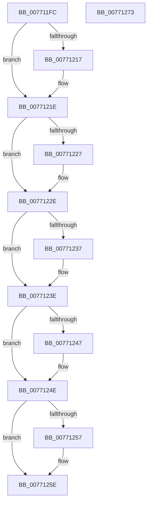

# PopDirectedDripsDiagFreeDeviceDiagnostic

- RVA: `0x007711FC`–`0x00771274` (길이 `120` bytes)
- VA: `0x00000001407711FC`
- 실행 섹션: `PAGE`
- PDB 이름 있음: `예`; PDB Function 태그: `아니요`
- unwind 정보 RVA: `0x0005CAAC`
- 디코드: `38`개 명령, `120/120` bytes 표시
- 미해석 바이트: `0` (있으면 어셈블리에 `.byte`로 보존)

> 이 문서는 커널 이미지의 기계어와 PDB 기호를 분석해 생성했습니다. 4번과 5번은 함수 원형과 자료형을 바이너리 사용 방식에서 추정한 C 해석이며 원본 소스 복구 결과는 아닙니다.

## 1. Dependencies

- 직접 호출 지점: **6**; 고유 호출 대상: **1**
- 직접 호출자로 확인된 함수: **2**
- RIP 상대 이미지 참조: **0**

### Outgoing calls
- `0x00771219` → [ExFreePoolWithTag](../../poolcode/B8/ExFreePoolWithTag_function_00B82870.md) (function, `0x00B82870`)
- `0x00771229` → [ExFreePoolWithTag](../../poolcode/B8/ExFreePoolWithTag_function_00B82870.md) (function, `0x00B82870`)
- `0x00771239` → [ExFreePoolWithTag](../../poolcode/B8/ExFreePoolWithTag_function_00B82870.md) (function, `0x00B82870`)
- `0x00771249` → [ExFreePoolWithTag](../../poolcode/B8/ExFreePoolWithTag_function_00B82870.md) (function, `0x00B82870`)
- `0x00771259` → [ExFreePoolWithTag](../../poolcode/B8/ExFreePoolWithTag_function_00B82870.md) (function, `0x00B82870`)
- `0x00771263` → [ExFreePoolWithTag](../../poolcode/B8/ExFreePoolWithTag_function_00B82870.md) (function, `0x00B82870`)

### Direct callers
- [PopDirectedDripsDiagCreateDeviceDiagnostic](PopDirectedDripsDiagCreateDeviceDiagnostic_function_007710D4.md) at `0x0077115C`
- [PopDirectedDripsDiagRundownDevices](../A8/PopDirectedDripsDiagRundownDevices_function_00A80E08.md) at `0x00A81544`

### Static image references
- 디코드된 RIP-relative 메모리 참조가 없습니다.

## 2. Other-region calls and transfers

- 다른 실행 섹션으로 향하는 call: **6**
  - `0x00771219` → [ExFreePoolWithTag](../../poolcode/B8/ExFreePoolWithTag_function_00B82870.md) (`PAGE` → `POOLCODE`)
  - `0x00771229` → [ExFreePoolWithTag](../../poolcode/B8/ExFreePoolWithTag_function_00B82870.md) (`PAGE` → `POOLCODE`)
  - `0x00771239` → [ExFreePoolWithTag](../../poolcode/B8/ExFreePoolWithTag_function_00B82870.md) (`PAGE` → `POOLCODE`)
  - `0x00771249` → [ExFreePoolWithTag](../../poolcode/B8/ExFreePoolWithTag_function_00B82870.md) (`PAGE` → `POOLCODE`)
  - `0x00771259` → [ExFreePoolWithTag](../../poolcode/B8/ExFreePoolWithTag_function_00B82870.md) (`PAGE` → `POOLCODE`)
  - `0x00771263` → [ExFreePoolWithTag](../../poolcode/B8/ExFreePoolWithTag_function_00B82870.md) (`PAGE` → `POOLCODE`)
- 별도 외부 분기/꼬리 이동을 확인하지 못했습니다.

## 3. Assembly (complete function range)

```asm
007711FC  48 89 5C 24 08                  mov qword ptr [rsp + 8], rbx
00771201  57                              push rdi
00771202  48 83 EC 20                     sub rsp, 0x20
00771206  48 8B D9                        mov rbx, rcx
00771209  BF 50 64 69 67                  mov edi, 0x67696450
0077120E  48 8B 49 38                     mov rcx, qword ptr [rcx + 0x38]
00771212  48 85 C9                        test rcx, rcx
00771215  74 07                           je 0x14077121e
00771217  8B D7                           mov edx, edi
00771219  E8 52 16 41 00                  call 0x140b82870
0077121E  48 8B 4B 48                     mov rcx, qword ptr [rbx + 0x48]
00771222  48 85 C9                        test rcx, rcx
00771225  74 07                           je 0x14077122e
00771227  8B D7                           mov edx, edi
00771229  E8 42 16 41 00                  call 0x140b82870
0077122E  48 8B 4B 58                     mov rcx, qword ptr [rbx + 0x58]
00771232  48 85 C9                        test rcx, rcx
00771235  74 07                           je 0x14077123e
00771237  8B D7                           mov edx, edi
00771239  E8 32 16 41 00                  call 0x140b82870
0077123E  48 8B 4B 68                     mov rcx, qword ptr [rbx + 0x68]
00771242  48 85 C9                        test rcx, rcx
00771245  74 07                           je 0x14077124e
00771247  8B D7                           mov edx, edi
00771249  E8 22 16 41 00                  call 0x140b82870
0077124E  48 8B 4B 78                     mov rcx, qword ptr [rbx + 0x78]
00771252  48 85 C9                        test rcx, rcx
00771255  74 07                           je 0x14077125e
00771257  8B D7                           mov edx, edi
00771259  E8 12 16 41 00                  call 0x140b82870
0077125E  8B D7                           mov edx, edi
00771260  48 8B CB                        mov rcx, rbx
00771263  E8 08 16 41 00                  call 0x140b82870
00771268  48 8B 5C 24 30                  mov rbx, qword ptr [rsp + 0x30]
0077126D  48 83 C4 20                     add rsp, 0x20
00771271  5F                              pop rdi
00771272  C3                              ret
00771273  CC                              int3
```

## 4. C-style interpretation (structured pseudocode)

```c
__int64 __fastcall PopDirectedDripsDiagFreeDeviceDiagnostic(__int64 a1)
{
    __int64 result;
    __int64 v_rsp;
    unsigned __int64 v_stack_p8;

    v_stack_p8 = v_rbx;
    v_rsp = (v_rsp) - (32);
    if (*(unsigned __int64 *)(a1 + 56) != 0) {
        a2 = (unsigned int)((unsigned int)(0x67696450ULL));
        result = ExFreePoolWithTag(*(unsigned __int64 *)(a1 + 56), a2, a3, a4);
    }
    if (*(unsigned __int64 *)(a1 + 72) != 0) {
        a2 = (unsigned int)((unsigned int)(0x67696450ULL));
        result = ExFreePoolWithTag(*(unsigned __int64 *)(a1 + 72), a2, a3, a4);
    }
    if (*(unsigned __int64 *)(a1 + 88) != 0) {
        a2 = (unsigned int)((unsigned int)(0x67696450ULL));
        result = ExFreePoolWithTag(*(unsigned __int64 *)(a1 + 88), a2, a3, a4);
    }
    if (*(unsigned __int64 *)(a1 + 104) != 0) {
        a2 = (unsigned int)((unsigned int)(0x67696450ULL));
        result = ExFreePoolWithTag(*(unsigned __int64 *)(a1 + 104), a2, a3, a4);
    }
    if (*(unsigned __int64 *)(a1 + 120) != 0) {
        a2 = (unsigned int)((unsigned int)(0x67696450ULL));
        result = ExFreePoolWithTag(*(unsigned __int64 *)(a1 + 120), a2, a3, a4);
    }
    result = ExFreePoolWithTag(a1, (unsigned int)((unsigned int)((unsigned int)(0x67696450ULL))), a3, a4);
    v_rsp = (v_rsp) + (32);
    return result;
}
```

## 5. (Beta) C Style

```c
int64_t PopDirectedDripsDiagFreeDeviceDiagnostic(void *Arg1)
{
    uint8_t *arg1 = (uint8_t *)Arg1;

    int64_t result;
    int64_t local_rsp;
    uint64_t v_stack_p8;

    v_stack_p8 = local_rbx;
    local_rsp = (local_rsp) - (32);
    if (*(uint64_t *)(arg1 + 0x38) != 0) {
        a2 = (uint32_t)((uint32_t)(0x67696450ULL));
        result = ExFreePoolWithTag(*(uint64_t *)(arg1 + 0x38), a2, a3, a4);
    }
    if (*(uint64_t *)(arg1 + 0x48) != 0) {
        a2 = (uint32_t)((uint32_t)(0x67696450ULL));
        result = ExFreePoolWithTag(*(uint64_t *)(arg1 + 0x48), a2, a3, a4);
    }
    if (*(uint64_t *)(arg1 + 0x58) != 0) {
        a2 = (uint32_t)((uint32_t)(0x67696450ULL));
        result = ExFreePoolWithTag(*(uint64_t *)(arg1 + 0x58), a2, a3, a4);
    }
    if (*(uint64_t *)(arg1 + 0x68) != 0) {
        a2 = (uint32_t)((uint32_t)(0x67696450ULL));
        result = ExFreePoolWithTag(*(uint64_t *)(arg1 + 0x68), a2, a3, a4);
    }
    if (*(uint64_t *)(arg1 + 0x78) != 0) {
        a2 = (uint32_t)((uint32_t)(0x67696450ULL));
        result = ExFreePoolWithTag(*(uint64_t *)(arg1 + 0x78), a2, a3, a4);
    }
    result = ExFreePoolWithTag(Arg1, (uint32_t)((uint32_t)((uint32_t)(0x67696450ULL))), a3, a4);
    local_rsp = (local_rsp) + (32);
    return result;
}
```

### 관측된 메모리 오프셋

구조체 형식이 확인되지 않은 접근은 인자 기준의 오프셋으로만 기록했습니다.

| 기준 인자 | 오프셋 표현 | 폭 (bit) | 접근 |
|---|---:|---:|---|
| `Arg1` | `+ 0x38` | `64` | `R` |
| `Arg1` | `+ 0x48` | `64` | `R` |
| `Arg1` | `+ 0x58` | `64` | `R` |
| `Arg1` | `+ 0x68` | `64` | `R` |
| `Arg1` | `+ 0x78` | `64` | `R` |

## 6. Execution-region graph

[열기: 2D/3D 그래프와 함수 탐색 컨트롤 패널](../../../control-panel.html?section=page&rva=0x007711FC&view=graph)

- 2D 그래프는 위에서 아래로 흐르고, 3D 그래프는 빈 공간을 드래그해 회전합니다. Shift+드래그는 이동, 휠은 확대·축소, 함수 노드 선택은 대상 보고서 이동입니다.

### Static fallback


