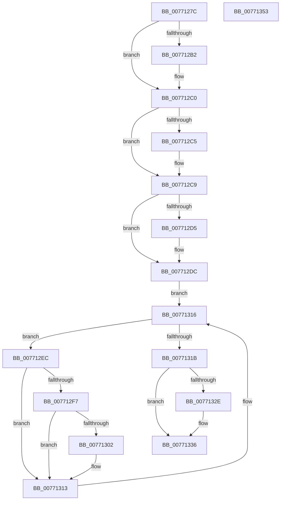

# PopDirectedDripsDiagTraceBroadcastFailureDevice

- RVA: `0x0077127C`–`0x00771354` (길이 `216` bytes)
- VA: `0x000000014077127C`
- 실행 섹션: `PAGE`
- PDB 이름 있음: `예`; PDB Function 태그: `아니요`
- unwind 정보 RVA: `0x0005C954`
- 디코드: `57`개 명령, `216/216` bytes 표시
- 미해석 바이트: `0` (있으면 어셈블리에 `.byte`로 보존)

> 이 문서는 커널 이미지의 기계어와 PDB 기호를 분석해 생성했습니다. 4번과 5번은 함수 원형과 자료형을 바이너리 사용 방식에서 추정한 C 해석이며 원본 소스 복구 결과는 아닙니다.

## 1. Dependencies

- 직접 호출 지점: **5**; 고유 호출 대상: **5**
- 직접 호출자로 확인된 함수: **1**
- RIP 상대 이미지 참조: **4**

### Outgoing calls
- `0x007712A2` → [KeAbPreAcquire](../../text/21/KeAbPreAcquire_function_00210230.md) (function, `0x00210230`)
- `0x007712BB` → [ExfAcquirePushLockExclusiveEx](../../text/20/ExfAcquirePushLockExclusiveEx_function_0020FC90.md) (function, `0x0020FC90`)
- `0x0077130E` → [PopDirectedDripsDiagInsertErrorRecord](../AB/PopDirectedDripsDiagInsertErrorRecord_function_00AB3F48.md) (function, `0x00AB3F48`)
- `0x00771331` → [ExfTryToWakePushLock](../../text/26/ExfTryToWakePushLock_function_00265DD0.md) (function, `0x00265DD0`)
- `0x00771339` → [KeAbPostRelease](../../text/2E/KeAbPostRelease_function_002E1600.md) (function, `0x002E1600`)

### Direct callers
- [PopDirectedDripsNotifyTransitionFailed](../75/PopDirectedDripsNotifyTransitionFailed_function_00757A34.md) at `0x00757A5C`

### Static image references
- `0x00771293` → RVA `0x00F07650` (`.data`; read)
- `0x007712DC` → RVA `0x00F07420` (`.data`; read)
- `0x007712EC` → RVA `0x00F07648` (`.data`; read)
- `0x0077131F` → RVA `0x00F07650` (`.data`; read/write)

## 2. Other-region calls and transfers

- 다른 실행 섹션으로 향하는 call: **4**
  - `0x007712A2` → [KeAbPreAcquire](../../text/21/KeAbPreAcquire_function_00210230.md) (`PAGE` → `.text`)
  - `0x007712BB` → [ExfAcquirePushLockExclusiveEx](../../text/20/ExfAcquirePushLockExclusiveEx_function_0020FC90.md) (`PAGE` → `.text`)
  - `0x00771331` → [ExfTryToWakePushLock](../../text/26/ExfTryToWakePushLock_function_00265DD0.md) (`PAGE` → `.text`)
  - `0x00771339` → [KeAbPostRelease](../../text/2E/KeAbPostRelease_function_002E1600.md) (`PAGE` → `.text`)
- 별도 외부 분기/꼬리 이동을 확인하지 못했습니다.

## 3. Assembly (complete function range)

```asm
0077127C  48 89 5C 24 08                  mov qword ptr [rsp + 8], rbx
00771281  48 89 6C 24 10                  mov qword ptr [rsp + 0x10], rbp
00771286  48 89 74 24 18                  mov qword ptr [rsp + 0x18], rsi
0077128B  57                              push rdi
0077128C  48 83 EC 20                     sub rsp, 0x20
00771290  48 8B F9                        mov rdi, rcx
00771293  48 8D 35 B6 63 79 00            lea rsi, [rip + 0x7963b6]
0077129A  48 8B CE                        mov rcx, rsi
0077129D  45 33 C0                        xor r8d, r8d
007712A0  33 D2                           xor edx, edx
007712A2  E8 89 EF A9 FF                  call 0x140210230
007712A7  F0 48 0F BA 2E 00               lock bts qword ptr [rsi], 0
007712AD  48 8B D8                        mov rbx, rax
007712B0  73 0E                           jae 0x1407712c0
007712B2  4C 8B C6                        mov r8, rsi
007712B5  48 8B D0                        mov rdx, rax
007712B8  48 8B CE                        mov rcx, rsi
007712BB  E8 D0 E9 A9 FF                  call 0x14020fc90
007712C0  48 85 DB                        test rbx, rbx
007712C3  74 04                           je 0x1407712c9
007712C5  C6 43 0A 01                     mov byte ptr [rbx + 0xa], 1
007712C9  48 8B BF 08 03 00 00            mov rdi, qword ptr [rdi + 0x308]
007712D0  48 85 FF                        test rdi, rdi
007712D3  74 07                           je 0x1407712dc
007712D5  83 8F 98 00 00 00 20            or dword ptr [rdi + 0x98], 0x20
007712DC  48 8B 1D 3D 61 79 00            mov rbx, qword ptr [rip + 0x79613d]
007712E3  48 8D 2D 36 61 79 00            lea rbp, [rip + 0x796136]
007712EA  EB 2A                           jmp 0x140771316
007712EC  8B 05 56 63 79 00               mov eax, dword ptr [rip + 0x796356]
007712F2  39 43 24                        cmp dword ptr [rbx + 0x24], eax
007712F5  75 1C                           jne 0x140771313
007712F7  FF 83 D4 00 00 00               inc dword ptr [rbx + 0xd4]
007712FD  48 85 FF                        test rdi, rdi
00771300  74 11                           je 0x140771313
00771302  41 B8 05 00 00 00               mov r8d, 5
00771308  48 8B D7                        mov rdx, rdi
0077130B  48 8B CB                        mov rcx, rbx
0077130E  E8 35 2C 34 00                  call 0x140ab3f48
00771313  48 8B 1B                        mov rbx, qword ptr [rbx]
00771316  48 3B DD                        cmp rbx, rbp
00771319  75 D1                           jne 0x1407712ec
0077131B  48 83 C8 FF                     or rax, 0xffffffffffffffff
0077131F  F0 48 0F C1 05 28 63 79 00      lock xadd qword ptr [rip + 0x796328], rax
00771328  24 06                           and al, 6
0077132A  3C 02                           cmp al, 2
0077132C  75 08                           jne 0x140771336
0077132E  48 8B CE                        mov rcx, rsi
00771331  E8 9A 4A AF FF                  call 0x140265dd0
00771336  48 8B CE                        mov rcx, rsi
00771339  E8 C2 02 B7 FF                  call 0x1402e1600
0077133E  48 8B 5C 24 30                  mov rbx, qword ptr [rsp + 0x30]
00771343  48 8B 6C 24 38                  mov rbp, qword ptr [rsp + 0x38]
00771348  48 8B 74 24 40                  mov rsi, qword ptr [rsp + 0x40]
0077134D  48 83 C4 20                     add rsp, 0x20
00771351  5F                              pop rdi
00771352  C3                              ret
00771353  CC                              int3
```

## 4. C-style interpretation (structured pseudocode)

```c
__int64 __fastcall PopDirectedDripsDiagTraceBroadcastFailureDevice(__int64 a1, int a2, int a3)
{
    __int64 result;
    __int64 v_rsp;
    unsigned __int64 v_stack_p10;
    unsigned __int64 v_stack_p18;
    unsigned __int64 v_stack_p8;

    v_stack_p8 = v_rbx;
    v_stack_p10 = v_rbp;
    v_stack_p18 = v_rsi;
    v_rsp = (v_rsp) - (32);
    a3 = 0;
    a2 = 0;
    result = KeAbPreAcquire(v_rip + 7955382, a2, a3, a4);
    if (!(condition_is_above_or_equal)) {
        a3 = v_rip + 7955382;
        a2 = result;
        a1 = v_rip + 7955382;
        result = ExfAcquirePushLockExclusiveEx(a1, a2, a3, a4);
    }
    if (result != 0) {
        *(unsigned __int8 *)(result + 10) = 1;
    }
    if (*(unsigned __int64 *)(a1 + 776) != 0) {
    }
    goto loc_00771316;
loc_007712EC:
    if ((*(unsigned int *)(*(unsigned __int64 *)(v_rip + 7954749) + 36)) != ((unsigned int)((unsigned int)(*(unsigned int *)(v_rip + 7955286))))) goto loc_00771313;
    result = (unsigned int)(*(unsigned int *)(v_rip + 7955286));
    if (*(unsigned __int64 *)(a1 + 776) != 0) {
        a3 = 5;
        a2 = *(unsigned __int64 *)(a1 + 776);
        a1 = *(unsigned __int64 *)(v_rip + 7954749);
        result = PopDirectedDripsDiagInsertErrorRecord(a1, a2, a3, a4);
    }
loc_00771316:
    if ((*(unsigned __int64 *)(*(unsigned __int64 *)(v_rip + 7954749))) != (v_rip + 7954742)) goto loc_007712EC;
    result = (result) | (-1);
    result = (unsigned __int8)((result) & (6));
    if (((unsigned __int8)(result)) == 2) {
        a1 = v_rip + 7955382;
        result = ExfTryToWakePushLock(a1, a2, a3, a4);
    }
    result = KeAbPostRelease(v_rip + 7955382, a2, a3, a4);
    v_rsp = (v_rsp) + (32);
    return result;
}
```

## 5. (Beta) C Style

```c
int64_t PopDirectedDripsDiagTraceBroadcastFailureDevice(void *Arg1, int32_t Arg2, int32_t Arg3)
{
    uint8_t *arg1 = (uint8_t *)Arg1;

    int64_t result;
    int64_t local_rsp;
    uint64_t v_stack_p10;
    uint64_t v_stack_p18;
    uint64_t v_stack_p8;

    v_stack_p8 = local_rbx;
    v_stack_p10 = local_rbp;
    v_stack_p18 = local_rsi;
    local_rsp = (local_rsp) - (32);
    Arg3 = 0;
    Arg2 = 0;
    result = KeAbPreAcquire(v_rip + 7955382, Arg2, Arg3, a4);
    if (!(condition_is_above_or_equal)) {
        Arg3 = v_rip + 7955382;
        Arg2 = result;
        Arg1 = v_rip + 7955382;
        result = ExfAcquirePushLockExclusiveEx(Arg1, Arg2, Arg3, a4);
    }
    if (result != 0) {
        *(uint8_t *)(result + 0xA) = 1;
    }
    if (*(uint64_t *)(arg1 + 0x308) != 0) {
    }
    goto loc_00771316;
loc_007712EC:
    if ((*(uint32_t *)(*(uint64_t *)(v_rip + 0x79613D) + 0x24)) != ((uint32_t)((uint32_t)(*(uint32_t *)(v_rip + 0x796356))))) goto loc_00771313;
    result = (uint32_t)(*(uint32_t *)(v_rip + 0x796356));
    if (*(uint64_t *)(arg1 + 0x308) != 0) {
        Arg3 = 5;
        Arg2 = *(uint64_t *)(arg1 + 0x308);
        Arg1 = *(uint64_t *)(v_rip + 0x79613D);
        result = PopDirectedDripsDiagInsertErrorRecord(Arg1, Arg2, Arg3, a4);
    }
loc_00771316:
    if ((*(uint64_t *)(*(uint64_t *)(v_rip + 0x79613D))) != (v_rip + 7954742)) goto loc_007712EC;
    result = (result) | (-1);
    result = (uint8_t)((result) & (6));
    if (((uint8_t)(result)) == 2) {
        Arg1 = v_rip + 7955382;
        result = ExfTryToWakePushLock(Arg1, Arg2, Arg3, a4);
    }
    result = KeAbPostRelease(v_rip + 7955382, Arg2, Arg3, a4);
    local_rsp = (local_rsp) + (32);
    return result;
}
```

### 관측된 메모리 오프셋

구조체 형식이 확인되지 않은 접근은 인자 기준의 오프셋으로만 기록했습니다.

| 기준 인자 | 오프셋 표현 | 폭 (bit) | 접근 |
|---|---:|---:|---|
| `Arg1` | `+ 0x308` | `64` | `R` |

## 6. Execution-region graph

[열기: 2D/3D 그래프와 함수 탐색 컨트롤 패널](../../../control-panel.html?section=page&rva=0x0077127C&view=graph)

- 2D 그래프는 위에서 아래로 흐르고, 3D 그래프는 빈 공간을 드래그해 회전합니다. Shift+드래그는 이동, 휠은 확대·축소, 함수 노드 선택은 대상 보고서 이동입니다.

### Static fallback


