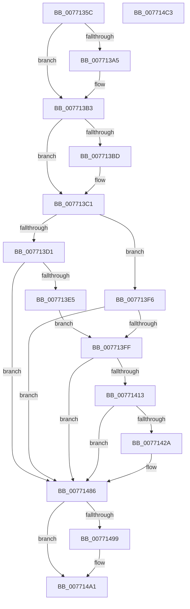

# PopDirectedDripsDiagTraceProblemDevice

- RVA: `0x0077135C`–`0x007714C4` (길이 `360` bytes)
- VA: `0x000000014077135C`
- 실행 섹션: `PAGE`
- PDB 이름 있음: `예`; PDB Function 태그: `아니요`
- unwind 정보 RVA: `0x000CD704`
- 디코드: `94`개 명령, `360/360` bytes 표시
- 미해석 바이트: `0` (있으면 어셈블리에 `.byte`로 보존)

> 이 문서는 커널 이미지의 기계어와 PDB 기호를 분석해 생성했습니다. 4번과 5번은 함수 원형과 자료형을 바이너리 사용 방식에서 추정한 C 해석이며 원본 소스 복구 결과는 아닙니다.

## 1. Dependencies

- 직접 호출 지점: **8**; 고유 호출 대상: **8**
- 직접 호출자로 확인된 함수: **3**
- RIP 상대 이미지 참조: **6**

### Outgoing calls
- `0x00771395` → [KeAbPreAcquire](../../text/21/KeAbPreAcquire_function_00210230.md) (function, `0x00210230`)
- `0x007713AE` → [ExfAcquirePushLockExclusiveEx](../../text/20/ExfAcquirePushLockExclusiveEx_function_0020FC90.md) (function, `0x0020FC90`)
- `0x007713EF` → [PopDirectedDripsDiagInsertErrorRecord](../AB/PopDirectedDripsDiagInsertErrorRecord_function_00AB3F48.md) (function, `0x00AB3F48`)
- `0x00771421` → [EtwEventEnabled](../../text/39/EtwEventEnabled_function_00392450.md) (function, `0x00392450`)
- `0x00771481` → [EtwWrite](../../text/41/EtwWrite_function_0041C720.md) (function, `0x0041C720`)
- `0x0077149C` → [ExfTryToWakePushLock](../../text/26/ExfTryToWakePushLock_function_00265DD0.md) (function, `0x00265DD0`)
- `0x007714A4` → [KeAbPostRelease](../../text/2E/KeAbPostRelease_function_002E1600.md) (function, `0x002E1600`)
- `0x007714B0` → [_security_check_cookie](../../text/6A/_security_check_cookie_function_006AC640.md) (function, `0x006AC640`)

### Direct callers
- [PopDirectedDripsBuildBroadcastTreeFull](PopDirectedDripsBuildBroadcastTreeFull_function_00771970.md) at `0x00771AA7`
- [PopDirectedDripsBuildBroadcastTreeFull](PopDirectedDripsBuildBroadcastTreeFull_function_00771970.md) at `0x00771AF9`
- [PopDirectedDripsBuildPs4BroadcastTree](PopDirectedDripsBuildPs4BroadcastTree_function_00771C90.md) at `0x00771DA4`
- [PopDirectedDripsVisitPs4Device](PopDirectedDripsVisitPs4Device_function_00771EE0.md) at `0x00771F3A`

### Static image references
- `0x0077136D` → RVA `0x00E0A740` (`.data`; read)
- `0x00771386` → RVA `0x00F07650` (`.data`; read)
- `0x0077140A` → RVA `0x00E67858` (`.data`; read)
- `0x00771413` → RVA `0x00F0B408` (`.data`; read)
- `0x0077141A` → RVA `0x000218A0` (`.rdata`; read)
- `0x0077148A` → RVA `0x00F07650` (`.data`; read/write)

## 2. Other-region calls and transfers

- 다른 실행 섹션으로 향하는 call: **7**
  - `0x00771395` → [KeAbPreAcquire](../../text/21/KeAbPreAcquire_function_00210230.md) (`PAGE` → `.text`)
  - `0x007713AE` → [ExfAcquirePushLockExclusiveEx](../../text/20/ExfAcquirePushLockExclusiveEx_function_0020FC90.md) (`PAGE` → `.text`)
  - `0x00771421` → [EtwEventEnabled](../../text/39/EtwEventEnabled_function_00392450.md) (`PAGE` → `.text`)
  - `0x00771481` → [EtwWrite](../../text/41/EtwWrite_function_0041C720.md) (`PAGE` → `.text`)
  - `0x0077149C` → [ExfTryToWakePushLock](../../text/26/ExfTryToWakePushLock_function_00265DD0.md) (`PAGE` → `.text`)
  - `0x007714A4` → [KeAbPostRelease](../../text/2E/KeAbPostRelease_function_002E1600.md) (`PAGE` → `.text`)
  - `0x007714B0` → [_security_check_cookie](../../text/6A/_security_check_cookie_function_006AC640.md) (`PAGE` → `.text`)
- 별도 외부 분기/꼬리 이동을 확인하지 못했습니다.

## 3. Assembly (complete function range)

```asm
0077135C  40 55                           push rbp
0077135E  53                              push rbx
0077135F  56                              push rsi
00771360  57                              push rdi
00771361  41 57                           push r15
00771363  48 8B EC                        mov rbp, rsp
00771366  48 81 EC 80 00 00 00            sub rsp, 0x80
0077136D  48 8B 05 CC 93 69 00            mov rax, qword ptr [rip + 0x6993cc]
00771374  48 33 C4                        xor rax, rsp
00771377  48 89 45 F0                     mov qword ptr [rbp - 0x10], rax
0077137B  48 8B F2                        mov rsi, rdx
0077137E  48 89 4D B8                     mov qword ptr [rbp - 0x48], rcx
00771382  44 89 45 B0                     mov dword ptr [rbp - 0x50], r8d
00771386  4C 8D 3D C3 62 79 00            lea r15, [rip + 0x7962c3]
0077138D  49 8B CF                        mov rcx, r15
00771390  45 33 C0                        xor r8d, r8d
00771393  33 D2                           xor edx, edx
00771395  E8 96 EE A9 FF                  call 0x140210230
0077139A  F0 49 0F BA 2F 00               lock bts qword ptr [r15], 0
007713A0  48 8B D8                        mov rbx, rax
007713A3  73 0E                           jae 0x1407713b3
007713A5  4D 8B C7                        mov r8, r15
007713A8  48 8B D0                        mov rdx, rax
007713AB  49 8B CF                        mov rcx, r15
007713AE  E8 DD E8 A9 FF                  call 0x14020fc90
007713B3  BF 01 00 00 00                  mov edi, 1
007713B8  48 85 DB                        test rbx, rbx
007713BB  74 04                           je 0x1407713c1
007713BD  40 88 7B 0A                     mov byte ptr [rbx + 0xa], dil
007713C1  48 8B 45 B8                     mov rax, qword ptr [rbp - 0x48]
007713C5  48 8B 98 08 03 00 00            mov rbx, qword ptr [rax + 0x308]
007713CC  48 85 F6                        test rsi, rsi
007713CF  74 25                           je 0x1407713f6
007713D1  48 63 45 B0                     movsxd rax, dword ptr [rbp - 0x50]
007713D5  01 BC 86 C0 00 00 00            add dword ptr [rsi + rax*4 + 0xc0], edi
007713DC  48 85 DB                        test rbx, rbx
007713DF  0F 84 A1 00 00 00               je 0x140771486
007713E5  44 8B 45 B0                     mov r8d, dword ptr [rbp - 0x50]
007713E9  48 8B D3                        mov rdx, rbx
007713EC  48 8B CE                        mov rcx, rsi
007713EF  E8 54 2B 34 00                  call 0x140ab3f48
007713F4  EB 09                           jmp 0x1407713ff
007713F6  48 85 DB                        test rbx, rbx
007713F9  0F 84 87 00 00 00               je 0x140771486
007713FF  8B 4D B0                        mov ecx, dword ptr [rbp - 0x50]
00771402  D3 E7                           shl edi, cl
00771404  09 BB 98 00 00 00               or dword ptr [rbx + 0x98], edi
0077140A  80 3D 47 64 6F 00 00            cmp byte ptr [rip + 0x6f6447], 0
00771411  74 73                           je 0x140771486
00771413  48 8B 0D EE 9F 79 00            mov rcx, qword ptr [rip + 0x799fee]
0077141A  48 8D 15 7F 04 8B FF            lea rdx, [rip - 0x74fb81]
00771421  E8 2A 10 C2 FF                  call 0x140392450
00771426  84 C0                           test al, al
00771428  74 5C                           je 0x140771486
0077142A  83 65 CC 00                     and dword ptr [rbp - 0x34], 0
0077142E  48 8D 83 94 00 00 00            lea rax, [rbx + 0x94]
00771435  83 65 DC 00                     and dword ptr [rbp - 0x24], 0
00771439  48 8D 15 60 04 8B FF            lea rdx, [rip - 0x74fba0]
00771440  83 65 EC 00                     and dword ptr [rbp - 0x14], 0
00771444  B9 04 00 00 00                  mov ecx, 4
00771449  48 89 45 C0                     mov qword ptr [rbp - 0x40], rax
0077144D  45 33 C0                        xor r8d, r8d
00771450  48 8D 45 B8                     lea rax, [rbp - 0x48]
00771454  89 4D C8                        mov dword ptr [rbp - 0x38], ecx
00771457  48 89 45 D0                     mov qword ptr [rbp - 0x30], rax
0077145B  48 8D 45 B0                     lea rax, [rbp - 0x50]
0077145F  48 89 45 E0                     mov qword ptr [rbp - 0x20], rax
00771463  44 8D 49 FF                     lea r9d, [rcx - 1]
00771467  48 8D 45 C0                     lea rax, [rbp - 0x40]
0077146B  89 4D E8                        mov dword ptr [rbp - 0x18], ecx
0077146E  48 8B 0D 93 9F 79 00            mov rcx, qword ptr [rip + 0x799f93]
00771475  48 89 44 24 20                  mov qword ptr [rsp + 0x20], rax
0077147A  C7 45 D8 08 00 00 00            mov dword ptr [rbp - 0x28], 8
00771481  E8 9A B2 CA FF                  call 0x14041c720
00771486  48 83 C8 FF                     or rax, 0xffffffffffffffff
0077148A  F0 48 0F C1 05 BD 61 79 00      lock xadd qword ptr [rip + 0x7961bd], rax
00771493  24 06                           and al, 6
00771495  3C 02                           cmp al, 2
00771497  75 08                           jne 0x1407714a1
00771499  49 8B CF                        mov rcx, r15
0077149C  E8 2F 49 AF FF                  call 0x140265dd0
007714A1  49 8B CF                        mov rcx, r15
007714A4  E8 57 01 B7 FF                  call 0x1402e1600
007714A9  48 8B 4D F0                     mov rcx, qword ptr [rbp - 0x10]
007714AD  48 33 CC                        xor rcx, rsp
007714B0  E8 8B B1 F3 FF                  call 0x1406ac640
007714B5  48 81 C4 80 00 00 00            add rsp, 0x80
007714BC  41 5F                           pop r15
007714BE  5F                              pop rdi
007714BF  5E                              pop rsi
007714C0  5B                              pop rbx
007714C1  5D                              pop rbp
007714C2  C3                              ret
007714C3  CC                              int3
```

## 4. C-style interpretation (structured pseudocode)

```c
__int64 __fastcall PopDirectedDripsDiagTraceProblemDevice(__int64 a1, __int64 a2, int a3)
{
    __int64 result;
    __int64 v_rdi;
    __int64 v_rsp;
    unsigned __int64 v_stack_m38;
    unsigned int v_stack_m3C;
    unsigned int v_stack_m40;
    unsigned __int64 v_stack_m48;
    unsigned int v_stack_m4C;
    unsigned int v_stack_m50;
    unsigned __int64 v_stack_m58;
    unsigned int v_stack_m5C;
    unsigned int v_stack_m60;
    unsigned __int64 v_stack_m68;
    unsigned __int64 v_stack_m70;
    unsigned int v_stack_m78;
    unsigned __int64 v_stack_m88;

    v_rsp = (v_rsp) - (128);
    result = (*(unsigned __int64 *)(v_rip + 6919116)) ^ (v_rsp);
    v_stack_m38 = result;
    v_stack_m70 = a1;
    v_stack_m78 = a3;
    a3 = 0;
    a2 = 0;
    result = KeAbPreAcquire(v_rip + 7955139, a2, a3, a4);
    if (!(condition_is_above_or_equal)) {
        a3 = v_rip + 7955139;
        a2 = result;
        a1 = v_rip + 7955139;
        result = ExfAcquirePushLockExclusiveEx(a1, a2, a3, a4);
    }
    if (result != 0) {
        *(unsigned __int8 *)(result + 10) = 1;
    }
    if (a2 == 0) goto loc_007713F6;
    if (*(unsigned __int64 *)(v_stack_m70 + 776) == 0) goto loc_00771486;
    result = PopDirectedDripsDiagInsertErrorRecord(a2, *(unsigned __int64 *)(v_stack_m70 + 776), (unsigned int)(v_stack_m78), a4);
    goto loc_007713FF;
loc_007713F6:
    if (*(unsigned __int64 *)(v_stack_m70 + 776) == 0) goto loc_00771486;
loc_007713FF:
    v_rdi = (unsigned int)((1) << ((unsigned __int8)((unsigned int)(v_stack_m78))));
    if ((*(unsigned __int8 *)(v_rip + 7300167)) == 0) goto loc_00771486;
    result = EtwEventEnabled(*(unsigned __int64 *)(v_rip + 7970798), v_rip - 7666561, (unsigned int)(v_stack_m78), a4);
    if ((unsigned __int8)(result) != 0) {
        result = *(unsigned __int64 *)(v_stack_m70 + 776) + 148;
        a2 = v_rip - 7666592;
        a1 = 4;
        v_stack_m68 = result;
        a3 = 0;
        result = v_stack_m70;
        v_stack_m60 = (unsigned int)(a1);
        v_stack_m58 = result;
        result = v_stack_m78;
        v_stack_m48 = result;
        a4 = a1 - 1;
        result = v_stack_m68;
        v_stack_m40 = (unsigned int)(a1);
        a1 = *(unsigned __int64 *)(v_rip + 7970707);
        v_stack_m88 = result;
        v_stack_m50 = 8;
        result = EtwWrite(a1, a2, a3, a4);
    }
    result = (result) | (-1);
    result = (unsigned __int8)((result) & (6));
    if (((unsigned __int8)(result)) == 2) {
        a1 = v_rip + 7955139;
        result = ExfTryToWakePushLock(a1, a2, a3, a4);
    }
    result = KeAbPostRelease(v_rip + 7955139, a2, a3, a4);
    a1 = (v_stack_m38) ^ (v_rsp);
    result = _security_check_cookie(a1, a2, a3, a4);
    v_rsp = (v_rsp) + (128);
    return result;
}
```

## 5. (Beta) C Style

```c
int64_t PopDirectedDripsDiagTraceProblemDevice(int64_t Arg1, int64_t Arg2, int32_t Arg3)
{
    int64_t result;
    int64_t local_rdi;
    int64_t local_rsp;
    uint64_t v_stack_m38;
    uint32_t v_stack_m3C;
    uint32_t v_stack_m40;
    uint64_t v_stack_m48;
    uint32_t v_stack_m4C;
    uint32_t v_stack_m50;
    uint64_t v_stack_m58;
    uint32_t v_stack_m5C;
    uint32_t v_stack_m60;
    uint64_t v_stack_m68;
    uint64_t v_stack_m70;
    uint32_t v_stack_m78;
    uint64_t v_stack_m88;

    local_rsp = (local_rsp) - (128);
    result = (*(uint64_t *)(v_rip + 0x6993CC)) ^ (local_rsp);
    v_stack_m38 = result;
    v_stack_m70 = Arg1;
    v_stack_m78 = Arg3;
    Arg3 = 0;
    Arg2 = 0;
    result = KeAbPreAcquire(v_rip + 7955139, Arg2, Arg3, a4);
    if (!(condition_is_above_or_equal)) {
        Arg3 = v_rip + 7955139;
        Arg2 = result;
        Arg1 = v_rip + 7955139;
        result = ExfAcquirePushLockExclusiveEx(Arg1, Arg2, Arg3, a4);
    }
    if (result != 0) {
        *(uint8_t *)(result + 0xA) = 1;
    }
    if (Arg2 == 0) goto loc_007713F6;
    if (*(uint64_t *)(v_stack_m70 + 0x308) == 0) goto loc_00771486;
    result = PopDirectedDripsDiagInsertErrorRecord(Arg2, *(uint64_t *)(v_stack_m70 + 0x308), (uint32_t)(v_stack_m78), a4);
    goto loc_007713FF;
loc_007713F6:
    if (*(uint64_t *)(v_stack_m70 + 0x308) == 0) goto loc_00771486;
loc_007713FF:
    local_rdi = (uint32_t)((1) << ((uint8_t)((uint32_t)(v_stack_m78))));
    if ((*(uint8_t *)(v_rip + 0x6F6447)) == 0) goto loc_00771486;
    result = EtwEventEnabled(*(uint64_t *)(v_rip + 0x799FEE), v_rip - 7666561, (uint32_t)(v_stack_m78), a4);
    if ((uint8_t)(result) != 0) {
        result = *(uint64_t *)(v_stack_m70 + 0x308) + 148;
        Arg2 = v_rip - 7666592;
        Arg1 = 4;
        v_stack_m68 = result;
        Arg3 = 0;
        result = v_stack_m70;
        v_stack_m60 = (uint32_t)(Arg1);
        v_stack_m58 = result;
        result = v_stack_m78;
        v_stack_m48 = result;
        a4 = Arg1 - 1;
        result = v_stack_m68;
        v_stack_m40 = (uint32_t)(Arg1);
        Arg1 = *(uint64_t *)(v_rip + 0x799F93);
        v_stack_m88 = result;
        v_stack_m50 = 8;
        result = EtwWrite(Arg1, Arg2, Arg3, a4);
    }
    result = (result) | (-1);
    result = (uint8_t)((result) & (6));
    if (((uint8_t)(result)) == 2) {
        Arg1 = v_rip + 7955139;
        result = ExfTryToWakePushLock(Arg1, Arg2, Arg3, a4);
    }
    result = KeAbPostRelease(v_rip + 7955139, Arg2, Arg3, a4);
    Arg1 = (v_stack_m38) ^ (local_rsp);
    result = _security_check_cookie(Arg1, Arg2, Arg3, a4);
    local_rsp = (local_rsp) + (128);
    return result;
}
```

## 6. Execution-region graph

[열기: 2D/3D 그래프와 함수 탐색 컨트롤 패널](../../../control-panel.html?section=page&rva=0x0077135C&view=graph)

- 2D 그래프는 위에서 아래로 흐르고, 3D 그래프는 빈 공간을 드래그해 회전합니다. Shift+드래그는 이동, 휠은 확대·축소, 함수 노드 선택은 대상 보고서 이동입니다.

### Static fallback


