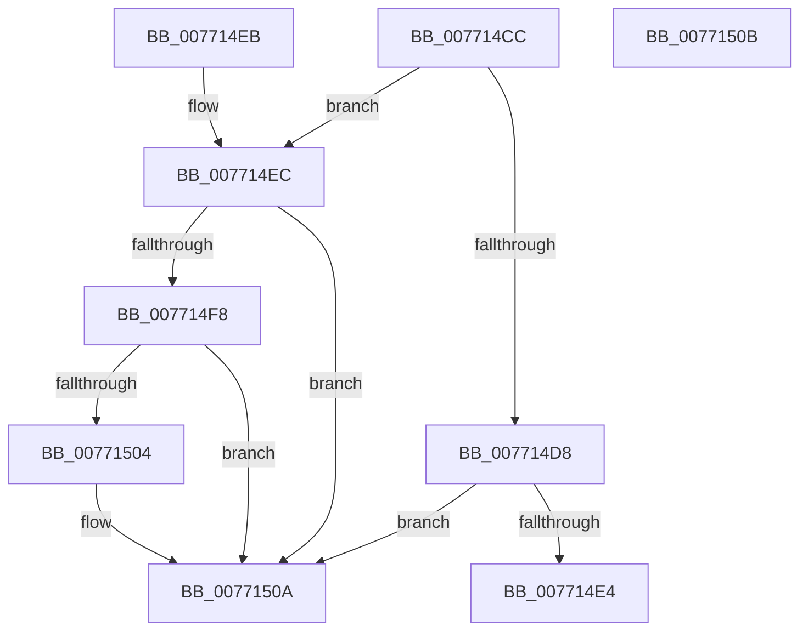

# PopDirectedDripsDiagTraceTransition

- RVA: `0x007714CC`–`0x0077150C` (길이 `64` bytes)
- VA: `0x00000001407714CC`
- 실행 섹션: `PAGE`
- PDB 이름 있음: `예`; PDB Function 태그: `아니요`
- unwind 정보 RVA: `0x000DB714`
- 디코드: `18`개 명령, `64/64` bytes 표시
- 미해석 바이트: `0` (있으면 어셈블리에 `.byte`로 보존)

> 이 문서는 커널 이미지의 기계어와 PDB 기호를 분석해 생성했습니다. 4번과 5번은 함수 원형과 자료형을 바이너리 사용 방식에서 추정한 C 해석이며 원본 소스 복구 결과는 아닙니다.

## 1. Dependencies

- 직접 호출 지점: **0**; 고유 호출 대상: **0**
- 직접 호출자로 확인된 함수: **1**
- RIP 상대 이미지 참조: **0**

### Outgoing calls
- 직접 디코드된 call 명령이 없습니다.

### Direct callers
- [PopDirectedDripsInitializeBroadcast](../A4/PopDirectedDripsInitializeBroadcast_function_00A4D634.md) at `0x00A4D736`

### Static image references
- 디코드된 RIP-relative 메모리 참조가 없습니다.

## 2. Other-region calls and transfers

- 다른 실행 섹션으로 향하는 call: **0**
- 별도 외부 분기/꼬리 이동을 확인하지 못했습니다.

## 3. Assembly (complete function range)

```asm
007714CC  8B 81 F8 02 00 00               mov eax, dword ptr [rcx + 0x2f8]
007714D2  0F BA E0 11                     bt eax, 0x11
007714D6  73 14                           jae 0x1407714ec
007714D8  48 8B 81 08 03 00 00            mov rax, qword ptr [rcx + 0x308]
007714DF  48 85 C0                        test rax, rax
007714E2  74 26                           je 0x14077150a
007714E4  FF 80 A0 00 00 00               inc dword ptr [rax + 0xa0]
007714EA  C3                              ret
007714EB  CC                              int3
007714EC  8B 81 F8 02 00 00               mov eax, dword ptr [rcx + 0x2f8]
007714F2  0F BA E0 10                     bt eax, 0x10
007714F6  73 12                           jae 0x14077150a
007714F8  48 8B 81 08 03 00 00            mov rax, qword ptr [rcx + 0x308]
007714FF  48 85 C0                        test rax, rax
00771502  74 06                           je 0x14077150a
00771504  FF 80 9C 00 00 00               inc dword ptr [rax + 0x9c]
0077150A  C3                              ret
0077150B  CC                              int3
```

## 4. C-style interpretation (structured pseudocode)

```c
__int64 __fastcall PopDirectedDripsDiagTraceTransition(__int64 a1)
{
    if (condition_is_above_or_equal) goto loc_007714EC;
    if (*(unsigned __int64 *)(a1 + 776) == 0) goto loc_0077150A;
    return *(unsigned __int64 *)(a1 + 776);
loc_007714EC:
    if (condition_is_above_or_equal) goto loc_0077150A;
    if (*(unsigned __int64 *)(a1 + 776) != 0) {
    }
    return *(unsigned __int64 *)(a1 + 776);
}
```

## 5. (Beta) C Style

```c
int64_t PopDirectedDripsDiagTraceTransition(void *Arg1)
{
    uint8_t *arg1 = (uint8_t *)Arg1;

    if (condition_is_above_or_equal) goto loc_007714EC;
    if (*(uint64_t *)(arg1 + 0x308) == 0) goto loc_0077150A;
    return *(uint64_t *)(arg1 + 0x308);
loc_007714EC:
    if (condition_is_above_or_equal) goto loc_0077150A;
    if (*(uint64_t *)(arg1 + 0x308) != 0) {
    }
    return *(uint64_t *)(arg1 + 0x308);
}
```

### 관측된 메모리 오프셋

구조체 형식이 확인되지 않은 접근은 인자 기준의 오프셋으로만 기록했습니다.

| 기준 인자 | 오프셋 표현 | 폭 (bit) | 접근 |
|---|---:|---:|---|
| `Arg1` | `+ 0x2F8` | `32` | `R` |
| `Arg1` | `+ 0x308` | `64` | `R` |

## 6. Execution-region graph

[열기: 2D/3D 그래프와 함수 탐색 컨트롤 패널](../../../control-panel.html?section=page&rva=0x007714CC&view=graph)

- 2D 그래프는 위에서 아래로 흐르고, 3D 그래프는 빈 공간을 드래그해 회전합니다. Shift+드래그는 이동, 휠은 확대·축소, 함수 노드 선택은 대상 보고서 이동입니다.

### Static fallback


