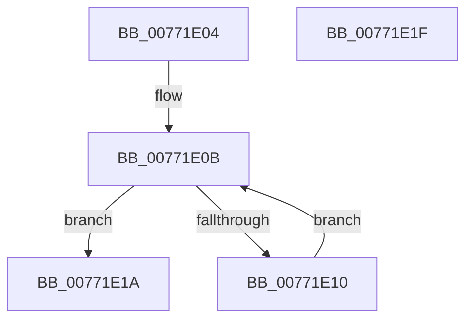

# PopDirectedDripsFlushDeviceQueue

- RVA: `0x00771E04`–`0x00771E20` (길이 `28` bytes)
- VA: `0x0000000140771E04`
- 실행 섹션: `PAGE`
- PDB 이름 있음: `예`; PDB Function 태그: `아니요`
- unwind 정보 RVA: `0x0005C788`
- 디코드: `10`개 명령, `28/28` bytes 표시
- 미해석 바이트: `0` (있으면 어셈블리에 `.byte`로 보존)

> 이 문서는 커널 이미지의 기계어와 PDB 기호를 분석해 생성했습니다. 4번과 5번은 함수 원형과 자료형을 바이너리 사용 방식에서 추정한 C 해석이며 원본 소스 복구 결과는 아닙니다.

## 1. Dependencies

- 직접 호출 지점: **1**; 고유 호출 대상: **1**
- 직접 호출자로 확인된 함수: **2**
- RIP 상대 이미지 참조: **0**

### Outgoing calls
- `0x00771E13` → [PopDirectedDripsRemoveQueueDevice](PopDirectedDripsRemoveQueueDevice_function_00771EB0.md) (function, `0x00771EB0`)

### Direct callers
- [PopDirectedDripsBuildBroadcastTreeFull](PopDirectedDripsBuildBroadcastTreeFull_function_00771970.md) at `0x00771B08`
- [PopDirectedDripsBuildPs4BroadcastTree](PopDirectedDripsBuildPs4BroadcastTree_function_00771C90.md) at `0x00771DB4`

### Static image references
- 디코드된 RIP-relative 메모리 참조가 없습니다.

## 2. Other-region calls and transfers

- 다른 실행 섹션으로 향하는 call: **0**
- 별도 외부 분기/꼬리 이동을 확인하지 못했습니다.

## 3. Assembly (complete function range)

```asm
00771E04  48 83 EC 28                     sub rsp, 0x28
00771E08  4C 8B C1                        mov r8, rcx
00771E0B  4D 39 00                        cmp qword ptr [r8], r8
00771E0E  74 0A                           je 0x140771e1a
00771E10  49 8B C8                        mov rcx, r8
00771E13  E8 98 00 00 00                  call 0x140771eb0
00771E18  EB F1                           jmp 0x140771e0b
00771E1A  48 83 C4 28                     add rsp, 0x28
00771E1E  C3                              ret
00771E1F  CC                              int3
```

## 4. C-style interpretation (structured pseudocode)

```c
__int64 __fastcall PopDirectedDripsFlushDeviceQueue(__int64 a1)
{
    __int64 result;
    __int64 v_rsp;

    v_rsp = (v_rsp) - (40);
loc_00771E0B:
    if ((*(unsigned __int64 *)(a1)) == a1) goto loc_00771E1A;
    result = PopDirectedDripsRemoveQueueDevice(a1, a2, a1, a4);
    goto loc_00771E0B;
loc_00771E1A:
    v_rsp = (v_rsp) + (40);
    return result;
}
```

## 5. (Beta) C Style

```c
int64_t PopDirectedDripsFlushDeviceQueue(int64_t Arg1)
{
    int64_t result;
    int64_t local_rsp;

    local_rsp = (local_rsp) - (40);
loc_00771E0B:
    if ((*(uint64_t *)(Arg1)) == Arg1) goto loc_00771E1A;
    result = PopDirectedDripsRemoveQueueDevice(Arg1, a2, Arg1, a4);
    goto loc_00771E0B;
loc_00771E1A:
    local_rsp = (local_rsp) + (40);
    return result;
}
```

## 6. Execution-region graph

[열기: 2D/3D 그래프와 함수 탐색 컨트롤 패널](../../../control-panel.html?section=page&rva=0x00771E04&view=graph)

- 2D 그래프는 위에서 아래로 흐르고, 3D 그래프는 빈 공간을 드래그해 회전합니다. Shift+드래그는 이동, 휠은 확대·축소, 함수 노드 선택은 대상 보고서 이동입니다.

### Static fallback


